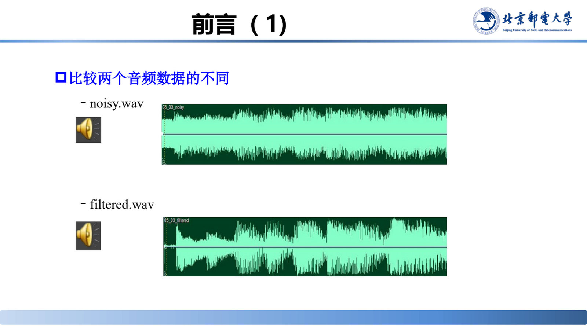
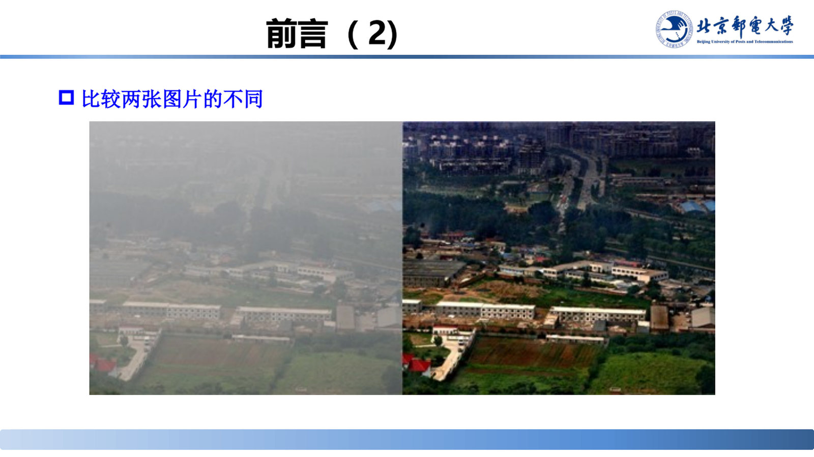
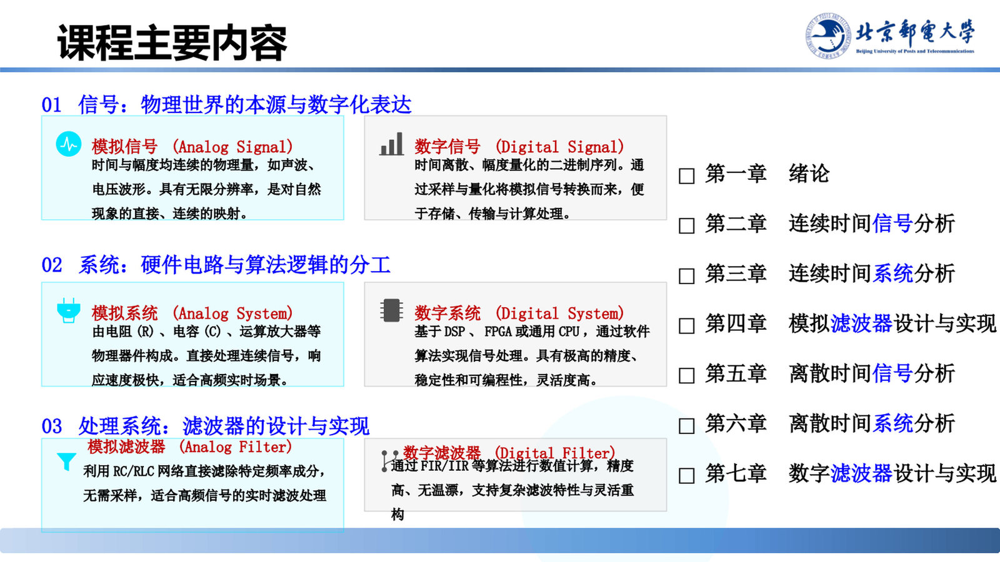

# 课程概况与学习方法

> 来源：《信号分析与处理》01_20260915.pptx，第 1–7 页、第 40–41 页、第 88–96 页（共 18 页）
> 对应课件章节：第一章 绪论（课程基本信息、前言、1.1 课程概述、课程由来、课程内容与考核要求）

绪论用两个对比实验（一段含噪语音、一张待滤波图像）说明本课程要解决的根本问题——**从噪声中提取有价值的信息**；随后给出全课程的内容地图、重点难点、考核比例与学习建议。

## 核心结论速查

| 项目 | 内容 |
|---|---|
| 课程名称 / 学分 | 信号分析与处理，80 学时（5 学分），教学周 3–18 周、每周 5 课时 |
| 先修课程 | 工科数学分析、线性代数、工程数学（同期学）、电子电路基础 |
| 课程定位 | 连接物理世界与数字世界的桥梁；解决现实问题的基本理论和方法 |
| 课程主线 | 信号（模拟/数字）→ 系统（模拟/数字）→ 处理系统（模拟/数字滤波器） |
| 课程重点 | 信号表示与基本运算（**卷积是重中之重**）、系统性质与响应、各类变换及快速算法、采样与内插定理、模拟及 IIR/FIR 滤波器设计 |
| 课程目标 | 4 条，分别支撑毕业要求指标点 1.4、2.3、4.1、4.2 |
| 成绩构成 | 日常作业 20% + 实验报告 10% + 课堂表现 10% + 期中 20% + 期末 40% |

---

## 课程基本信息（第 1–3 页）

课程名称：**信号分析与处理**。课程沿革：由 3 学分、4 学分版本演进至当前的 **5 学分 / 80 学时**版本（第 40 页）。

> 第 3 页的课程安排图表文字未随文本层导出，具体周次安排以课件原图为准。

## 前言：两个对比实验（第 4–6 页）

**实验一**：同一段语音的 `noisy.wav`（含噪）与 `filtered.wav`（滤波后）版本，听感与波形都明显不同。

**实验二**：图像滤波前后，噪点、边缘与细节被重新分配。

两个实验指向同一结论：解决现实问题的基本理论和方法是**信号分析与处理**；其目标是**从噪声中分析和提取有价值的信息，并实现高效、精准的信息利用**，它是连接物理世界与数字世界的桥梁。

## 课程内容框架（第 7、41、88 页）

课程按五节展开：1.1 信号分析与处理概述；1.2 信号的表示与系统的描述；1.3 发展历程；1.4 应用案例；1.5 信息通信中的信号分析与处理。

主要内容归纳为模拟 / 数字两条并行技术路线，在"信号—系统—处理系统"三个环节上一一对应：

| 环节 | 模拟路线 | 数字路线 |
|---|---|---|
| 01 信号 | 时间与幅度均连续的物理量（声波、电压波形），无限分辨率，是自然现象的直接映射 | 时间离散、幅度量化的二进制序列，由采样与量化得到，便于存储、传输与计算 |
| 02 系统 | 由电阻 R、电容 C、运算放大器等器件构成，直接处理连续信号，响应极快，适合高频实时场景 | 基于 DSP、FPGA 或通用 CPU，以软件算法实现，精度、稳定性与可编程性高 |
| 03 处理系统 | 模拟滤波器：用 RC/RLC 网络直接滤除特定频率成分，无需采样，适合高频实时滤波 | 数字滤波器：用 FIR/IIR 算法数值计算，精度高、无温漂，特性可灵活重构 |

课程章节对应关系：第一章 绪论；第二章 连续时间信号分析；第三章 连续时间系统分析；第四章 模拟滤波器设计与实现；第五章 离散时间信号分析；第六章 离散时间系统分析；第七章 数字滤波器设计与实现。

> 课堂补充：整个处理流程分信号、系统、典型应用系统（滤波器）三步，每步都有模拟与数字两条并行路径。

## 课程的重点与难点（第 89–90 页）

**重点：** 连续（离散）时间信号的表示及基本运算（**卷积运算是重中之重**）；连续（离散）时间系统的性质、单位冲激响应、系统函数、频率响应、零极点分布；DFT、拉氏变换、DTFT、Z 变换、DFS、FFT 的定义与性质；采样与内插定理；模拟及 IIR/FIR 数字滤波器的设计与实现。

**难点：** 信号变换的性质；卷积运算的物理意义；信号的频谱分析；系统的频率响应特性；FFT 算法的蝶形复合；模拟频率变换；线性相位约束。

## 课程的基本要求（第 91 页）

- **课程目标 1**（指标点 1.4）：能够分析和求解信号分析与处理工程问题。
- **课程目标 2**（指标点 2.3）：能够建立信号分析与处理模型并论证方案合理性。
- **课程目标 3**（指标点 4.1）：能够调研评述信号分析与处理技术方案并形成合理结论。
- **课程目标 4**（指标点 4.2）：能够设计信号分析与处理综合实验方案并构建实验系统。

> 课堂补充：四条目标依次培养工程知识综合应用、工程模型抽象与科学论证、工程方案研判、工程实践创新优化四种能力。

## 教材、参考书目与在线资源（第 92–93 页）

教材：齐冬莲、张建良《信号分析与处理》第 4 版，机械工业出版社，2024；参考书：马立玲、沈伟《信号分析与处理》，北京理工大学出版社，2019。教材与讲义在高教社云创平台 <https://ehep.com.cn/> 领取，PPT 由班级微信群或教学云平台发布。

在线资源：浙江大学《信号分析与处理》（国家级精品课）<https://www.bilibili.com/video/BV1gt4y1Q7Az/>；国防科技大学《信号处理与系统》<https://www.bilibili.com/video/BV1BJ411U7wv?p=35>；MIT Oppenheim《Signals and Systems》<http://open.163.com/special/opencourse/signals.html>、MIT《Digital Signal Processing》<http://ocw.mit.edu/resources/res-6-008-digital-signal-processing-spring-2011/>。

## 作业、考试与学习建议（第 94–95 页）

平时作业约每周交一次，上传教学云平台；实验三选一；期中、期末统一闭卷考试。分数构成：日常作业 20%、实验报告 10%、课堂表现 10%、期中 20%、期末 40%。

学习建议：加深概念理解，不要只死记公式；掌握解决问题的思路，重视结论中的启示；注重工程思维并结合专业应用；课外自己推导重要公式、认真做题；多使用 Matlab / Python 等工具。

## 本章思考与讨论（第 96 页）

1. **概念与链路**：以"手机发语音"为例辨析消息、信息与信号的区别，并梳理从发声、编码、传输到解码收听的完整物理信号转换链路。
2. **分析与处理的协同**：以"手机拍照优化"为例，说明信号分析（认知亮度、对比度与色彩分布）与处理（降噪、锐化、增强）如何分工互补。
3. **工程权衡**：以自动驾驶紧急制动或 5G OFDM、智能手环心率监测为例，讨论因果性/稳定性对安全攸关系统的必要性，以及算法精度、功耗、成本与响应速度之间的权衡。

## 易错点与考点提示

- 先修课中的**线性代数与工程数学**是本课程的直接工具，变换（傅里叶、拉普拉斯、Z）与矩阵运算会反复使用。
- 重点列表里的 **DFT** 与单列的 **FFT** 不是一回事：FFT 是 DFT 的快速算法；拉氏变换、DTFT、Z 变换分别面向连续/离散、时域/复频域，注意对应关系。
- 成绩构成中**期末只占 40%**，平时作业 + 实验 + 课堂表现合计 40%，过程性考核比重高，不要指望期末突击。

## 自测

1. 本课程的总学时、学分、授课周次与每周课时分别是多少？
2. 课程目标分别支撑哪几个毕业要求指标点？
3. 用自己的话说出"信号—系统—滤波器"三条主线在模拟与数字两条路线上的对应关系。

参考答案

1. 80 学时（5 学分），教学周 3–18 周，每周 5 个课时。
2. 指标点 1.4、2.3、4.1、4.2。
3. 模拟信号由模拟系统（R、C、运放等）处理，最终用 RC/RLC 网络构成的模拟滤波器滤除特定频率成分；数字信号由数字系统（DSP、FPGA、CPU）处理，最终用 FIR/IIR 算法构成的数字滤波器实现同等甚至更复杂的滤波特性；两条路线在"信号—系统—滤波器"三个环节一一对应。

