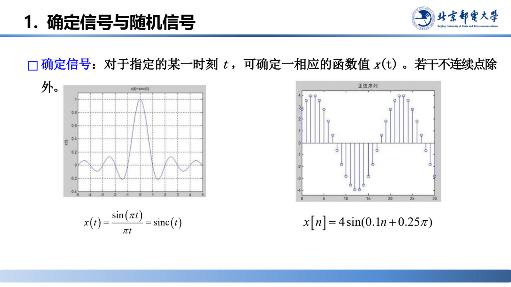
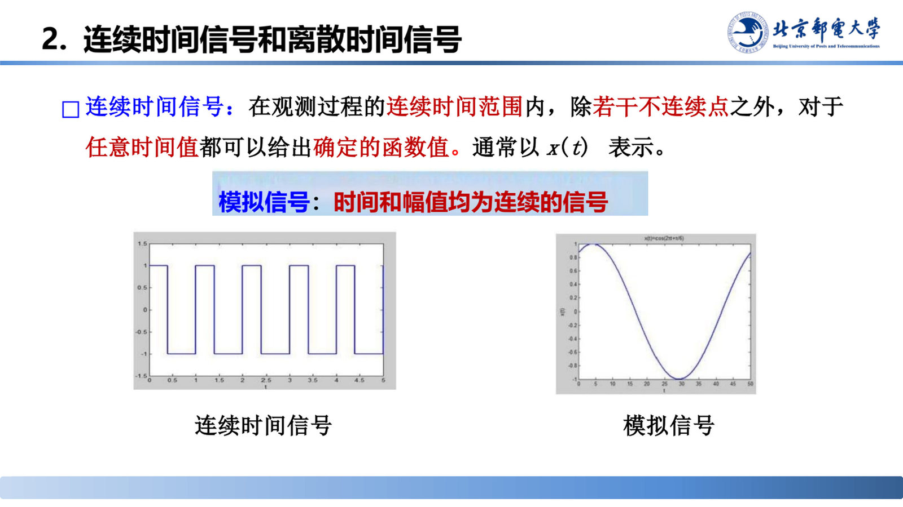
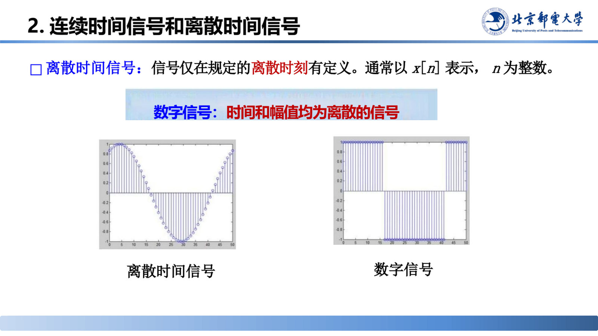
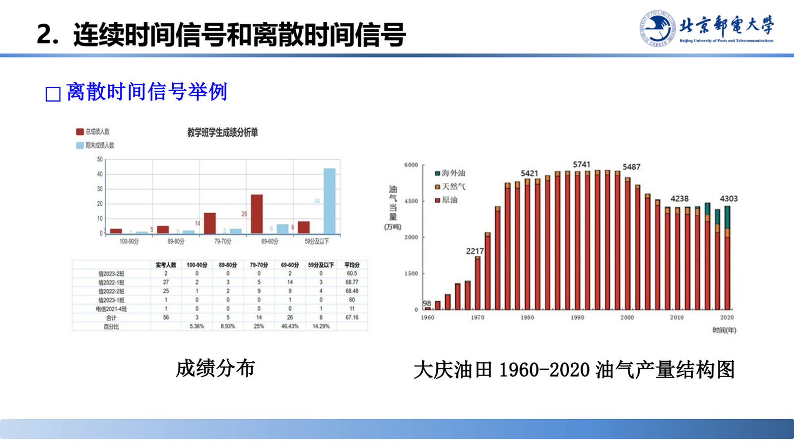
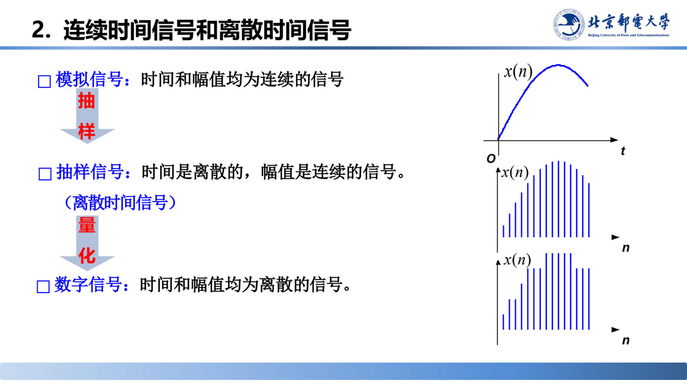
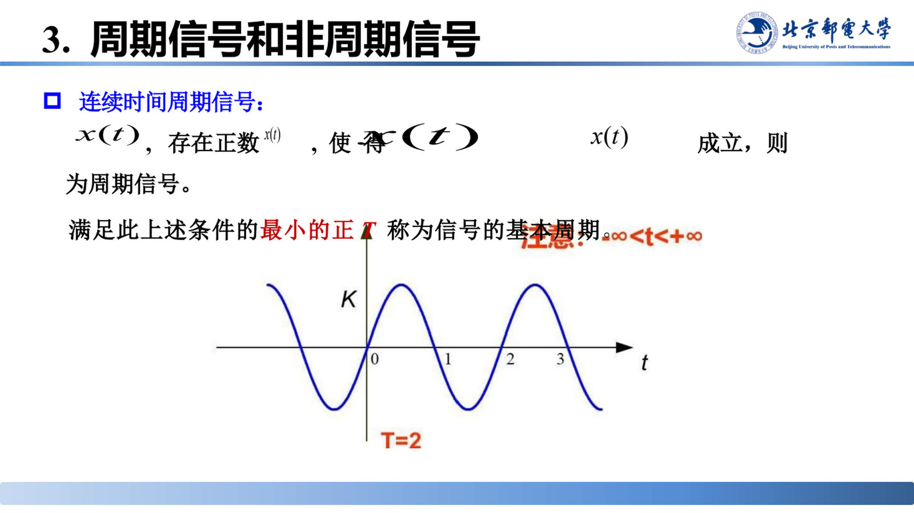
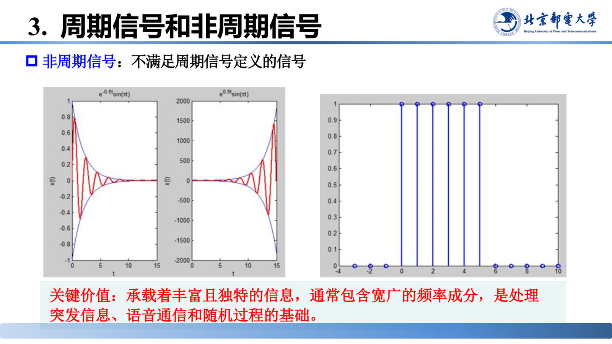

# 信号的表示与分类

> 来源：《信号分析与处理》01_20260915.pptx，第 42–59 页（共 18 页）
> 对应课件章节：1.2.1 信号的表示；信号的分类（确定/随机、连续/离散、周期/非周期、能量/功率）

一个信号可以用几种方式写下来？面对五花八门的物理量，怎样用有限的几个维度归类，从而决定用哪套数学工具去分析？本节给出信号的**三种表示法**与**四组分类**，是全课程的概念底座：先分清对象是连续还是离散、确定还是随机、周期还是非周期、能量型还是功率型，才能选对变换和算法。

## 核心结论速查

| 分类维度 | 两类对象 | 判别依据 |
|---|---|---|
| 确定性 | 确定信号 / 随机信号 | 指定时刻 t 能否确定函数值 x(t) |
| 自变量 | 连续时间信号 x(t) / 离散时间信号 x[n] | 自变量取值是否连续；**幅值**是否离散另行区分模拟/数字信号 |
| 周期性 | 周期信号 / 非周期信号 | 是否存在 T>0 使 x(t+T)=x(t)（离散为 x[n+N]=x[n]） |
| 能量功率 | 能量信号 / 功率信号 | E<∞（则 P=0）为能量信号；P<∞（则 E=∞）为功率信号 |

| 关键公式 | 表达式 | 适用条件 |
|---|---|---|
| 连续周期 | $x(t)=x(t+T)$，最小正 T 为基本周期 | T 为正数 |
| 离散周期 | $x[n]=x[n+N]$，最小正 N 为基本周期 | N 为正整数 |
| 信号能量 | $E=\int_{-\infty}^{\infty}\lvert f(t)\rvert^{2}\,dt$ | 1Ω 电阻上的能量 |
| 平均功率 | $P=\lim_{T\to\infty}\dfrac{1}{2T}\int_{-T}^{T}\lvert f(t)\rvert^{2}\,dt$ | 1Ω 电阻上的平均功率 |

---

## 信号的三种表示法（第 42 页）

- **公式法**：给出解析表达式，便于运算与推导。
- **图形法**：画出波形，横轴为自变量（通常是时间 t），纵轴为幅度，直观看出变化规律。
- **表格法**：把离散自变量取值与对应函数值列成表，适合实验数据或离散序列。

## 信号的分类总览（第 43 页）

信号可按四组维度分类：**确定信号与随机信号**、**连续时间信号与离散时间信号**、**周期信号与非周期信号**、**能量信号与功率信号**。

## 一、确定信号与随机信号（第 44–47 页）

**确定信号**（第 44 页）：对于指定的某一时刻 t，可确定一相应的函数值 x(t)（若干不连续点除外）；信号可以用确定的时间函数（或确定的数列）描述，给定时刻就能算出或量出确定的取值。课件该页内嵌持续运行的 canvas 动画（原 PPT 内嵌浏览器对象），教学时现场运行以观察确定信号的波形，静态导出未渲染出内容。

**随机信号**（第 46 页）：也称不确定信号，不是时间的确定函数，只能用统计特性（均值、方差、概率分布）描述，具有未可知的不确定性。该页同样内嵌了一个使用噪声（noise）类型的演示，用于呈现随机信号不可预测的波形。

> 课堂补充：第 46 页备注指出该页中的符号 x[k] 应写成 x[n]。

### 平稳高斯信号与非平稳非高斯信号（第 47 页）

| 项目 | 01 平稳高斯信号 | 02 非平稳非高斯信号 |
|---|---|---|
| 定义 | 统计特性（均值、方差）不随时间变化，幅值严格服从正态分布 | 统计特性随时间演变，幅值分布呈现尖峰、重尾或不对称特征 |
| 波形特征 | 平稳无趋势，波动范围恒定，呈经典的"钟形曲线"分布 | 存在趋势、突变或周期变化，极端值出现概率更高 |
| 幅值分布 | 高斯分布：对称钟形，数据集中于均值，极端值概率低 | 非高斯分布：尖峰重尾，极端异常值更容易出现 |
| 典型场景 | 通信系统中的背景噪声、恒温下的电子热噪声 | 股票价格走势、地震波、机械故障时的振动信号 |

> 课堂补充：平稳高斯是一种理想化模型——统计特性恒定、任何时刻取值都遵循钟形分布；非平稳非高斯更贴近现实（如股票价格），统计特性随时间变化、分布呈尖峰重尾。前者"静态且规则"，后者"动态且不规则"；理解二者区别对选择正确的分析方法至关重要。

## 二、连续时间信号与离散时间信号（第 48–53 页）

**连续时间信号**（第 48 页）：在观测过程的连续时间范围内，除若干不连续点之外，对于任意时间值都可以给出确定的函数值，通常记作 $x(t)$。**模拟信号**是时间和幅值**均为连续**的信号。

**离散时间信号**（第 49 页）：仅在规定的离散时刻有定义，通常记作 $x[n]$，$n$ 为整数。**数字信号**是时间和幅值**均为离散**的信号。

**离散时间信号举例**（第 50 页）：成绩分布、大庆油田 1960–2020 油气产量结构图等，都是以离散自变量（第几名学生、第几年）给出的序列。

**模拟信号与数字信号的关系**（第 51–52 页）：模拟信号经**抽样**得到离散时间信号，再经**量化**得到数字信号。

> 课堂补充："连续时间信号和离散时间信号"一节还内嵌了交互演示（原 PPT 内嵌浏览器对象），教学时现场运行以展示离散化过程。

## 三、周期信号与非周期信号（第 54–57 页）

**连续时间周期信号**（第 54 页）：若存在正数 $T$ 使 $x(t)=x(t+T)$ 成立，则 $x(t)$ 为周期信号；满足条件的最小正 $T$ 称为**基本周期**。

**离散时间周期信号**（第 55 页）：若存在正整数 $N$ 使 $x[n]=x[n+N]$ 成立，则 $x[n]$ 为周期信号；满足条件的最小正 $N$ 称为**基本周期**。课件在此另附"注意"说明（原页以图形/公式对象给出，文本层未导出），并以 $N=20$ 的示例波形说明。

> **关键价值**：只需掌握一个周期内的波形特征，即可推演信号在全部时间轴上的形态，极大简化分析与处理的复杂度。

**非周期信号**（第 56 页）：不满足周期信号定义的信号。

> **关键价值**：非周期信号承载丰富且独特的信息，通常包含宽广的频率成分，是处理突发信息、语音通信和随机过程的基础。

> 课堂补充："周期信号和非周期信号"一节内嵌的演示使用锯齿波（sawtooth）波形，用于观察周期信号的持续波形。

## 四、能量信号与功率信号（第 58–59 页）

### 定义（第 58 页）

信号可以看作随时间变化的电压或电流，信号 $f(t)$ 在 1Ω 电阻上的瞬时功率为 $f^{2}(t)$，在区间 $(-\infty, \infty)$ 消耗的总能量定义为

$$E = \int_{-\infty}^{\infty} \lvert f(t) \rvert^{2} \, dt$$

其平均功率定义为

$$P = \lim_{T \to \infty} \frac{1}{2T} \int_{-T}^{T} \lvert f(t) \rvert^{2} \, dt$$

信号能量 $E$ 和信号功率 $P$ 都是**非负实数**：

- 若 $E < \infty$，称为能量有限信号，简称**能量信号**，此时 $P = 0$。
- 若 $P < \infty$，称为功率有限信号，简称**功率信号**，此时 $E = \infty$。

### 两类信号的特征与实例（第 59 页）

| 项目 | 01 能量信号（Energy Signal） | 02 功率信号（Power Signal） |
|---|---|---|
| 总能量 | 总能量为有限值 | 总能量为无穷大 |
| 平均功率 | 平均功率为零 | 平均功率为有限值 |
| 能量分布 | 能量集中在有限的时间范围内，不会随时间无限累积 | 信号持续时间无限，能量随时间不断累积，但单位时间内的功率保持恒定 |
| 数学表示 | $E=\int_{-\infty}^{\infty}\lvert x(t)\rvert^{2}dt$ | $P=\lim_{T\to\infty}\dfrac{1}{2T}\int_{-T}^{T}\lvert x(t)\rvert^{2}dt$ |
| 典型示例 | 相机闪光灯：极短时间内发出强光，能量有限但平均功率几乎为零 | 持续点亮的灯泡：总能量随时间无限累积，但单位时间消耗的功率（亮度）恒定 |

> 课堂补充：这是按总能量和平均功率是否有限来划分的。能量信号的典型例子是矩形脉冲信号，只在很短的时间内存在，能量有限；功率信号则相反，典型例子是正弦信号，一直持续、能量不断累积，但平均功率是固定值。

## 易错点与考点提示

- **抽样 ≠ 量化**：抽样只离散化**时间**（得到离散时间信号，幅值仍连续），量化才离散化**幅值**（得到数字信号）。这是本节最高频的失分点。
- **连续/离散**看自变量，**模拟/数字**看时间和幅值是否都连续。因此"离散时间信号"不一定"数字"，"数字信号"一定离散。
- **周期性的最小周期**：满足条件的最小正 T（或正 N）才叫基本周期；对离散周期信号，N 必须是正整数，这一点与连续情形的 T 为任意正实数不同。
- **能量信号与功率信号互斥**：能量信号 P=0，功率信号 E=∞，不存在"既有界又无穷"的信号；判断时先算 E 再算 P，不要同时假设两者都有限。
- **平稳 ≠ 高斯**：平稳说的是统计特性（均值、方差）不随时间变化，高斯说的是幅值的概率分布形状，两者独立，可以组合出四种情形。

## 自测

1. 信号的三种表示法各自适合什么场合？
2. 写出连续时间周期信号与离散时间周期信号的定义，并说明"基本周期"是什么。
3. 已知某信号 $E$ 有限而 $P=0$，它属于哪类信号？再举出一个功率信号的例子。
4. 抽样后得到的信号是数字信号吗？为什么？

参考答案

1. 公式法适合解析推导与运算；图形法适合直观观察波形与变化规律；表格法适合实验数据、离散序列的逐点记录。
2. 连续：存在正数 T 使 x(t)=x(t+T) 成立，则 x(t) 为周期信号，最小的正 T 为基本周期；离散：存在正整数 N 使 x[n]=x[n+N] 成立，则 x[n] 为周期信号，最小的正 N 为基本周期。
3. 属于能量信号（E<∞，P=0）；功率信号的例子：持续点亮的灯泡、正弦信号、恒温下的电子热噪声。
4. 不是。抽样只把时间离散化，幅值仍然连续，得到的是离散时间信号（抽样信号）；还需再经量化使幅值也离散，才是数字信号。

