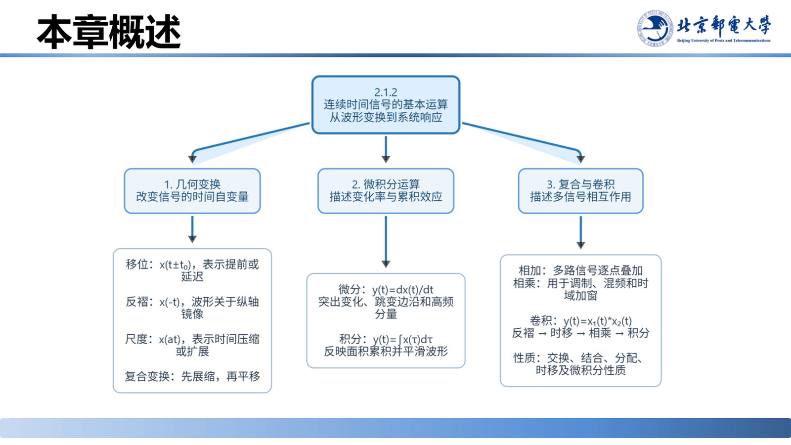

# 信号分类说明与本节重难点

> **来源**：《信号分析与处理》2.1节-20260920.pptx，第 48–51 页（共 121 页）
> **对应课件章节**：2.1.1.3 信号分类说明、2.1.1 本节重点与难点、2.1.2 章节导入
> **页码说明**：正文中"第 N 页"指课件**幻灯片序号**；插图说明"课件 slide N / 第 P 页"中的 P 为**渲染图页码**（与文件名 page-00PP 一致）。幻灯片 46/47/48 为隐藏页、未导出渲染图；幻灯片序号 n ≥ 49 时 P = n − 3。

学完典型信号需要一次"归纳"：信号可以从哪些角度分类、每一类的判据是什么；同时明确 2.1.1 的考点，并看清 2.1.2"信号运算"要学什么。

## 核心结论速查

| 分类角度 | 类别 | 判据 | 典型例子 |
|---|---|---|---|
| 时域光滑性与奇异性 | 普通信号（连续光滑信号） | 时域波形连续光滑、幅值变化平稳、无跳变间断 | 直流、正弦、指数类、Sa/sinc |
| 时域光滑性与奇异性 | 奇异信号 | 函数本身或其各阶导数存在跳变与不连续点 | 斜变、阶跃、冲激、冲激偶 |
| 能量与功率特征 | 能量有限信号（能量信号） | 全时域总能量有界 $0<E<\infty$，平均功率 $P=0$ | 有限时宽矩形脉冲、单边衰减指数信号 |
| 能量与功率特征 | 功率有限信号（功率信号） | 全时域持续存在，$E=\infty$ 但时间平均功率有限 $0<P<\infty$ | 周期信号、直流信号 |

本节重点：典型普通信号的参数与物理意义；奇异信号的核心功能与建模应用；斜变—阶跃—冲激—冲激偶的微积分链；冲激复合自变量性质的准确运算。

---

## 一、信号的分类（第 48 页）

### 1.1 按时域光滑性与奇异性分类

- **普通信号（连续光滑信号）**：时域波形连续光滑、幅值变化平稳且不存在跳变间断。
- **奇异信号（含间断点或导数突变信号）**：函数本身或其各阶导数存在跳变与不连续点，用于模拟瞬时通断、短时冲击与定时采样等物理突变过程。

### 1.2 按信号能量与功率特征分类

- **能量有限信号（能量信号）**：在全时域内总能量有界（$0<E<\infty$），平均功率 $P=0$。如有限时宽的矩形脉冲、单边衰减指数信号。
- **功率有限信号（功率信号）**：在全时域内持续存在，总能量无限（$E=\infty$），但时间平均功率有限（$0<P<\infty$）。

> 补充说明：课件只给出定性描述与符号 $E$、$P$。通用定义为 $E=\displaystyle\int_{-\infty}^{+\infty}|x(t)|^2dt$，$P=\lim\limits_{T\to\infty}\dfrac{1}{T}\displaystyle\int_{-T/2}^{T/2}|x(t)|^2dt$；另有"既非能量信号也非功率信号"的一类（如 $t$ 的幂次增长信号），本课件未涉及。

> 说明：第 48 页在课件中为隐藏页，未导出渲染图。

## 二、本节（2.1.1）重点与难点（第 49 页）

1. **典型普通信号的参数与物理意义**（振幅、角频率、频率、周期、初相、时间常数 $\tau$ 等）。
2. **奇异信号的核心功能与建模应用**（开关、矩形脉冲、符号函数、时间范围截取、瞬时冲击、理想采样）。
3. **奇异信号间的微积分链条**：熟练掌握斜变、阶跃、冲激与冲激偶之间的微积分关系

$$u(t)=\frac{dr(t)}{dt},\qquad \delta(t)=\frac{du(t)}{dt},\qquad \delta'(t)=\frac{d\delta(t)}{dt}$$

4. **冲激信号复合自变量性质的准确运算**：展缩特性 $\delta(at\pm b)=\dfrac{1}{|a|}\delta\!\left(t\pm\dfrac{b}{a}\right)$ 与筛选特性 $\displaystyle\int x(t)\delta(t-t_0)dt=x(t_0)$ 的应用。

## 三、过渡到 2.1.2（第 50–51 页）

第 50 页是章节页（进入 **2.1.2 连续时间信号的基本运算**），第 51 页"本章概述"给出知识地图——总体思路是"从波形变换到系统响应"。2.1.2 的基本运算有四类：

| 运算 | 内容 |
|---|---|
| 几何变换 | 平移、反褶、尺度变换及其组合 |
| 微分和积分 | 时域微分与积分运算 |
| 两信号相加和相乘 | 对应时间点上的逐点运算 |
| 卷积 | 线性时不变系统分析的核心工具 |

要求：掌握信号的基本运算方法。

## 易错点与考点提示

- 能量信号与功率信号是**互斥**的两类：能量信号的平均功率必为 0，功率信号的总能量必为无穷。
- "奇异"指的不是信号"很特殊"，而是指**不连续点/导数突变**这一数学特征。
- 冲激偶 $\delta'(t)$ 只在本页的重难点中点到；它在 2.1.2.3 中作为"微分器"的单位冲激响应 $h(t)=\delta'(t)$ 再次出现（见第 97 页）。

## 自测

1. 判断：周期信号一定是功率信号。为什么？
2. 有限时宽矩形脉冲属于能量信号还是功率信号？

参考答案

1. 正确。周期信号在全时域持续存在，总能量无穷；但其一个周期内的平均功率有限且等于全时域平均功率，故为功率信号。
2. 能量信号：它只在有限时间内非零，$E=\displaystyle\int|x(t)|^2dt$ 有界，$P=0$。

