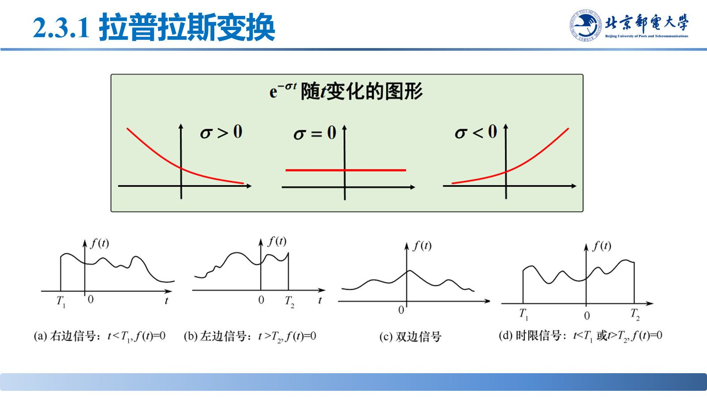
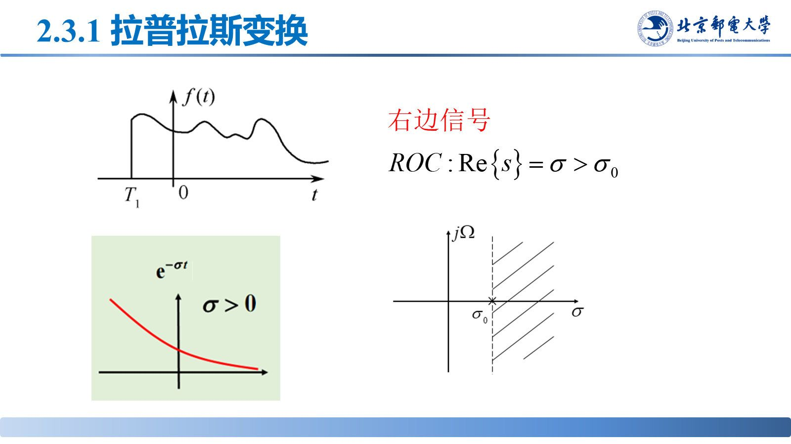
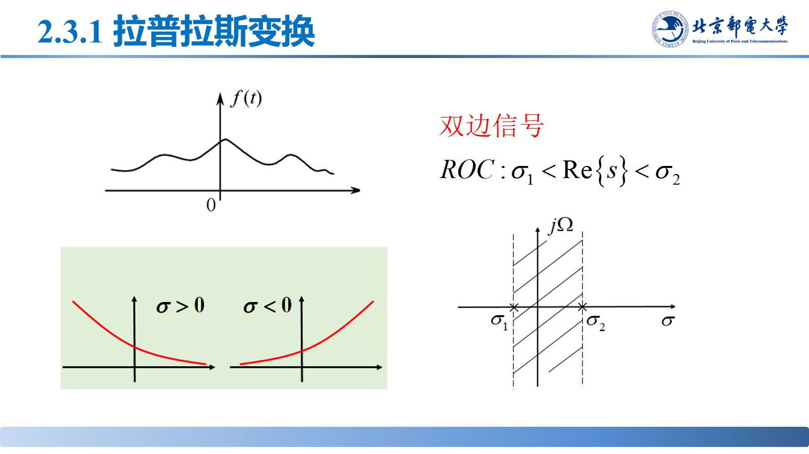
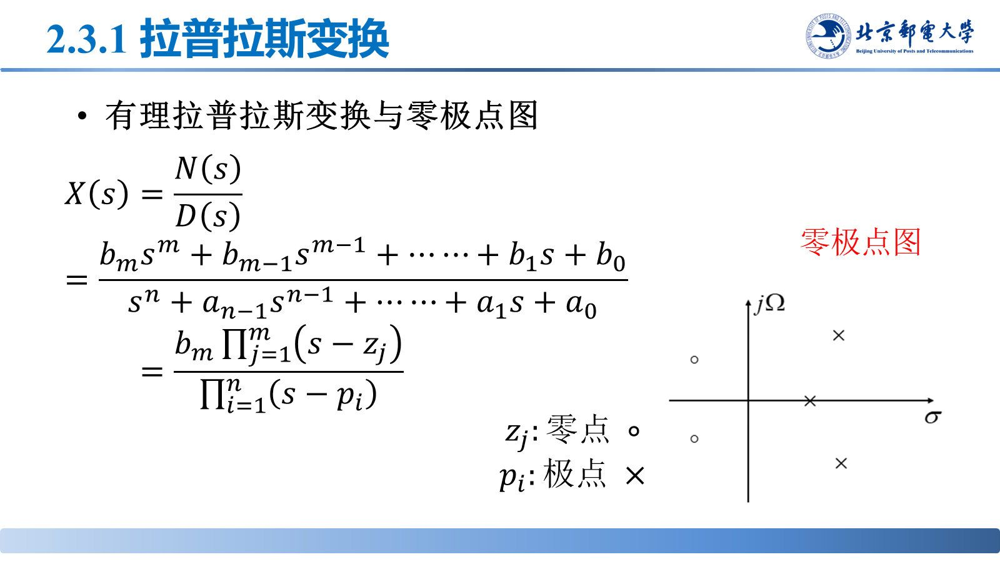

# 拉普拉斯变换的定义与收敛域

> **来源**：《信号分析与处理》2.3节20261008.pptx，第 1–31 页（共 87 页）
> **对应课件章节**：2.3.1 拉普拉斯变换

傅里叶变换要求信号绝对可积，阶跃、增长的指数等信号不满足；乘以衰减因子 $\mathrm{e}^{-\sigma t}$ 把信号"压住"后再作傅里叶变换，就得到拉普拉斯变换。$s=\sigma+\mathrm{j}\Omega$ 把实频率推广为**复频率**。

## 核心结论速查

| 名称 | 公式 | 说明 |
|---|---|---|
| 双边变换 | $X(s)=\mathscr{L}\{x(t)\}=\displaystyle\int_{-\infty}^{\infty}x(t)\mathrm{e}^{-st}\,\mathrm{d}t$ | 记 $x(t)\leftrightarrow X(s)$，$s\in$ ROC |
| 双边逆变换 | $x(t)=\mathscr{L}^{-1}\{X(s)\}=\dfrac{1}{2\pi\mathrm{j}}\displaystyle\int_{\gamma-\mathrm{j}\infty}^{\gamma+\mathrm{j}\infty}X(s)\mathrm{e}^{st}\,\mathrm{d}s$ | $\gamma$ 为取在 ROC 内的实常数 |
| 复频率 | $s=\sigma+\mathrm{j}\Omega$ | $\sigma$ 为待定实常数 |
| 收敛域 ROC | 使 $X(s)$ 存在的 $s$ 的取值范围 | 平行于虚轴的区域，不含边界 |
| 存在条件 | $\displaystyle\int_{-\infty}^{\infty}\lvert x(t)\mathrm{e}^{-\sigma t}\rvert\,\mathrm{d}t<\infty$ | 即 $x(t)\mathrm{e}^{-\sigma t}$ 绝对可积 |
| 单边变换 | $X(s)=\mathscr{L}_+\{x(t)\}=\displaystyle\int_{0^{-}}^{\infty}x(t)\mathrm{e}^{-st}\,\mathrm{d}t$ | 逆变换式同上，$t\ge0^{-}$ |
| 有理函数 | $X(s)=\dfrac{b_m\prod_{j=1}^{m}(s-z_j)}{\prod_{i=1}^{n}(s-p_i)}$ | $z_j$ 为零点（○），$p_i$ 为极点（×） |

---

## 1. 从傅里叶变换到拉普拉斯变换

傅里叶变换 $F\{f(t)\}=\displaystyle\int_{-\infty}^{+\infty}f(t)\mathrm{e}^{-\mathrm{j}\Omega t}\,\mathrm{d}t$ 要求 $f(t)$ 绝对可积。若信号不满足，可乘以**衰减因子** $\mathrm{e}^{-\sigma t}$（$\sigma$ 为实数）；当 $\sigma$ 取合适值时，$f(t)\mathrm{e}^{-\sigma t}$ 满足绝对可积条件。对这个新信号作傅里叶变换：

$$\mathscr{F}\left\{x(t)\mathrm{e}^{-\sigma t}\right\}=\int_{-\infty}^{\infty}x(t)\mathrm{e}^{-\sigma t}\mathrm{e}^{-\mathrm{j}\Omega t}\,\mathrm{d}t=\int_{-\infty}^{\infty}x(t)\mathrm{e}^{-(\sigma+\mathrm{j}\Omega)t}\,\mathrm{d}t\overset{s=\sigma+\mathrm{j}\Omega}{=}\int_{-\infty}^{\infty}x(t)\mathrm{e}^{-st}\,\mathrm{d}t=X(s)$$

$s=\sigma+\mathrm{j}\Omega$ 称为**复频率**。物理含义：$x(t)$ 可表示成复指数 $\mathrm{e}^{st}$ 的线性组合，$F(s)$ 是复频率 $s$ 的函数，称为信号的**复频谱**。

## 2. 双边变换与逆变换

定义与逆变换见表。逆变换的由来（把傅氏反变换推广到复频率）：$F(\sigma+\mathrm{j}\Omega)$ 的傅里叶反变换是 $f(t)\mathrm{e}^{-\sigma t}$，

$$f(t)\mathrm{e}^{-\sigma t}=\frac{1}{2\pi}\int_{-\infty}^{+\infty}F(\sigma+\mathrm{j}\Omega)\mathrm{e}^{\mathrm{j}\Omega t}\,\mathrm{d}\Omega\ \Longrightarrow\ f(t)=\frac{1}{2\pi}\int_{-\infty}^{+\infty}F(\sigma+\mathrm{j}\Omega)\mathrm{e}^{(\sigma+\mathrm{j}\Omega)t}\,\mathrm{d}\Omega$$

再由 $s=\sigma+\mathrm{j}\Omega$ 得 $\mathrm{d}\Omega=\mathrm{d}s/\mathrm{j}$，于是

$$x(t)=\frac{1}{2\pi\mathrm{j}}\int_{\sigma-\mathrm{j}\infty}^{\sigma+\mathrm{j}\infty}X(s)\mathrm{e}^{st}\,\mathrm{d}s$$

**积分路径是收敛域中的一条竖直直线**（一般记其横坐标为 $\gamma$，$\gamma\in$ ROC）；路径不在 ROC 内，逆变换不收敛。

## 3. 收敛域 ROC

**定义**：使 $X(s)$（或 $F(s)$）存在的 $s$ 的取值范围称为**收敛域**，记作 ROC（region of convergence）。由定义式可见，可积性只取决于 $\mathrm{Re}\{s\}=\sigma$、与虚部 $\Omega$ 无关。

**基本特性**：

- ROC 中**不包含任何极点**；
- ROC 是 $s$ 平面中**平行于虚轴**的区域，可能是右半平面、左半平面或竖直带状区域。

**信号类型 → ROC 形状**：

| 信号类型 | 定义（非零区间） | ROC 位置 |
|---|---|---|
| 右边信号 | $t<T_1$ 时 $f(t)=0$ | 某条竖直线的**右侧** |
| 左边信号 | $t>T_2$ 时 $f(t)=0$ | 某条竖直线的**左侧** |
| 双边信号 | 两侧都有非零部分 | 两条竖直线**之间**（竖直带） |
| 时限信号 | $t<T_1$ 或 $t>T_2$ 时 $f(t)=0$ | 若绝对可积，可扩展为**整个 $s$ 平面** |

**同一像函数、不同 ROC，对应不同 $x(t)$**：

| $x(t)$ | $X(s)$ | ROC |
|---|---|---|
| $\mathrm{e}^{\alpha t}u(t)$ | $\dfrac{1}{s-\alpha}$ | $\mathrm{Re}\{s\}>\alpha$（右边） |
| $-\mathrm{e}^{\alpha t}u(-t)$ | $\dfrac{1}{s-\alpha}$ | $\mathrm{Re}\{s\}<\alpha$（左边） |
| $\mathrm{e}^{\alpha t}u(t)+\mathrm{e}^{\beta t}u(-t)$ | $\dfrac{1}{s-\alpha}-\dfrac{1}{s-\beta}$ | $\alpha<\mathrm{Re}\{s\}<\beta$，需 $\alpha<\beta$ |
| $u(t)$ | $\dfrac{1}{s}$ | $\mathrm{Re}\{s\}>0$ |
| $\mathrm{e}^{-\mathrm{j}\Omega_0t}u(t)$ | $\dfrac{1}{s+\mathrm{j}\Omega_0}$ | $\mathrm{Re}\{s\}>0$ |

结论：**写拉氏变换必须成对写出 $X(s)$ 与 ROC**，只写 $X(s)$ 定不了信号；两段 ROC 边界重合（$\alpha\ge\beta$）时条带消失，说明该信号的双边变换不存在。

> 课堂补充：只有给出收敛域，拉氏变换式与原时域信号才是一一对应的关系——讲双边拉氏变换时这一点更明显。

## 4. 单边拉普拉斯变换

积分下限改为 $0^{-}$，与双边只差这一点：$t<0$ 的部分不参与变换，所以**初始状态不丢**；取 $0^{-}$ 而非 $0^{+}$，是为了把 $t=0$ 处的冲激及其各阶导数包含进来（微分性质的初始值一律取 $x(0^{-})$）。单边变换是分析因果信号与初值问题的主要工具。

## 5. 有理函数与零极点图

分子 $N(s)$ 的根 $z_j$ 称**零点**（$X(z_j)=0$，图上画 ○），分母 $D(s)$ 的根 $p_i$ 称**极点**（$X(p_i)\to\infty$，图上画 ×）。

极点位置决定 ROC 边界（ROC 不含极点），也决定 $x(t)$ 的时域形态；逆变换的部分分式展开就按极点分类进行。

---

## 易错点与考点提示

- **$s=\sigma+\mathrm{j}\Omega$ 中 $\sigma$ 是实部**（课件用 $\sigma$；逆变换路径的横坐标另记 $\gamma$，两者不要混）；$s=\mathrm{j}\Omega$ 只是虚轴一条线。
- **必须带 ROC**：$1/(s-\alpha)$ 既可能是 $\mathrm{e}^{\alpha t}u(t)$ 也可能是 $-\mathrm{e}^{\alpha t}u(-t)$，只凭 $X(s)$ 定不了信号。
- ROC 不含边界、里面不能有极点；ROC 边界由极点所在的竖直线决定。
- 单边下限是 $0^{-}$，不是 $0$ 或 $0^{+}$；初始值一律写 $x(0^{-})$。
- 双边信号对应**条带状** ROC，两端都开；条带为空则变换不存在。
- 时限信号只有**同时绝对可积**时取整个 $s$ 平面；不绝对可积时不能说 ROC 是全平面。
- 课件对同一函数有 $x(t)/X(s)$（第 8、15、29 页起）与 $f(t)/F(s)$（第 6、11–13 页）两套记法，$F(s)=X(s)$，不要当成两个函数。
