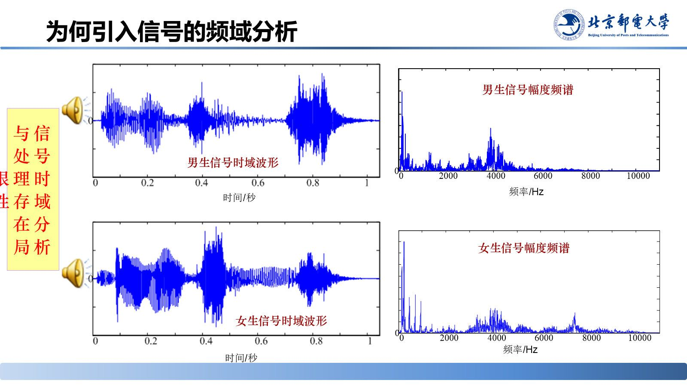
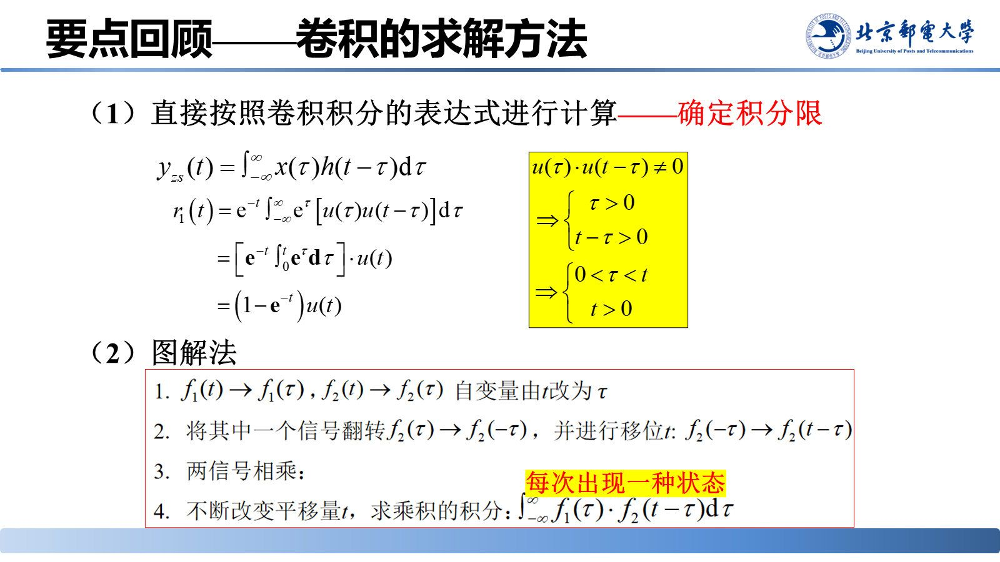

# 引言：为何做频域分析

> **来源**：《信号分析与处理》2.2节-20261007.pptx，第 1–13 页（共 152 页）
> **对应课件章节**：2.2 连续时间信号的频域分析（概述与本节导引）

连续时间信号是自然界与工程中最普遍的形式（语音、光波、温度、电磁波）。**时域分析的天花板**：它只反映幅值随时间的整体变化（强弱、快慢、突变），无法区分频率不同而波形相似的信号。本节回答：怎样把信号从"随时间的取值"翻译成"由哪些频率成分叠加而成"，以及这套翻译（傅里叶级数、傅里叶变换）有哪些可复用的性质。

## 核心结论速查

| 维度 | 工具 | 看什么 | 局限性 / 收益 |
|---|---|---|---|
| 时域 | 波形 | 幅值随时间的变化：强弱、快慢、突变 | 难以区分频率不同而波形相似的信号 |
| 频域 | 傅里叶级数 / 傅里叶变换 | 信号的频率结构与频谱特征 | **本节重点**，可分辨各频率成分 |
| 复频域 | 拉普拉斯变换 | 把微分运算转化为代数运算 | 简化动态系统求解 |

---

## 1. 时域分析的局限：A 大调与 C 大调

**A 大调与 C 大调在时域波形上几乎无法区分**，频域中却可直接分辨各音符的频率差异——时域里"藏着"却"看不出"的信息，正是频域分析要提取的对象。男生/女生语音同理：时域相似，频域频率结构明显不同。

> 课堂补充：本页例子源于陈后金《知而有识 学而善用》概述例子 P43–46。

### 工程应用

| 应用 | 用频域做什么 |
|---|---|
| 降噪耳机 | 区分人声与噪声 |
| 北斗导航 | 筛选有效载波 |
| 滤波器设计 | 按频率范围取舍信号 |
| 频谱监测 | 观测信号占用的频段 |

## 2. 傅里叶变换理论的发展历程

课件用一张发展历程图交代傅里叶分析的思想来源与演进脉络（从热传导问题到傅里叶级数、再到傅里叶变换与快速算法），说明"用正弦分量描述信号"不是凭空假设，而是有历史积累的分析工具。

## 3. 傅里叶变换的引出：信号分解为正弦之和

**任意（满足条件的）信号都可以看作一系列不同频率、不同幅度、不同初相的正弦分量叠加。**

> 课堂演示（slide 4，交互页）：拖动频率/幅度/相位滑块，合成波形逐步逼近任意给定波形。结论：满足狄利克雷条件的信号都能展开为不同频率、幅度、初相的正弦分量之和——这正是傅里叶级数与傅里叶变换的出发点。

## 4. 要点回顾：2.1 节的铺垫（新版本增补）

本版课件在正式进入 2.2 之前，用 3 页回顾 2.1 节的基础，因为这些工具在频域分析里会被反复调用。

### (1) 信号的基本运算及其分解

- 信号相加、相乘、微分、积分；
- 信号分解为**直流分量与交流分量**；
- 信号分解为**奇分量与偶分量**——这一条是 2.2.3 节"奇偶虚实性"的直接前提；
- 信号分解为实部分量与虚部分量；
- 信号的矢量空间分析、连续信号分解为冲激信号的线性组合。

### (2) 卷积的求解方法

两条路：**（1）直接按卷积的定义式做积分——关键是确定积分限；（2）图解法**。图解法把卷积拆成"翻转—平移—相乘—积分"四步，每一时刻对应一种重叠状态。

### (3) 卷积的性质

- 代数性质：**交换律**、**分配律**（对应系统并联）、**结合律**（对应系统级联）；
- **时移性质**：若 $x_1(t)*x_2(t)=y(t)$，则 $x_1(t-t_1)*x_2(t-t_2)=y(t-t_1-t_2)$。

这些性质正是 2.2.3 节"时域卷积定理 $x_1(t)*x_2(t)\leftrightarrow X_1(\Omega)X_2(\Omega)$"以及工程案例（用卷积实现滤波）的基础。

---

## 5. 本节导航：目标、重点与难点

**主要内容**：2.2.1 周期信号的傅里叶级数；2.2.2 傅里叶变换及典型非周期信号的傅里叶变换；2.2.3 傅里叶变换的基本性质；2.2.4 典型周期信号的傅里叶变换；本节总结。

**目标与要求**：掌握信号频谱的概念和物理意义；掌握傅里叶变换的性质；掌握抽样信号频谱的特点。

**重点与难点**：傅里叶变换的定义和物理意义（重点）；傅里叶变换的性质（重点）。

---

## 易错点与考点提示

- "频域分析"用傅里叶级数/变换，"复频域分析"用拉普拉斯变换把微分方程代数化，两条路线不要混用适用场合。
- 频谱存在的前提是狄利克雷条件；2.2.2 节讲"傅里叶变换存在的条件"时会再出现，前后要串起来记。
- 奇偶分解（2.1 回顾页）→ 奇偶虚实性（2.2.3）：**时域偶分量决定频谱实部、奇分量决定频谱虚部**，这条链子要记牢。

## 自测

1. 时域分析为什么难以区分 A 大调与 C 大调音阶信号？频域分析靠什么区分？
2. 本节列出的三个分析维度分别对应什么数学工具？
3. 卷积的图解法分哪四步？为什么"每一时刻对应一种重叠状态"？

参考答案

1. 两种音阶时域波形几乎一致，时域只反映幅值随时间的整体变化；频域给出各音符的频率成分（谱线位置与强度），可直接分辨。
2. 时域→波形分析；频域→傅里叶级数与傅里叶变换；复频域→拉普拉斯变换。
3. 翻转 → 平移 → 相乘 → 积分。因为 $x_2(t-\tau)$ 随 $t$ 平移时，两个波形的重叠区间一直在变，每个 $t$ 值对应一种不同的重叠状态，故需分段讨论积分限。

