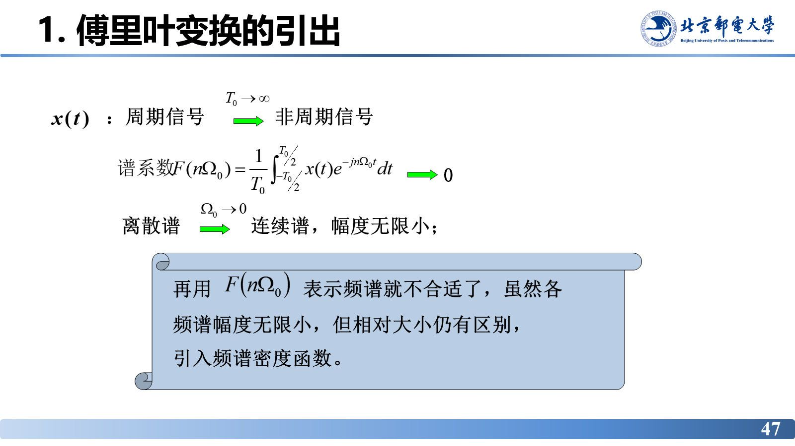

# 傅里叶变换的引出与定义

> **来源**：《信号分析与处理》2.2节-20261007.pptx，第 44–56 页（共 152 页）
> **对应课件章节**：2.2.2 傅里叶变换及典型非周期信号的傅里叶变换

周期信号的频谱是一根根离散谱线，高度为有限值；当 $T_0\to\infty$ 时信号退化为非周期信号，谱线间隔 $\Omega_0\to0$、谱线高度也趋近于零，"谱线高度"不再可用。本章说明这时改用什么量描述频谱（**频谱密度函数**）、正反变换如何成对出现、变换的物理意义与存在条件。

## 核心结论速查

| 名称 | 公式 | 说明 |
|---|---|---|
| 频谱密度函数 | $X(\Omega)=\lim\limits_{T_0\to\infty}T_0F(n\Omega_0)$ | 单位频带上的频谱值，简称频谱 |
| 傅里叶正变换 | $X(\Omega)=\displaystyle\int_{-\infty}^{\infty}x(t)\mathrm{e}^{-\mathrm{j}\Omega t}\,\mathrm{d}t=F[x(t)]$ | 由 $x(t)$ 求 $X(\Omega)$ |
| 傅里叶反变换 | $x(t)=\dfrac{1}{2\pi}\displaystyle\int_{-\infty}^{\infty}X(\Omega)\mathrm{e}^{\mathrm{j}\Omega t}\,\mathrm{d}\Omega=F^{-1}[X(\Omega)]$ | 由 $X(\Omega)$ 还原 $x(t)$ |
| 简写 | $x(t)\leftrightarrow X(\Omega)$ | $x(t)$ 称原函数，$X(\Omega)$ 称傅里叶变换函数 |
| 幅度谱 / 相位谱 | $\lvert X(\Omega) \rvert\sim\Omega$，$\varphi(\Omega)\sim\Omega$ | $X(\Omega)=\lvert X(\Omega) \rvert\mathrm{e}^{\mathrm{j}\varphi(\Omega)}$ |
| 存在条件 | 狄利克雷条件（绝对可积、有限个极值、有限个间断点且为有限值） | 充分条件 |
| 中心点校验 | $X(0)=\displaystyle\int_{-\infty}^{\infty}x(t)\mathrm{d}t$，$x(0)=\dfrac{1}{2\pi}\displaystyle\int_{-\infty}^{\infty}X(\Omega)\mathrm{d}\Omega$ | 快速检验频谱计算结果 |

---

## 1. 傅里叶变换的引出：从 $F(n\Omega_0)$ 到频谱密度

起点是周期信号的指数形式傅里叶级数系数：

$$F(n\Omega_0)=\frac{1}{T_0}\int_{-T_0/2}^{T_0/2}x(t)\mathrm{e}^{-\mathrm{j}n\Omega_0 t}\,\mathrm{d}t$$

当 $T_0\to\infty$ 时：

$$T_0F(n\Omega_0)=\frac{F(n\Omega_0)}{1/T_0}=\frac{F(n\Omega_0)}{f}\quad\text{——单位频带上的频谱值}$$

其中 $f=\dfrac{1}{T_0}\to 0$，$F(n\Omega_0)\to 0$，但比值 $\dfrac{F(n\Omega_0)}{f}$ **趋于有界函数**；同时离散谱线间隔趋于微分 $\Delta(n\Omega_0)=\Omega_0\to \mathrm{d}\Omega$，离散变量连续化 $(n\Omega_0)\to\Omega$。

因此把 $\dfrac{F(n\Omega_0)}{f}$ 记作 $F(\Omega)$ 或 $F(\mathrm{j}\Omega)$，称为**频谱密度函数**（简称频谱）：

$$X(\Omega)=\lim_{T_0\to\infty}T_0F(n\Omega_0)\ \xrightarrow{\ T_0\to\infty\ }\ \int_{-T_0/2}^{T_0/2}x(t)\mathrm{e}^{-\mathrm{j}n\Omega_0 t}\,\mathrm{d}t$$

**物理对照**：

| 信号类型 | 频谱 | 幅度 |
|---|---|---|
| 周期信号 | 离散谱 | 谱线幅度为有限值 |
| 非周期信号 | 连续谱 | 幅度无限小 |

非周期信号各分量幅度虽无限小，但**相对大小仍有区别**，所以才引入频谱密度函数。

## 2. 傅里叶反变换

由复指数形式的傅里叶级数 $x(t)=\sum\limits_{n=-\infty}^{\infty}F(n\Omega_0)\mathrm{e}^{\mathrm{j}n\Omega_0 t}$ 出发，除以 $\Omega_0$ 再乘以 $\Omega_0$：

$$x(t)=\sum_{n=-\infty}^{\infty}\frac{F(n\Omega_0)}{\Omega_0}\cdot\Omega_0\cdot\mathrm{e}^{\mathrm{j}n\Omega_0 t}$$

当 $T_0\to\infty$ 时，$\Omega_0\to\mathrm{d}\Omega$，$n\Omega_0\to\Omega$，而由 $X(\Omega)=\lim\limits_{T_0\to\infty}T_0F(n\Omega_0)=\lim\limits_{T_0\to\infty}\dfrac{F(n\Omega_0)}{\Omega_0}2\pi$ 得

$$\lim_{T_0\to\infty}\frac{F(n\Omega_0)}{\Omega_0}=\frac{X(\Omega)}{2\pi}$$

于是求和化为积分，得到**傅里叶反变换**：

$$x(t)=\frac{1}{2\pi}\int_{-\infty}^{\infty}X(\Omega)\mathrm{e}^{\mathrm{j}\Omega t}\,\mathrm{d}\Omega$$

## 3. 傅里叶变换对

$$X(\Omega)=\int_{-\infty}^{\infty}x(t)\mathrm{e}^{-\mathrm{j}\Omega t}\,\mathrm{d}t=F[x(t)]$$

$$x(t)=\frac{1}{2\pi}\int_{-\infty}^{\infty}X(\Omega)\mathrm{e}^{\mathrm{j}\Omega t}\,\mathrm{d}\Omega=F^{-1}[X(\Omega)]$$

简写为 $x(t)\leftrightarrow X(\Omega)$：$x(t)$ 称**原函数**，$X(\Omega)$ 称**傅里叶变换函数**，由 $x(t)$ 求 $X(\Omega)$ 称为**傅里叶变换**。

$X(\Omega)$ 一般为复信号，故可表示为 $X(\Omega)=|X(\Omega)|\mathrm{e}^{\mathrm{j}\varphi(\Omega)}$，其中 $|X(\Omega)|\sim\Omega$ 为**幅度频谱**，$\varphi(\Omega)\sim\Omega$ 为**相位频谱**。

## 4. 傅里叶变换的物理意义

从反变换出发，把 $X(\Omega)$ 写成模与相位：

$$x(t)=\frac{1}{2\pi}\int_{-\infty}^{\infty}X(\Omega)\mathrm{e}^{\mathrm{j}\Omega t}\mathrm{d}\Omega=\frac{1}{2\pi}\int_{-\infty}^{\infty}|X(\Omega)|\mathrm{e}^{\mathrm{j}\varphi(\Omega)}\mathrm{e}^{\mathrm{j}\Omega t}\mathrm{d}\Omega$$

利用欧拉公式展开：

$$=\frac{1}{2\pi}\int_{-\infty}^{\infty}|X(\Omega)|\cos\left[\Omega t+\varphi(\Omega)\right]\mathrm{d}\Omega+\mathrm{j}\frac{1}{2\pi}\int_{-\infty}^{\infty}|X(\Omega)|\sin\left[\Omega t+\varphi(\Omega)\right]\mathrm{d}\Omega$$

被积函数中 $\sin[\cdot]$ 对 $\Omega$ 是**奇函数，积分为 0**，虚部消失；又因 $|X(\Omega)|$、$\varphi(\Omega)$ 对 $\Omega$ 分别为偶函数和奇函数，可用 $0\to\infty$ 的积分表示：

$$x(t)=\frac{1}{\pi}\int_{0}^{\infty}|X(\Omega)|\cos\left[\Omega t+\varphi(\Omega)\right]\mathrm{d}\Omega$$

写成便于解读的形式：

$$x(t)\Rightarrow\int_{0}^{\infty}\frac{|X(\Omega)|}{\pi}\,\mathrm{d}\Omega\cos\left[\Omega t+\theta(\Omega)\right]$$

$$\underbrace{\text{求和}}_{\text{连续叠加}}\quad\underbrace{\text{振幅}}_{\frac{1}{\pi}|X(\Omega)|\mathrm{d}\Omega}\quad\underbrace{\text{带初始相位的余弦波}}_{\cos[\Omega t+\theta(\Omega)]}$$

> 课堂补充（本版新增）：**一个实际的实信号，是由无穷多个"带初始相位的余弦波"叠加而成的；从更普遍的复数角度看，信号是由无穷多个"连续指数信号"叠加而成的。**

**解释**：

- $x(t)$ 是**无穷多个振幅为无穷小**（$\dfrac{1}{\pi}|X(\Omega)|\mathrm{d}\Omega$）的**连续余弦信号之和**，频域范围 $0\to\infty$：

$$f(t)=\frac{1}{2\pi}\int_{-\infty}^{\infty}X(\Omega)\mathrm{e}^{\mathrm{j}\Omega t}\mathrm{d}\Omega\ \Rightarrow\ \int_{-\infty}^{\infty}\frac{X(\Omega)}{2\pi}\,\mathrm{d}\Omega\cdot\mathrm{e}^{\mathrm{j}\Omega t}$$

- 也可理解为无穷多个幅度为无穷小（$\dfrac{1}{2\pi}|X(\Omega)|\mathrm{d}\Omega$）的**连续指数信号之和**，占据整个频域 $\Omega:-\infty\to\infty$。

> 课堂演示（slide 54，H5 交互页）：拖动时域波形参数，实时看它的频谱密度函数如何变化，直观体会"时域波形 ↔ 频谱"一一对应。该页为内嵌网页，静态渲染无有效信息，故不插图。

## 5. 频带宽度与频谱中心点

### 频带宽度（带宽）

- **带宽**：信号主要占用的频率范围，是频域分析的核心指标，主要由幅度频谱决定。
- 常用划分：**零点带宽**（幅度频谱第一个过零点，矩形信号 $\Omega_B=\dfrac{2\pi}{\tau}$）、**$3\ \mathrm{dB}$ 半功率带宽**（幅值降至最大值 $0.707$ 倍的频率范围）、**能量有效带宽**（含信号总能量一定占比的频率区间）。
- 时频制约关系：时域波形越窄，频谱主瓣越宽；时域波形越宽，频谱主瓣越窄。

### 频谱中心点（速算校验）

在正变换定义式中令 $\Omega=0$：

$$X(0)=\int_{-\infty}^{\infty}x(t)\,\mathrm{d}t$$

信号在整个时间轴上的积分（"面积"）等于频谱在零频处的值。在反变换中令 $t=0$：

$$x(0)=\frac{1}{2\pi}\int_{-\infty}^{\infty}X(\Omega)\,\mathrm{d}\Omega$$

频谱曲线与横轴围成的面积为 $2\pi\cdot x(0)$。

**应用**：快速检验频谱计算结果。例：矩形脉冲面积为 $E\tau$，则其频谱在零频处应为 $E\tau$，否则检查归一化系数。

**等效脉冲宽度与等效带宽**：描述时域、频域集中程度，体现二者制约关系。通信速率提高 $\Rightarrow$ 码元持续时间缩短 $\Rightarrow$ 频谱占用更宽——这是高速传输与有限带宽矛盾的来源。

## 6. 傅里叶变换存在的条件

**狄利克雷条件（充分条件）**

- **绝对可积**，即 $\displaystyle\int_{-\infty}^{\infty}|x(t)|\,\mathrm{d}t<\infty$；
- 在任何有限区间内，$x(t)$ 只有**有限个最大值和最小值**；
- 在任何有限区间内，$x(t)$ 有**有限个不连续点**，且每个不连续点都必须是有限值。

此外：**能量有限信号的傅里叶变换存在**；引入 $\delta(\Omega)$ 函数的概念后，允许作傅里叶变换的函数类型大大扩展。

> 课堂补充：**这三个条件叫"充分条件"，不是"必要条件"**——满足它一定有傅里叶变换，但有些信号不满足它（如 $\delta(t)$、$u(t)$、$\mathrm{sgn}(t)$）在引入冲激函数后依然可以有傅里叶变换。答题时若问"是否充要"，答案是不能反推。

---

## 易错点与考点提示

- **"频谱"与"频谱密度"不同**：周期信号的 $F_n$ 是谱线幅度（有限值），非周期信号的 $X(\Omega)$ 是单位频带上的值；$T_0\to\infty$ 时谱线幅度趋于零，但不能说"频谱为零"。
- 反变换前有系数 $\dfrac{1}{2\pi}$、正变换没有——这是 $\Omega$ 体系；$f$ 体系正反变换对称、无 $2\pi$，两者不要混用。
- $X(0)=\displaystyle\int x(t)\mathrm{d}t$ 是最常用的自检公式，算完频谱先代 $\Omega=0$ 验一遍。
- 狄利克雷条件是**充分条件**而非必要条件：$\delta(t)$、$u(t)$、$\mathrm{sgn}(t)$ 都不满足绝对可积，但引入 $\delta(\Omega)$ 后仍可有傅里叶变换。
- 本版顺序有小改动：**频带宽度排在"课堂演示"之后、存在条件之前**（旧版在演示之前），阅读时勿按旧顺序找页。

## 自测

1. 写出傅里叶正变换与反变换的定义式（$\Omega$ 体系），并说明 $1/(2\pi)$ 出现在哪一侧。
2. 已知某信号 $x(t)$ 面积为 $A$，其频谱在 $\Omega=0$ 处的取值应为多少？
3. 为什么非周期信号不能用 $F_n$ 表示频谱？
4. 物理意义上，傅里叶反变换把 $x(t)$ 说成什么？虚部为什么消失？

参考答案

1. $X(\Omega)=\displaystyle\int_{-\infty}^{\infty}x(t)\mathrm{e}^{-\mathrm{j}\Omega t}\mathrm{d}t$；$x(t)=\dfrac{1}{2\pi}\displaystyle\int_{-\infty}^{\infty}X(\Omega)\mathrm{e}^{\mathrm{j}\Omega t}\mathrm{d}\Omega$。系数 $\dfrac{1}{2\pi}$ 只在反变换一侧。
2. $X(0)=\displaystyle\int_{-\infty}^{\infty}x(t)\mathrm{d}t=A$。
3. $T_0\to\infty$ 时谱线间隔与谱线幅度都趋于零，各分量幅度均为无穷小，$F_n$ 不再能反映"大小"；必须改用单位频带上的频谱密度 $X(\Omega)$，它仍是有限值，且能区分各频率成分的相对大小。
4. 说成无穷多个"带初始相位的余弦波"（振幅为 $\frac{1}{\pi}|X(\Omega)|\mathrm{d}\Omega$ 的无穷小量）连续叠加而成。虚部被积函数 $\sin[\Omega t+\varphi(\Omega)]$ 对 $\Omega$ 是奇函数，在对称区间上积分为零。

