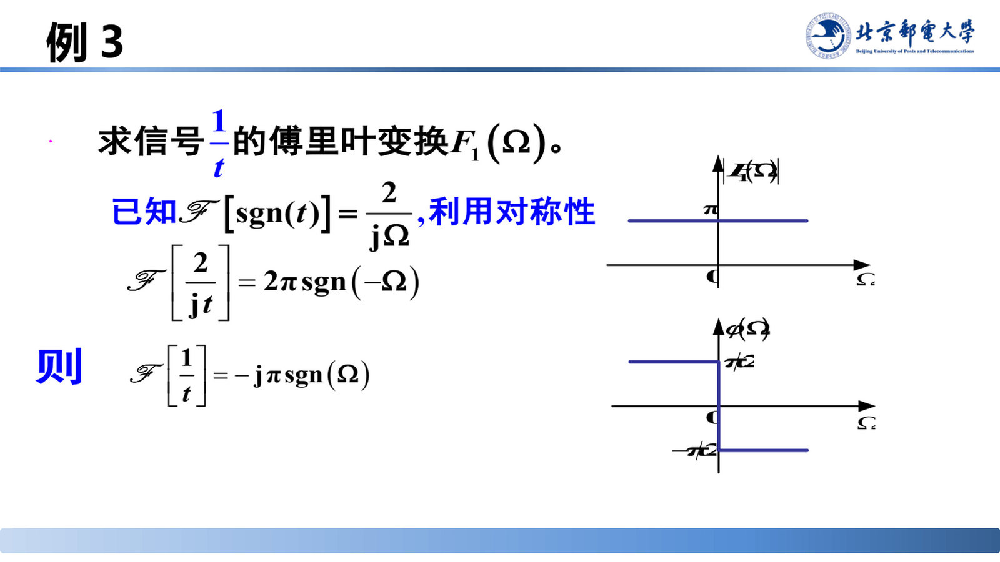
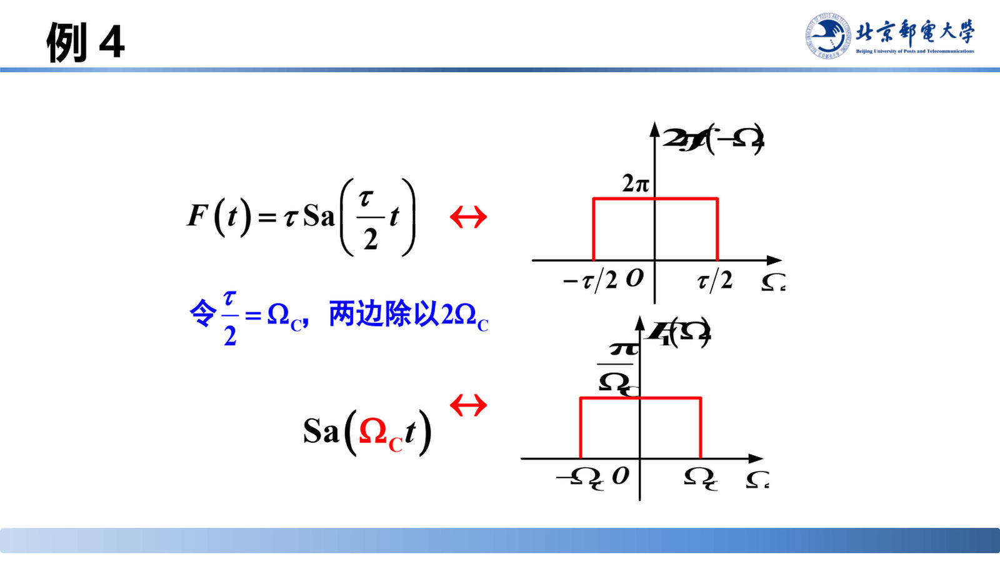
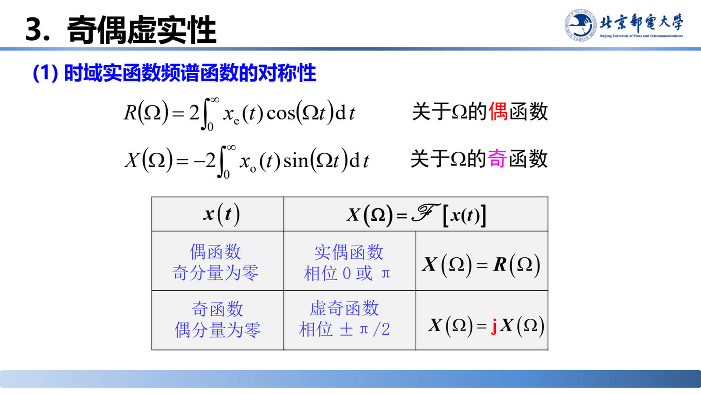
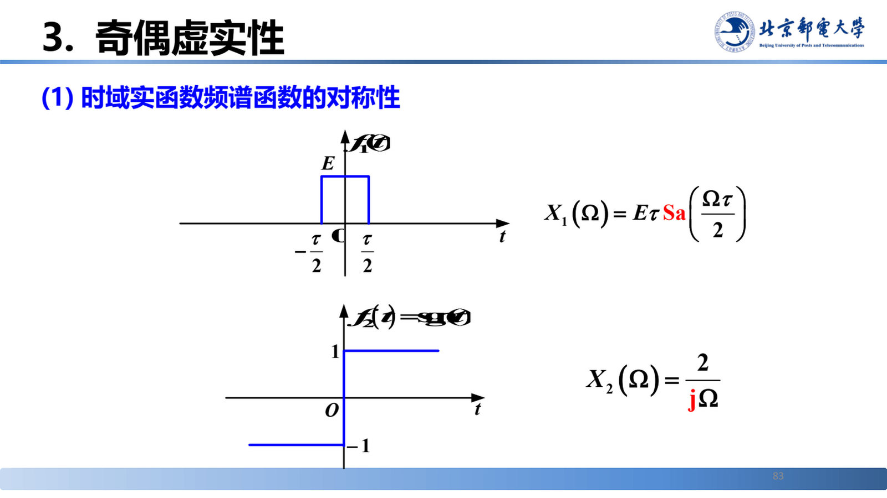
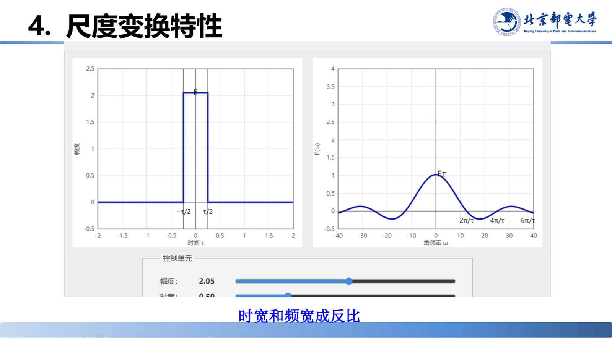
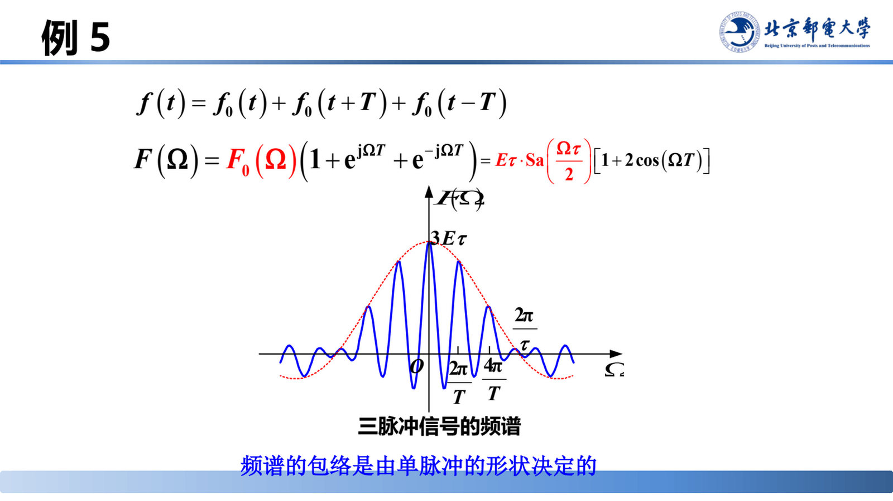
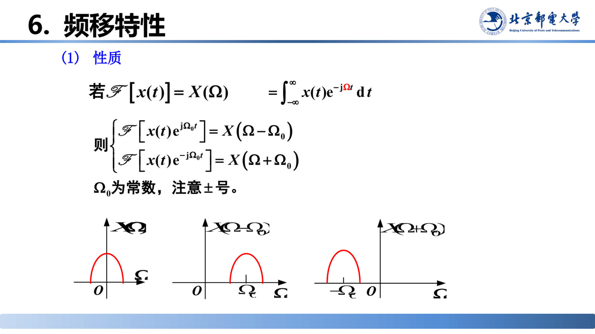
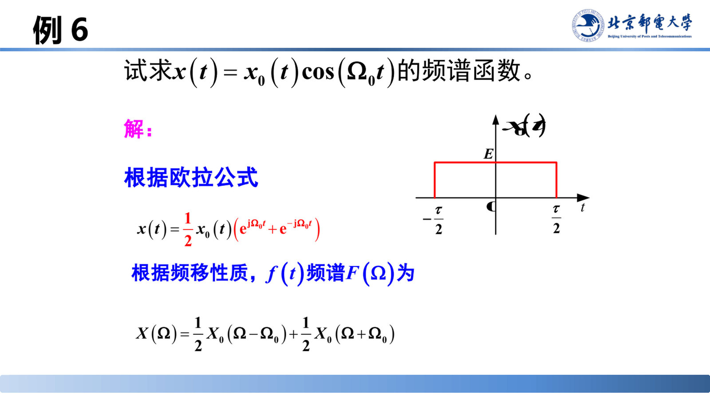
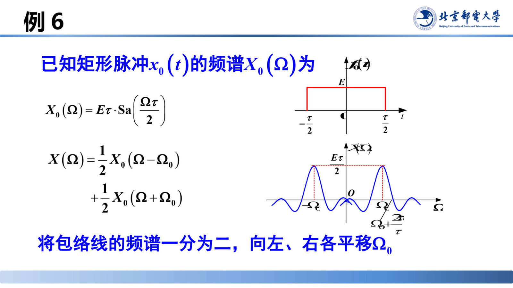
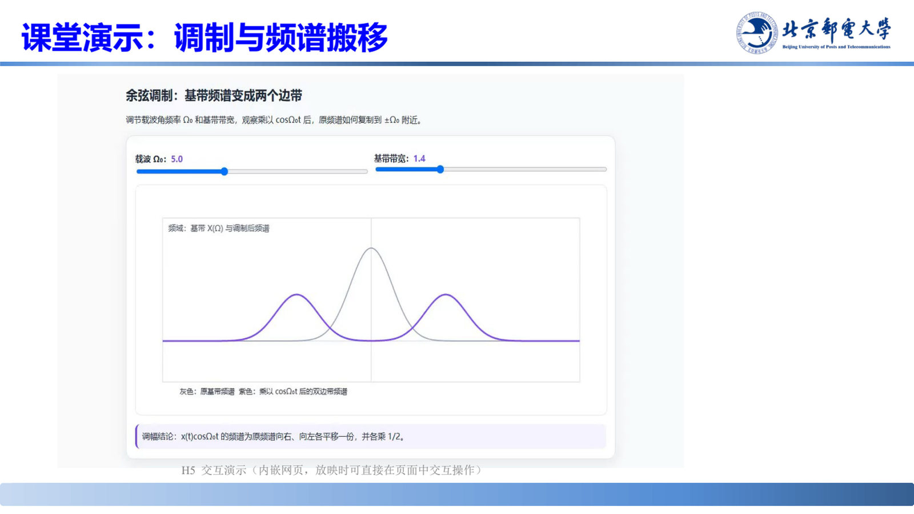

# 傅里叶变换的性质（一）：线性、对称性、奇偶虚实性、尺度变换、时移、频移

> **来源**：《信号分析与处理》2.2节-20260920.pptx，第 67–100 页（共 144 页）
> **对应课件章节**：2.2.2.3 傅里叶变换的基本性质

若每个变换都从定义式积分出发会非常繁琐。本章给出最常用的六条性质（线性、对称性、奇偶虚实性、尺度变换、时移、频移）及其证明，用途有三：看清时域与频域特性的内在联系；用性质求变换（而不是硬算积分）；理解傅里叶变换在通信中的应用（幅度调制与频谱搬移）。

## 核心结论速查

| 性质 | 时域 | 频域 | 一句话说明 |
|---|---|---|---|
| 线性 | $\sum\limits_{i=1}^{n}a_ix_i(t)$ | $\sum\limits_{i=1}^{n}a_iX_i(\Omega)$ | $a_i$ 为常数 |
| 对称性 | $X(t)$ | $2\pi x(-\Omega)$ | 时频角色互换 |
| 奇偶虚实性（实信号） | 偶函数（奇分量为零） | 实偶函数，相位 $0$ 或 $\pi$ | $X(\Omega)=R(\Omega)$ |
| 奇偶虚实性（实信号） | 奇函数（偶分量为零） | 虚奇函数，相位 $\pm\pi/2$ | $X(\Omega)=\mathrm{j}X(\Omega)$ |
| 共轭对称性 | 实信号 | $X(-\Omega)=X^{*}(\Omega)$ | 幅频偶、相频奇 |
| 时域复信号 | $x^{*}(t)$ | $F^{*}(-\Omega)$ | 取共轭再反褶 |
| 尺度变换 | $x(at)$ | $\dfrac{1}{\lvert a \rvert}X\!\left(\dfrac{\Omega}{a}\right)$ | $a$ 为非零实常数 |
| 时移 | $x(t-t_0)$ | $X(\Omega)\mathrm{e}^{-\mathrm{j}\Omega t_0}$ | 幅频不变，只改相频 |
| 时移 + 尺度 | $x(at+b)$ | $\dfrac{1}{\lvert a \rvert}X\!\left(\dfrac{\Omega}{a}\right)\mathrm{e}^{\mathrm{j}\Omega\frac{b}{a}}$ | 先尺度后时移 |
| 频移 | $x(t)\mathrm{e}^{\mathrm{j}\Omega_0 t}$ | $X(\Omega-\Omega_0)$ | 频谱整体搬移 |

---

## 1. 线性

若 $\mathscr{F}\left[x_i(t)\right]=X_i(\Omega)\ (i=1,2,\cdots,n)$，则

$$\mathscr{F}\left[\sum_{i=1}^{n}a_ix_i(t)\right]=\sum_{i=1}^{n}a_iX_i(\Omega)$$

其中 $a_i$ 为常数，$n$ 为正整数。**用途**：把复杂信号拆成若干已知变换对的线性组合（如 $u(t)=\dfrac{1}{2}+\dfrac{1}{2}\mathrm{sgn}(t)$）。**注意**：只取**有限项**叠加不成问题；若为无穷级数，需考虑一致收敛性。

## 2. 对称性

### (1) 性质

$$\text{若}\ \mathscr{F}\left[x(t)\right]=X(\Omega),\ \text{则}\ \mathscr{F}\left[X(t)\right]=2\pi x(-\Omega)$$

### (2) 分析

正变换与反变换形式很相似，但又不完全相同：

$$\begin{cases}\text{正变换：}X(\Omega)=\displaystyle\int_{-\infty}^{\infty}x(t)\mathrm{e}^{-\mathrm{j}\Omega t}\mathrm{d}t\\[3mm]\text{逆变换：}x(t)=\dfrac{1}{2\pi}\displaystyle\int_{-\infty}^{\infty}X(\Omega)\mathrm{e}^{\mathrm{j}\Omega t}\mathrm{d}\Omega\end{cases}$$

### (3) 证明

由反变换式出发，把变量名 $t$ 与 $\Omega$ 互换（把 $t$ 换成 $-\Omega$ 的形式），即得 $\mathscr{F}\left[X(t)\right]=2\pi x(-\Omega)$。

> 记法提示：若 $x(t)\leftrightarrow X(\Omega)$，则 $X(t)\leftrightarrow 2\pi x(-\Omega)$——把频域函数搬到时域，等于把时域函数反褶后乘 $2\pi$。

### 例 2：由 $\delta(t)\leftrightarrow 1$ 求常数的频谱

若 $x(t)=\delta(t)$，$X(\Omega)=1$ 已知，利用对称性求 $X(t)=1$ 的傅里叶变换 $X_1(\Omega)$。

**解**：由 $\mathscr{F}\left[X(t)\right]=2\pi x(-\Omega)$，

$$\mathscr{F}\left[X(t)\right]=2\pi\delta(-\Omega)=2\pi\delta(\Omega)\qquad(\delta(\Omega)\ \text{为偶函数})$$

即 $1\leftrightarrow 2\pi\delta(\Omega)$——与 [05-典型非周期信号的傅里叶变换.md](05-典型非周期信号的傅里叶变换.md) 中直流信号的结果一致。

### 例 3：求 $1/t$ 的傅里叶变换

求信号 $\dfrac{1}{t}$ 的傅里叶变换 $F_1(\Omega)$。已知 $\mathscr{F}\left[\mathrm{sgn}(t)\right]=\dfrac{2}{\mathrm{j}\Omega}$，利用对称性：

$$\mathscr{F}\left[\frac{2}{\mathrm{j}t}\right]=2\pi\,\mathrm{sgn}(-\Omega)$$

> 课堂补充：符号函数是**奇函数**，所以 $\mathrm{sgn}(-\Omega)=-\mathrm{sgn}(\Omega)$。

则

$$\mathscr{F}\left[\frac{1}{t}\right]=-\mathrm{j}\pi\,\mathrm{sgn}(\Omega)$$

其幅度频谱 $|F_1(\Omega)|=\pi$（常数），相位频谱为 $\Omega>0$ 时 $-\pi/2$、$\Omega<0$ 时 $+\pi/2$。

### 例 4：求抽样信号 $\mathrm{Sa}(\Omega_ct)$ 的傅里叶变换

求抽样信号 $\mathrm{Sa}(\Omega_ct)$ 的傅里叶变换 $X_1(\Omega)$。

**分析**：若利用定义式，则 $X_1(\Omega)=\displaystyle\int_{-\infty}^{\infty}\mathrm{Sa}(\Omega_ct)\mathrm{e}^{-\mathrm{j}\Omega t}\mathrm{d}t$，积分 $\displaystyle\int_{-\infty}^{\infty}\mathrm{Sa}(\Omega_ct)\mathrm{e}^{\mathrm{j}\Omega t}\mathrm{d}t$ **无法求出**，故尝试利用**对称性**求解。

**解**：已知门函数（矩形脉冲）与其频谱的变换对

$$f(t)\ \leftrightarrow\ X(\Omega)=\tau\,\mathrm{Sa}\!\left(\frac{\tau}{2}\Omega\right)$$

利用对称性得**新变换对**：

$$X(t)=\tau\,\mathrm{Sa}\!\left(\frac{\tau}{2}t\right)\ \leftrightarrow\ 2\pi f(-\Omega)$$

$f(-\Omega)$ 仍是同一个矩形脉冲（宽度 $\tau$、高度 1，且在 $-\tau/2$ 到 $\tau/2$ 之间），故频谱为高度 $2\pi$、宽度 $\tau$ 的矩形。

## 3. 奇偶虚实性

### (1) 时域实函数频谱函数的对称性

频谱的代数形式与极坐标形式：

$$X(\Omega)=|X(\Omega)|\mathrm{e}^{\mathrm{j}\varphi(\Omega)}=R(\Omega)+\mathrm{j}X(\Omega)$$

其中 $R(\Omega)$ 为实部、$\mathrm{j}X(\Omega)$ 的系数为虚部。把实信号分解为偶分量与奇分量 $x(t)=x_e(t)+x_o(t)$，代入正变换并用欧拉公式展开：

$$X(\Omega)=\int_{-\infty}^{\infty}x(t)\mathrm{e}^{-\mathrm{j}\Omega t}\mathrm{d}t=\int_{-\infty}^{\infty}\left[x_e(t)+x_o(t)\right]\left[\cos\Omega t-\mathrm{j}\sin\Omega t\right]\mathrm{d}t$$

利用 $x_e(t)\cos\Omega t$ 与 $x_o(t)\sin\Omega t$ 为偶函数（交叉项为奇函数、积分为零），得

$$X(\Omega)=2\int_{0}^{\infty}x_e(t)\cos\Omega t\,\mathrm{d}t-\mathrm{j}2\int_{0}^{\infty}x_o(t)\sin\Omega t\,\mathrm{d}t$$

$$\underbrace{2\int_{0}^{\infty}x_e(t)\cos\Omega t\,\mathrm{d}t}_{\text{实部}R(\Omega)}\qquad\underbrace{-2\int_{0}^{\infty}x_o(t)\sin\Omega t\,\mathrm{d}t}_{\text{虚部}}$$

由此得到四条对称性：

| 量 | 关于 $\Omega$ 的奇偶性 |
|---|---|
| $R(\Omega)=2\displaystyle\int_{0}^{\infty}x_e(t)\cos(\Omega t)\mathrm{d}t$ | **偶函数** |
| $X(\Omega)=-2\displaystyle\int_{0}^{\infty}x_o(t)\sin(\Omega t)\mathrm{d}t$ | **奇函数** |
| $\lvert X(\Omega) \rvert=\sqrt{\left[R(\Omega)\right]^2+\left[X(\Omega)\right]^2}$ | **偶函数** |
| $\varphi(\Omega)=\mathrm{atan2}\left[X(\Omega),\ R(\Omega)\right]$ | **奇函数** |

并得到**共轭对称性**：

$$X(-\Omega)=R(-\Omega)+\mathrm{j}X(-\Omega)=R(\Omega)-\mathrm{j}X(\Omega)=X^{*}(\Omega)$$

### 奇偶虚实性汇总表

| $x(t)$ | $X(\Omega)=\mathscr{F}\left[x(t)\right]$ | 结论 |
|---|---|---|
| 偶函数（奇分量为零） | 实偶函数，相位 $0$ 或 $\pi$ | $X(\Omega)=R(\Omega)$ |
| 奇函数（偶分量为零） | 虚奇函数，相位 $\pm\pi/2$ | $X(\Omega)=\mathrm{j}X(\Omega)$ |

> 课堂补充：**时域偶函数 $\to$ 频域实函数，时域奇函数 $\to$ 频域虚函数**。判谱最快的口诀：先看时域奇偶性，即可判断频谱是实是虚、相位取 $0/\pi$ 还是 $\pm\pi/2$。

### (2) 时域复信号频谱的性质

设 $x^{*}(t)$ 的傅里叶变换为 $G(\Omega)$，令 $g(t)=x^{*}(t)$，则

$$G(\Omega)=\int_{-\infty}^{+\infty}g(t)\mathrm{e}^{-\mathrm{j}\Omega t}\mathrm{d}t=\int_{-\infty}^{+\infty}x^{*}(t)\mathrm{e}^{-\mathrm{j}\Omega t}\mathrm{d}t$$

对 (1) 式取共轭：

$$G(\Omega)=\left[\int_{-\infty}^{+\infty}x(t)\mathrm{e}^{\mathrm{j}\Omega t}\mathrm{d}t\right]^{*}=\left[\int_{-\infty}^{+\infty}x(t)\mathrm{e}^{-\mathrm{j}(-\Omega)t}\mathrm{d}t\right]^{*}$$

与傅里叶正变换对照，(2) 式即为 $F^{*}(-\Omega)$，即

$$F\left[x^{*}(t)\right]=F^{*}(-\Omega)$$

## 4. 尺度变换特性

$$\text{若}\ \mathscr{F}\left[x(t)\right]=X(\Omega),\ \text{则}\ \mathscr{F}\left[x(at)\right]=\frac{1}{|a|}X\!\left(\frac{\Omega}{a}\right)$$

其中 $a$ 为非零的实常数。特别地，$a=-1$ 时：$x(t)\to x(-t)$，$X(\Omega)\to X(-\Omega)$（时域反褶对应频域反褶）。

**证明**（以 $a<0$ 为例）：令 $u=at$，则 $t=\dfrac{u}{a}$，$\mathrm{d}t=\dfrac{\mathrm{d}u}{a}$。

$$\mathscr{F}\left[x(at)\right]=\int_{-\infty}^{\infty}x(u)\mathrm{e}^{-\mathrm{j}\Omega\frac{u}{a}}\frac{\mathrm{d}u}{a}=\frac{1}{a}\int_{-\infty}^{-\infty}x(u)\mathrm{e}^{-\mathrm{j}\frac{\Omega}{a}u}\mathrm{d}u=-\frac{1}{a}\int_{-\infty}^{\infty}x(u)\mathrm{e}^{-\mathrm{j}\frac{\Omega}{a}u}\mathrm{d}u=-\frac{1}{a}X\!\left(\frac{\Omega}{a}\right)$$

$a<0$ 时积分上下限互换产生一个负号，与 $\dfrac{1}{a}$ 中的负号抵消，故

$$\text{综上，}\ \mathscr{F}\left[x(at)\right]=\frac{1}{|a|}X\!\left(\frac{\Omega}{a}\right)$$

### 时宽与频宽成反比

$|a|>1$ 时波形压缩、频谱展宽；$|a|<1$ 时波形展宽、频谱压缩——**时宽和频宽成反比**。

> 频谱中心点与等效带宽等内容见 [04-傅里叶变换的引出与定义.md](04-傅里叶变换的引出与定义.md) 第 5 节。

## 5. 时移特性

$$\text{若}\ \mathscr{F}\left[x(t)\right]=X(\Omega),\ \text{则}\ \mathscr{F}\left[x(t-t_0)\right]=X(\Omega)\mathrm{e}^{-\mathrm{j}\Omega t_0}$$

即

$$\mathscr{F}\left[x(t-t_0)\right]=|X(\Omega)|\cdot\mathrm{e}^{\mathrm{j}\left[\varphi(\Omega)-\Omega t_0\right]}$$

**幅度频谱无变化，只影响相位频谱**（相位增加与 $\Omega$ 成正比的线性项 $-\Omega t_0$）。

**证明**：令 $\lambda=t-t_0$，则 $t=\lambda+t_0$，

$$\int_{-\infty}^{\infty}x(t-t_0)\mathrm{e}^{-\mathrm{j}\Omega t}\mathrm{d}t=\int_{-\infty}^{\infty}x(\lambda)\mathrm{e}^{-\mathrm{j}\Omega(\lambda+t_0)}\mathrm{d}\lambda=\mathrm{e}^{-\mathrm{j}\Omega t_0}\int_{-\infty}^{\infty}x(\lambda)\mathrm{e}^{-\mathrm{j}\Omega\lambda}\mathrm{d}\lambda=\mathrm{e}^{-\mathrm{j}\Omega t_0}X(\Omega)$$

### 例 5：三脉冲信号的频谱

求三脉冲信号（一个中心脉冲，左右各一个移位脉冲，脉宽均为 $\tau$、高度均为 $E$）的频谱。

**解**：把三脉冲分解为一个中心脉冲与两个移位脉冲之和：

$$x(t)=x_0(t)+x_0(t+T)+x_0(t-T)$$

单个脉冲（宽度 $\tau$、高度 $E$、中心在原点）的频谱为

$$X_0(\Omega)=E\tau\cdot\mathrm{Sa}\!\left(\frac{\Omega\tau}{2}\right)$$

用线性性质与时移特性：

$$F(\Omega)=F_0(\Omega)\left(1+\mathrm{e}^{\mathrm{j}\Omega T}+\mathrm{e}^{-\mathrm{j}\Omega T}\right)=E\tau\cdot\mathrm{Sa}\!\left(\frac{\Omega\tau}{2}\right)\left[1+2\cos(\Omega T)\right]$$

**结论**：

- **频谱的包络是由单脉冲的形状决定的**（包络即 $E\tau\mathrm{Sa}(\Omega\tau/2)$）；
- 脉冲个数增多，**频谱包络不变，带宽不变**，只是在包络下"填充"出更多瓣。

### 时移加尺度变换

$$\text{若}\ \mathscr{F}\left[x(t)\right]=X(\Omega),\ \text{则}\ \mathscr{F}\left[x(at+b)\right]=\mathscr{F}\left\{x\!\left[a\!\left(t+\frac{b}{a}\right)\right]\right\}=\frac{1}{|a|}X\!\left(\frac{\Omega}{a}\right)\cdot\mathrm{e}^{\mathrm{j}\Omega\frac{b}{a}}$$

**算例**：已知 $\mathscr{F}\left[x(t)\right]=X(\Omega)$，求 $x(2t-5)$ 的频谱密度函数。

$$x(2t)\leftrightarrow\frac{1}{2}X\!\left(\frac{\Omega}{2}\right)$$

$$x(2t-5)=x\!\left[2\!\left(t-\frac{5}{2}\right)\right]\leftrightarrow\frac{1}{2}X\!\left(\frac{\Omega}{2}\right)\cdot\mathrm{e}^{-\mathrm{j}\Omega\frac{5}{2}}$$

> 注意符号：一般式写成 $\mathrm{e}^{\mathrm{j}\Omega\frac{b}{a}}$（对应 $x(at+b)$），而算例中的 $x(2t-5)=x[2(t-5/2)]$ 属于"先尺度再右移"，故指数因子为 $\mathrm{e}^{-\mathrm{j}\Omega\cdot\frac{5}{2}}$。使用时统一按 $x\!\left[a\left(t-t_0\right)\right]\leftrightarrow\dfrac{1}{|a|}X\!\left(\dfrac{\Omega}{a}\right)\mathrm{e}^{-\mathrm{j}\Omega t_0}$ 更不易出错。

## 6. 频移特性

### (1) 性质

$$\text{若}\ \mathscr{F}\left[x(t)\right]=X(\Omega)=\int_{-\infty}^{\infty}x(t)\mathrm{e}^{-\mathrm{j}\Omega t}\mathrm{d}t$$

$$\text{则}\quad\begin{cases}\mathscr{F}\left[x(t)\mathrm{e}^{\mathrm{j}\Omega_0 t}\right]=X(\Omega-\Omega_0)\\[2mm]\mathscr{F}\left[x(t)\mathrm{e}^{-\mathrm{j}\Omega_0 t}\right]=X(\Omega+\Omega_0)\end{cases}$$

$\Omega_0$ 为常数，**注意 $\pm$ 号**。

### 证明

把 $x(t)\mathrm{e}^{\mathrm{j}\Omega_0 t}$ 代入正变换定义式，$\mathrm{e}^{\mathrm{j}\Omega_0 t}\mathrm{e}^{-\mathrm{j}\Omega t}=\mathrm{e}^{-\mathrm{j}(\Omega-\Omega_0)t}$，令 $\Omega'=\Omega-\Omega_0$ 即得 $X(\Omega-\Omega_0)$。

### 例 6：矩形调幅信号的频谱

试求 $x(t)=x_0(t)\cos(\Omega_0 t)$ 的频谱函数，其中 $x_0(t)$ 为宽度 $\tau$、高度 $E$ 的矩形脉冲。

**解**：根据欧拉公式

$$x(t)=\frac{1}{2}x_0(t)\left(\mathrm{e}^{\mathrm{j}\Omega_0 t}+\mathrm{e}^{-\mathrm{j}\Omega_0 t}\right)$$

再根据**频移性质**，

$$X(\Omega)=\frac{1}{2}X_0(\Omega-\Omega_0)+\frac{1}{2}X_0(\Omega+\Omega_0)$$

由矩形脉冲的频谱 $X_0(\Omega)=E\tau\cdot\mathrm{Sa}\!\left(\dfrac{\Omega\tau}{2}\right)$，得

$$X(\Omega)=\frac{1}{2}E\tau\,\mathrm{Sa}\!\left[\frac{(\Omega-\Omega_0)\tau}{2}\right]+\frac{1}{2}E\tau\,\mathrm{Sa}\!\left[\frac{(\Omega+\Omega_0)\tau}{2}\right]$$

**将包络线的频谱一分为二，向左、右各平移 $\Omega_0$**：峰值由 $E\tau$ 降为 $\dfrac{E\tau}{2}$，中心分别移到 $\pm\Omega_0$。这就是调幅（AM）信号的频谱结构。

> 课堂补充：演示中可见余弦波变密，说明频率变高、即 $\Omega_0$ 变大，于是矩形脉冲的频谱往两边移。

> 课堂演示（slide 100，交互页）：三条性质放在一起对比——改变 $a$ 看时宽与频宽的反比；改变 $t_0$ 看幅度谱不动、相位谱加线性项；改变 $\Omega_0$ 看频谱整体平移。**结论**：影响"谱的形状"的是尺度因子 $a$；只改"相位"的是时移 $t_0$；只改"谱的位置"的是频移 $\Omega_0$。

### 课堂演示：调制与频谱搬移（slide 122）

演示"余弦调制：基带频谱变成两个边带"，可分别调节**载波角频率 $\Omega_0$**（默认 5.0）与**基带带宽**（默认 1.4）。图中灰色曲线为原基带频谱 $X(\Omega)$，紫色曲线为乘以 $\cos\Omega_0 t$ 后的双边带频谱。

**现象与结论**：$x(t)\cos\Omega_0 t$ 的频谱是把原频谱**向右、向左各平移一份，并各乘 $\dfrac{1}{2}$**，即

$$X(\Omega)=\frac{1}{2}X_0(\Omega-\Omega_0)+\frac{1}{2}X_0(\Omega+\Omega_0)$$

原基带谱被"搬"到 $\pm\Omega_0$ 附近形成双边带；增大载波 $\Omega_0$ 则两个边带整体外移且间距变大，改变基带带宽则只改变边带自身的宽度——这正是频移性质在调幅通信中的直接应用。

---

## 易错点与考点提示

- **时移不改幅度谱**：$|X(\Omega)\mathrm{e}^{-\mathrm{j}\Omega t_0}|=|X(\Omega)|$，只给相位加 $-\Omega t_0$；问"时移后幅度谱如何变化"，答案一定是"不变"。
- **频移与调制定理**：$x(t)\cos\Omega_0 t$ 的频谱是 $\dfrac{1}{2}\left[X(\Omega-\Omega_0)+X(\Omega+\Omega_0)\right]$，系数 $\dfrac{1}{2}$，峰值减半。
- **尺度因子取绝对值**：公式是 $\dfrac{1}{|a|}$，$a<0$ 时不要漏 $|a|$；证明中"上下限互换"的负号与 $\dfrac{1}{a}$ 的负号恰好抵消。
- 对称性公式 $\mathscr{F}\left[X(t)\right]=2\pi x(-\Omega)$ 中的 $2\pi$ 与**反褶**（$-\Omega$）都不能漏；对偶题（$\mathrm{Sa}$ 信号、$1/t$）必须先确认时域信号的奇偶性。
- 实信号的 $X(-\Omega)=X^{*}(\Omega)$；判断"幅频偶、相频奇"就靠这一条。

## 自测

1. 已知 $x(t)\leftrightarrow X(\Omega)$，写出 $x(3t-6)$ 的频谱。
2. $x(t)$ 为实信号且为**奇函数**，其频谱的实部是多少？相位谱取什么值？
3. 用对称性由 $\mathrm{sgn}(t)\leftrightarrow\dfrac{2}{\mathrm{j}\Omega}$ 求 $\dfrac{1}{t}$ 的频谱。

参考答案

1. $x(3t-6)=x\left[3(t-2)\right]\leftrightarrow\dfrac{1}{3}X\!\left(\dfrac{\Omega}{3}\right)\mathrm{e}^{-\mathrm{j}2\Omega}$。
2. 实部 $R(\Omega)=0$（偶分量为零），频谱为**虚奇函数**，相位谱取 $\pm\pi/2$。
3. $\mathscr{F}\left[\dfrac{2}{\mathrm{j}t}\right]=2\pi\,\mathrm{sgn}(-\Omega)=-2\pi\,\mathrm{sgn}(\Omega)$，故 $\mathscr{F}\left[\dfrac{1}{t}\right]=-\mathrm{j}\pi\,\mathrm{sgn}(\Omega)$。

