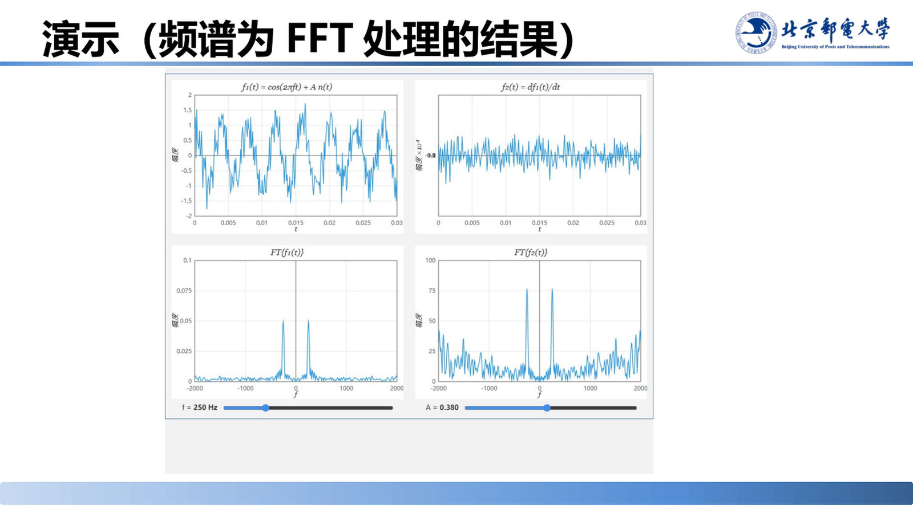
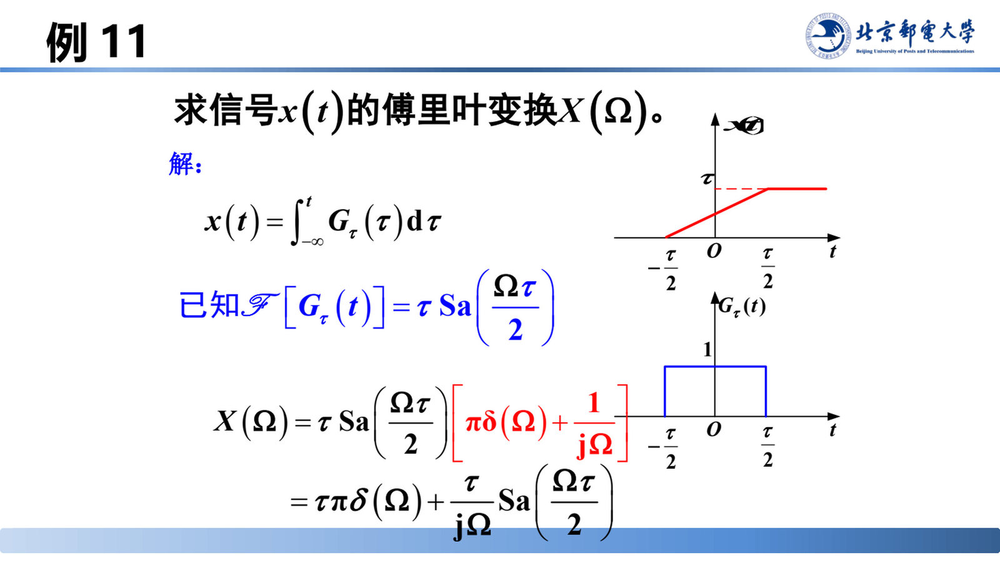
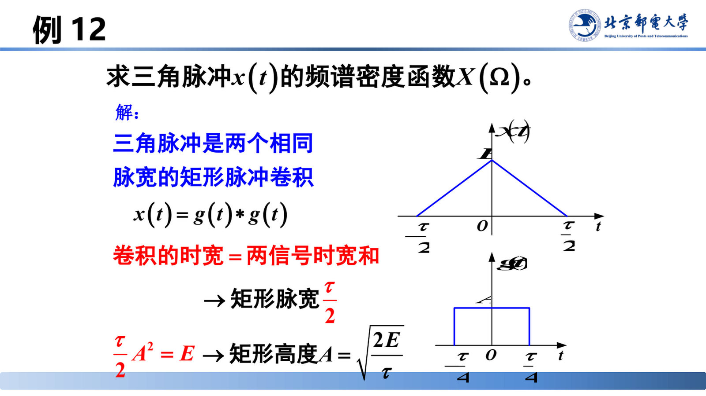
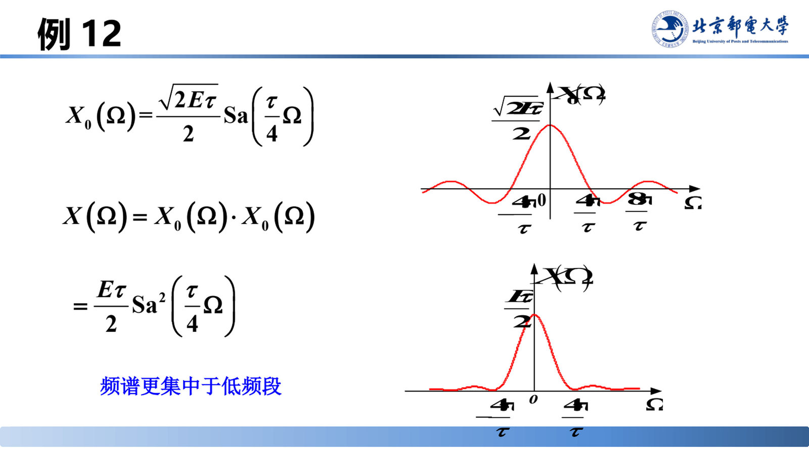
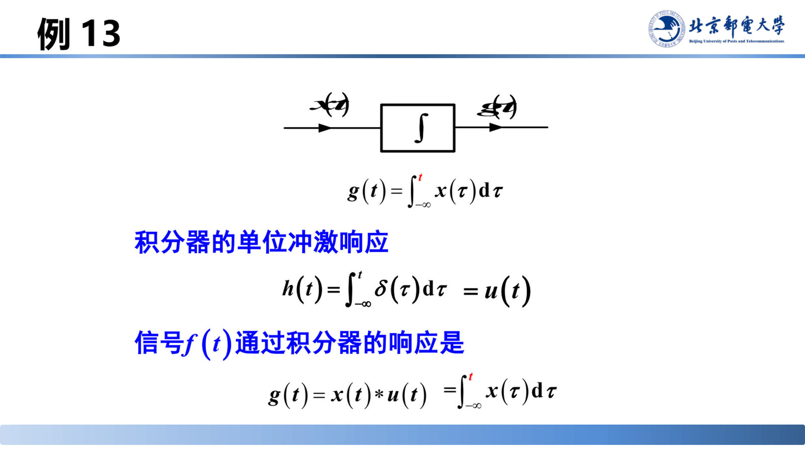
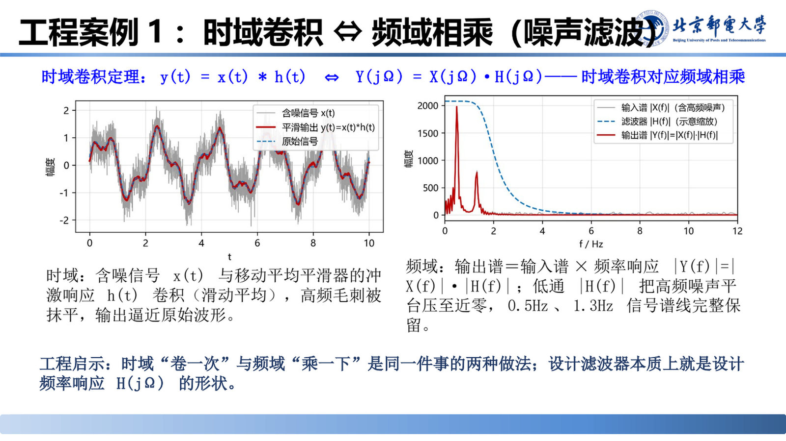
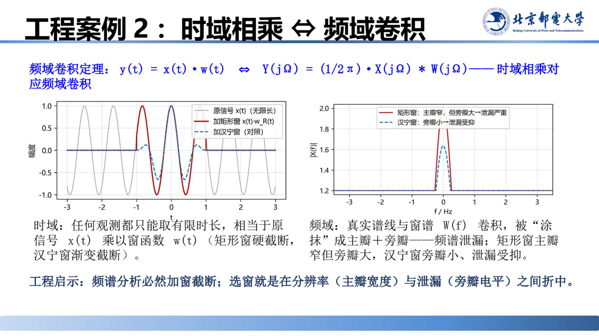
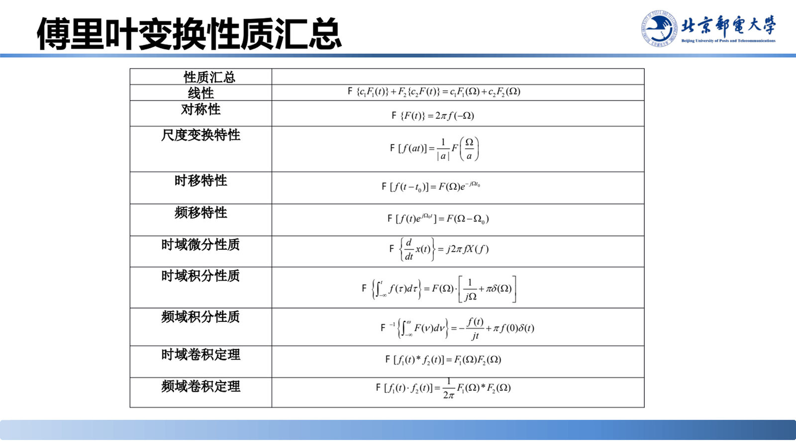

# 傅里叶变换的性质（二）：微积分性质与卷积定理

> **来源**：《信号分析与处理》2.2节-20260920.pptx，第 101–123 页（共 144 页）
> **对应课件章节**：2.2.2.3 傅里叶变换的基本性质

本章给出傅里叶变换最有工程价值的几条性质：时域微分/积分、频域微分/积分，以及**时域卷积定理**与**频域卷积定理**。它们把微积分运算变成代数乘法、把卷积变成乘积（或反过来），是滤波器设计、调制解调、频谱分析的数学基础。两个工程案例把卷积定理落到"降噪滤波"与"加窗截断引起频谱泄漏"上。

## 核心结论速查

| 性质 | 时域 | 频域 |
|---|---|---|
| 时域微分 | $x'(t)$（一般 $x^{(n)}(t)$） | $\mathrm{j}\Omega X(\Omega)$（$(j\Omega)^nX(\Omega)$） |
| 频域微分 | $tx(t)$（$t^nx(t)$） | $\mathrm{j}\dfrac{\mathrm{d}X(\Omega)}{\mathrm{d}\Omega}$（$(\mathrm{j})^n\dfrac{\mathrm{d}^nX(\Omega)}{\mathrm{d}\Omega^n}$） |
| 频域微分（等价形式） | $(-\mathrm{j}t)^nx(t)$ | $\dfrac{\mathrm{d}^nX(\Omega)}{\mathrm{d}\Omega^n}$ |
| 时域积分 | $\displaystyle\int_{-\infty}^{t}x(\tau)\mathrm{d}\tau$ | $X(\Omega)\left[\dfrac{1}{\mathrm{j}\Omega}+\pi\delta(\Omega)\right]$；若 $X(0)=0$ 则为 $\dfrac{X(\Omega)}{\mathrm{j}\Omega}$ |
| 频域积分（了解） | $-\dfrac{x(t)}{\mathrm{j}t}+\pi f(0)\delta(t)$ | $\displaystyle\int_{-\infty}^{\Omega}X(v)\mathrm{d}v$ |
| 时域卷积定理 | $x_1(t)*x_2(t)$ | $X_1(\Omega)\cdot X_2(\Omega)$ |
| 频域卷积定理 | $x_1(t)\cdot x_2(t)$ | $\dfrac{1}{2\pi}X_1(\Omega)*X_2(\Omega)$ |

---

## 1. 时域微分性质

$$\text{已知}\ \mathscr{F}\left[x(t)\right]=X(\Omega),\ \text{则}\ \mathscr{F}\left[x'(t)\right]=\mathrm{j}\Omega X(\Omega)$$

**作用效果**：幅度乘 $|\Omega|$；相位增加 $\mathrm{j}=\mathrm{e}^{\mathrm{j}\frac{\pi}{2}}$，即相位增加 $\dfrac{\pi}{2}$。一般情况：

$$x^{(n)}(t)\leftrightarrow(\mathrm{j}\Omega)^nX(\Omega)$$

**证明**：由反变换 $x(t)=\dfrac{1}{2\pi}\displaystyle\int_{-\infty}^{\infty}X(\Omega)\mathrm{e}^{\mathrm{j}\Omega t}\mathrm{d}\Omega$，两边对 $t$ 求导：

$$x'(t)=\frac{\mathrm{d}}{\mathrm{d}t}\left[\frac{1}{2\pi}\int_{-\infty}^{\infty}X(\Omega)\mathrm{e}^{\mathrm{j}\Omega t}\mathrm{d}\Omega\right]=\frac{1}{2\pi}\int_{-\infty}^{\infty}X(\Omega)\frac{\mathrm{d}}{\mathrm{d}t}\left(\mathrm{e}^{\mathrm{j}\Omega t}\right)\mathrm{d}\Omega=\frac{1}{2\pi}\int_{-\infty}^{\infty}\mathrm{j}\Omega X(\Omega)\mathrm{e}^{\mathrm{j}\Omega t}\mathrm{d}\Omega$$

$x'(t)$ 和 $\mathrm{j}\Omega X(\Omega)$ 是一个傅里叶变换对，即 $\mathscr{F}\left[x'(t)\right]=\mathrm{j}\Omega X(\Omega)$。

**结论**：**微分使高频分量增强**（幅度按 $|\Omega|$ 加权），微分是"高通"操作。

### 例 7：求 $\delta'(t)$ 的傅里叶变换

已知 $\mathscr{F}\left[\delta(t)\right]=1$，求 $\mathscr{F}\left[\delta'(t)\right]$。

**解**：根据时域微分性质，

$$\mathscr{F}\left[\delta'(t)\right]=\mathrm{j}\Omega\cdot1=\mathrm{j}\Omega$$

### 例 8：求 $1/t^2$ 的傅里叶变换

已知 $x(t)=\dfrac{1}{t^2}$，求 $\mathscr{F}\left[x(t)\right]=X(\Omega)$。

**解**：注意到 $\dfrac{1}{t^2}=-\dfrac{\mathrm{d}}{\mathrm{d}t}\left(\dfrac{1}{t}\right)$，所以 $X(\Omega)=-\mathrm{j}\Omega\,\mathscr{F}\left[\dfrac{1}{t}\right]$；已知 $\dfrac{1}{t}\leftrightarrow-\mathrm{j}\pi\,\mathrm{sgn}(\Omega)$，故

$$\therefore\ X(\Omega)=-\pi\Omega\,\mathrm{sgn}(\Omega)$$

### 演示：微分的频谱效应（频谱为 FFT 处理的结果）

演示中取 $f_1(t)=\cos(2\pi ft)+A\cdot n(t)$（带噪余弦），再做时域微分 $f_2(t)=\mathrm{d}f_1(t)/\mathrm{d}t$，并用 FFT 观察两者频谱（$f=250\ \mathrm{Hz}$，$A=0.380$）。

**现象与结论**：微分后 $f_2(t)$ 的时域波形中高频毛刺被显著放大；其 FFT 频谱在信号频率附近仍有两个尖峰，但**整个频段的本底噪声被抬高**，信噪比变差——印证 $\mathscr{F}[x'(t)]=\mathrm{j}\Omega X(\Omega)$：幅度按 $|\Omega|$ 加权，微分就是高通。

## 2. 频域微分性质

$$\text{若}\ \mathscr{F}\left[x(t)\right]=X(\Omega),\ \text{则}\ \mathscr{F}\left[tx(t)\right]=\mathrm{j}\frac{\mathrm{d}X(\Omega)}{\mathrm{d}\Omega}\quad\text{或}\quad\mathscr{F}\left[-\mathrm{j}tx(t)\right]=\frac{\mathrm{d}X(\Omega)}{\mathrm{d}\Omega}$$

**推广**：

$$\mathscr{F}\left[(-\mathrm{j}t)^nx(t)\right]=\frac{\mathrm{d}^nX(\Omega)}{\mathrm{d}\Omega^n}\qquad\text{或}\qquad\mathscr{F}\left[t^nx(t)\right]=(\mathrm{j})^n\frac{\mathrm{d}^nX(\Omega)}{\mathrm{d}\Omega^n}$$

**证明**：已知 $X(\Omega)=\displaystyle\int_{-\infty}^{\infty}x(t)\mathrm{e}^{-\mathrm{j}\Omega t}\mathrm{d}t$，两边对 $\Omega$ 求导：

$$\frac{\mathrm{d}}{\mathrm{d}\Omega}X(\Omega)=\frac{\mathrm{d}}{\mathrm{d}\Omega}\left[\int_{-\infty}^{+\infty}x(t)\mathrm{e}^{-\mathrm{j}\Omega t}\mathrm{d}t\right]=\int_{-\infty}^{\infty}x(t)\frac{\mathrm{d}}{\mathrm{d}\Omega}\left(\mathrm{e}^{-\mathrm{j}\Omega t}\right)\mathrm{d}t=\int_{-\infty}^{\infty}\left[-\mathrm{j}tx(t)\right]\mathrm{e}^{-\mathrm{j}\Omega t}\mathrm{d}t$$

$$\therefore\ \mathscr{F}\left[-\mathrm{j}tx(t)\right]=\frac{\mathrm{d}X(\Omega)}{\mathrm{d}\Omega}$$

### 例 9：求 $(t-2)x(t)$ 的傅里叶变换

已知 $\mathscr{F}\left[x(t)\right]=X(\Omega)$，求 $\mathscr{F}\left[(t-2)x(t)\right]$。

**解**：

$$\mathscr{F}\left[(t-2)x(t)\right]=\mathscr{F}\left[tx(t)-2x(t)\right]=\mathrm{j}\frac{\mathrm{d}X(\Omega)}{\mathrm{d}\Omega}-2X(\Omega)$$

### 例 10：求 $\mathscr{F}\left[t^n\right]$

**解**：把 $t^n$ 写成 $t^n\cdot1$，已知 $\mathscr{F}\left[1\right]=2\pi\delta(\Omega)=X(\Omega)$，逐次用频域微分性质：

$$\mathscr{F}\left[t\cdot1\right]=\mathrm{j}\frac{\mathrm{d}X(\Omega)}{\mathrm{d}\Omega},\qquad\mathscr{F}\left[t\cdot(t\cdot1)\right]=\mathrm{j}\left[\mathrm{j}\frac{\mathrm{d}X^2(\Omega)}{\mathrm{d}\Omega^2}\right]$$

$$\mathscr{F}\left[t^n\cdot1\right]=(\mathrm{j})^n\frac{\mathrm{d}^nX(\Omega)}{\mathrm{d}\Omega^n}=(\mathrm{j})^n\frac{\mathrm{d}^n\left[2\pi\delta(\Omega)\right]}{\mathrm{d}\Omega^n}$$

即 $t^n$ 的频谱是冲激函数的 $n$ 阶导数（乘常数）。

## 3. 时域积分性质

$$\text{若}\ x(t)\leftrightarrow X(\Omega),\ \text{则}\ \int_{-\infty}^{t}x(\tau)\mathrm{d}\tau\ \leftrightarrow\ X(\Omega)\cdot\left[\frac{1}{\mathrm{j}\Omega}+\pi\delta(\Omega)\right]$$

当 $X(0)=0$ 时（信号面积为零，无直流分量）：

$$\int_{-\infty}^{t}x(\tau)\mathrm{d}\tau\ \leftrightarrow\ \frac{X(\Omega)}{\mathrm{j}\Omega}$$

**结论**：积分使幅度按 $\dfrac{1}{|\Omega|}$ 衰减、相位减 $\dfrac{\pi}{2}$，是**低通**操作；$\pi\delta(\Omega)$ 项体现积分可能引入的直流（常数）分量。

### 例 11：求积分型折线信号的频谱

求信号 $x(t)$ 的傅里叶变换 $X(\Omega)$，其中 $x(t)=\displaystyle\int_{-\infty}^{t}G_\tau(\tau)\mathrm{d}\tau$，$G_\tau(t)$ 为宽度 $\tau$、高度 1 的矩形脉冲。

**解**：已知 $\mathscr{F}\left[G_\tau(t)\right]=\tau\,\mathrm{Sa}\!\left(\dfrac{\Omega\tau}{2}\right)$，用**时域积分性质**：

$$X(\Omega)=\tau\,\mathrm{Sa}\!\left(\frac{\Omega\tau}{2}\right)\left[\pi\delta(\Omega)+\frac{1}{\mathrm{j}\Omega}\right]=\tau\pi\delta(\Omega)+\frac{\tau}{\mathrm{j}\Omega}\mathrm{Sa}\!\left(\frac{\Omega\tau}{2}\right)$$

> 注意结果中的 $\tau\pi\delta(\Omega)$ 项：$G_\tau(t)$ 的面积为 $\tau\ne0$，积分后信号含有直流分量 $\dfrac{\tau}{2}$，这一项不能丢。

## 4. 频域积分性质（了解）

$$\text{已知}\ \mathscr{F}\left[x(t)\right]=X(\Omega),\ \text{则}\ \mathscr{F}^{-1}\left[\int_{-\infty}^{\Omega}X(v)\mathrm{d}v\right]=-\frac{x(t)}{\mathrm{j}t}+\pi f(0)\delta(t)$$

## 5. 时域卷积定理

若 $\mathscr{F}\left[x_1(t)\right]=X_1(\Omega)$，$\mathscr{F}\left[x_2(t)\right]=X_2(\Omega)$，则

$$\mathscr{F}\left[x_1(t)*x_2(t)\right]=X_1(\Omega)\cdot X_2(\Omega)$$

**时域卷积 $\xleftrightarrow{\ \mathrm{FT}\ }$ 频域乘积**。

**证明**：

$$\mathscr{F}\left[x_1(t)*x_2(t)\right]=\int_{-\infty}^{\infty}\left[\int_{-\infty}^{\infty}x_1(\tau)x_2(t-\tau)\mathrm{d}\tau\right]\mathrm{e}^{-\mathrm{j}\Omega t}\mathrm{d}t$$

交换积分次序：

$$=\int_{-\infty}^{\infty}x_1(\tau)\left[\int_{-\infty}^{\infty}x_2(t-\tau)\mathrm{e}^{-\mathrm{j}\Omega t}\mathrm{d}t\right]\mathrm{d}\tau=\int_{-\infty}^{\infty}x_1(\tau)\mathrm{e}^{-\mathrm{j}\Omega\tau}\mathrm{d}\tau\cdot X_2(\Omega)=X_1(\Omega)\cdot X_2(\Omega)$$

### 例 12：三角脉冲的频谱

求三角脉冲 $x(t)$ 的频谱密度函数 $X(\Omega)$：三角脉冲宽度 $\tau$、峰值 $E$，是两个相同脉宽的矩形脉冲的卷积

$$x(t)=g(t)*g(t)$$

**关键关系**：**卷积的时宽 = 两信号时宽之和**，故矩形脉宽取 $\dfrac{\tau}{2}$；由面积守恒

$$\frac{\tau}{2}A^2=E\quad\Longrightarrow\quad\text{矩形高度}\ A=\sqrt{\frac{2E}{\tau}}$$

**解**：矩形脉冲的频谱为

$$X_0(\Omega)=\frac{\sqrt{2E\tau}}{2}\mathrm{Sa}\!\left(\frac{\tau}{4}\Omega\right)$$

由时域卷积定理：

$$X(\Omega)=X_0(\Omega)\cdot X_0(\Omega)=\frac{E\tau}{2}\mathrm{Sa}^2\!\left(\frac{\tau}{4}\Omega\right)$$

**结论**：与同宽度的矩形脉冲相比，三角脉冲的频谱按 $\mathrm{Sa}^2$ 衰减（比 $\mathrm{Sa}$ 更快），**频谱更集中于低频段**。

> 课堂补充：三角脉冲在纵坐标的截距为 $\dfrac{A^2\tau}{2}$。

### 例 13：积分器的频率响应

积分器的单位冲激响应 $h(t)=\displaystyle\int_{-\infty}^{t}\delta(\tau)\mathrm{d}\tau=u(t)$；信号 $x(t)$ 通过积分器的响应是

$$g(t)=x(t)*u(t)=\int_{-\infty}^{t}x(\tau)\mathrm{d}\tau$$

**用卷积定理重新导出时域积分性质**：

$$\mathscr{F}\left[\int_{-\infty}^{t}x(\tau)\mathrm{d}\tau\right]=\mathscr{F}\left[x(t)\right]\cdot\mathscr{F}\left[u(t)\right]=X(\Omega)\cdot\left[\frac{1}{\mathrm{j}\Omega}+\pi\delta(\Omega)\right]$$

即"时域积分 = 与 $u(t)$ 卷积"，其频域效果就是乘上 $u(t)$ 的频谱——**时域积分性质是时域卷积定理的推论**。

## 6. 频域卷积定理

若 $\mathscr{F}\left[f_1(t)\right]=F_1(\Omega)$，$\mathscr{F}\left[f_2(t)\right]=F_2(\Omega)$，则

$$\mathscr{F}\left[x_1(t)\cdot x_2(t)\right]=\frac{1}{2\pi}X_1(\Omega)*X_2(\Omega)$$

**时域乘积 $\xleftrightarrow{\ \mathrm{FT}\ }$ 频域卷积的 $\dfrac{1}{2\pi}$ 倍**。

> 课堂演示（slide 117，交互页）：并排展示"时域卷积 $\leftrightarrow$ 频域乘积"与"时域乘积 $\leftrightarrow$ 频域卷积"两条对偶路线。结论：两条定理互为对偶，系数 $\dfrac{1}{2\pi}$ 只出现在频域卷积一侧。

## 7. 工程案例 1：时域卷积 ⇔ 频域相乘（噪声滤波）

**问题**：实测信号 $x(t)$ 含 0.5 Hz、1.3 Hz 两个有用分量，同时叠加了宽带高频噪声，如何在保留有用分量的前提下去掉噪声？

**方法**：用时域卷积定理

$$y(t)=x(t)*h(t)\ \Longleftrightarrow\ Y(\mathrm{j}\Omega)=X(\mathrm{j}\Omega)\cdot H(\mathrm{j}\Omega)$$

取 $h(t)$ 为移动平均平滑器的冲激响应（矩形窗），则 $|H(f)|$ 为低通形状。

**结果**：

- **频域**：输出谱＝输入谱 × 频率响应，$|Y(f)|=|X(f)|\cdot|H(f)|$；低通 $|H(f)|$ 把高频噪声平台压至近零，而 0.5 Hz、1.3 Hz 两条信号谱线**完整保留**。
- **时域**：含噪信号 $x(t)$ 与 $h(t)$ 卷积（滑动平均），高频毛刺被抹平，输出逼近原始波形。

**工程启示**：时域"卷一次"与频域"乘一下"是同一件事的两种做法；**设计滤波器本质上就是设计频率响应 $H(\mathrm{j}\Omega)$ 的形状**。

## 8. 工程案例 2：时域相乘 ⇔ 频域卷积（加窗与频谱泄漏）

**问题**：实际频谱分析只能观测有限时长，截断会不会改变频谱？

**方法**：用时域相乘等价于加窗 $w(t)$，再用频域卷积定理

$$y(t)=x(t)\cdot w(t)\ \Longleftrightarrow\ Y(\mathrm{j}\Omega)=\frac{1}{2\pi}X(\mathrm{j}\Omega)*W(\mathrm{j}\Omega)$$

**结果**：

- **时域**：任何观测都只能取有限时长，相当于原信号 $x(t)$ 乘以窗函数 $w(t)$——矩形窗是硬截断，汉宁窗是渐变截断。
- **频域**：真实谱线与窗谱 $W(f)$ 卷积，被"涂抹"成主瓣＋旁瓣，形成**频谱泄漏**；矩形窗主瓣窄但旁瓣大，汉宁窗旁瓣小、泄漏受抑。

**工程启示**：频谱分析必然加窗截断；**选窗就是在分辨率（主瓣宽度）与泄漏（旁瓣电平）之间折中**。

## 9. 傅里叶变换性质汇总表

| 性质汇总 | 表达式 |
|---|---|
| 线性 | $\mathrm{F}\left\{c_1F_1(t)\right\}+F_2\left\{c_2F_2(t)\right\}=c_1F_1(\Omega)+c_2F_2(\Omega)$（课件原表记法） |
| 对称性 | $\mathrm{F}\left\{F(t)\right\}=2\pi f(-\Omega)$ |
| 尺度变换特性 | $\mathrm{F}\left\{f(at)\right\}=\dfrac{1}{\lvert a \rvert}F\!\left(\dfrac{\Omega}{a}\right)$ |
| 时移特性 | $\mathrm{F}\left\{f(t-t_0)\right\}=F(\Omega)\mathrm{e}^{-\mathrm{j}\Omega t_0}$ |
| 频移特性 | $\mathrm{F}\left\{f(t)\mathrm{e}^{\mathrm{j}\Omega_0 t}\right\}=F(\Omega-\Omega_0)$ |
| 时域微分性质 | $\mathrm{F}\left\{\dfrac{\mathrm{d}}{\mathrm{d}t}x(t)\right\}=\mathrm{j}2\pi fX(f)$（课件原表记法） |
| 时域积分性质 | $\mathrm{F}\left\{\displaystyle\int_{-\infty}^{t}f(\tau)\mathrm{d}\tau\right\}=F(\Omega)\cdot\left[\dfrac{1}{\mathrm{j}\Omega}+\pi\delta(\Omega)\right]$ |
| 频域积分性质 | $\mathrm{F}^{-1}\left\{\displaystyle\int_{-\infty}^{\Omega}F(v)\mathrm{d}v\right\}=-\dfrac{f(t)}{\mathrm{j}t}+\pi f(0)\delta(t)$ |
| 时域卷积定理 | $\mathrm{F}\left\{f_1(t)*f_2(t)\right\}=F_1(\Omega)F_2(\Omega)$ |
| 频域卷积定理 | $\mathrm{F}\left\{f_1(t)\cdot f_2(t)\right\}=\dfrac{1}{2\pi}F_1(\Omega)*F_2(\Omega)$ |

> **读表提示**：课件汇总表把"线性"写成 $c_1F_1(\Omega)+c_2F_2(\Omega)$、"时域微分"写成 $\mathrm{j}2\pi fX(f)$，前者是原表格的记号排列，后者换用了 $f$（Hz）体系。本笔记正文统一用 $\Omega$ 体系（线性为 $\mathscr{F}\left[\sum_i a_ix_i(t)\right]=\sum_i a_iX_i(\Omega)$，时域微分为 $\mathrm{j}\Omega X(\Omega)$）；做题时按题目给定的频率变量取对应形式，不要两套混用。

---

## 易错点与考点提示

- 时域微分与积分互为"逆操作"：微分乘 $\mathrm{j}\Omega$（高通、增强高频），积分除 $\mathrm{j}\Omega$（低通、削弱高频）。信号被微分后噪声变差，就该想到 $|\Omega|$ 加权。
- 时域积分公式中的 $\pi\delta(\Omega)$ **只有当 $X(0)=0$ 时才能省掉**，判据是信号面积是否为零（有无直流分量）。例 11 中 $G_\tau(t)$ 面积不为零，故 $\tau\pi\delta(\Omega)$ 必须保留。
- 卷积定理两侧系数不对称：时域卷积对频域**乘积**（无系数）；时域乘积对频域卷积要乘 $\dfrac{1}{2\pi}$，丢它是高频错误。
- 频域微分性质有两种等价写法（$\mathrm{j}\dfrac{\mathrm{d}}{\mathrm{d}\Omega}$ 与 $-\mathrm{j}$ 的符号）：按 $\mathrm{e}^{-\mathrm{j}\Omega t}$ 对 $\Omega$ 求导得 $-\mathrm{j}t$，写成公式后符号别反。
- 三角脉冲频谱 $\dfrac{E\tau}{2}\mathrm{Sa}^2\!\left(\dfrac{\tau}{4}\Omega\right)$ 的衰减比矩形脉冲的 $\mathrm{Sa}$ 快一阶（平方），这是"信号越平滑、频谱衰减越快"的体现；卷积使波形变平滑，频谱衰减更快。

## 自测

1. 已知 $x(t)\leftrightarrow X(\Omega)$，求 $\dfrac{\mathrm{d}^2x(t)}{\mathrm{d}t^2}$ 的频谱，并说明它对高频分量的影响。
2. 某信号面积为 0，其积分 $\displaystyle\int_{-\infty}^{t}x(\tau)\mathrm{d}\tau$ 的频谱表达式可以简化成什么？
3. 用卷积定理解释：为什么"时域平滑（滑动平均）"能滤掉高频噪声？

参考答案

1. $\mathscr{F}\left[x''(t)\right]=(\mathrm{j}\Omega)^2X(\Omega)=-\Omega^2X(\Omega)$；幅度按 $\Omega^2$ 加权，**高频分量被大幅增强**（二阶微分的"高通"作用比一阶更强）。
2. 因 $X(0)=\displaystyle\int_{-\infty}^{\infty}x(t)\mathrm{d}t=0$，$\pi\delta(\Omega)$ 项为零，故频谱为 $\dfrac{X(\Omega)}{\mathrm{j}\Omega}$。
3. 滑动平均即 $y(t)=x(t)*h(t)$，$h(t)$ 为矩形脉冲，$H(\Omega)$ 为 $\mathrm{Sa}$ 型低通；由时域卷积定理 $Y(\Omega)=X(\Omega)H(\Omega)$，高频段被 $|H(\Omega)|$ 的小值抑制，故高频噪声被滤除。

