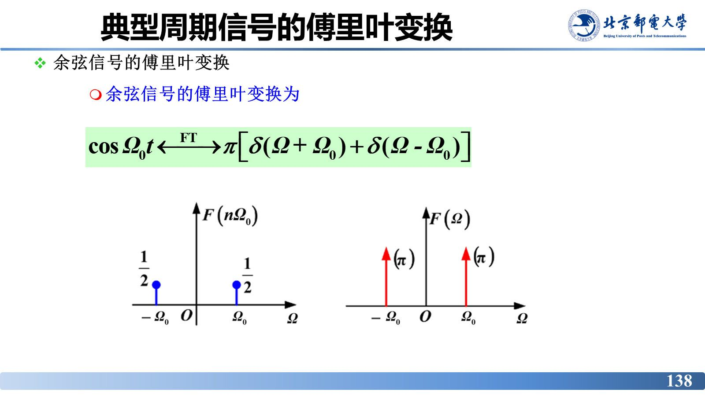
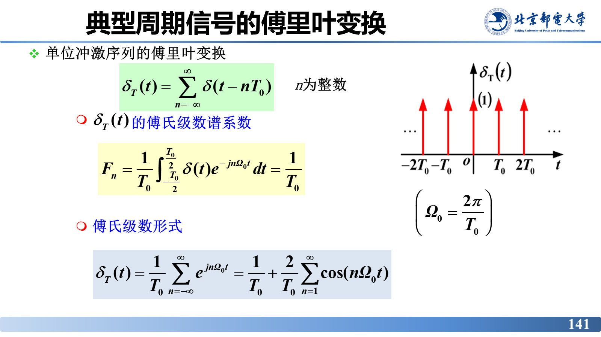
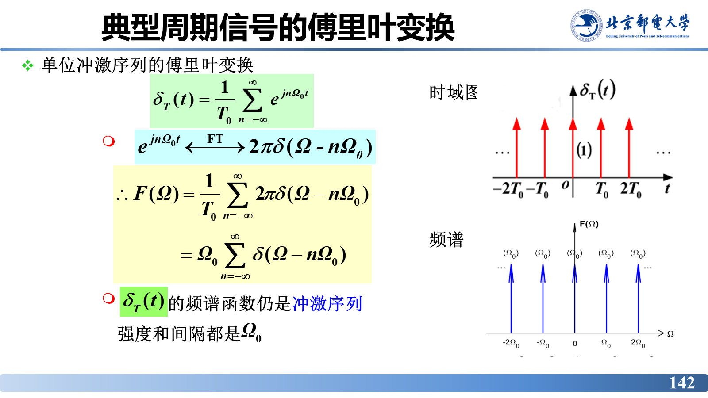
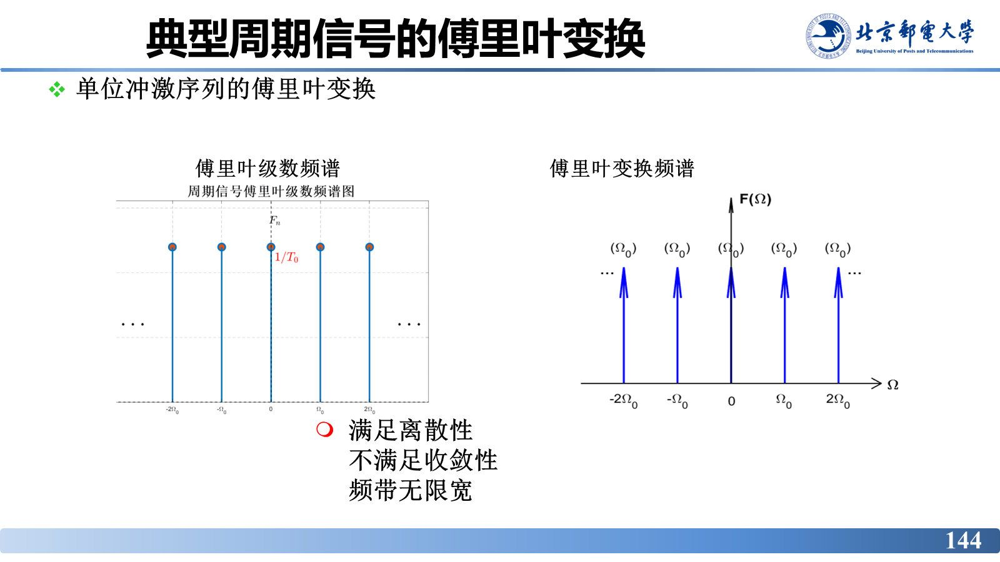
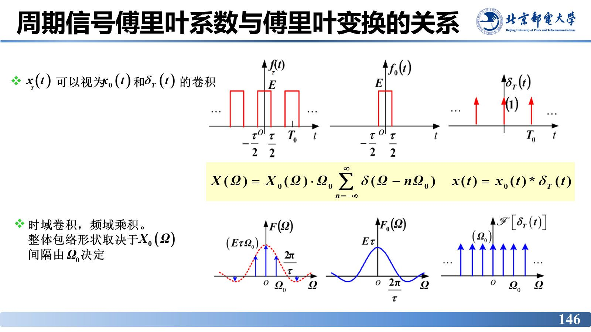
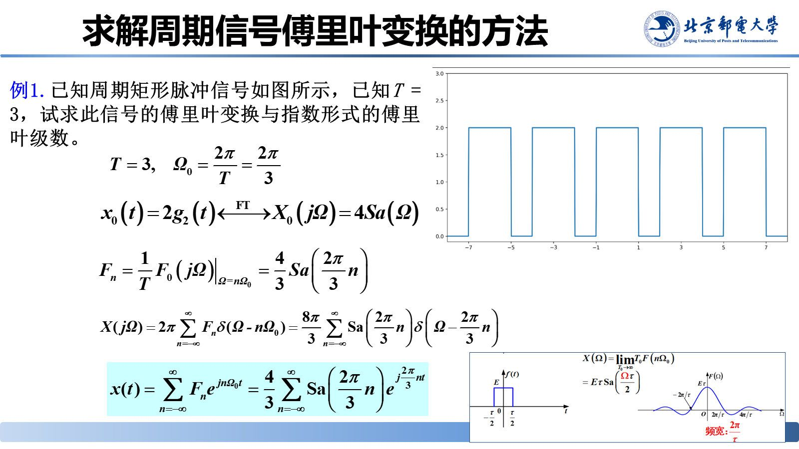
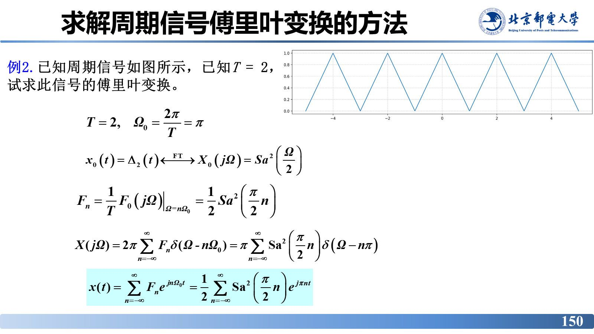

# 一般周期信号的傅里叶变换

> **来源**：《信号分析与处理》2.2节-20261007.pptx，第 132–152 页（共 152 页）
> **对应课件章节**：2.2.4 典型周期信号的傅里叶变换

前面把"周期信号用傅里叶级数（离散谱）"与"非周期信号用傅里叶变换（连续谱）"当两条路走。本章把两条路统一：**周期信号也可以做傅里叶变换**，只是其频谱密度由一串冲激组成。内容包括一般周期信号的变换公式、三个典型周期信号（余弦、正弦、单位冲激序列）的频谱、$F_n$ 与单脉冲频谱 $F_0(\mathrm{j}\Omega)$ 的关系，以及一条极实用的求解流程。

## 核心结论速查

| 名称 | 公式 |
|---|---|
| 一般周期信号的傅里叶变换 | $X(\Omega)=\mathrm{F}\left[x(t)\right]=2\pi\sum\limits_{n=-\infty}^{\infty}F_n\delta(\Omega-n\Omega_0)$，$\Omega_0=\dfrac{2\pi}{T}$ |
| 冲激位置 | $\Omega=n\Omega_0$（谐波频率处） |
| 冲激强度 | $2\pi F_n$，与 $F_n$ 成正比，由傅里叶系数决定 |
| 与单脉冲频谱的关系 | $F_n=\dfrac{1}{T}F_0(\mathrm{j}n\Omega_0)=\dfrac{1}{T}F_0(\mathrm{j}\Omega)\Big\rvert _{\Omega=n\Omega_0}$ |
| 等价形式 | $\mathrm{F}\left[f_T(t)\right]=\Omega_0\sum\limits_{n=-\infty}^{\infty}F_0(\mathrm{j}n\Omega_0)\delta(\Omega-n\Omega_0)$ |
| 时域卷积表示 | $x(t)=x_0(t)*\delta_T(t)=x_0(t)*\sum\limits_{n=-\infty}^{\infty}\delta(t-nT)$ |
| 余弦信号 | $\cos\Omega_0t\ \xleftrightarrow{\ \mathrm{FT}\ }\ \pi\left[\delta(\Omega+\Omega_0)+\delta(\Omega-\Omega_0)\right]$ |
| 正弦信号 | $\sin\Omega_0t\ \xleftrightarrow{\ \mathrm{FT}\ }-\mathrm{j}\pi\delta(\Omega-\Omega_0)+\mathrm{j}\pi\delta(\Omega+\Omega_0)$ |
| 单位冲激序列 | $\mathrm{F}\left[\delta_T(t)\right]=\Omega_0\sum\limits_{n=-\infty}^{\infty}\delta(\Omega-n\Omega_0)$ |

---

## 1. 统一的分析方法：周期信号也能做傅里叶变换

| 信号 | 频谱工具 | 谱型 |
|---|---|---|
| 周期信号 | 傅里叶级数 $F_n$ | 离散谱 |
| 非周期信号 | 傅里叶变换 $X(\Omega)$ | 连续谱 |

要回答两个问题：**周期信号的傅里叶变换如何求？与傅里叶级数的关系？** 答案是：$x(t)$（无论周期或非周期）统一采用**傅里叶变换分析法**——周期信号的频谱密度由**冲激序列**构成，冲激的位置与强度都由 $F_n$ 决定。

从有限长到周期：时域有限（单个脉冲）$\to$ 频谱连续；脉冲数量增加 $\to$ 频谱开始振荡；成为**周期脉冲序列**后 $\to$ 频谱**离散化**，仅含基频整数倍分量。

## 2. 一般周期信号的傅里叶变换

周期为 $T$ 的周期信号可展开为指数形式的傅里叶级数：

$$x(t)=\sum_{n=-\infty}^{\infty}F_n\mathrm{e}^{\mathrm{j}n\Omega_0 t}\qquad\left(T_0=\frac{2\pi}{\Omega_0}\right)$$

对它求傅里叶变换，由于 **$F_n$ 与 $t$ 无关**，可逐项求变换：

$$\mathrm{F}\left[x(t)\right]=\mathrm{F}\left[\sum_{n=-\infty}^{\infty}F_n\mathrm{e}^{\mathrm{j}n\Omega_0 t}\right]=\sum_{n=-\infty}^{\infty}F_n\mathrm{F}\left[\mathrm{e}^{\mathrm{j}n\Omega_0 t}\right]$$

用到两个基本变换对：

$$1\ \xleftrightarrow{\ \mathrm{FT}\ }\ 2\pi\delta(\Omega),\qquad \mathrm{e}^{\mathrm{j}n\Omega_0 t}\ \xleftrightarrow{\ \mathrm{FT}\ }\ 2\pi\delta(\Omega-n\Omega_0)$$

于是得到**一般周期信号的傅里叶变换**：

$$\mathrm{F}\left[x(t)\right]=2\pi\sum_{n=-\infty}^{\infty}F_n\delta(\Omega-n\Omega_0)\qquad\left(T_0=\frac{2\pi}{\Omega_0}\right)$$

### 频谱密度的结构

$$X(\Omega)=2\pi\sum_{n=-\infty}^{\infty}F_n\cdot\delta(\Omega-n\Omega_0)$$

- $x(t)$ 的频谱密度由**冲激序列**组成；
- **冲激位置**：$\Omega=n\Omega_0$（谐波频率处）；
- **冲激强度**：$2\pi F_n$，与 $F_n$ 成正比，由傅里叶系数决定。

**谱线幅度不是有限值**，因为 $X(\Omega)$ 是**频谱密度**：周期信号的 $X(\Omega)$ **只存在于 $\Omega=n\Omega_0$ 处**，频率范围无限小、幅度为 $\infty$。

## 3. 典型周期信号的傅里叶变换

### (1) 余弦信号的傅里叶变换

由欧拉公式 $\cos\Omega_0t=\dfrac{1}{2}\left(\mathrm{e}^{\mathrm{j}\Omega_0t}+\mathrm{e}^{-\mathrm{j}\Omega_0t}\right)$，已知 $1\leftrightarrow2\pi\delta(\Omega)$，由**频移性质**：

$$\cos\Omega_0t\ \xleftrightarrow{\ \mathrm{FT}\ }\ \pi\left[\delta(\Omega+\Omega_0)+\delta(\Omega-\Omega_0)\right]$$

对比两种谱的画法：傅里叶级数谱 $F(n\Omega_0)$ 在 $\pm\Omega_0$ 处高度为 $\dfrac{1}{2}$；傅里叶变换谱 $F(\Omega)$ 在 $\pm\Omega_0$ 处为强度 $\pi$ 的冲激——**同一信号，两种谱的"高度"物理量不同**（一个是谱系数，一个是谱密度×冲激强度）。

### (2) 正弦信号的傅里叶变换

由 $\sin\Omega_0t=\dfrac{1}{2\mathrm{j}}\left(\mathrm{e}^{\mathrm{j}\Omega_0t}-\mathrm{e}^{-\mathrm{j}\Omega_0t}\right)$，得

$$\sin\Omega_0t\ \xleftrightarrow{\ \mathrm{FT}\ }-\mathrm{j}\pi\delta(\Omega-\Omega_0)+\mathrm{j}\pi\delta(\Omega+\Omega_0)=\pi\mathrm{e}^{\mathrm{j}\frac{\pi}{2}}\delta(\Omega-\Omega_0)+\pi\mathrm{e}^{\mathrm{j}\frac{\pi}{2}}\delta(\Omega+\Omega_0)$$

**结论**：

- $\sin(\Omega_0t)$ 的**幅度频谱与 $\cos(\Omega_0t)$ 相同**（都是 $\pm\Omega_0$ 处强度 $\pi$ 的冲激）；
- **相位频谱不同**：正弦的相位谱在 $\Omega>0$ 处为 $-\dfrac{\pi}{2}$、$\Omega<0$ 处为 $+\dfrac{\pi}{2}$；余弦的相位谱为 $0$（或 $\pi$）。

> 课堂演示（slide 139，交互页）：改变正弦频率 $\Omega_0$，频谱上的两根冲激随之左右移动、幅度不变——**冲激位置由信号频率决定，强度与频率无关**。

### (3) 单位冲激序列的傅里叶变换

单位冲激序列 $\delta_T(t)=\sum\limits_{n=-\infty}^{\infty}\delta(t-nT_0)$（$n$ 为整数）的**傅氏级数谱系数**：

$$F_n=\frac{1}{T_0}\int_{-\frac{T_0}{2}}^{\frac{T_0}{2}}\delta(t)\mathrm{e}^{-\mathrm{j}n\Omega_0 t}\mathrm{d}t=\frac{1}{T_0}$$

**傅氏级数形式**：

$$\delta_T(t)=\frac{1}{T_0}\sum_{n=-\infty}^{\infty}\mathrm{e}^{\mathrm{j}n\Omega_0 t}=\frac{1}{T_0}+\frac{2}{T_0}\sum_{n=1}^{\infty}\cos(n\Omega_0 t)$$

**求傅里叶变换**：由 $\mathrm{e}^{\mathrm{j}n\Omega_0t}\leftrightarrow2\pi\delta(\Omega-n\Omega_0)$，

$$\therefore\ F(\Omega)=\frac{1}{T_0}\sum_{n=-\infty}^{\infty}2\pi\delta(\Omega-n\Omega_0)=\Omega_0\sum_{n=-\infty}^{\infty}\delta(\Omega-n\Omega_0)$$

**结论：$\delta_T(t)$ 的频谱函数仍是冲激序列，强度和间隔都是 $\Omega_0$**（时域、频域形式自相似，是傅里叶变换对偶性的典型例子）。

### 两种谱的对比（单位冲激序列）

| | 傅里叶级数频谱 | 傅里叶变换频谱 |
|---|---|---|
| 谱线形状 | 冲激序列 | 冲激序列 |
| 高度/强度 | $F_n=\dfrac{1}{T_0}$ | $\Omega_0=\dfrac{2\pi}{T_0}$ |
| 特征 | 满足离散性、**不满足收敛性**、频带无限宽 | 同左 |

> 课堂演示（slide 143，交互页）：改变周期冲激序列的间隔 $T_0$，频域冲激间隔 $\Omega_0=2\pi/T_0$ 随之反向变化——**时域间隔与频域间隔成反比**。

## 4. 本节重点：典型周期信号的傅里叶变换（slide 145）

三个典型周期信号的变换对见上文「核心结论速查」。**根据单脉冲傅里叶变换得到周期信号的傅里叶变换**：

$$x(t)=x_0(t)*\delta_T(t),\qquad X(\Omega)=X_0(\Omega)\cdot\Omega_0\sum_{n=-\infty}^{\infty}\delta(\Omega-n\Omega_0)$$

其中用到冲激函数的**搬移（筛选）性质**：

$$x(t)*\delta(t)=\int_{-\infty}^{\infty}x(\tau)\delta(t-\tau)\mathrm{d}\tau=x(t),\qquad x(t)*\delta(t-t_0)=\int_{-\infty}^{\infty}x(\tau)\delta(t-t_0-\tau)\mathrm{d}\tau=x(t-t_0)$$

> 课堂补充：**非周期信号 $f_0(t)$ 与冲激序列卷积可得到周期脉冲信号**——这是把周期信号看成"单脉冲的周期复制"的时域解释，也是下面 $F_n$ 与 $F_0(\mathrm{j}\Omega)$ 关系的来源。

## 5. 周期信号傅里叶系数与傅里叶变换的关系（slide 146–147）

### 时域卷积的视角

$x_T(t)$ 可视为 $x_0(t)$（第一个周期内的单脉冲）和 $\delta_T(t)$（周期冲激序列）的**卷积**：

$$x(t)=x_0(t)*\delta_T(t)=x_0(t)*\sum_{n=-\infty}^{\infty}\delta(t-nT)$$

由**时域卷积定理**（时域卷积，频域乘积）：

$$X(\Omega)=X_0(\Omega)\cdot\Omega_0\sum_{n=-\infty}^{\infty}\delta(\Omega-n\Omega_0)=\Omega_0\sum_{n=-\infty}^{\infty}F_0(\mathrm{j}n\Omega_0)\delta(\Omega-n\Omega_0)$$

**读图要点**：**整体包络形状取决于 $X_0(\Omega)$**（单脉冲的频谱）；**间隔由 $\Omega_0$ 决定**。

### 关系式的推导（slide 147）

$$X(\mathrm{j}\Omega)=X_0(\mathrm{j}\Omega)\cdot\Omega_0\sum_{n=-\infty}^{\infty}\delta(\Omega-n\Omega_0)=\Omega_0\sum_{n=-\infty}^{\infty}F_0(\mathrm{j}n\Omega_0)\delta(\Omega-n\Omega_0)$$

$$X(\mathrm{j}\Omega)=2\pi\sum_{n=-\infty}^{\infty}F_n\delta(\Omega-n\Omega_0)=\Omega_0\sum_{n=-\infty}^{\infty}F_0(\mathrm{j}n\Omega_0)\delta(\Omega-n\Omega_0)$$

比较冲激强度，$2\pi F_n=\Omega_0F_0(\mathrm{j}n\Omega_0)$，而 $\Omega_0=\dfrac{2\pi}{T}$，故

$$\boxed{\ F_n=\frac{1}{T}F_0(\mathrm{j}n\Omega_0)=\frac{1}{T}F_0(\mathrm{j}\Omega)\Big|_{\Omega=n\Omega_0}\ }$$

## 6. 求解周期信号傅里叶变换的方法（slide 148–150）

$$\mathrm{F}\left[f_T(t)\right]=2\pi\sum_{n=-\infty}^{\infty}F_n\delta(\Omega-n\Omega_0),\qquad\Omega_0=\frac{2\pi}{T},\qquad F_n=\frac{1}{T}F_0(\mathrm{j}n\Omega_0)=\frac{1}{T}F_0(\mathrm{j}\Omega)\Big|_{\Omega=n\Omega_0}$$

$$\mathrm{F}\left[f_T(t)\right]=\Omega_0\sum_{n=-\infty}^{\infty}F_0(\mathrm{j}n\Omega_0)\delta(\Omega-n\Omega_0),\qquad\Omega_0=\frac{2\pi}{T}$$

**四步法（slide 148）**：

1. **找**周期信号在第一个周期内的**单体** $f_0(t)$；
2. **求** $f_0(t)$ 对应的傅里叶变换 $F_0(\mathrm{j}\Omega)$；
3. 周期信号的**傅里叶系数**为 $F_n=\dfrac{1}{T}F_0(\mathrm{j}n\Omega_0)=\dfrac{1}{T}F_0(\mathrm{j}\Omega)\Big|_{\Omega=n\Omega_0}$；
4. 周期信号的**傅里叶变换** $\mathrm{F}\left[f_T(t)\right]=2\pi\sum\limits_{n=-\infty}^{\infty}F_n\delta(\Omega-n\Omega_0)$，$\Omega_0=\dfrac{2\pi}{T}$。

> 课堂补充（老师口述，解题最实用的两句话）：
> - 周期信号的频谱密度由冲激序列组成，冲激强度是傅里叶系数的 $2\pi$ 倍；
> - 周期信号的傅里叶系数 $F_n$ 等于单个周期信号频谱密度在 $n\Omega_0$ 处的**抽样值再乘 $\dfrac{1}{T}$**。
>
> 另一页备注强调：**先求非周期信号的频谱密度，再取样 $1/T$，得到傅里叶级数的系数 $F_n$**。

### 例 1：周期矩形脉冲信号的傅里叶变换与指数形式傅里叶级数（slide 149）

已知周期矩形脉冲信号（如下图），$T=3$，试求此信号的傅里叶变换与指数形式的傅里叶级数。

$$T=3,\qquad\Omega_0=\frac{2\pi}{T}=\frac{2\pi}{3}$$

单脉冲与它的变换：

$$x_0(t)=2g_2(t)\ \xleftrightarrow{\ \mathrm{FT}\ }\ X_0(\mathrm{j}\Omega)=4\,\mathrm{Sa}(\Omega)$$

傅里叶系数：

$$F_n=\frac{1}{T}F_0(\mathrm{j}\Omega)\Big|_{\Omega=n\Omega_0}=\frac{4}{3}\mathrm{Sa}\!\left(\frac{2\pi}{3}n\right)$$

傅里叶变换：

$$X(\mathrm{j}\Omega)=2\pi\sum_{n=-\infty}^{\infty}F_n\delta(\Omega-n\Omega_0)=\frac{8\pi}{3}\sum_{n=-\infty}^{\infty}\mathrm{Sa}\!\left(\frac{2\pi}{3}n\right)\delta\!\left(\Omega-\frac{2\pi}{3}n\right)$$

指数形式傅里叶级数：

$$x(t)=\sum_{n=-\infty}^{\infty}F_n\mathrm{e}^{\mathrm{j}n\Omega_0t}=\frac{4}{3}\sum_{n=-\infty}^{\infty}\mathrm{Sa}\!\left(\frac{2\pi}{3}n\right)\mathrm{e}^{\mathrm{j}\frac{2\pi}{3}nt}$$

> 符号说明：课件在本例中把单脉冲写作 $x_0(t)=2g_2(t)$，并直接给出 $X_0(\mathrm{j}\Omega)=4\,\mathrm{Sa}(\Omega)$（$g_2$ 为课件记号下的门函数）。记公式时以课件原式的数值关系为准，不必替换成别的记法。
>
> **本版新增**：该页除周期波形图外，还补了一张推导过程公式图（旧版没有），逐步给出从 $X_0(\mathrm{j}\Omega)$ 到 $F_n$、再到 $X(\mathrm{j}\Omega)$ 的代入过程，看渲染图时可对照。

### 例 2：周期三角信号的傅里叶变换（slide 150）

已知周期信号如图所示（三角波），$T=2$，试求此信号的傅里叶变换。

$$T=2,\qquad\Omega_0=\frac{2\pi}{T}=\pi$$

单脉冲与它的变换：

$$x_0(t)=\Delta_2(t)\ \xleftrightarrow{\ \mathrm{FT}\ }\ X_0(\mathrm{j}\Omega)=\mathrm{Sa}^2\!\left(\frac{\Omega}{2}\right)$$

傅里叶系数：

$$F_n=\frac{1}{T}F_0(\mathrm{j}\Omega)\Big|_{\Omega=n\Omega_0}=\frac{1}{2}\mathrm{Sa}^2\!\left(\frac{\pi}{2}n\right)$$

傅里叶变换：

$$X(\mathrm{j}\Omega)=2\pi\sum_{n=-\infty}^{\infty}F_n\delta(\Omega-n\Omega_0)=\pi\sum_{n=-\infty}^{\infty}\mathrm{Sa}^2\!\left(\frac{\pi}{2}n\right)\delta(\Omega-n\pi)$$

指数形式傅里叶级数：

$$x(t)=\sum_{n=-\infty}^{\infty}F_n\mathrm{e}^{\mathrm{j}n\Omega_0t}=\frac{1}{2}\sum_{n=-\infty}^{\infty}\mathrm{Sa}^2\!\left(\frac{\pi}{2}n\right)\mathrm{e}^{\mathrm{j}\pi nt}$$

## 7. 本节总结（slide 151–152）

- **离散谱**，仅含基频 $\Omega_0=\dfrac{2\pi}{T}$ 的**整数倍分量**；
- 傅里叶变换公式：$X(\Omega)=2\pi\sum\limits_{n=-\infty}^{\infty}F_n\delta(\Omega-n\Omega_0)$。

（slide 151「本节重点」再列一次 $\mathrm{F}[\cos]$、$\mathrm{F}[\sin]$、$\mathrm{F}[\delta_T]$ 三个变换对与"单脉冲卷积冲激序列"的思路；slide 152 为结束页。）

---

## 易错点与考点提示

- 周期信号的 $X(\Omega)$ 是**频谱密度**，谱线是冲激，其"高度"是冲激**强度** $2\pi F_n$，不是有限幅度——不要把 $2\pi F_n$ 当成有限高度的谱线再讨论"收敛性"。
- $F_n=\dfrac{1}{T}F_0(\mathrm{j}n\Omega_0)$ 的因子是 $\dfrac{1}{T}$（不是 $2\pi$、也不是 $\dfrac{1}{2\pi}$）；$\mathrm{F}[f_T(t)]$ 前的因子才是 $2\pi$。这两个系数最易写错。
- 比较 $\cos$ 与 $\sin$：**幅度谱相同、相位谱相差 $\pi/2$**。"两者频谱差在哪里"要答相位。
- 单脉冲 $x_0(t)$ 的取法会影响 $F_0(\mathrm{j}\Omega)$ 的表达式，但 $F_n$ 的结果唯一——只要 $x_0(t)$ 恰好是 $f_T(t)$ 在一个周期内的波形即可。
- 冲激序列时域与频域形式自相似（间隔 $T_0$ / $\Omega_0$、强度 $1$ 或 $\Omega_0$），是傅里叶变换**对偶性**的经典例子，常出现在概念题中。

## 自测

1. 写出周期信号 $x(t)$ 的傅里叶变换表达式，并说明冲激的位置与强度分别由什么决定。
2. 已知单脉冲 $f_0(t)$ 的频谱 $F_0(\mathrm{j}\Omega)$，写出周期复制后信号 $f_T(t)$ 的傅里叶系数 $F_n$。
3. $\cos\Omega_0t$ 与 $\sin\Omega_0t$ 的频谱在幅度谱和相位谱上分别有什么异同？
4. 用四步法求一个周期方波的傅里叶变换，第一步要做什么？

参考答案

1. $X(\Omega)=2\pi\sum\limits_{n=-\infty}^{\infty}F_n\delta(\Omega-n\Omega_0)$，$\Omega_0=\dfrac{2\pi}{T}$；冲激位于谐波频率 $\Omega=n\Omega_0$ 处，强度为 $2\pi F_n$，由 $F_n$ 决定。
2. $F_n=\dfrac{1}{T}F_0(\mathrm{j}n\Omega_0)=\dfrac{1}{T}F_0(\mathrm{j}\Omega)\Big|_{\Omega=n\Omega_0}$。
3. 幅度谱相同：都在 $\pm\Omega_0$ 处有强度 $\pi$ 的冲激；相位谱不同：$\cos$ 的相位为 $0$（或 $\pi$），$\sin$ 的相位在 $\Omega>0$ 处为 $-\pi/2$、$\Omega<0$ 处为 $+\pi/2$。
4. 先**找出该周期信号在第一个周期内的单体** $f_0(t)$（截出一个周期的波形），再求它的傅里叶变换 $F_0(\mathrm{j}\Omega)$。

