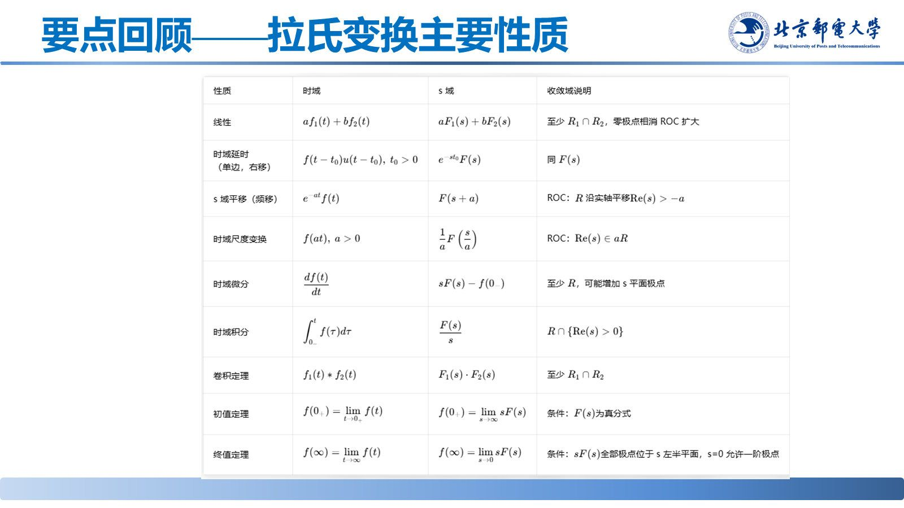
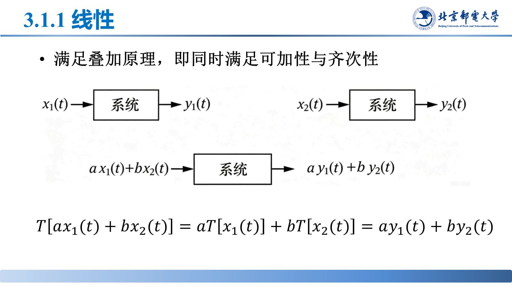

# 要点回顾与系统特性

> **来源**：《信号分析与处理》第3章-20261020.pptx，第 1–23 页（共 145 页）
> **对应课件章节**：3.1 连续时间系统的特性（线性、时不变性、因果性、稳定性）

先回顾拉氏变换的常用变换对与本章要用的性质，再给出四大特性的判别式——三条分析路线都以"线性时不变、因果稳定"为前提。

## 核心结论速查

| 特性 | 判据 | 一句话 |
|---|---|---|
| 线性 | $T[ax_1+bx_2]=aT[x_1]+bT[x_2]=ay_1+by_2$ | 同时满足**可加性与齐次性**（叠加原理） |
| 时不变 | $T[x(t-t_0)]=y(t-t_0)$ | 参数不随时间变；激励时延 → 响应同样时延、波形不变 |
| 因果 | $x(t)=0\ (t<t_0)\Rightarrow y(t)=0\ (t<t_0)$ | 输出只依赖当前与过去的输入 |
| 稳定 | $\lvert x(t)\rvert<\infty\Rightarrow\lvert y(t)\rvert<\infty$ | 有界输入 → 有界输出（BIBO） |

系统即算子 $y(t)=T[x(t)]$。四个特性**各自独立**：线性系统可以时变，时不变系统也可以非线性。

## 一、拉氏变换要点回顾

本章实际用到**线性、时移、时域微分、时域卷积**四条性质。

| 信号 | 拉氏变换 | 收敛域 |
|---|---|---|
| $\delta(t)$ | $1$ | 全 $s$ 平面 |
| $u(t)$ | $\frac{1}{s}$ | $\mathrm{Re}[s]>0$ |
| $e^{-at}u(t)$ | $\frac{1}{s+a}$ | $\mathrm{Re}[s]>-a$ |
| $\sin(\Omega_0t)u(t)$ | $\frac{\Omega_0}{s^2+\Omega_0^2}$ | $\mathrm{Re}[s]>0$ |
| $\cos(\Omega_0t)u(t)$ | $\frac{s}{s^2+\Omega_0^2}$ | $\mathrm{Re}[s]>0$ |

## 二、线性

满足叠加原理，即同时满足可加性与齐次性：

$$T[x_1(t)+x_2(t)]=y_1(t)+y_2(t),\qquad T[ax(t)]=ay(t)$$

合写：$T[ax_1(t)+bx_2(t)]=ay_1(t)+by_2(t)$（$a,b$ 为常数）。

- $y(t)=2x(t)$ ⇒ **线性**；$y(t)=x^2(t)$ 展开多出交叉项 $2abx_1x_2$ ⇒ **非线性**。

## 三、时不变性

系统参数不随时间变化，激励的时延导致响应的相同时延、波形不变：$T[x(t-t_0)]=y(t-t_0)$。等价说法：先时移再入系统，与先入系统再时移输出，结果相同。判别时把 $t$ 换成 $t-t_0$，看输出中**所有** $t$ 是否同步替换。

- 微分器 $y=\frac{dx}{dt}$：$T[x(t-t_0)]=\frac{dx(t-t_0)}{d(t-t_0)}=y(t-t_0)$ ⇒ 线性且时不变；
- $y(t)=tx(t)$：$T[x(t-t_0)]=t\,x(t-t_0)$ 而 $y(t-t_0)=(t-t_0)x(t-t_0)$，不等 ⇒ **时变**。

## 四、因果性

输出只依赖当前和过去的输入。判据：若 $x(t)=0\ (t<t_0)$，则 $y(t)=0\ (t<t_0)$（一般取 $t_0=0$）。

- $y_1(t)=x_1(t-1)$ 只用过去输入 ⇒ 因果；$y_2(t)=x_2(t)+x_2(t+1)$ 用了未来输入 ⇒ 非因果。

## 五、稳定性

输入有界 $\lvert x(t)\rvert<\infty$ 时输出也有界 $\lvert y(t)\rvert<\infty$（BIBO）。

反例：$y(t)=\int_0^tx(\upsilon)d\upsilon$，取有界 $x(t)=u(t)$ 得 $y(t)=t$，$t\to\infty$ 时无界 ⇒ 不稳定。

由 $h(t)$ 判因果与稳定的充要条件见 [05-冲激响应判断因果稳定性.md](05-冲激响应判断因果稳定性.md)。

## 易错点与考点提示

- 线性 = 可加性 + 齐次性，**缺一不可**；只验一半不算线性。
- 判线性要一次性代入 $ax_1+bx_2$：$x^2(t)$ 的交叉项 $2abx_1x_2$ 就是非线性的证据。
- 线性与时不变相互独立：$y=tx(t)$ 线性但时变，$y=x^2(t)$ 非线性但时不变。
- 因果看输入的时间变量：出现 $t+t_0\ (t_0>0)$ 就是用了未来输入。
- 稳定指"有界输入 → 有界输出"，与"响应最终是否衰减到 0"是两个概念。