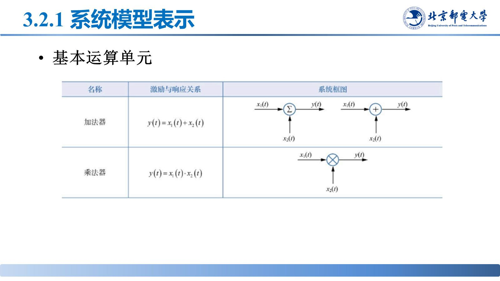
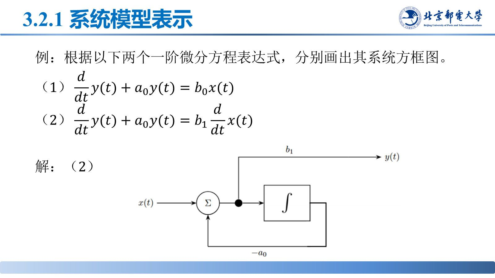
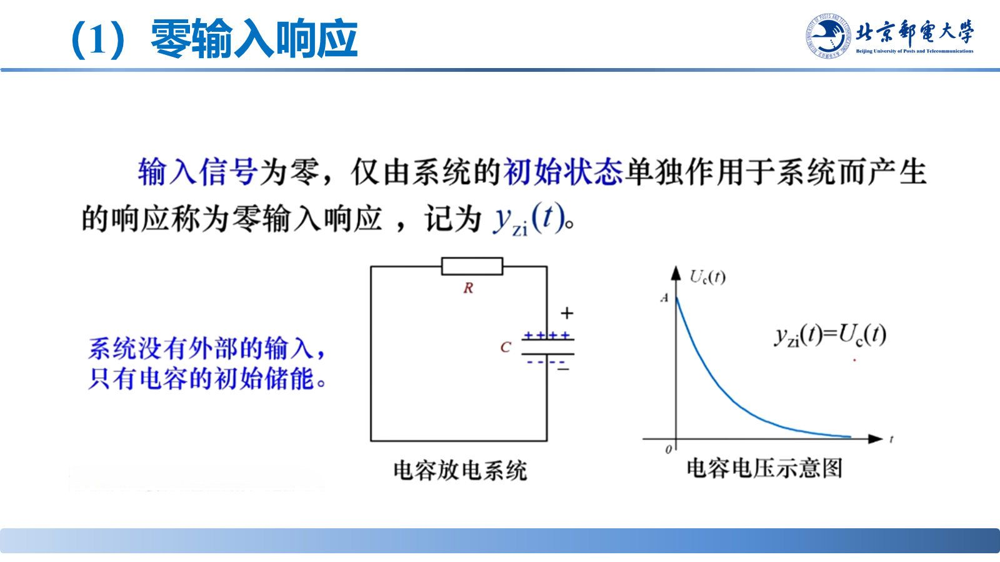
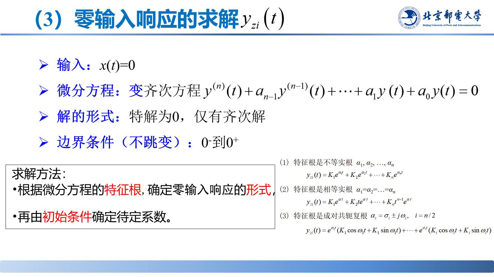

# 系统模型与微分方程求解

> **来源**：《信号分析与处理》第3章-20261020.pptx，第 24–39 页（共 145 页）
> **对应课件章节**：3.2.1 系统模型表示、3.2.2 系统微分方程的建立与求解

连续 LTI 系统的时域模型是线性常系数微分方程；求解时把完全响应拆成零输入响应与零状态响应，分别对应齐次解与卷积。

## 核心结论速查

| 内容 | 结论 |
|---|---|
| 系统模型 | $n$ 阶线性常系数微分方程（或等价的方框图、信号流图） |
| 完全响应 | $y(t)=y_{zi}(t)+y_{zs}(t)$ |
| 零输入响应 | 输入 $x(t)=0$，由初始状态引起，对应**齐次解** |
| 零状态响应 | 初始状态为零，由输入引起，对应**特解**，用卷积求 |

## 一、系统模型表示

连续系统用三种**基本运算单元**搭成方框图：加法器、数乘器（比例 $a$）、积分器（$\frac{1}{s}$）；微分器一般不用，改用积分器实现。

$n$ 阶线性常系数微分方程（$a_n\ne0$），及其简记：

$$\sum_{i=0}^{n}a_i\frac{d^iy(t)}{dt^i}=\sum_{j=0}^{m}b_j\frac{d^jx(t)}{dt^j}\quad\Longleftrightarrow\quad\sum_{i=0}^{n}a_iy^{(i)}(t)=\sum_{j=0}^{m}b_jx^{(j)}(t)$$

**建方程**：对电路用基尔霍夫定律（KVL/KCL）与元件约束列方程，选电容电压、电感电流为状态量，消去中间变量后整理成"输出在左、输入在右"的标准形式。微分方程、方框图、信号流图三者等价。

## 二、完全响应 = 零输入响应 + 零状态响应

$$y(t)=y_{zi}(t)+y_{zs}(t)$$

- $y_{zi}(t)$：只由初始状态决定，与激励无关，形式为齐次解；
- $y_{zs}(t)$：只由激励决定，初始状态取零，形式由激励决定（特解）。

依据是**线性**：两者各自满足叠加原理，可分开求再相加。

## 三、零输入响应的求解

令 $x(t)=0$，方程退化为齐次方程 $\sum_{i=0}^{n}a_iy^{(i)}=0$。

**步骤**：① 特征方程 $\sum_{i=0}^{n}a_i\alpha^i=0$，求特征根 $\alpha_i$；② 按根型写齐次解；③ 用初始条件定系数。

| 特征根 | 齐次解 |
|---|---|
| 互异实根 $\alpha_i$ | $\sum_{i=1}^{n}A_ie^{\alpha_it}$ |
| 共轭复根 $\sigma\pm j\Omega$ | $e^{\sigma t}\left(A\cos\Omega t+B\sin\Omega t\right)$ |
| $r$ 重根 $\alpha$ | $\left(A_0+A_1t+\cdots+A_{r-1}t^{r-1}\right)e^{\alpha t}$ |

输入为零时状态不跳变，用 $t=0_-$ 的初始值定系数：$y_{zi}^{(k)}(0_-)=y^{(k)}(0_-)$，$k=0,1,\cdots,n-1$。

## 四、零状态响应的求解

初始状态为零，只由输入引起；直接求解繁琐，用**卷积法**：

$$y_{zs}(t)=x(t)*h(t)=\int_{-\infty}^{\infty}x(\upsilon)h(t-\upsilon)d\upsilon$$

$h(t)$ 为冲激响应（见 [03-冲激响应与阶跃响应.md](03-冲激响应与阶跃响应.md)）。若已知阶跃响应 $g(t)$，则激励为 $u(t-t_0)$ 时 $y_{zs}(t)=g(t-t_0)$。

## 五、用线性性质求响应

- 激励变为 $x(t-t_0)$、初始条件不变：$y_3(t)=y_{zi}(t)+y_{zs}(t-t_0)$；
- 初始状态加倍、激励变为 $0.5x(t)$：$y_4(t)=2y_{zi}(t)+0.5y_{zs}(t)$。

即**初始状态只缩放零输入响应、激励只缩放零状态响应，时移只作用于零状态响应**。

## 易错点与考点提示

- 零输入响应不是"输入为零时的全响应"，它只由初始状态决定。
- 求零状态响应必须把初始状态置零，不能沿用原有初始条件。
- 特征根为共轭复根时，齐次解写成 $e^{\sigma t}(A\cos\Omega t+B\sin\Omega t)$，不要保留复数指数。
- "完全响应 = 零输入 + 零状态"只对线性系统成立。
