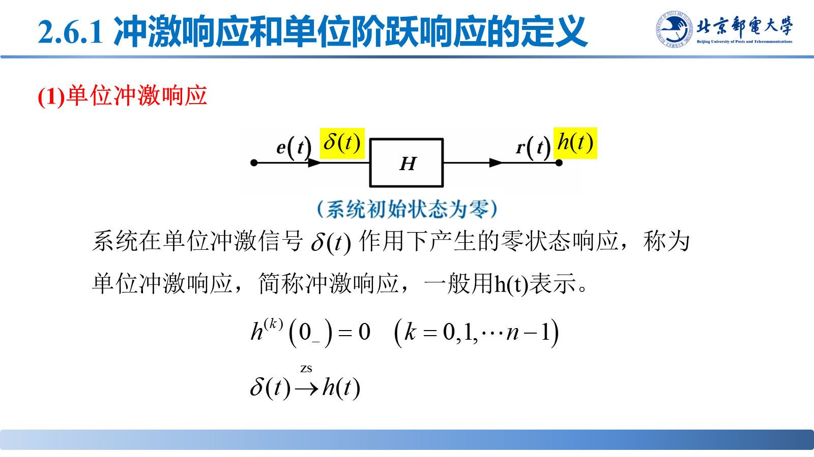

# 冲激响应与阶跃响应

> **来源**：《信号分析与处理》第3章-20261020.pptx，第 40–49 页（共 145 页）
> **对应课件章节**：3.2.3 系统的冲激响应与阶跃响应

$h(t)$ 是 LTI 系统最核心的时域描述：它既是系统对 $\delta(t)$ 的零状态响应，也是把任意输入映射为输出的卷积核。

## 核心结论速查

| 量 | 定义 | 相互关系 |
|---|---|---|
| 冲激响应 $h(t)$ | 输入 $x(t)=\delta(t)$ 时的**零状态**响应 | $h(t)=\frac{dg(t)}{dt}$ |
| 阶跃响应 $g(t)$ | 输入 $x(t)=u(t)$ 时的**零状态**响应 | $g(t)=\int_{-\infty}^{t}h(\upsilon)d\upsilon$ |

两者都是零状态响应（初始状态为零），且只要知道其中一个就能求出另一个。

## 一、典型系统的冲激响应

| 系统 | $h(t)$ | 说明 |
|---|---|---|
| 放大器（数乘） | $a\delta(t)$ | 输出 $=ax(t)$ |
| 微分器 | $\delta'(t)$ | 输出 $=\frac{dx(t)}{dt}$ |
| 积分器 | $u(t)$ | 输出 $=\int_{-\infty}^{t}x(\upsilon)d\upsilon$ |
| 延时器 | $\delta(t-\upsilon)$ | 输出 $=x(t-\upsilon)$ |

## 二、由微分方程求 $h(t)$

令 $x(t)=\delta(t)$、$y(t)=h(t)$，代入系统微分方程：

$$\sum_{i=0}^{n}a_i\frac{d^ih(t)}{dt^i}=\sum_{j=0}^{m}b_j\frac{d^j\delta(t)}{dt^j}$$

按 $n$ 与 $m$ 的大小分两种情形：

- **$n>m$**：$h(t)$ 中不含冲激项，只有齐次解形式
$$h(t)=\left(\sum_{i=1}^{n}A_ie^{\alpha_it}\right)u(t)$$
- **$n\le m$**：$h(t)$ 中还要加上 $\delta(t)$ 及其各阶导数
$$h(t)=\left(\sum_{i=1}^{n}A_ie^{\alpha_it}\right)u(t)+\sum_{j=0}^{m-n}B_j\delta^{(j)}(t)$$

**求法**：把 $h(t)$ 的通解形式代入方程，比较两端 $\delta(t)$ 及各阶导数的系数，解出 $A_i$（$n\le m$ 时同时解出 $B_j$）。

$h(t)$ 也可由系统函数反变换得到：$h(t)=\mathscr{L}^{-1}\{H(s)\}$（见 [07-复频域分析与系统函数.md](07-复频域分析与系统函数.md)）。

## 三、阶跃响应

$$g(t)=\int_{-\infty}^{t}h(\upsilon)d\upsilon,\qquad h(t)=\frac{dg(t)}{dt}$$

**方向**：对 $g(t)$ 求导得 $h(t)$；对 $h(t)$ 积分得 $g(t)$。若 $h(t)$ 含冲激项，则 $g(t)$ 中相应出现阶跃项。

## 易错点与考点提示

- $h(t)$、$g(t)$ 都是**零状态**响应，初始状态必须为零。
- 关系方向别反：$h(t)=\frac{dg(t)}{dt}$，不是 $\frac{dh}{dt}=g$。
- 代入法求 $A_i$ 时要比较 $\delta$ 的所有阶次（含 $\delta''$），不能只看 $\delta(t)$ 一项。
