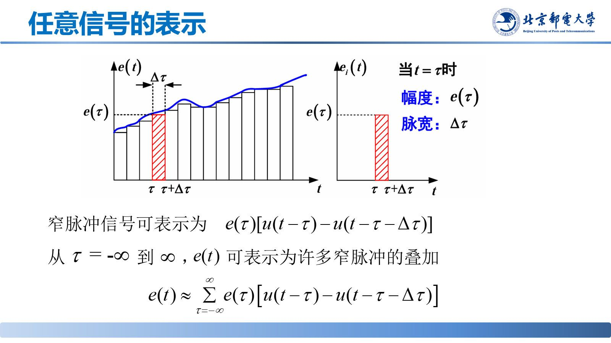
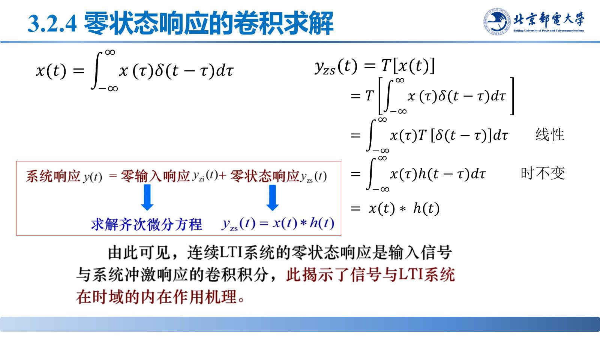

# 零状态响应的卷积求解

> **来源**：《信号分析与处理》第3章-20261020.pptx，第 50–58 页（共 145 页）
> **对应课件章节**：3.2.4 零状态响应的卷积求解

任意输入都能拆成冲激的加权叠加，LTI 系统对每个冲激的响应又是 $h(t)$，叠加即得卷积——这是时域分析的主线结论。

## 核心结论速查

| 内容 | 关系式 |
|---|---|
| 任意信号的冲激分解 | $x(t)=\int_{-\infty}^{\infty}x(\upsilon)\delta(t-\upsilon)d\upsilon$ |
| 零状态响应 | $y_{zs}(t)=x(t)*h(t)=\int_{-\infty}^{\infty}x(\upsilon)h(t-\upsilon)d\upsilon$ |
| 成立条件 | 系统**线性** + **时不变**（LTI） |

## 一、求解思路（三步）

1. 把输入表示为单位冲激信号的线性组合：$x(t)=\int_{-\infty}^{\infty}x(\upsilon)\delta(t-\upsilon)d\upsilon$；
2. 求 $\delta(t)$ 的零状态响应 $h(t)$，由**时不变性**得 $\delta(t-\upsilon)\to h(t-\upsilon)$；
3. 由**线性**叠加得 $y_{zs}(t)=\int_{-\infty}^{\infty}x(\upsilon)h(t-\upsilon)d\upsilon=x(t)*h(t)$。

推导中"线性"与"时不变"各用一次，缺一不可。

## 二、直接可用的三种情形

| 激励 | 零状态响应 |
|---|---|
| $\delta(t-t_0)$ | $h(t-t_0)$ |
| $u(t-t_0)$ | $g(t-t_0)$ |
| 一般 $x(t)$ | $x(t)*h(t)$ |

即激励的时移原样传给响应；已知 $h(t)$ 或 $g(t)$ 就能免解微分方程直接得响应。

## 三、卷积结果的典型形态

两个有限时宽矩形脉冲卷积，结果是分段线性的**梯形**（两者等宽时退化为三角形），卷积时宽 = 两信号时宽之和。分段点由两个脉冲的端点相遇时刻确定。

> 课堂补充：CNN 里的"卷积"不翻转、滑动求和提特征，与这里的卷积数学本质不同，只是名字相同。

## 易错点与考点提示

- 卷积法只求**零状态**响应；含初始状态的部分要另算零输入响应再相加。
- 积分变量是 $\upsilon$、$t$ 是参变量，别把 $h(t-\upsilon)$ 写成 $h(t)$。
- 前提是 LTI：只有线性或只有时不变都不足以得出 $y_{zs}=x*h$。
- 卷积的计算（解析式法、图解法）见 2.1 节笔记，本节只记结论式。
