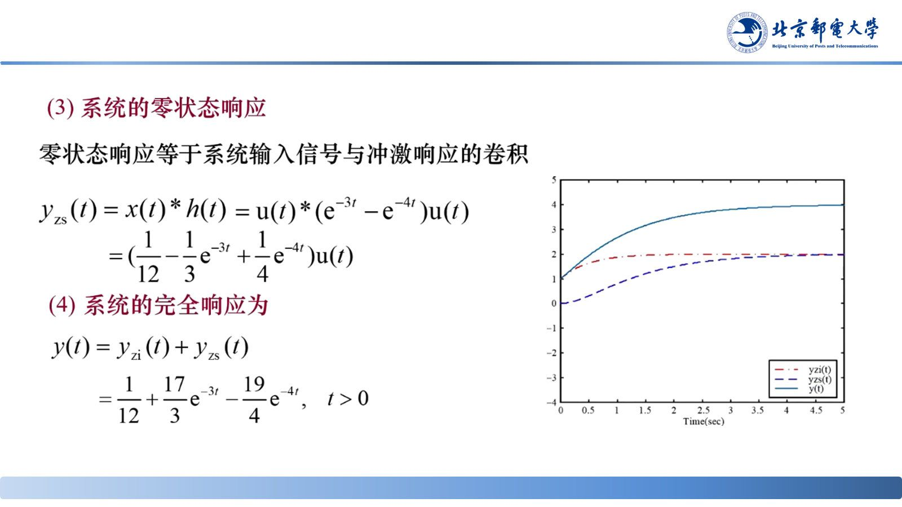

# 冲激响应判断因果稳定性

> **来源**：《信号分析与处理》第3章-20261020.pptx，第 59–66 页（共 145 页）
> **对应课件章节**：3.2.5 冲激响应判断系统的因果稳定性

系统的因果性与稳定性都可直接由 $h(t)$ 判定，不必解微分方程——这两条充要条件是本章最常考的结论。

## 核心结论速查

| 特性 | 充要条件 |
|---|---|
| 因果系统 | $h(t)=0,\quad t<0$ |
| 稳定系统 | $\int_{-\infty}^{\infty}\lvert h(t)\rvert dt<\infty$（绝对可积） |

## 一、因果性的判据

**定义**：输出只依赖当前和过去的输入。**充要条件**：$h(t)=0\ (t<0)$——冲激作用之前不能有响应。

课件给出两种判断法：

1. **定义判断法**：看输出是否用了未来时刻的输入；
2. **单位冲激响应判断法**：看 $h(t)$ 在 $t<0$ 是否恒为零。

**例**：$y_1(t)=x_1(t-1)$ 的 $h_1(t)=\delta(t-1)$，$t<0$ 时为零 ⇒ 因果；$y_2(t)=x_2(t+1)$ 的 $h_2(t)=\delta(t+1)$，$t<0$ 时不为零 ⇒ 非因果。

## 二、稳定性的判据

**定义**（BIBO）：有界输入产生有界输出。**充要条件**：$h(t)$ 绝对可积

$$\int_{-\infty}^{\infty}\lvert h(t)\rvert dt<\infty$$

**例**：$h(t)=e^{-t}u(t)$，$\int_0^{\infty}e^{-t}dt=1<\infty$ ⇒ 稳定。

**反例**：积分器 $h(t)=u(t)$，$\int_0^{\infty}dt$ 发散 ⇒ 不稳定。

## 三、时域分析的完整链条

1. 由物理系统建立线性常系数微分方程；
2. 分别求零输入响应（特征方程 → 齐次解 → 初始条件定系数）与零状态响应（$h(t)$ 与卷积）；
3. 全响应 $y=y_{zi}+y_{zs}$，并由 $h(t)$ 判因果性（$t<0$ 是否为零）与稳定性（是否绝对可积）。

四种时域描述（微分方程、$h(t)$、$g(t)$、卷积关系）彼此等价，可任选最方便的一种。

> 课堂补充：$y_{zi}$ 由系统本身特性决定、与激励形式无关，对应齐次解；$y_{zs}$ 的形式取决于外加激励，对应特解。$t\to\infty$ 时趋于 0 的分量是暂态分量，保留下来的分量是稳态分量。

## 易错点与考点提示

- 因果看 $h(t)$ 在 $t<0$ 是否**恒为零**，不是看系统有没有延迟环节。
- 稳定看 $\int\lvert h(t)\rvert dt$ 是否有限，**绝对值不能丢**（否则符号相消会误判稳定）。
- 因果与稳定相互独立：因果系统可能不稳定，稳定系统也可能非因果，两条判据要分开验。
- 冲激响应判断法要求 $h(t)$ 已经求出；若只给了微分方程，先求 $h(t)$ 或直接用 $H(s)$ 的极点判稳定（见 07）。
