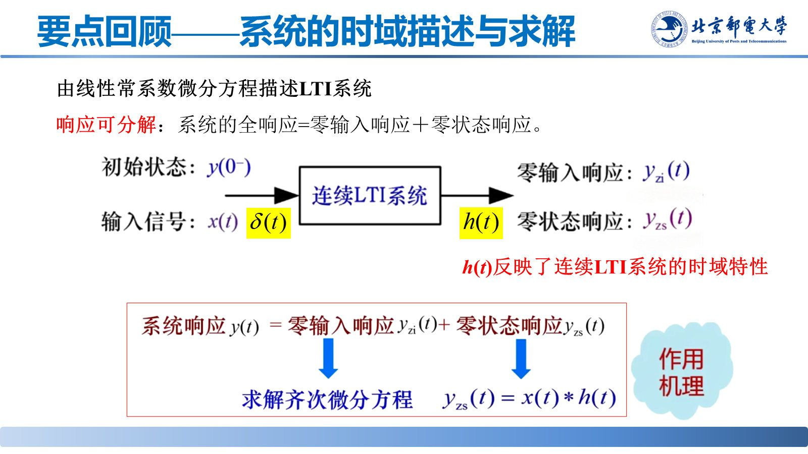
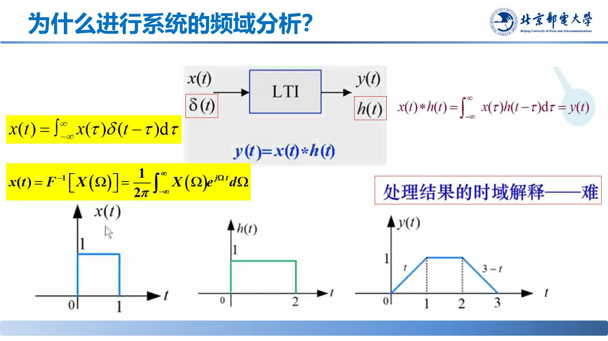

# 频域分析

> **来源**：《信号分析与处理》第3章-20261020.pptx，第 67–85 页（共 145 页）
> **对应课件章节**：3.3 连续线性时不变系统的频域分析（3.3.1 系统的频率响应、3.3.2 频域分析法）

时域卷积在频域变成乘积——把输入、输出都换到频域，系统只由一个复函数 $H(j\Omega)$ 描述，求响应只需乘法和一次反变换。

## 核心结论速查

| 关系 | 公式 |
|---|---|
| 频率响应 | $H(j\Omega)=\int_{-\infty}^{+\infty}h(t)e^{-j\Omega t}dt=\mathscr{F}[h(t)]$ |
| 输出谱 | $Y_{zs}(j\Omega)=X(j\Omega)\cdot H(j\Omega)$ |
| 系统函数 | $H(j\Omega)=\frac{Y_{zs}(j\Omega)}{X(j\Omega)}$ |
| 由微分方程 | $H(j\Omega)=\dfrac{\sum_{k=0}^{m}b_k(j\Omega)^k}{\sum_{k=0}^{n}a_k(j\Omega)^k}$ |

## 一、系统的频率响应 $H(j\Omega)$

**定义**：虚指数信号 $x(t)=e^{j\Omega t}$ 通过稳定的连续 LTI 系统，输出仍为同频率的虚指数信号，只被乘上一个复常数：

$$y_{zs}(t)=e^{j\Omega t}*h(t)=e^{j\Omega t}H(j\Omega),\qquad H(j\Omega)=\int_{-\infty}^{+\infty}h(t)e^{-j\Omega t}dt=\mathscr{F}[h(t)]$$

即**频率响应就是冲激响应的傅里叶变换**，反映系统对不同频率信号的传输特性。

**幅频与相频**：$H(j\Omega)=\lvert H(j\Omega)\rvert e^{j\chi(\Omega)}$，其中幅频特性 $\lvert H(j\Omega)\rvert$ 是 $\Omega$ 的**偶函数**，相频特性 $\chi(\Omega)$ 是 $\Omega$ 的**奇函数**。输出满足

$$\lvert Y(j\Omega)\rvert=\lvert X(j\Omega)\rvert\cdot\lvert H(j\Omega)\rvert,\qquad \chi_y(\Omega)=\chi_x(\Omega)+\chi(\Omega)$$

## 二、正弦稳态响应

$$\cos(\Omega_0t)\ \to\ \lvert H(j\Omega_0)\rvert\cos\left[\Omega_0t+\chi(\Omega_0)\right]$$

$$\sin(\Omega_0t)\ \to\ \lvert H(j\Omega_0)\rvert\sin\left[\Omega_0t+\chi(\Omega_0)\right]$$

即**幅度乘 $\lvert H(j\Omega_0)\rvert$、相位加 $\chi(\Omega_0)$**。例：$H(j\Omega)=\frac{1}{1+j\Omega}$，输入 $\sin t$、$\sin 2t$ 时输出为 $\frac{1}{2}\sin(t-45^{\circ})$、$\frac{1}{5}\sin(2t-63^{\circ})$。

## 三、频域分析法

**三步**：① 求 $H(j\Omega)$；② $Y_{zs}(j\Omega)=X(j\Omega)H(j\Omega)$；③ 反变换 $y_{zs}(t)=\mathscr{F}^{-1}\{Y_{zs}(j\Omega)\}$。

**由微分方程求 $H(j\Omega)$**：两端取傅里叶变换，时域第 $k$ 阶导数对应乘 $(j\Omega)^k$：

$$\sum_{k=0}^{n}a_k(j\Omega)^kY_{zs}(j\Omega)=\sum_{k=0}^{m}b_k(j\Omega)^kX(j\Omega)\ \Longrightarrow\ H(j\Omega)=\frac{\sum_{k=0}^{m}b_k(j\Omega)^k}{\sum_{k=0}^{n}a_k(j\Omega)^k}$$

## 易错点与考点提示

- $H(j\Omega)$ 是 $h(t)$ 的傅里叶变换，不是 $h(t)$ 本身。
- 频域分析求的是**零状态响应**；零输入响应要另算后相加。
- 正弦稳态：幅度乘 $\lvert H(j\Omega_0)\rvert$、相位**加** $\chi(\Omega_0)$，符号不要写反。
