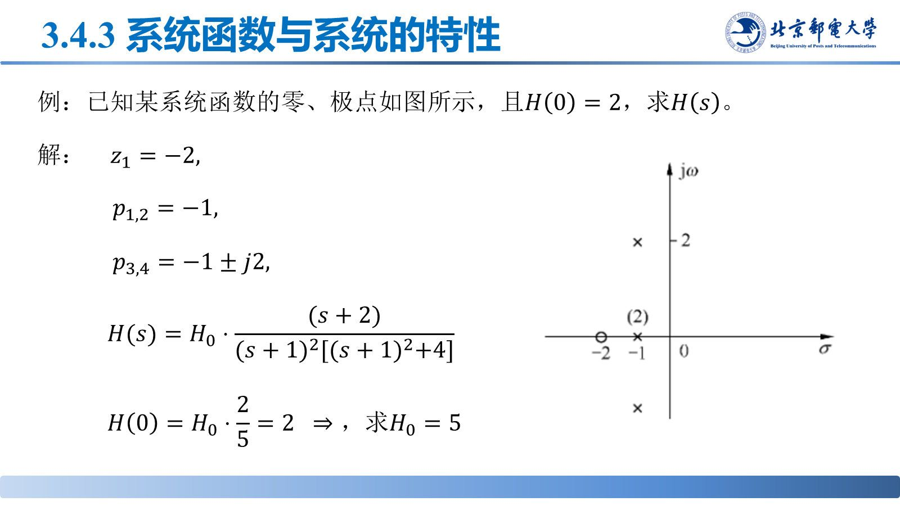
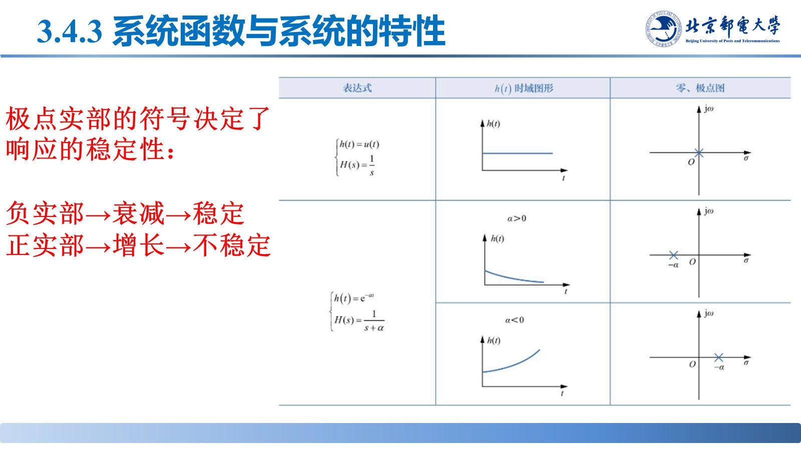
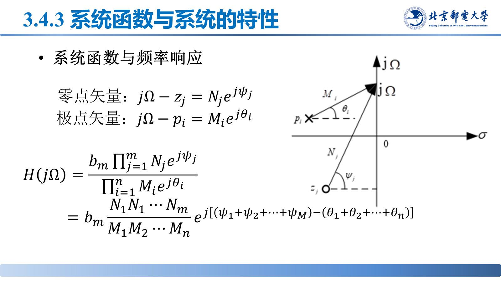
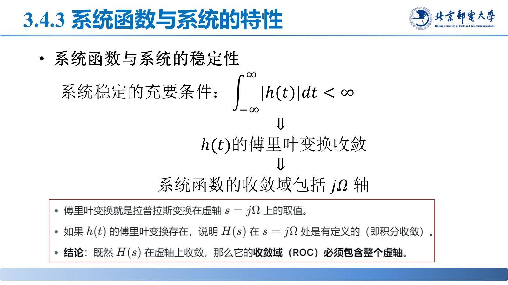

# 复频域分析与系统函数

> **来源**：《信号分析与处理》第3章-20261020.pptx，第 86–114 页（共 145 页）
> **对应课件章节**：3.4 连续线性时不变系统的复频域分析（3.4.1 系统函数、3.4.2 复频域分析法、3.4.3 系统函数与系统的特性）

把 $j\Omega$ 推广到复频率 $s=\sigma+j\Omega$ 就得到系统函数 $H(s)$；零极点图上极点的位置直接决定因果性与稳定性。

## 核心结论速查

| 关系 | 公式 |
|---|---|
| 系统函数 | $H(s)=\int_{-\infty}^{+\infty}h(t)e^{-st}dt=\mathscr{L}[h(t)]$ |
| 输出像函数 | $Y_{zs}(s)=X(s)\cdot H(s)$，$H(s)=\frac{Y_{zs}(s)}{X(s)}$ |
| 由微分方程 | $H(s)=\dfrac{\sum_{k=0}^{m}b_ks^k}{\sum_{k=0}^{n}a_ks^k}$ |
| 零极点形式 | $H(s)=H_0\dfrac{\prod_{j=1}^{m}(s-z_j)}{\prod_{i=1}^{n}(s-p_i)}$ |
| 频率响应 | $H(j\Omega)=\left.H(s)\right\lvert_{s=j\Omega}$ |

## 一、系统函数与复频域分析法

输入推广为 $e^{st}$，输出为 $e^{st}H(s)$：$H(s)=\mathscr{L}[h(t)]$，$Y_{zs}(s)=X(s)H(s)$，$H(s)=\frac{Y_{zs}(s)}{X(s)}$。

**三步**：① 求 $H(s)$；② $Y_{zs}(s)=X(s)H(s)$；③ 反变换 $y_{zs}(t)=\mathscr{L}^{-1}\{Y_{zs}(s)\}$。

**由微分方程求**：两端取拉氏变换（零状态），$s^k\leftrightarrow\frac{d^k}{dt^k}$，得 $H(s)=\frac{\sum b_ks^k}{\sum a_ks^k}$。例：$y''+3y'+2y=2x'-3x\Rightarrow H(s)=\frac{2s-3}{s^2+3s+2}$。

## 二、零极点与零极点图

$$H(s)=H_0\frac{\prod_{j=1}^{m}(s-z_j)}{\prod_{i=1}^{n}(s-p_i)},\qquad H_0=\frac{b_m}{a_n}$$

- **零点** $z_j$：使 $H(s)=0$ 的分子根；**极点** $p_i$：使 $H(s)\to\infty$ 的分母根；
- **零极点图**：在 $s$ 平面上零点画 $\circ$、极点画 $\times$，重根标重数。

## 三、零极点分布与时域特性

| 极点位置 | $h(t)$ 的模态 |
|---|---|
| 实极点 $p=\alpha$ | $e^{\alpha t}$：$\alpha<0$ 衰减，$\alpha>0$ 增长，$\alpha=0$ 为常数 |
| 共轭极点 $\sigma\pm j\Omega$ | $e^{\sigma t}\cos(\Omega t+\varphi)$：$\sigma<0$ 衰减振荡，$\sigma=0$ 等幅振荡 |

**一句话**：极点实部符号决定稳定性、虚部决定是否振荡；零点只影响幅度与相位。

## 四、系统函数与频率响应

收敛域包含虚轴时，令 $s=j\Omega$ 即得频率响应：

$$H(j\Omega)=\left.H(s)\right\lvert_{s=j\Omega}=\frac{b_m\prod_{j=1}^{m}(j\Omega-z_j)}{\prod_{i=1}^{n}(j\Omega-p_i)}$$

**零极点矢量法**：零点矢量 $j\Omega-z_j=N_je^{j\omega_j}$、极点矢量 $j\Omega-p_i=M_ie^{j\theta_i}$，则

$$\lvert H(j\Omega)\rvert=b_m\frac{N_1N_2\cdots N_m}{M_1M_2\cdots M_n},\qquad \varphi(\Omega)=\sum_j\omega_j-\sum_i\theta_i$$

$\Omega$ 沿虚轴移动时，离极点越近 $\lvert H\rvert$ 越大、离零点越近 $\lvert H\rvert$ 越小——零极点图的几何直观由此而来。

## 五、因果性与稳定性的零极点判据（重点）

| 结论 | 内容 |
|---|---|
| 因果 | $h(t)=0\ (t<0)$ ⇔ 收敛域为 $\mathrm{Re}[s]>\tau_0$ 型右半平面（最右极点右侧） |
| 稳定 | $\int_{-\infty}^{\infty}\lvert h(t)\rvert dt<\infty$ ⇔ 收敛域**包含虚轴** $j\Omega$ |
| 因果且稳定 | $H(s)$ 的**全部极点位于 $s$ 左半平面**（$\mathrm{Re}[s]<0$） |

因果要求收敛域在最右极点右侧、稳定要求收敛域含虚轴，两者同时成立 ⇒ 最右极点必在虚轴左侧；右半平面有极点必不稳定，虚轴上的极点为等幅振荡。

## 易错点与考点提示

- $H(s)$ 与 $H(j\Omega)$ 不是一回事：$H(j\Omega)=H(s)\lvert_{s=j\Omega}$ 只在收敛域包含虚轴（系统稳定）时成立。
- 用 $Y_{zs}(s)=X(s)H(s)$ 求的是零状态响应；若带初始条件，输出像函数还要加初始状态项。
- 稳定性由**极点**决定，零点不影响稳定性；判读时一个极点都不能漏。
- 虚轴上有极点 ⇒ 不是稳定系统，响应等幅振荡。
