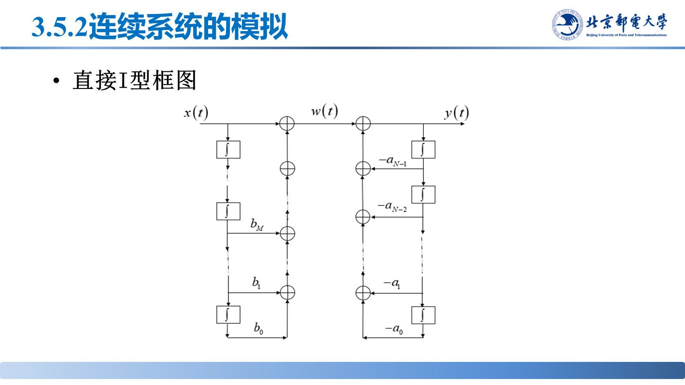
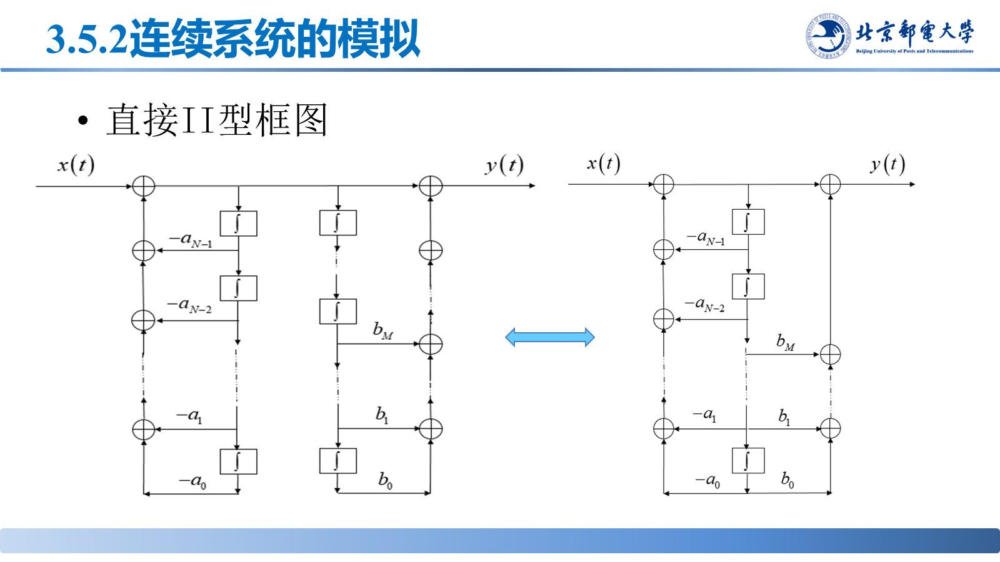
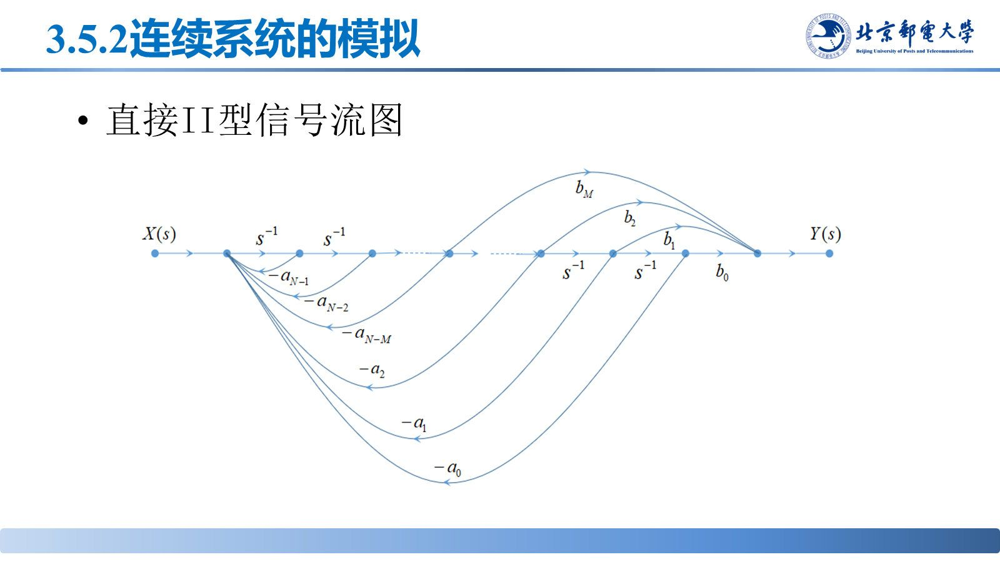
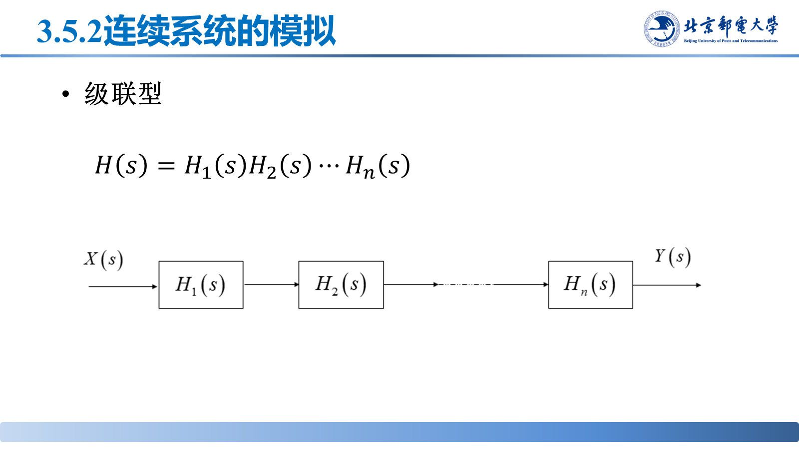
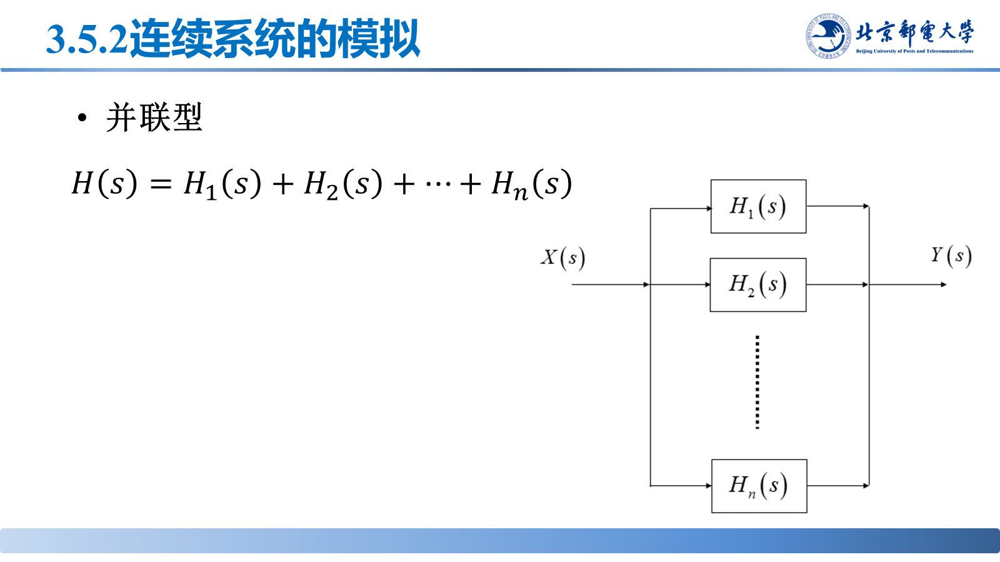

# 信号流图与系统模拟

> **来源**：《信号分析与处理》第3章-20261020.pptx，第 115–145 页（共 145 页）
> **对应课件章节**：3.5 信号流图与连续系统的模拟（3.5.1 信号流图、3.5.2 连续系统的模拟）

信号流图把系统画成"节点 + 有向支路"的网络，梅森公式直接读出总传输；反过来，给定 $H(s)$ 可用直接型、级联型、并联型三种结构模拟实现。

## 核心结论速查

| 内容 | 结论 |
|---|---|
| 梅森公式 | $H=\dfrac{\sum_k P_k\Delta_k}{\Delta}$ |
| 特征式 | $\Delta=1-\sum_kL_k+\sum_{m,n}L_mL_n-\sum_{p,q,r}L_pL_qL_r+\cdots$ |
| 直接I型 | 分子、分母两个子系统级联，各用一条积分链 |
| 直接II型 | 交换次序并共用积分链，积分器最少（$N$ 阶用 $N$ 个） |
| 级联型 | $H(s)=H_1(s)H_2(s)\cdots H_n(s)$ |
| 并联型 | $H(s)=H_1(s)+H_2(s)+\cdots+H_n(s)$ |

## 一、信号流图的术语

| 术语 | 含义 |
|---|---|
| 节点 | 表示信号（变量）；输入节点只有输出支路，输出节点只有输入支路 |
| 支路 | 有向线段，标支路增益（传输） |
| 前向通路 | 从输入节点到输出节点、不重复经过节点的通路，增益 $P_k$ 为各支路增益之积 |
| 环路 | 闭合路径，环路增益 $L_k$ 为各支路增益之积 |
| 不接触环路 | 没有公共节点的环路 |

## 二、梅森公式

$$H=\frac{\sum_kP_k\Delta_k}{\Delta}$$

- $P_k$：第 $k$ 条前向通路的增益；
- $\Delta$：特征式，$\Delta=1-\sum_kL_k+\sum_{m,n}L_mL_n-\sum_{p,q,r}L_pL_qL_r+\cdots$，即"所有单个环路增益之和"取负、"所有两两不接触环路增益乘积之和"取正、三三不接触取负，符号交替；
- $\Delta_k$：与第 $k$ 条前向通路**不接触**的那部分环路的特征式（没有不接触环路时 $\Delta_k=1$）。

**例（二阶直接型流图）**：环路 $L_1=-a_1s^{-1}$、$L_2=-a_2s^{-2}$；三条前向通路 $P_1=b_0$、$P_2=b_1s^{-1}$、$P_3=b_2s^{-2}$，且 $\Delta_k=1$，故

$$H(s)=\frac{b_0+b_1s^{-1}+b_2s^{-2}}{1+a_1s^{-1}+a_2s^{-2}}$$

**转置**：把流图中所有支路反向、输入与输出节点互换，得到的转置流图与原因传输函数相同。

## 三、连续系统的模拟

**基本运算单元**：积分器（$s^{-1}$）、加法器（$\Sigma$）、数乘器（$a$）。微分器一般不用，改用积分器实现。

| 结构 | 构造方式 | 特点 |
|---|---|---|
| 直接I型 | 按 $H=H_1H_2$ 级联：$H_1$ 实现零点（分子）、$H_2$ 实现极点（分母） | 每条通道各用一条积分链，积分器多 |
| 直接II型 | 交换 $H_1$、$H_2$ 次序并共用同一条积分链 | 积分器最少，$N$ 阶用 $N$ 个，工程上最常用 |
| 级联型 | 把 $H(s)$ 分解为一阶/二阶子系统**相乘**，每节用直接II型 | 便于单独调整零极点 |
| 并联型 | 把 $H(s)$ 展开成若干一阶/二阶项**相加** | 便于调整各极点；各支路独立 |

**本章重点**：四大特性判别；零输入/零状态响应；$h(t)$、$g(t)$ 与卷积；$H(j\Omega)$、$H(s)$ 与零极点；信号流图与三种模拟结构。

## 易错点与考点提示

- 梅森公式分子是 $\sum_kP_k\Delta_k$，漏掉 $\Delta_k$ 是最常见错误；$\Delta_k$ 只统计与该前向通路"不接触"的环路。
- 不接触环路必须**没有公共节点**，仅仅是支路不相交不算。
- 级联型用"因子相乘"、并联型用"分式分解后相加"，两种分解方式别混。
- 直接II型比直接I型省积分器，但两种结构的 $H(s)$ 相同——实现方式不同，传输函数不变。
