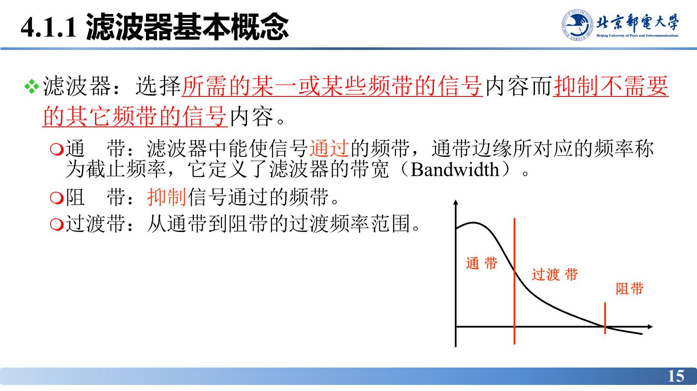
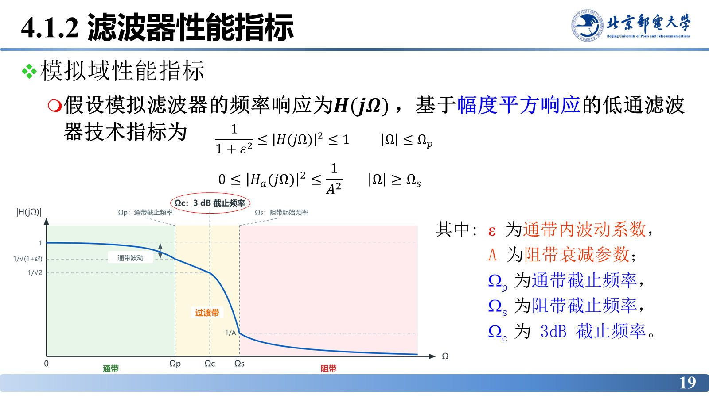

# 滤波器概述与分类

> **来源**：《信号分析与处理》第4章-20261020.pptx，第 11–22 页（共 101 页）
> **对应课件章节**：4.1 滤波器概述（4.1.1 基本概念、4.1.2 性能指标）

先把滤波器的定义、四个频带、四类通频带与两套性能指标说清楚，后面所有设计都是“用可实现的 $H(s)$ 逼近这些指标”。

## 核心结论速查

| 概念 | 定义 / 结论 |
|---|---|
| 滤波器 | 选择所需的某一或某些频带内的信号内容，而抑制不需要的其它频带信号内容的系统 |
| 通带 | 能使信号通过的频带；通带边缘对应**截止频率**，它定义了滤波器的**带宽**（Bandwidth） |
| 阻带 | 抑制信号通过的频带 |
| 过渡带 | 从通带到阻带的过渡频率范围 |
| 按信号种类分 | 模拟滤波器 / 数字滤波器 |
| 按应用分 | 有源滤波器 / 无源滤波器 |
| 按通频带分 | 低通（LPF）/ 高通（HPF）/ 带通（BPF）/ 带阻（BSF） |
| 绝对指标 | $\dfrac{1}{1+\varepsilon^{2}}\le\lvert H(j\Omega)\rvert^{2}\le 1\ (\lvert\Omega\rvert\le\Omega_{p})$；$0\le\lvert H_{a}(j\Omega)\rvert^{2}\le\dfrac{1}{A^{2}}\ (\lvert\Omega\rvert\ge\Omega_{s})$ |
| 相对指标 | 通带最大衰减 $A_{p}=10\lg(1+\varepsilon^{2})\ \mathrm{dB}$；阻带最小衰减 $A_{s}=20\lg A\ \mathrm{dB}$ |
| 由相对指标反算 | $\varepsilon^{2}=10^{A_{p}/10}-1$；$A=10^{A_{s}/20}$ |

---

## 本章内容与在信号处理链路中的位置

行文顺序：4.1 概述（概念、指标）→ 4.2 理想滤波器（无失真传输、理想低通）→ 4.3 模拟滤波器设计（巴特沃斯、切比雪夫、椭圆逼近、频率变换）→ 4.4 模拟滤波器的实现*。

在“连续时间信号分析与处理（第 2、3 章）→ AD 取样 → 离散时间信号分析与处理（第 5、6、7 章）→ DA 内插 → 连续时间信号分析与处理”的整条链路中，第 4 章对应模拟侧的滤波环节：发射机与接收机里的 AD/DA 电路、滤波电路、功率放大电路都要用模拟滤波器。

## 一个降噪案例：噪声污染的音乐信号

一段音乐中夹杂噪声，严重影响收听质量。原始信号 `05_03_noisy.wav` 与其频谱对比：FFT 后可见有效音乐成分之外还叠着一片高频噪声；滤波后噪声被削掉、音乐成分保留。滤波器的用途就是**在频域把有用成分与噪声分开**——滤波的第一直觉是“频域上的筛子”。

## 基本概念

滤波器的定义：选择所需的某一或某些频带内的信号内容，而抑制不需要的其它频带的信号内容。

四个频带术语：

- **通带**：滤波器中能使信号通过的频带。通带边缘所对应的频率称为**截止频率**，它定义了滤波器的**带宽**。
- **阻带**：抑制信号通过的频带。
- **过渡带**：从通带到阻带的过渡频率范围。理想滤波器没有过渡带，实际滤波器必然有。

## 分类

**按输入、输出信号的种类**：模拟滤波器、数字滤波器。

**按应用**：有源滤波器、无源滤波器。

**按通频带**（本章主线）：

| 类型 | 作用 | 典型例子 |
|---|---|---|
| 低通滤波器 | 只允许低频信号通过而抑制高频信号 | 消除旧音乐录音带中的背景噪声 |
| 高通滤波器 | 只允许高频信号通过而抑制低频信号 | 声纳系统中消除船和海浪的低频噪声，保留目标特征 |
| 带通滤波器 | 只允许某一频带的信号通过 | 数字电话系统双音多频（DTMF）信号的解码 |
| 带阻滤波器 | 只抑制某一频带的信号 | 从复合电视信号中滤除频分复用的色度信号，得到亮度信号 |

课件用交互演示拖动截止频率，四种滤波器的幅频曲线与通带/阻带/过渡带同步移动——结论与上表一致，静态图无额外信息，不插图。

## 性能指标

**绝对指标**（图 4.1 的典型模拟低通）：

- 通带内：$\dfrac{1}{1+\varepsilon^{2}}\le\lvert H(j\Omega)\rvert^{2}\le 1$，$\lvert\Omega\rvert\le\Omega_{p}$；
- 阻带内：$0\le\lvert H_{a}(j\Omega)\rvert^{2}\le\dfrac{1}{A^{2}}$，$\lvert\Omega\rvert\ge\Omega_{s}$。

其中 $\varepsilon$ 为**通带内波动系数**，$A$ 为**阻带衰减参数**；$\Omega_{p}$ 为**通带截止频率**，$\Omega_{s}$ 为**阻带截止频率**，$\Omega_{c}$ 为 **3 dB 截止频率**。

**相对指标**（工程上常用，单位 dB）：由绝对指标转化得到

$$A_{p}=10\lg\left(1+\varepsilon^{2}\right)\ \mathrm{dB},\qquad A_{s}=20\lg A\ \mathrm{dB}$$

$A_{p}$ 称**通带最大衰减**，$A_{s}$ 称**阻带最小衰减**。反向换算：

$$\varepsilon^{2}=10^{A_{p}/10}-1,\qquad A=10^{A_{s}/20}$$

课件用交互演示展示四指标与曲线的对应：$A_{p}$ 决定通带内允许的最大起伏（曲线在 $1$ 与 $1/\sqrt{1+\varepsilon^{2}}$ 之间摆动），$A_{s}$ 决定阻带被压到多低，$\Omega_{p}$、$\Omega_{s}$ 卡住通带边缘与阻带起点，二者之差即过渡带宽度。

## 易错点与考点提示

- **$\Omega_{c}$ 与 $\Omega_{p}$ 不是一回事**：$\Omega_{p}$ 是设计指标给定的通带边缘，$\Omega_{c}$ 是巴特沃斯幅频特性上衰减为 3 dB 的频率点，只有 $A_{p}=3\ \mathrm{dB}$ 时二者才重合。
- $A_{p}$ 是**最大**衰减、$A_{s}$ 是**最小**衰减：通带内衰减不得超过 $A_{p}$，阻带内衰减不得小于 $A_{s}$，写不等式时方向不要反。
- 注意 dB 定义里的系数：功率比用 $10\lg$，幅度比用 $20\lg$。$A_{s}=20\lg A$ 来自幅度比，$A_{p}=10\lg(1+\varepsilon^{2})$ 来自功率比（$\lvert H\rvert^{2}$）。
- 低通/高通的“高、低”是相对频率轴而言，与信号本身“高频/低频”无关；带通用两个截止频率（上、下截止），其几何中心频率在 4.3.4 节出现。

## 自测

1. 通带、阻带、过渡带、截止频率、带宽之间是什么关系？
2. 已知 $A_{p}=3\ \mathrm{dB}$、$A_{s}=30\ \mathrm{dB}$，求 $\varepsilon$ 与 $A$。
3. 按通频带分类，滤波器分哪四种？各举一个课件中的应用例子。

参考答案

1. 通带是允许信号通过的频带，阻带是抑制的频带，过渡带是二者之间的过渡频率范围；通带边缘频率就是截止频率，它定义了滤波器的带宽。
2. $\varepsilon^{2}=10^{0.3}-1\approx0.9953$，$\varepsilon\approx0.9976$；$A=10^{30/20}=10^{1.5}\approx31.62$。
3. 低通（消除旧录音带背景噪声）、高通（声纳中消除船与海浪的低频噪声）、带通（DTMF 信号解码）、带阻（从复合电视信号中滤除色度信号）。

