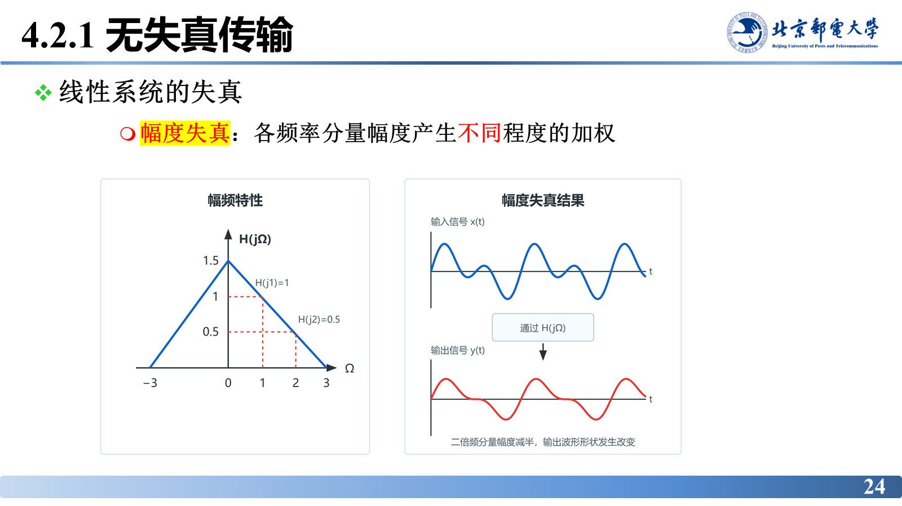
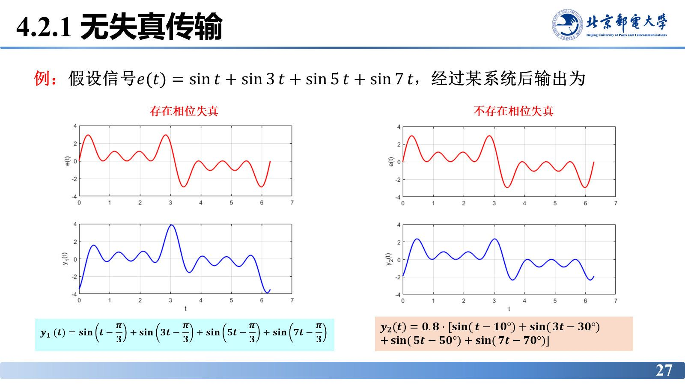
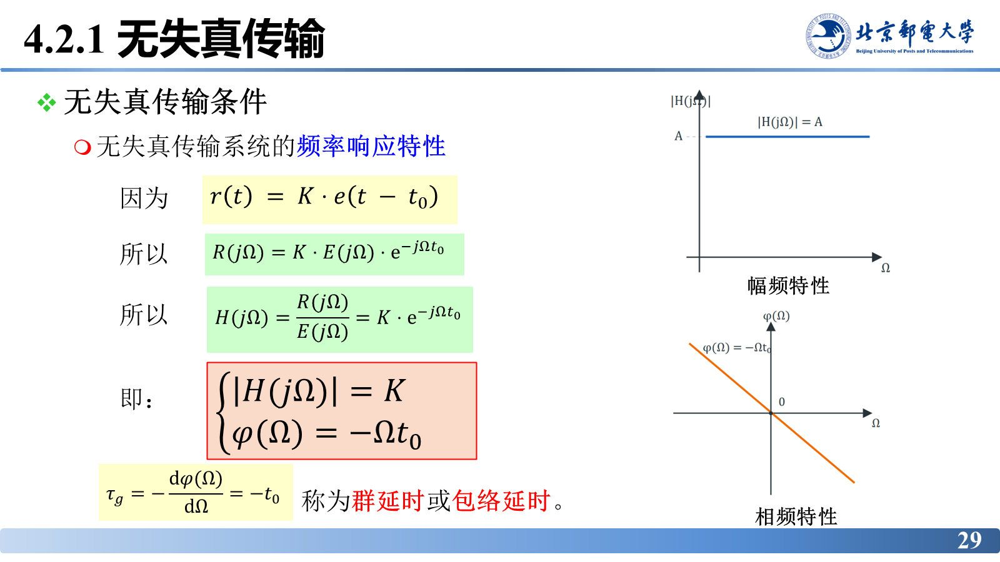

# 无失真传输

> **来源**：《信号分析与处理》第4章-20261020.pptx，第 23–31 页（共 101 页）
> **对应课件章节**：4.2.1 无失真传输

信号经过系统后波形为什么变？把失真拆成幅度与相位两部分，就得到"什么系统不改变波形"的答案：幅频为常数、相频为过原点的直线，这也是后面衡量一切实际滤波器"够不够好"的标尺。

## 核心结论速查

| 项目 | 结论 |
|---|---|
| 失真的来源 | 各频率分量被系统**不同程度**地加权（幅度）与相移（相位），合成波形改变 |
| 幅度失真 | 各频率分量幅度产生不同程度的加权 |
| 相位失真 | 各频率分量产生的相移**不与频率成正比**，使响应各分量的时移不同 |
| 相延时 | $\tau_{p}=-\dfrac{\chi(\Omega)}{\Omega}$，频率不同则时移不同 |
| 无失真条件（时域） | $y(t)=K\,e(t-t_{0})$，$K$、$t_{0}$ 均为实常数 |
| 无失真条件（频域） | $\lvert H(j\Omega)\rvert=K$（常数），$\chi(\Omega)=-\Omega t_{0}$（过原点的直线） |
| 群延时（包络延时） | $\tau_{g}=-\dfrac{d\chi(\Omega)}{d\Omega}=t_{0}$，无失真系统群延时恒为常数 |
| 无失真系统冲激响应 | $h(t)=K\delta(t-t_{0})$ |

---

## 失真是怎么产生的

传输信号经过系统后，幅度和相位都发生变化：幅度由系统函数的幅度加权，相位由系统函数的相位修正：

$$R(j\Omega)=E(j\Omega)H(j\Omega)$$

$$\lvert R(j\Omega)\rvert=\lvert H(j\Omega)\rvert\cdot\lvert E(j\Omega)\rvert,\qquad
\chi_{r}(\Omega)=\chi_{e}(\Omega)+\chi_{h}(\Omega)$$

对于不同频率的信号，系统对其幅度加权和相位修正的程度不同。这导致含多种频率成分的被传输信号，其输入波形与输出波形可能不同——这种情况称为**失真**。

## 幅度失真与相位失真

**幅度失真**：各频率分量幅度产生不同程度的加权。例如系统对低频增益大、对高频增益小，输出波形的“棱角”就被削圆（图 4.3 画出了同一输入在两种幅频特性下的输出对比）。

**相位失真**：各频率分量产生的相移不与频率成正比，使响应中各频率分量的时移不同。以正弦信号为例，设 $e(t)=\sin(\Omega_{0}t)$，经系统后

$$\sin(\Omega_{0}t)\ \to\ \lvert H(j\Omega_{0})\rvert\sin\left[\Omega_{0}t+\chi(\Omega_{0})\right]
=\lvert H(j\Omega_{0})\rvert\sin\left\{\Omega_{0}\left[t+\frac{\chi(\Omega_{0})}{\Omega_{0}}\right]\right\}$$

由此定义**相延时**

$$\tau_{p}=-\frac{\chi(\Omega)}{\Omega}$$

相移为 $\chi(\Omega_{0})$ 时，该分量被延迟的时间就是 $\tau_{p}$。若 $\chi(\Omega)$ 与 $\Omega$ 不成正比，不同频率分量的 $\tau_{p}$ 不同，合成波形就被“拉散”——这就是相位失真。例如

$$\sin(2t-3)=\sin\left[2\left(t-\frac{3}{2}\right)\right]$$

该分量的相延时为 $3/2$。

课件用两组波形对比判据（输入 $e(t)=\sin t+\sin 3t+\sin 5t+\sin 7t$，四个分量幅度相同、初相为零）：

- 相移相同（都减 $\pi/3$）：时移分别为 $\pi/3$、$\pi/9$、$\pi/15$、$\pi/21$，**时移不同 → 存在相位失真**；
- 相移与频率成正比（$10°$、$30°$、$50°$、$70°$，整体再乘 $0.8$）：时移同为 $10°/\Omega$，**时移相同 → 不存在相位失真**（只剩幅度比例变化）。

## 无失真传输条件

**时域条件**：响应与激励相比，

$$y(t)=K\,e(t-t_{0})$$

即幅度等比例变化、波形形状不变、整体时移 $t_{0}$。

**频域条件**：对 $y(t)=K e(t-t_{0})$ 取傅里叶变换，

$$R(j\Omega)=K\cdot E(j\Omega)\cdot e^{-j\Omega t_{0}}
\ \Longrightarrow\
H(j\Omega)=\frac{R(j\Omega)}{E(j\Omega)}=K e^{-j\Omega t_{0}}$$

所以无失真传输系统的频率响应必须满足

$$\left|H(j\Omega)\right|=K,\qquad \chi(\Omega)=-\Omega t_{0}$$

**幅频特性为常数**（对所有频率等比例放大）、**相频特性为过原点的直线**。由相频特性可得

$$\tau_{g}=-\frac{d\chi(\Omega)}{d\Omega}=-t_{0}\cdot(-1)=t_{0}$$

$\tau_{g}$ 称为**群延时**或**包络延时**；无失真系统的群延时恒为 $t_{0}$，与频率无关。此时相延时 $\tau_{p}=-\chi(\Omega)/\Omega=t_{0}$ 也恒等于 $t_{0}$，两者相等。

**冲激响应**：对 $H(j\Omega)=K e^{-j\Omega t_{0}}$ 取反变换，

$$h(t)=K\delta(t-t_{0})$$

即无失真系统对输入只是“放大 $K$ 倍并整体延迟 $t_{0}$”。

## 易错点与考点提示

- **无失真 ≠ 幅度不变**：允许常数增益 $K$，也允许整体时移 $t_{0}$；不允许的是波形形状改变。
- $K$ 与 $t_{0}$ 必须是**实常数**。若 $t_{0}<0$，$h(t)=K\delta(t-t_{0})$ 会出现在 $t<0$，系统非因果、不可实时实现。
- **相延时与群延时**：相延时描述单一正弦分量的时移，群延时描述包络/整体的时移。无失真时二者相等且恒定；一般系统两者不等，判断相位失真应看群延时是否随频率恒定。
- 判据只涉及 $\lvert H\rvert$ 与 $\chi$ 两项：幅频满足常数、相频满足线性，两者**缺一不可**——只满足幅频仍会因相位失真导致波形改变。

## 自测

1. 无失真传输的时域条件与频域条件分别是什么？
2. 已知系统 $H(j\Omega)=2e^{-j3\Omega}$，判断是否无失真，并写出冲激响应。
3. 为什么"相移与频率成正比"等价于"各分量时移相同"？

参考答案

1. 时域：$y(t)=K e(t-t_{0})$（$K$、$t_{0}$ 为实常数）；频域：$\lvert H(j\Omega)\rvert=K$ 且 $\chi(\Omega)=-\Omega t_{0}$。
2. 是无失真系统：$K=2$、$t_{0}=3$，幅频为常数 2、相频为过原点直线；$h(t)=2\delta(t-3)$。
3. 相移 $\chi$ 对应时移 $\tau=-\chi/\Omega$；若 $\chi(\Omega)=-\Omega t_{0}$，则 $\tau=t_{0}$ 对所有频率相同，各分量同步移动，合成波形整体平移而不变形。

