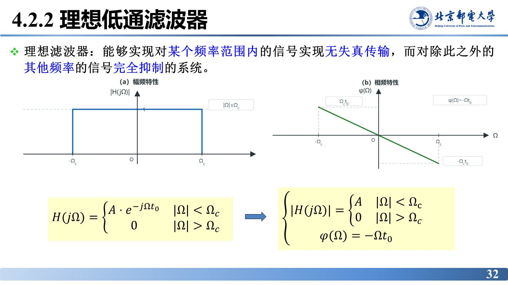
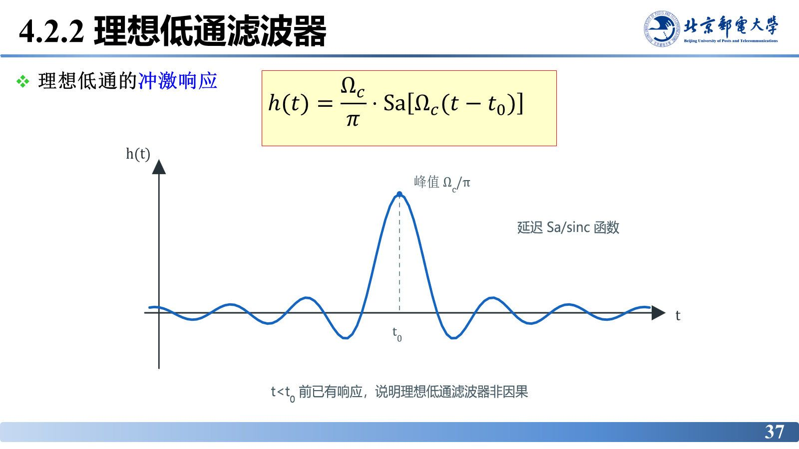
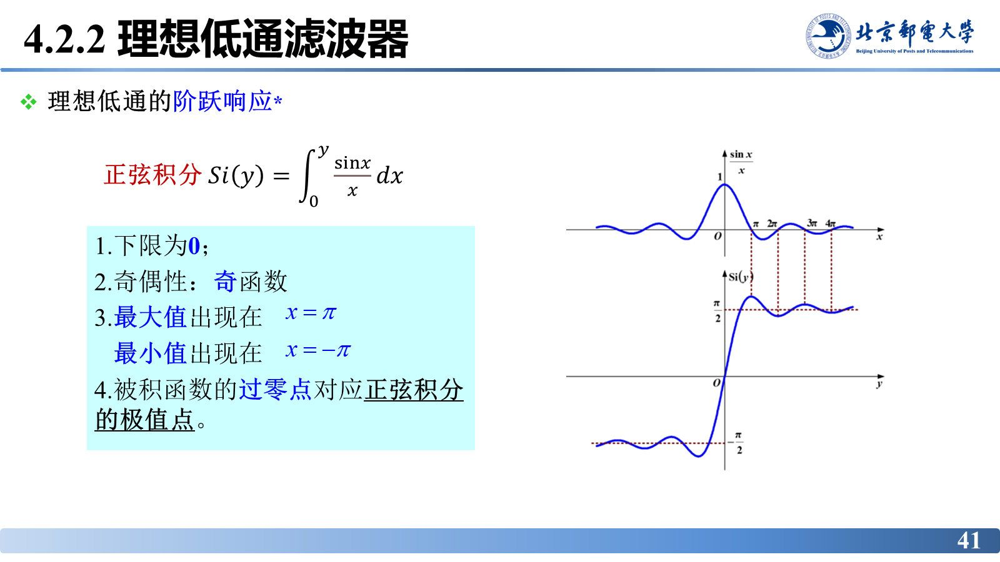
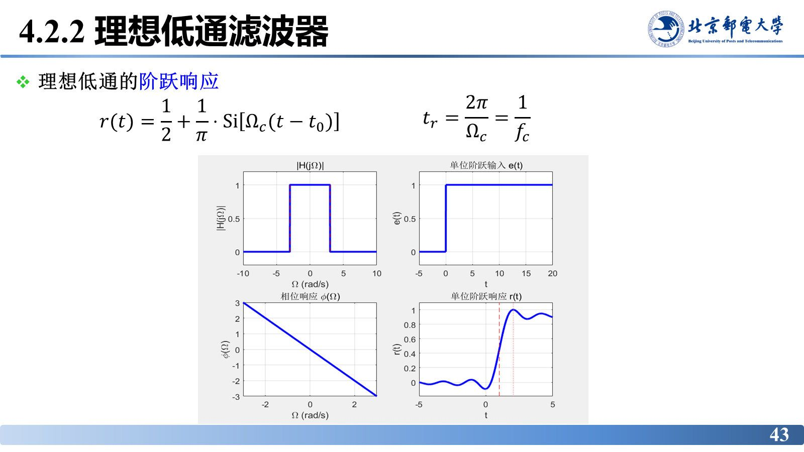
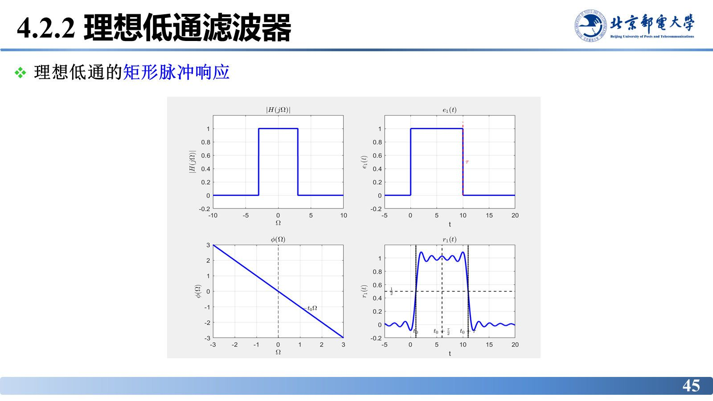
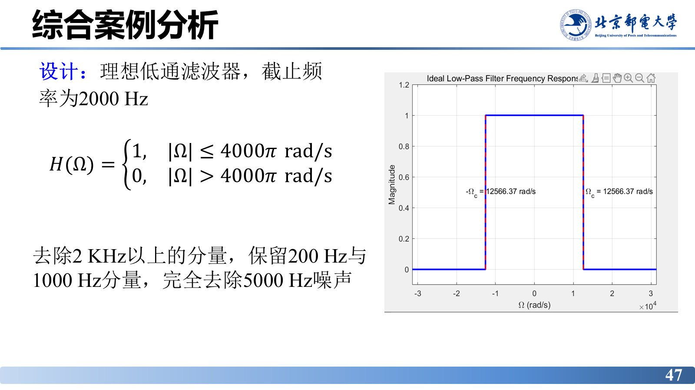
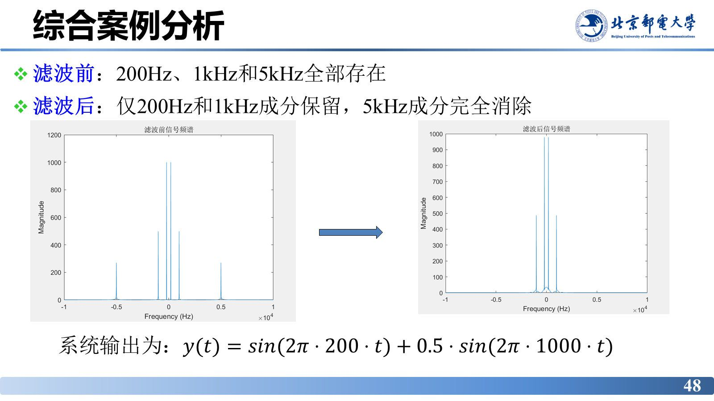

# 理想低通滤波器

> **来源**：《信号分析与处理》第4章-20261020.pptx，第 32–57 页（共 101 页）
> **对应课件章节**：4.2.2 理想低通滤波器

理想低通滤波器是"滤波器应该长什么样"的极限答案：通带内幅频为常数、相频为直线，通带外干脆为零。它本身造不出来——冲激响应是无限长的 Sa 函数，非因果；但正是它把"理想"与"可实现"的差距量化了出来（上升时间、振铃），也提供了由 $\lvert H(j\Omega)\rvert$ 反求 $H(s)$ 的完整方法。

## 核心结论速查

| 项目 | 结论 |
|---|---|
| 理想滤波器 | 对某个频率范围内的信号无失真传输，对此外的频率完全抑制 |
| 理想低通频率特性 | $H(j\Omega)=A e^{-j\Omega t_{0}}\ (\lvert\Omega\rvert<\Omega_{c})$，$H(j\Omega)=0\ (\lvert\Omega\rvert>\Omega_{c})$ |
| 冲激响应 | $h(t)=\dfrac{\Omega_{c}}{\pi}\,\mathrm{Sa}\left[\Omega_{c}(t-t_{0})\right]$，无限长、**非因果** |
| 阶跃响应 | $r(t)=\dfrac{1}{2}+\dfrac{1}{\pi}\mathrm{Si}\left[\Omega_{c}(t-t_{0})\right]$，$\mathrm{Si}(y)=\int_{0}^{y}\dfrac{\sin x}{x}dx$ |
| 上升时间 | $t_{r}=\dfrac{2\pi}{\Omega_{c}}=\dfrac{1}{f_{c}}$（与截止频率成反比） |
| 矩形脉冲响应 | $r_{1}(t)=\dfrac{1}{\pi}\{\mathrm{Si}[\Omega_{c}(t-t_{0})]-\mathrm{Si}[\Omega_{c}(t-t_{0}-\tau)]\}$，跳变处过冲振铃 |
| 因果性 | 理想低通冲激响应延伸到 $t<t_{0}$，**非因果**；因果且物理可实现 ⇒ 必然得不到真正理想的低通 |
| 频率响应性质 | 因果系统 $H(j\Omega)=P(\Omega)-jQ(\Omega)$，$P$ 为偶函数、$Q$ 为奇函数 ⇒ $\lvert H\rvert$ 偶、$\chi$ 奇 |
| 求 $H(s)$ 的路线 | 指标 $\to\lvert H_{a}(j\Omega)\rvert^{2}\to H(s)H(-s)\big\vert_{\Omega^{2}=-s^{2}}\to$ 零极点分配 $\to H_{a}(s)$ |
| 零极点分配 | 因果稳定：取**左半平面极点**；最小相位：取**左半平面零点** |

---

## 理想滤波器的定义与频率特性

**理想滤波器**：能够实现对某个频率范围内的信号实现无失真传输，而对除此之外的其他频率的信号完全抑制的系统。

理想低通滤波器的频率响应为

$$H(j\Omega)=\begin{cases}A\,e^{-j\Omega t_{0}}, & \lvert\Omega\rvert<\Omega_{c}\\[2pt] 0, & \lvert\Omega\rvert>\Omega_{c}\end{cases}$$

即通带内幅频为常数 $A$、相频为过原点的直线（满足 4.2.1 的无失真条件），通带外幅值为零，通带与阻带之间没有过渡带。

## 例：余弦信号通过理想低通

设 $e(t)=\cos t+\cos 3t$，理想低通满足 $\lvert H(j\Omega)\rvert=1\ (\lvert\Omega\rvert\le 2)$、$\lvert H(j\Omega)\rvert=0\ (\lvert\Omega\rvert>2)$，相频 $\chi(\Omega)=-0.5\Omega\ (\lvert\Omega\rvert\le 2)$。

3 rad/s 的 $\cos 3t$ 落在通带外被完全滤除，1 rad/s 的 $\cos t$ 落在通带内无失真通过，并产生 $t_{0}=0.5\,\mathrm{s}$ 的延时：

$$y(t)=\cos\left(t-\frac{1}{2}\right)$$

这就是理想低通“按频率取舍”的最直观演示：**通带内原样通过（只延时），通带外一律清零**。

## 冲激响应与因果性

由 $H(j\Omega)$ 求反变换：

$$h(t)=\frac{1}{2\pi}\int_{-\infty}^{\infty}H(j\Omega)e^{j\Omega t}d\Omega
=\frac{1}{2\pi}\int_{-\Omega_{c}}^{\Omega_{c}}A\,e^{-j\Omega t_{0}}e^{j\Omega t}d\Omega
=\frac{1}{2\pi}\int_{-\Omega_{c}}^{\Omega_{c}}e^{j\Omega(t-t_{0})}d\Omega$$

取 $A=1$ 计算得

$$h(t)=\frac{\Omega_{c}}{\pi}\cdot\frac{\sin\left[\Omega_{c}(t-t_{0})\right]}{\Omega_{c}(t-t_{0})}
=\frac{\Omega_{c}}{\pi}\,\mathrm{Sa}\left[\Omega_{c}(t-t_{0})\right]$$

峰值 $\Omega_{c}/\pi$ 出现在 $t=t_{0}$；波形向 $t\to\pm\infty$ 两侧无限延伸，且在 $t<t_{0}$ 区间仍有非零值。

**结论（非因果性）**：理想低通的冲激响应是无限长的 $\mathrm{Sa}$ 函数，在 $t<0$ 已不为零，因此**非因果**。在实际应用中，如果要求滤波器必须是因果且物理可实现的，就绝对无法获得真正理想的低通滤波器。

## 阶跃响应

输入单位阶跃 $u(t)$，其频谱含 $1/(j\Omega)$ 项，与通带特性相乘后反变换得

$$r(t)=\frac{1}{2}+\frac{2}{2\pi}\int_{0}^{\Omega_{c}}\frac{\sin\left[\Omega(t-t_{0})\right]}{\Omega}d\Omega
=\frac{1}{2}+\frac{1}{\pi}\int_{0}^{\Omega_{c}(t-t_{0})}\frac{\sin x}{x}dx$$

令

$$\mathrm{Si}(y)=\int_{0}^{y}\frac{\sin x}{x}dx\quad(\text{正弦积分})$$

则

$$r(t)=\frac{1}{2}+\frac{1}{\pi}\mathrm{Si}\left[\Omega_{c}(t-t_{0})\right]$$

$\mathrm{Si}(y)$ 的性质（课件第 41 页）：下限为 0；是奇函数；最大值出现在 $y=\pi$、最小值出现在 $y=-\pi$；被积函数的过零点对应 $\mathrm{Si}$ 的极值点。由此，阶跃响应在 $t=t_{0}$ 处等于 $1/2$，从 0 上升到 1 需要一个过渡过程。

**上升时间**定义为跳变处的过渡时间，课件给出

$$t_{r}=\frac{2\pi}{\Omega_{c}}=\frac{1}{f_{c}}$$

上升时间与截止频率成**反比**：截止频率越高（通带越宽），阶跃上升越快、时域分辨率越高。这是“时域—频域互为反比”关系在滤波器上的体现。

## 矩形脉冲响应与吉布斯现象

矩形脉冲可写成两个阶跃之差：$e_{1}(t)=u(t)-u(t-\tau)$，由线性时不变性，响应为两个阶跃响应之差

$$r_{1}(t)=\frac{1}{\pi}\left\{\mathrm{Si}\left[\Omega_{c}(t-t_{0})\right]-\mathrm{Si}\left[\Omega_{c}(t-t_{0}-\tau)\right]\right\}$$

课件第 45 页画出该响应：脉冲跳变处出现**过冲与衰减振荡（振铃）**，且振铃幅度不随 $\Omega_{c}$ 增大而消失——这就是**吉布斯现象**。原因是理想低通在 $\Omega_{c}$ 处“一刀切”，等价于频域乘矩形窗，时域必伴随 $\mathrm{Sa}$ 型拖尾；增大 $\Omega_{c}$ 只压缩振铃的时间尺度，不改变过冲相对幅度，故“截止越陡”与“无过冲”不可兼得。

## 综合案例：音频降噪

**问题**：模拟音频信号

$$x(t)=\sin(2\pi\cdot 200t)+0.5\sin(2\pi\cdot 1000t)+0.3\sin(2\pi\cdot 5000t)$$

输入音频系统，要去除 5 kHz 及以上噪声，仅保留有效音频。

**分析**：频谱是三对共轭冲激（200 Hz、1000 Hz、5000 Hz），成分在频域分得很开，用滤波器即可分离。

**设计**：理想的低通滤波器，截止频率取 2000 Hz（角频率 $\Omega_{c}=4000\pi\ \mathrm{rad/s}$）：

$$H(\Omega)=\begin{cases}1, & \lvert\Omega\rvert\le 4000\pi\ \mathrm{rad/s}\\[2pt] 0, & \lvert\Omega\rvert>4000\pi\ \mathrm{rad/s}\end{cases}$$

**结论**：去除 2 kHz 以上的分量，保留 200 Hz 与 1000 Hz 分量，完全去除 5000 Hz 噪声：$y(t)=\sin(2\pi\cdot200t)+0.5\sin(2\pi\cdot1000t)$。滤波前后对比：200 Hz、1 kHz、5 kHz 全部存在 → 仅 200 Hz 和 1 kHz 保留。

## 难点：由 $\lvert H(j\Omega)\rvert$ 求系统函数 $H(s)$

滤波器设计最终要拿到可实现的有理函数 $H_{a}(s)$，而设计的起点是幅度指标 $\lvert H(j\Omega)\rvert$。桥接两者需要下面这套方法。

### 频率响应的奇偶性

对因果系统，$h(t)=0\ (t<0)$，故

$$H(j\Omega)=\int_{0}^{\infty}h(t)e^{-j\Omega t}dt
=\int_{0}^{\infty}h(t)\cos(\Omega t)dt-j\int_{0}^{\infty}h(t)\sin(\Omega t)dt
=P(\Omega)-jQ(\Omega)$$

$P(\Omega)$ 是 $\Omega$ 的**偶函数**、$Q(\Omega)$ 是 $\Omega$ 的**奇函数**，于是

$$\left|H(j\Omega)\right|^{2}=P^{2}(\Omega)+Q^{2}(\Omega)\ \Rightarrow\ \lvert H(j\Omega)\rvert\text{ 是偶函数}$$
$$\chi(\Omega)=\arctan\left[-\frac{Q(\Omega)}{P(\Omega)}\right]\ \Rightarrow\ \chi(\Omega)\text{ 是奇函数}$$

即幅频特性关于 $\Omega=0$ 对称，相频特性关于原点对称。

### 构造路线与零极点分配

$$\text{性能指标}\ \to\ \lvert H_{a}(j\Omega)\rvert^{2}\ \to\ H(s)H(-s)\big\vert_{\Omega^{2}=-s^{2}}\ \to\ \text{零极点分配}\ \to\ H_{a}(s)$$

关键一步是用 $\Omega^{2}=-s^{2}$ 把 $\lvert H(j\Omega)\rvert^{2}$ 换成 $H(s)H(-s)$：

$$H(s)H(-s)=\left.\lvert H(j\Omega)\rvert^{2}\right|_{\Omega^{2}=-s^{2}},\qquad
H(s)=K_{0}\frac{(s-z_{0})(s-z_{1})\cdots(s-z_{m})}{(s-p_{0})(s-p_{1})\cdots(s-p_{n})}$$

- 因 $h(t)$ 是实函数，$H(s)$ 的极点（零点）必以**共轭对**存在；
- $H(s)H(-s)$ 的零极点关于虚轴呈**象限对称**；在虚轴上的极点或零点必为**二阶**（课件在图上标“2”表示二阶零点）；
- 对**稳定系统**，$H(s)H(-s)$ 在虚轴上**没有极点**；
- 分配规则：要**因果稳定** → 取左半平面的极点给 $H(s)$；要**最小相位** → 取左半平面的零点给 $H(s)$。

### 例

已知 $\lvert H(j\Omega)\rvert^{2}=\dfrac{4(\Omega^{4}+64)}{\Omega^{4}-10\Omega^{2}+169}$，求 $H(s)$。

**方法**：令 $\Omega^{2}=-s^{2}$ 得

$$H(s)H(-s)=\frac{4(s^{4}+64)}{s^{4}+10s^{2}+169}$$

分母零点（极点）为 $s=\pm2\pm3j$，分子零点为 $s=\pm2\pm2j$。取左半平面极点 $-2\pm3j$ 与左半平面零点 $-2\pm2j$：

$$H(s)=K_{0}\frac{(s+2-2j)(s+2+2j)}{(s+2-3j)(s+2+3j)}=K_{0}\frac{s^{2}+4s+8}{s^{2}+4s+13}$$

由 $\Omega=0$ 处定常数：$\lvert H(j0)\rvert^{2}=\dfrac{4\times64}{169}=\dfrac{256}{169}\Rightarrow\lvert H(j0)\rvert=\dfrac{16}{13}$，而 $H(0)=\dfrac{8K_{0}}{13}=\dfrac{16}{13}$，故 $K_{0}=2$，

$$H(s)=\frac{2(s^{2}+4s+8)}{s^{2}+4s+13}=\frac{2s^{2}+8s+16}{s^{2}+4s+13}$$

## 易错点与考点提示

- **理想低通非因果**：$h(t)$ 在 $t<t_{0}$ 已非零，故不能实时实现；无条件可实现的理想滤波器不存在，只能逼近。
- **上升时间反比于截止频率**：$t_{r}=2\pi/\Omega_{c}=1/f_{c}$，注意 $\Omega_{c}=2\pi f_{c}$，粗心会把 $2\pi$ 丢掉。
- 阶跃响应在 $t=t_{0}$ 处取 $1/2$，不是 0 也不是 1；上升过程是 $\mathrm{Si}$ 函数的形状，不是指数。
- 求 $H(s)$ 时**只取一半极点**：$H(s)H(-s)$ 有 $2N$ 个极点，$H(s)$ 只取左半平面的 $N$ 个（因果稳定要求），漏取或全取都会错。
- 常数 $K_{0}$ 不能由极点确定，必须用 $\Omega=0$（或任何已知频率点）的幅度条件回代求出。
- $\lvert H(j\Omega)\rvert$ 是偶函数这一结论只对**实系数**系统成立，复系数系统不适用。

## 自测

1. 写出理想低通的频率响应、冲激响应与阶跃响应，并说明其非因果性从何体现。
2. 理想低通的上升时间与截止频率是什么关系？若 $f_{c}=1\ \mathrm{kHz}$，上升时间是多少？
3. 已知 $\lvert H(j\Omega)\rvert^{2}=\dfrac{1}{1+\Omega^{4}}$，求因果稳定的 $H(s)$。

参考答案

1. $H(j\Omega)=Ae^{-j\Omega t_{0}}\ (\lvert\Omega\rvert<\Omega_{c})$，其余为 0；$h(t)=\dfrac{\Omega_{c}}{\pi}\mathrm{Sa}[\Omega_{c}(t-t_{0})]$；$r(t)=\dfrac{1}{2}+\dfrac{1}{\pi}\mathrm{Si}[\Omega_{c}(t-t_{0})]$。非因果性体现在 $h(t)$ 在 $t<t_{0}$（甚至 $t<0$）时已不为零，即输出由未来的输入决定。
2. $t_{r}=2\pi/\Omega_{c}=1/f_{c}$，反比关系；$f_{c}=1\ \mathrm{kHz}$ 时 $t_{r}=1\ \mathrm{ms}$。
3. 令 $\Omega^{2}=-s^{2}$：$H(s)H(-s)=\dfrac{1}{1+s^{4}}$，极点 $s=e^{j\pi/4},e^{j3\pi/4},e^{j5\pi/4},e^{j7\pi/4}$，取左半平面两个 $s=\dfrac{-1\pm j}{\sqrt{2}}$，得 $H(s)=\dfrac{1}{s^{2}+\sqrt{2}s+1}$。

