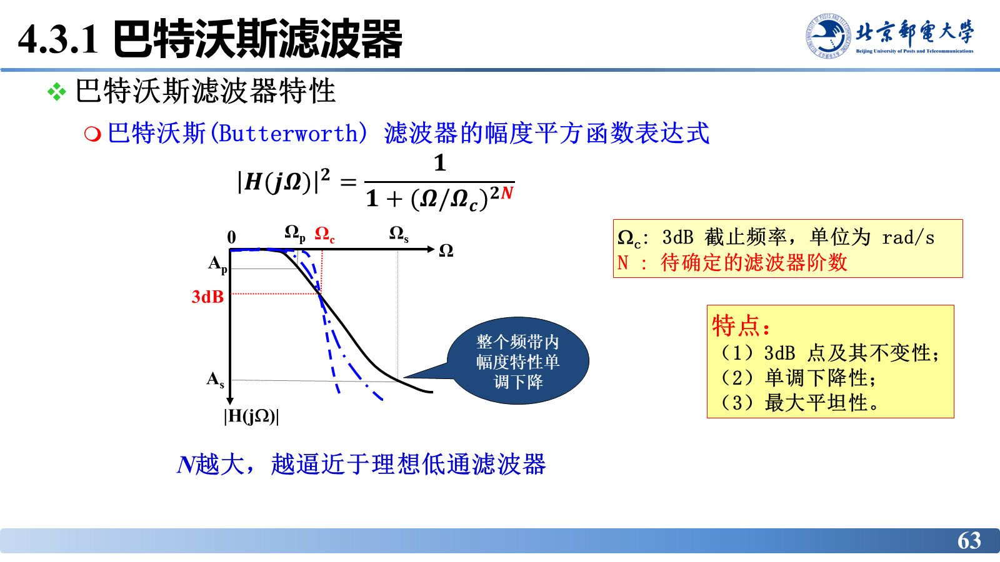
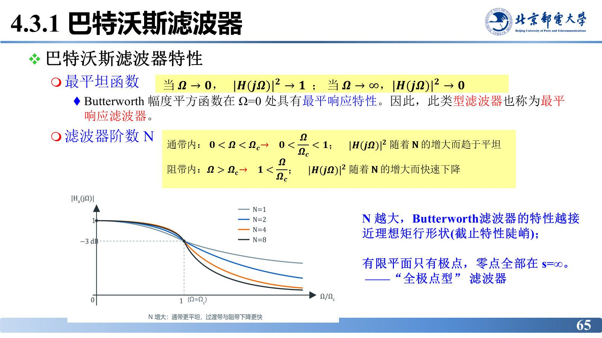
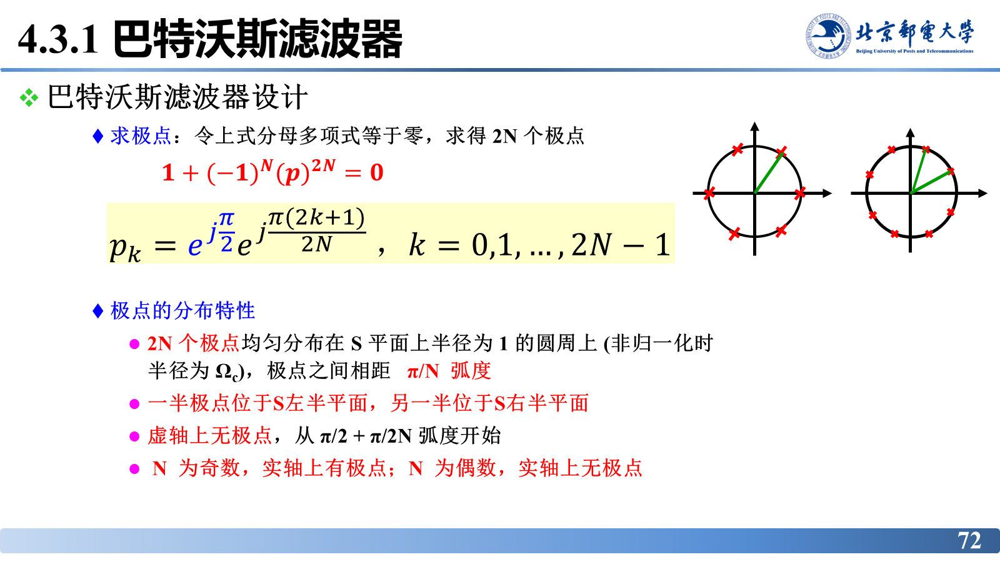
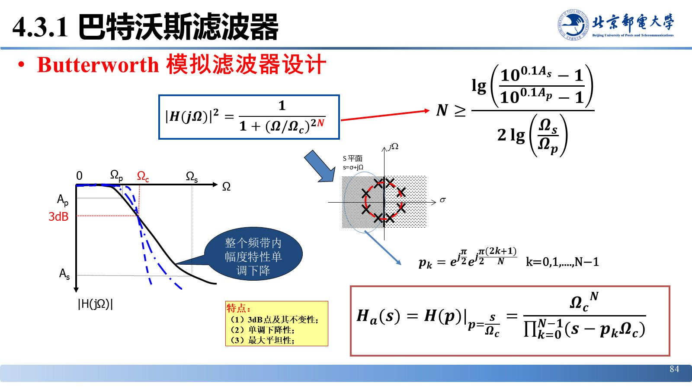

# 巴特沃斯模拟低通滤波器

> **来源**：《信号分析与处理》第4章-20261020.pptx，第 58–86 页（共 101 页）
> **对应课件章节**：4.3 模拟滤波器设计、4.3.1 巴特沃斯滤波器、4.3.2/4.3.3 其他类型低通滤波器

理想特性造不出来，于是用"可实现的函数去逼近它"——这就是模拟滤波器设计的全部思想。巴特沃斯滤波器用最简单的全极点有理函数换来通带内最平坦的幅频响应，其设计流程（求阶数 $N$ → 求 $\Omega_{c}$ → 求归一化 $H(p)$ → 反归一化）是本章必须背下来的固定套路。

## 核心结论速查

| 项目 | 结论 |
|---|---|
| 为什么用逼近 | 理想滤波器特性无法实现，只能用可实现的有理函数逼近 |
| 衰减定义 | $\alpha(\Omega)=10\lg\dfrac{P_{1}}{P_{2}}=10\lg\left\lvert\dfrac{X(j\Omega)}{Y(j\Omega)}\right\rvert^{2}=-20\lg\lvert H(j\Omega)\rvert\ \mathrm{dB}$ |
| LPF 四项指标 | 通带：$\Omega_{p}$、$A_{p}$；阻带：$\Omega_{s}$、$A_{s}$ |
| 巴特沃斯幅度平方 | $\lvert H(j\Omega)\rvert^{2}=\dfrac{1}{1+\left(\Omega/\Omega_{c}\right)^{2N}}$ |
| 参数含义 | $\Omega_{c}$ 为 3 dB 截止频率（rad/s），$N$ 为待定阶数 |
| 三个特点 | ① 3 dB 点及其不变性 ② 单调下降性 ③ 最大平坦性（全极点型） |
| 阶数公式 | $N=\left\lceil\dfrac{\lg\left[\dfrac{10^{0.1A_{s}}-1}{10^{0.1A_{p}}-1}\right]}{2\lg\left(\Omega_{s}/\Omega_{p}\right)}\right\rceil$ |
| 3 dB 频率（由通带） | $\Omega_{c}=\dfrac{\Omega_{p}}{\left(10^{0.1A_{p}}-1\right)^{1/(2N)}}$ |
| 3 dB 频率（由阻带） | $\Omega_{c}=\dfrac{\Omega_{s}}{\left(10^{0.1A_{s}}-1\right)^{1/(2N)}}$ |
| 归一化系统函数 | $H(p)=\dfrac{1}{\prod_{k=0}^{N-1}\left(p-p_{k}\right)}$，$p=s/\Omega_{c}$ |
| 极点公式 | $p_{k}=\exp\left\{\mathrm{j}\left[\dfrac{\pi}{2}+\dfrac{(2k+1)\pi}{2N}\right]\right\},\ k=0,1,\dots,N-1$（取左半平面 $N$ 个） |
| 反归一化 | $H(s)=H(p)\big\vert_{p=s/\Omega_{c}}=\dfrac{\Omega_{c}^{N}}{\prod_{k=0}^{N-1}\left(s-p_{k}\Omega_{c}\right)}$ |

---

## 模拟滤波器设计：为什么逼近、逼近什么

**为什么研究模拟滤波器**：模拟滤波器设计原理已非常成熟；数字滤波器（DF）发展仅几十年，其设计要借鉴模拟滤波器的理念与思路，故先讨论模拟滤波器、再用逼近方法求解系统函数。

**为什么用逼近**：理想特性无法实现，只能用可实现的有理函数逼近。逼近的靶子是理想矩形幅频，实际曲线允许**通带波动**（最大衰减 $A_{p}$）、**过渡带**、**阻带衰减**（最少衰减 $A_{s}$）；所谓"滤波特性"就是频域上的**衰减分布特性**。

LPF 的技术要求共四项：

- 通带指标：通带截止频率 $\Omega_{p}$、通带内允许的最大衰减（波动）$A_{p}$；
- 阻带指标：阻带起始频率 $\Omega_{s}$、阻带内要求的最小衰减 $A_{s}$。

工程上用**衰减** $\alpha(\Omega)$（dB）描述幅频特性，它与 $\lvert H(j\Omega)\rvert$ 的关系为

$$\alpha(\Omega)=10\lg\frac{P_{1}}{P_{2}}=10\lg\left|\frac{X(j\Omega)}{Y(j\Omega)}\right|^{2}=-20\lg\left|H(j\Omega)\right|$$

## 巴特沃斯滤波器的幅频特性

幅度平方函数为

$$\left|H(j\Omega)\right|^{2}=\frac{1}{1+\left(\Omega/\Omega_{c}\right)^{2N}}$$

其中 $\Omega_{c}$ 是 3 dB 截止频率（单位 rad/s），$N$ 是待确定的滤波器阶数。

**三个特点**：

1. **3 dB 点及其不变性**：当 $\Omega=\Omega_{c}$ 时 $\lvert H(j\Omega)\rvert^{2}=\dfrac{1}{2}$，对应衰减 $-10\lg\lvert H\rvert^{2}=-10\lg\dfrac{1}{2}\approx3\ \mathrm{dB}$，即无论 $N$ 取多少，$\Omega_{c}$ 处的衰减恒为 3 dB，故称**3 dB 带宽**。
2. **单调下降性**：整个频带内幅度特性单调下降，$\Omega\to0$ 时 $\lvert H\rvert^{2}\to1$，$\Omega\to\infty$ 时 $\lvert H\rvert^{2}\to0$。
3. **最大平坦性**：幅度平方函数在 $\Omega=0$ 处具有最平响应特性，故巴特沃斯滤波器也称**最平响应滤波器**。

$\Omega=0$ 附近 $\lvert H\rvert^{2}$ 的各阶导数（除最高阶）为零，所以通带内曲线"趴"得极平；在阻带内 $\lvert H\rvert^{2}$ 随 $N$ 增大而快速下降，$N$ 越大越逼近理想矩形（截止特性越陡峭）。巴特沃斯滤波器在有限平面内**只有极点，零点全部在 $s=\infty$**，属于**"全极点型"滤波器**。课件用交互演示展示 $N=1,2,\dots$ 时曲线族向矩形逼近的过程。

## 设计步骤（四步）

1. 由性能指标求滤波器阶数 $N$；
2. 由性能指标求 3 dB 频率点 $\Omega_{c}$；
3. 计算极点或查表得到归一化系统函数 $H(p)$；
4. 反归一化得到实际系统函数 $H(s)$。

### 第 1 步：求阶数 $N$

由幅度平方函数与 $A_{p}$、$A_{s}$ 的定义：

$$A_{p}=10\lg\left[1+\left(\frac{\Omega_{p}}{\Omega_{c}}\right)^{2N}\right],\qquad
A_{s}=10\lg\left[1+\left(\frac{\Omega_{s}}{\Omega_{c}}\right)^{2N}\right]$$

两式相比消去 $\Omega_{c}$：

$$\left(\frac{\Omega_{s}}{\Omega_{p}}\right)^{2N}=\frac{10^{0.1A_{s}}-1}{10^{0.1A_{p}}-1}
\ \Longrightarrow\
N=\left\lceil\frac{\lg\left[\frac{10^{0.1A_{s}}-1}{10^{0.1A_{p}}-1}\right]}{2\lg\left(\Omega_{s}/\Omega_{p}\right)}\right\rceil=\left\lceil\frac{\lg\left[\frac{10^{0.1A_{s}}-1}{10^{0.1A_{p}}-1}\right]}{\lg\left[\left(\Omega_{s}/\Omega_{p}\right)^{2}\right]}\right\rceil$$

分母两种写法等价（课件写作 $\lg(\Omega_{s}/\Omega_{p})^{2}$ 的形式）；结果**向上取整**，因为阶数必须是整数，取整后阻带指标会更富裕。

### 第 2 步：求 3 dB 截止频率 $\Omega_{c}$

由 $A_{p}$ 的定义反解（方法 1）：

$$\Omega_{c}=\frac{\Omega_{p}}{\left(10^{0.1A_{p}}-1\right)^{1/(2N)}}$$

由此式确定的滤波器在通带截止频率处正好满足设计要求。也可由 $A_{s}$ 反解（方法 2）：

$$\Omega_{c}=\frac{\Omega_{s}}{\left(10^{0.1A_{s}}-1\right)^{1/(2N)}}$$

由此式确定的滤波器在阻带处正好满足设计要求。两法结果略有差异，取其一即可（实际工程中常在两者之间折中，或按更严格的一侧取）。

### 第 3 步：求归一化系统函数 $H(p)$

由 $\lvert H(j\Omega)\rvert^{2}=H(s)H(-s)\big\vert_{s=j\Omega}$ 与 $\Omega=s/j$：

$$H(s)H(-s)=\left.\frac{1}{1+\left(\Omega/\Omega_{c}\right)^{2N}}\right|_{\Omega=s/j}=\frac{1}{1+(-1)^{N}\left(s/\Omega_{c}\right)^{2N}}$$

令归一化变量 $p=s/\Omega_{c}$，得

$$H(p)H(-p)=\frac{1}{1+(-1)^{N}p^{2N}}$$

令分母多项式为零，得到 $2N$ 个极点：

$$1+(-1)^{N}p^{2N}=0,\qquad
p_{k}=\exp\left\{\mathrm{j}\left[\frac{\pi}{2}+\frac{(2k+1)\pi}{2N}\right]\right\},\quad k=0,1,\dots,2N-1$$

**极点分布特性**（课件强调，画零极点图时逐条用）：

- $2N$ 个极点均匀分布在 $S$ 平面上半径为 1 的圆周上（非归一化时半径为 $\Omega_{c}$），相邻极点相距 $\pi/N$ 弧度；
- 一半极点位于左半平面，另一半位于右半平面；
- 虚轴上无极点，起始角为 $\dfrac{\pi}{2}+\dfrac{\pi}{2N}$ 弧度；$N$ 为奇数时实轴上有极点，偶数时无。

为保证系统稳定，**取左半平面的 $N$ 个根**作为 $H(p)$ 的极点（即 $k=0,1,\dots,N-1$ 对应的那 $N$ 个，其相角位于 $\pi/2$ 与 $3\pi/2$ 之间），于是

$$H(p)=\frac{1}{\prod_{k=0}^{N-1}\left(p-p_{k}\right)}$$

### 第 4 步：反归一化求 $H(s)$

把 $p=s/\Omega_{c}$ 代回 $H(p)$：

$$H(s)=H(p)\bigg|_{p=\frac{s}{\Omega_{c}}}
=\frac{1}{\prod_{k=0}^{N-1}\left(\dfrac{s}{\Omega_{c}}-p_{k}\right)}
=\frac{\Omega_{c}^{N}}{\prod_{k=0}^{N-1}\left(s-p_{k}\Omega_{c}\right)}$$

即：归一化极点乘以 $\Omega_{c}$ 就是实际极点，分子补上 $\Omega_{c}^{N}$ **保持幅度量纲不变**。

## 例：设计巴特沃斯模拟低通

**技术要求**：$\Omega_{p}=2\pi(5\ \mathrm{kHz})$、$A_{p}=3\ \mathrm{dB}$；$\Omega_{s}=2\pi(10\ \mathrm{kHz})$、$A_{s}=30\ \mathrm{dB}$。

**解法 1（图表法）**：频率归一化 $\lambda_{c}=\Omega_{c}/\Omega_{c}=1$、$\lambda_{s}=\Omega_{s}/\Omega_{c}=2$（因 $A_{p}=3$ dB，$\Omega_{p}=\Omega_{c}$）。由 $\lambda_{s}=2$、$A_{s}=30$ dB 查归一化幅频特性图得 $N=5$；查表（$c$ 栏）得 $H(p)$ 的分母多项式

$$(p+1)\left(p^{2}+0.6180340p+1\right)\left(p^{2}+1.6180340p+1\right)$$

以 $p=\dfrac{s}{\pi\cdot10^{4}}$ 代入，得

$$H(s)=\frac{\pi^{5}\cdot10^{20}}{(s+\pi\cdot10^{4})\left[s^{2}+0.618(\pi\cdot10^{4})s+(\pi\cdot10^{4})^{2}\right]\left[s^{2}+1.618(\pi\cdot10^{4})s+(\pi\cdot10^{4})^{2}\right]}$$

**解法 2（计算法）**：直接代入阶数公式

$$N=\frac{\lg\left(10^{0.1\times30}-1\right)}{2\lg2}=4.98\ \Longrightarrow\ N=5\ (\text{向上取整})$$

极点 $p_{k}=\exp\left\{\mathrm{j}\left[\dfrac{\pi}{2}+\dfrac{(2k+1)\pi}{10}\right]\right\}$，$k=0,\dots,9$；取左半平面 $k=0,\dots,4$ 得 $e^{\mathrm{j}3\pi/5}$、$e^{\mathrm{j}4\pi/5}$、$-1$、$e^{\mathrm{j}6\pi/5}$、$e^{\mathrm{j}7\pi/5}$，即

$$H(p)=\frac{1}{(p+1)\left(p^{2}+0.6180p+1\right)\left(p^{2}+1.6180p+1\right)}$$

再以 $p=s/\Omega_{c}$（$\Omega_{c}=\pi\cdot10^{4}\ \mathrm{rad/s}$）反归一化即得 $H(s)$，与解法 1 结果一致。

**结论**：两法结果一致——图表法快、适合手算；计算法精确、适合程序实现。$N=5$ 时 $H(s)$ 为五阶全极点有理函数（一个实极点 + 两对共轭复极点）。

## 其他类型模拟低通滤波器

**切比雪夫（Chebyshev）滤波器**也是一种常用的多项式逼近滤波器，设计思想是**在某一频带内引入等幅波动，用允许的波纹换取过渡带变窄和阻带衰减速度加快**。Ⅰ 型在通带内等波纹、Ⅱ 型在阻带内等波纹。

**四种常见逼近方法的比较**（课件第 86 页表格）：

| 滤波器类型 | 通带特性 | 阻带特性 | 过渡带陡峭程度 | 同指标下阶数 | 主要优点 | 主要不足 |
|---|---|---|---|---|---|---|
| 巴特沃斯 | 最大平坦、单调 | 单调 | 较缓 | 较高 | 通带最平滑、无波纹，设计和实现较简单 | 过渡带较宽，达到同样阻带衰减常需较高阶数 |
| 切比雪夫 Ⅰ 型 | 等波纹 | 单调 | 较陡 | 中等 | 过渡带比巴特沃斯窄，同指标下阶数较低 | 通带存在波纹，幅度平坦性较差 |
| 切比雪夫 Ⅱ 型 | 单调 | 等波纹 | 较陡 | 中等 | 通带无波纹，阻带衰减效率较高 | 阻带有波纹，实现中会引入有限频率零点 |
| 椭圆（考尔） | 等波纹 | 等波纹 | 最陡 | 最低 | 给定幅度指标下阶数最低、过渡带最窄 | 通带阻带均有波纹，相位与群延时特性较差，设计较复杂 |

## 易错点与考点提示

- **$N$ 要向上取整**：算得 4.98 取 5；取 4 不满足阻带指标。
- **$\Omega_{c}$ 与 $\Omega_{p}$ 只在 $A_{p}=3$ dB 时重合**：一般情况必须用第 2 步的公式单独求 $\Omega_{c}$，不能直接把 $\Omega_{p}$ 当 $\Omega_{c}$。
- **极点只取一半**：$H(p)H(-p)$ 有 $2N$ 个极点，$H(p)$ 只取左半平面的 $N$ 个；漏取会导致系统不稳定。
- 反归一化时分子要乘 $\Omega_{c}^{N}$，否则量纲与低频增益都不对（$\lvert H(j0)\rvert$ 应为 1）。
- 阶数公式分母是 $2\lg(\Omega_{s}/\Omega_{p})$，漏掉因子 2 会把 $N$ 算大一倍。
- 巴特沃斯是**全极点型**：有限平面只有极点，零点在 $s=\infty$，不要在图里找有限零点。

## 自测

1. 写出巴特沃斯滤波器幅度平方函数，并说明 $\Omega_{c}$ 为什么叫 3 dB 截止频率。
2. 给定 $\Omega_{p}$、$A_{p}$、$\Omega_{s}$、$A_{s}$，写出求 $N$ 与 $\Omega_{c}$ 的公式。
3. 归一化巴特沃斯滤波器的 $2N$ 个极点如何分布？求 $H(s)$ 时取哪些？

参考答案

1. $\lvert H(j\Omega)\rvert^{2}=\dfrac{1}{1+(\Omega/\Omega_{c})^{2N}}$。当 $\Omega=\Omega_{c}$ 时 $\lvert H\rvert^{2}=1/2$，衰减 $-10\lg(1/2)\approx3$ dB，且该结论与 $N$ 无关（3 dB 点不变性），故称 $\Omega_{c}$ 为 3 dB 截止频率。
2. $N=\left\lceil\dfrac{\lg\left[(10^{0.1A_{s}}-1)/(10^{0.1A_{p}}-1)\right]}{2\lg(\Omega_{s}/\Omega_{p})}\right\rceil$；$\Omega_{c}=\dfrac{\Omega_{p}}{(10^{0.1A_{p}}-1)^{1/(2N)}}$，或 $\Omega_{c}=\dfrac{\Omega_{s}}{(10^{0.1A_{s}}-1)^{1/(2N)}}$。
3. $2N$ 个极点均匀分布在半径 1（非归一化为 $\Omega_{c}$）的圆周上，相邻间隔 $\pi/N$，虚轴上无极点，起始角 $\pi/2+\pi/(2N)$，一半在左半平面一半在右半平面；为保证因果稳定，取左半平面的 $N$ 个极点，$H(p)=1/\prod_{k=0}^{N-1}(p-p_{k})$。

