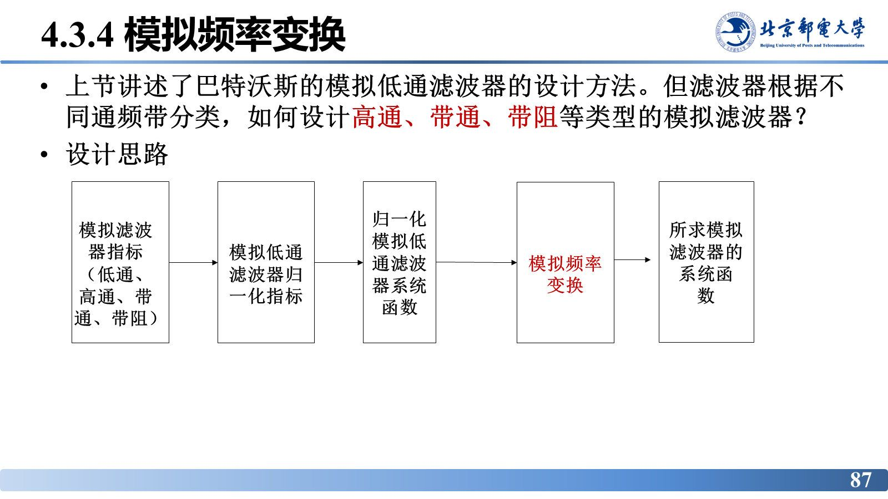
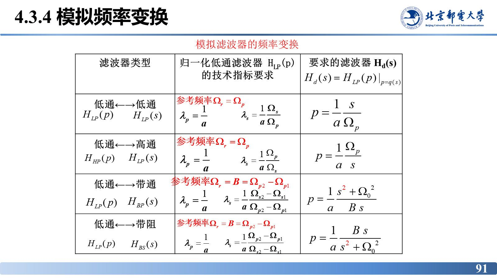
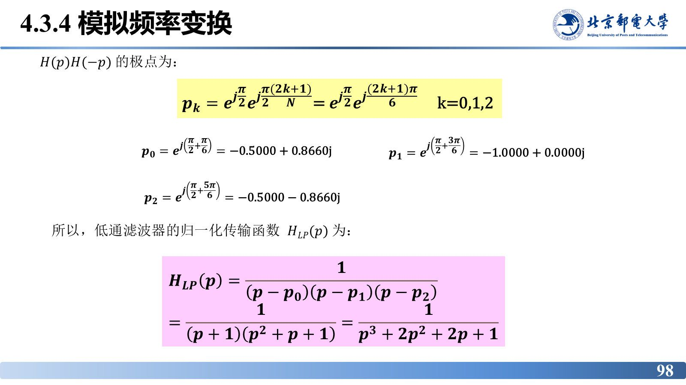

# 模拟频率变换

> **来源**：《信号分析与处理》第4章-20261020.pptx，第 87–101 页（共 101 页）
> **对应课件章节**：4.3.4 模拟频率变换；本章小结

前面只解决了低通。高通、带通、带阻怎么办？答案是不重学一套设计方法，而是**先把指标变换成归一化低通指标，按低通设计出 $H_{lp}(p)$，再用频率变换把 $p$ 换成 $s$ 的有理式**。一套低通设计流程，通吃四类滤波器。

## 核心结论速查

| 项目 | 结论 |
|---|---|
| 设计思路 | 目标滤波器指标 → 归一化低通指标 → 归一化低通 $H_{lp}(p)$ → **模拟频率变换** → 目标系统函数 $H_{d}(s)$ |
| 变换公式 | $H_{d}(s)=H_{lp}(p)\big\vert_{p=q(s)}$，$q(s)$ 为低通到目标类型的映射 |
| 四种映射 | 低通：$p=\dfrac{1}{a}\dfrac{s}{\Omega_{p}}$；高通：$p=\dfrac{1}{a}\dfrac{\Omega_{p}}{s}$；带通：$p=\dfrac{1}{a}\dfrac{s^{2}+\Omega_{0}^{2}}{Bs}$；带阻：$p=\dfrac{1}{a}\dfrac{Bs}{s^{2}+\Omega_{0}^{2}}$ |
| 参考频率 | 低通/高通：$\Omega_{r}=\Omega_{p}$；带通/带阻：$\Omega_{r}=B=\Omega_{p2}-\Omega_{p1}$ |
| 归一化通带 | 四种变换统一为 $\lambda_{p}=1/a$（$a$ 为归一化常数，通常取 1） |
| 归一化阻带 | 低通 $\lambda_{s}=\dfrac{1}{a}\dfrac{\Omega_{s}}{\Omega_{p}}$；高通 $\lambda_{s}=\dfrac{1}{a}\dfrac{\Omega_{p}}{\Omega_{s}}$；带通 $\lambda_{s}=\dfrac{1}{a}\dfrac{\Omega_{s2}-\Omega_{s1}}{\Omega_{p2}-\Omega_{p1}}$；带阻 $\lambda_{s}=\dfrac{1}{a}\dfrac{\Omega_{p2}-\Omega_{p1}}{\Omega_{s2}-\Omega_{s1}}$ |
| 几何对称条件 | 带通/带阻的四条截止频率关于中心频率 $\Omega_{0}$ 几何对称：$\Omega_{0}^{2}=\Omega_{p1}\Omega_{p2}=\Omega_{s1}\Omega_{s2}$ |
| 对称性结论 | 由归一化低通变换得到的带通、带阻滤波器**都是关于 $\Omega_{0}$ 几何对称的** |
| 不对称时 | 必须在满足设计指标的前提下**先调整截止频率**，用调整后的几何对称参数设计 |
| 阻带调整 | $\hat{\Omega}_{s1}=\dfrac{\Omega_{0}^{2}}{\Omega_{s2}}$，取 $A_{s}=\max\{A_{s1},A_{s2}\}$ |
| 通带调整 | $\hat{\Omega}_{p1}=\dfrac{\Omega_{0}^{2}}{\Omega_{p2}}$，取 $A_{p}=\min\{A_{p1},A_{p2}\}$ |

---

## 设计思路

$$H_{d}(s)=H_{lp}(p)\big\vert_{p=q(s)}$$

即：把目标滤波器的技术指标按参数表换算成归一化低通指标（$\lambda_{p}$、$\lambda_{s}$、$A_{p}$、$A_{s}$），用巴特沃斯/切比雪夫/椭圆逼近设计出 $H_{lp}(p)$，最后查变换表得到非归一化的 $H_{d}(s)$。

映射 $q(s)$ 的作用是把 $S$ 平面的不同区域"折"回归一化低通的频率轴：带通/带阻的映射是 $s$ 的二阶有理式（把两个频段折叠到一条），高通是倒数型映射，低通只差一个频率缩放。四种变换的完整关系（课件第 91 页频率变换表）：

| 滤波器类型 | 归一化低通 $H_{LP}(p)$ 的技术指标要求 | 要求的滤波器 $H_{d}(s)=H_{LP}(p)\big\vert_{p=q(s)}$ |
|---|---|---|
| 低通 ←→ 低通 | 参考频率 $\Omega_{r}=\Omega_{p}$；$\lambda_{p}=\dfrac{1}{a}$，$\lambda_{s}=\dfrac{1}{a}\cdot\dfrac{\Omega_{s}}{\Omega_{p}}$ | $p=\dfrac{1}{a}\cdot\dfrac{s}{\Omega_{p}}$ |
| 低通 ←→ 高通 | 参考频率 $\Omega_{r}=\Omega_{p}$；$\lambda_{p}=\dfrac{1}{a}$，$\lambda_{s}=\dfrac{1}{a}\cdot\dfrac{\Omega_{p}}{\Omega_{s}}$ | $p=\dfrac{1}{a}\cdot\dfrac{\Omega_{p}}{s}$ |
| 低通 ←→ 带通 | 参考频率 $\Omega_{r}=B=\Omega_{p2}-\Omega_{p1}$；$\lambda_{p}=\dfrac{1}{a}$，$\lambda_{s}=\dfrac{1}{a}\cdot\dfrac{\Omega_{s2}-\Omega_{s1}}{\Omega_{p2}-\Omega_{p1}}$ | $p=\dfrac{1}{a}\cdot\dfrac{s^{2}+\Omega_{0}^{2}}{Bs}$ |
| 低通 ←→ 带阻 | 参考频率 $\Omega_{r}=B=\Omega_{p2}-\Omega_{p1}$；$\lambda_{p}=\dfrac{1}{a}$，$\lambda_{s}=\dfrac{1}{a}\cdot\dfrac{\Omega_{p2}-\Omega_{p1}}{\Omega_{s2}-\Omega_{s1}}$ | $p=\dfrac{1}{a}\cdot\dfrac{Bs}{s^{2}+\Omega_{0}^{2}}$ |

其中 $a$ 为归一化常数（一般取 $a=1$，此时 $\lambda_{p}=1$，与 4.3.1 节巴特沃斯设计的归一化一致）；带通与带阻的 $B=\Omega_{p2}-\Omega_{p1}$ 为带宽，$\Omega_{0}$ 为中心频率。注意带通的 $\lambda_{s}$ 与带阻互为倒数关系——两者一个"分子为阻带宽度"、一个"分子为通带宽度"，写反会直接算错阶数。

## 几何对称性：带通/带阻设计的前提

当所求带通或带阻滤波器的两个通带截止频率和两个阻带起始频率都关于中心频率 $\Omega_{0}$ 呈几何对称时，有

$$\Omega_{0}^{2}=\Omega_{p1}\Omega_{p2}=\Omega_{s1}\Omega_{s2}$$

由归一化低通滤波器频率转换得到的带通滤波器和带阻滤波器，**都是关于 $\Omega_{0}$ 呈几何对称的**。因此当给定指标不满足对称特性时，必须在满足设计指标的前提下**首先调整截止频率**，再以调整后的几何对称参数进行设计。

**调整规则**：

- 阻带侧：令 $\hat{\Omega}_{s1}=\dfrac{\Omega_{0}^{2}}{\Omega_{s2}}$；若 $\hat{\Omega}_{s1}>\Omega_{s1}$，说明原阻带指标偏松，改用 $\hat{\Omega}_{s1}$ 重标；两侧衰减不同时取更严者 $A_{s}=\max\{A_{s1},A_{s2}\}$。
- 通带侧：同理 $\hat{\Omega}_{p1}=\dfrac{\Omega_{0}^{2}}{\Omega_{p2}}$；取 $A_{p}=\min\{A_{p1},A_{p2}\}$。

一句话：**指标偏松的一侧要被"收紧"到对称位置，衰减取两侧中更严的那个**。

## 归一化低通指标

调整后，目标滤波器的指标换成归一化低通的四项指标：通带截止 $\lambda_{p}$、阻带起始 $\lambda_{s}$、通带最大衰减 $A_{p}$（dB）、阻带最小衰减 $A_{s}$（dB）。带通/带阻的 $\lambda_{s}$ 用**带宽比**表示，且两者互为倒数：

$$\text{带通：}\ \lambda_{s}=\frac{1}{a}\cdot\frac{\Omega_{s2}-\Omega_{s1}}{\Omega_{p2}-\Omega_{p1}},
\qquad
\text{带阻：}\ \lambda_{s}=\frac{1}{a}\cdot\frac{\Omega_{p2}-\Omega_{p1}}{\Omega_{s2}-\Omega_{s1}}$$

## 例：带阻指标不对称时的处理

**问题**：某带阻滤波器 $\Omega_{p1}=2\pi\times3.1$、$\Omega_{p2}=2\pi\times5.5$，$\Omega_{s1}=2\pi\times3.8$、$\Omega_{s2}=2\pi\times4.8$（单位 MHz），$A_{p}=3$ dB、$A_{s}=20$ dB。

**对称性检查**：

$$\Omega_{p1}\Omega_{p2}=2\pi\times3.1\times2\pi\times5.5\times10^{12}=6.7311\times10^{14}$$
$$\Omega_{s1}\Omega_{s2}=2\pi\times3.8\times2\pi\times4.8\times10^{12}=7.2009\times10^{14}$$

两者不相等，且 $\Omega_{p1}\Omega_{p2}\ne\Omega_{s1}\Omega_{s2}$，**不满足几何对称**。

**调整**：取 $\hat{\Omega}_{p1}=\dfrac{\Omega_{s1}\Omega_{s2}}{\Omega_{p2}}=\dfrac{2\pi\times3.8\times2\pi\times4.8}{2\pi\times5.5}=2\pi\times3.3\ \mathrm{MHz}$。因 $\hat{\Omega}_{p1}=3.3\ \mathrm{MHz}>\Omega_{p1}=3.1\ \mathrm{MHz}$，通带边沿被推向阻带、过渡带变窄，须按更严的 $\hat{\Omega}_{p1}$ 重新标定。

**求阶数**：$\lambda_{p}=1$，$\lambda_{s}=\dfrac{\Omega_{p2}-\hat{\Omega}_{p1}}{\Omega_{s2}-\Omega_{s1}}=\dfrac{2\pi\times5.5-2\pi\times3.3}{2\pi\times4.8-2\pi\times3.8}=2.2$，

$$N\ge\frac{\lg\left(10^{0.1\times20}-1\right)}{2\lg2.2}=2.91\ \Longrightarrow\ N=3$$

**求归一化低通**：$N=3$ 的极点

$$p_{0}=-0.5+0.8660\mathrm{j},\quad p_{1}=-1.0000+0\mathrm{j},\quad p_{2}=-0.5-0.8660\mathrm{j}$$

$$H_{LP}(p)=\frac{1}{(p-p_{0})(p-p_{1})(p-p_{2})}=\frac{1}{(p+1)(p^{2}+p+1)}=\frac{1}{p^{3}+2p^{2}+2p+1}$$

**频率变换**：按带阻映射 $p=\dfrac{Bs}{s^{2}+\Omega_{0}^{2}}$ 代入，得到

$$H_{BS}(s)=\left.H_{LP}(p)\right|_{p=\frac{Bs}{s^{2}+\Omega_{0}^{2}}}
=\frac{s^{6}+2.1603\times10^{3}s^{4}+1.5556\times10^{30}s^{2}+3.7339\times10^{44}}
{s^{6}+2.7646\times10^{7}s^{5}+2.5424\times10^{15}s^{4}+4.2456\times10^{22}s^{3}+1.8308\times10^{39}s^{2}+1.4335\times10^{37}s+3.7339\times10^{44}}$$

**结论**：不对称指标先做几何对称调整（本例把通带下边沿从 3.1 MHz 收紧到 3.3 MHz），再按带宽比 $\lambda_{s}=2.2$ 算得 $N=3$，最后用 $p=Bs/(s^{2}+\Omega_{0}^{2})$ 把三阶归一化低通搬成六阶带阻滤波器——阶数翻倍是带通/带阻变换的固有代价（每个 $p$ 极点变成两个 $s$ 极点）。

## 用模拟频率变换法设计模拟滤波器的步骤

1. 确定低通、高通、带通、带阻模拟滤波器的技术要求（若带通、带阻是**非几何对称**的，要先作参数调整，使其呈对称）；
2. 根据参数表确定归一化低通滤波器的技术指标：通带截止频率 $\lambda_{p}$、阻带起始频率 $\lambda_{s}$、通带衰减 $A_{p}$（dB）、阻带衰减 $A_{s}$（dB）；
3. 根据上述四项指标，用巴特沃斯、切比雪夫或椭圆逼近法设计归一化低通滤波器；
4. 查变换关系表得到要求的非归一化模拟滤波器。

## 本章小结

本章要求掌握四点：**模拟滤波器的性能指标**；**理解无失真传输的基本概念**；**掌握理想滤波器的冲激响应**；**掌握巴特沃斯模拟滤波器的特点和设计方法**。

## 易错点与考点提示

- **先对称、后设计**：带通/带阻指标不对称时必须先调整截止频率，直接用原始指标套公式会得到不满足另一侧要求的滤波器。
- 调整时衰减指标取**更严**的一侧：阻带取 $\max\{A_{s1},A_{s2}\}$、通带取 $\min\{A_{p1},A_{p2}\}$，不要取平均。
- **归一化低通设计完才做变换**：顺序不能反——先变换指标、再设计低通、最后把 $H_{lp}(p)$ 换成 $H_{d}(s)$。
- 带通/带阻的阶数与低通的关系：$N$ 阶低通变换后得到 $2N$ 阶带通/带阻，算实现复杂度时别按 $N$ 算。
- 变换后的 $H_{d}(s)$ 系数可能很大（本例 $10^{44}$ 量级），这是 $\Omega_{0}$、$B$ 的幂次所致，不是算错。

## 自测

1. 模拟频率变换的设计思路分哪几步？为什么必须先设计归一化低通？
2. 带通/带阻滤波器"关于 $\Omega_{0}$ 几何对称"的数学条件是什么？
3. 某带阻滤波器给定 $\Omega_{p1}=3.1$、$\Omega_{p2}=5.5$、$\Omega_{s1}=3.8$、$\Omega_{s2}=4.8$（MHz），判断是否几何对称，并写出调整后的通带下边沿。

参考答案

1. 四步：①确定目标滤波器技术要求（非几何对称先调整）②换算成归一化低通指标 $\lambda_{p}$、$\lambda_{s}$、$A_{p}$、$A_{s}$ ③用巴特沃斯/切比雪夫/椭圆逼近设计归一化低通 $H_{lp}(p)$ ④查变换表（$p=q(s)$）得到非归一化 $H_{d}(s)$。因为四类滤波器的设计只有低通有成熟公式，其余类型都通过频率变换从低通"映射"得到，所以必须先有归一化低通。
2. $\Omega_{0}^{2}=\Omega_{p1}\Omega_{p2}=\Omega_{s1}\Omega_{s2}$，即通带、阻带的截止频率都关于中心频率 $\Omega_{0}$ 成几何对称。
3. $\Omega_{p1}\Omega_{p2}=3.1\times5.5=17.05$，$\Omega_{s1}\Omega_{s2}=3.8\times4.8=18.24$，二者不等，不满足几何对称；调整 $\hat{\Omega}_{p1}=\dfrac{\Omega_{s1}\Omega_{s2}}{\Omega_{p2}}=\dfrac{18.24}{5.5}=3.32\ \mathrm{MHz}$（课件取 $3.3\ \mathrm{MHz}$）。

