# 《信号分析与处理》完整笔记

北京邮电大学《信号分析与处理》课程课件（3 份、361 张幻灯片）整理而成的合并笔记。

> **阅读建议**：本文件是全部笔记的合并版（3 篇 25 章，浓缩版）。
> 用编辑器的大纲（VSCode：`Ctrl+Shift+O`）或下面的目录跳转；
> 只想看某一节时，打开 `笔记/` 下对应的单章文件更轻快。
>
> **来源标注**：每章开头 `> 来源：` 给出对应课件与页码范围；
> 插图均为课件原页渲染图，点击可放大；课件里被设为隐藏、未导出的页面已在正文中注明。
>
> **公式说明**：2.1 节的公式可由课件原始 XML 提取（OMML），01 与 2.2 节的公式是 MathType 对象、
> 无法提取文字，因此这些页的公式以**课件截图为准**，正文 LaTeX 仅供检索与排版参考。

---

## 目录（共 3 篇 25 章）

**第一篇　第一章 绪论**　（《信号分析与处理》01_20260915.pptx，96 页）

1. [课程概况与学习方法](#ch-01)
2. [信号与信息的基本概念](#ch-02)
3. [信号分析与处理的任务与地位](#ch-03)
4. [为什么要学信号分析与处理](#ch-04)
5. [信号的表示与分类](#ch-05)
6. [系统的描述与分类](#ch-06)
7. [发展历程与课程体系](#ch-07)
8. [典型应用领域与信息通信](#ch-08)

**第二篇　2.1 连续时间信号的时域分析**　（《信号分析与处理》2.1节-20260920.pptx，121 页）

9. [典型的连续时间信号（普通信号）](#ch-09)
10. [奇异信号（斜变、阶跃、冲激）](#ch-10)
11. [信号分类说明与本节重难点](#ch-11)
12. [信号的几何变换（平移、反褶、尺度变换）](#ch-12)
13. [信号运算要点回顾与综合变换（含例题）](#ch-13)
14. [信号的微积分运算](#ch-14)
15. [复合运算：相加、相乘与卷积](#ch-15)
16. [信号的分解与矢量空间](#ch-16)
17. [工程案例：音频回声与心电图时域滤波](#ch-17)

**第三篇　2.2 连续时间信号的频域分析**　（《信号分析与处理》2.2节-20260920.pptx，144 页）

18. [引言：为何做频域分析](#ch-18)
19. [周期信号的傅里叶级数](#ch-19)
20. [周期信号的频谱结构](#ch-20)
21. [傅里叶变换的引出与定义](#ch-21)
22. [典型非周期信号的傅里叶变换](#ch-22)
23. [傅里叶变换的性质（一）：线性、对称性、奇偶虚实性、尺度变换、时移、频移](#ch-23)
24. [傅里叶变换的性质（二）：微积分性质与卷积定理](#ch-24)
25. [一般周期信号的傅里叶变换](#ch-25)

---

# 第一篇　第一章 绪论

> 对应课件：《信号分析与处理》01_20260915.pptx，96 页

---

## 1. 课程概况与学习方法

> 单章文件：[01-课程概况与学习方法.md](notes/01-信号分析与处理概述/01-课程概况与学习方法.md)

> 来源：《信号分析与处理》01_20260915.pptx，第 1–7 页、第 40–41 页、第 88–96 页（共 18 页）
> 对应课件章节：第一章 绪论（课程基本信息、前言、1.1 课程概述、课程由来、课程内容与考核要求）

绪论用两个对比实验（一段含噪语音、一张待滤波图像）说明本课程要解决的根本问题——**从噪声中提取有价值的信息**；随后给出全课程的内容地图、重点难点、考核比例与学习建议。

### 核心结论速查

| 项目 | 内容 |
|---|---|
| 课程名称 / 学分 | 信号分析与处理，80 学时（5 学分），教学周 3–18 周、每周 5 课时 |
| 先修课程 | 工科数学分析、线性代数、工程数学（同期学）、电子电路基础 |
| 课程定位 | 连接物理世界与数字世界的桥梁；解决现实问题的基本理论和方法 |
| 课程主线 | 信号（模拟/数字）→ 系统（模拟/数字）→ 处理系统（模拟/数字滤波器） |
| 课程重点 | 信号表示与基本运算（**卷积是重中之重**）、系统性质与响应、各类变换及快速算法、采样与内插定理、模拟及 IIR/FIR 滤波器设计 |
| 课程目标 | 4 条，分别支撑毕业要求指标点 1.4、2.3、4.1、4.2 |
| 成绩构成 | 日常作业 20% + 实验报告 10% + 课堂表现 10% + 期中 20% + 期末 40% |

---

### 课程基本信息（第 1–3 页）

课程名称：**信号分析与处理**。课程沿革：由 3 学分、4 学分版本演进至当前的 **5 学分 / 80 学时**版本（第 40 页）。

> 第 3 页的课程安排图表文字未随文本层导出，具体周次安排以课件原图为准。

### 前言：两个对比实验（第 4–6 页）

**实验一**：同一段语音的 `noisy.wav`（含噪）与 `filtered.wav`（滤波后）版本，听感与波形都明显不同。

**实验二**：图像滤波前后，噪点、边缘与细节被重新分配。

两个实验指向同一结论：解决现实问题的基本理论和方法是**信号分析与处理**；其目标是**从噪声中分析和提取有价值的信息，并实现高效、精准的信息利用**，它是连接物理世界与数字世界的桥梁。

### 课程内容框架（第 7、41、88 页）

课程按五节展开：1.1 信号分析与处理概述；1.2 信号的表示与系统的描述；1.3 发展历程；1.4 应用案例；1.5 信息通信中的信号分析与处理。

主要内容归纳为模拟 / 数字两条并行技术路线，在"信号—系统—处理系统"三个环节上一一对应：

| 环节 | 模拟路线 | 数字路线 |
|---|---|---|
| 01 信号 | 时间与幅度均连续的物理量（声波、电压波形），无限分辨率，是自然现象的直接映射 | 时间离散、幅度量化的二进制序列，由采样与量化得到，便于存储、传输与计算 |
| 02 系统 | 由电阻 R、电容 C、运算放大器等器件构成，直接处理连续信号，响应极快，适合高频实时场景 | 基于 DSP、FPGA 或通用 CPU，以软件算法实现，精度、稳定性与可编程性高 |
| 03 处理系统 | 模拟滤波器：用 RC/RLC 网络直接滤除特定频率成分，无需采样，适合高频实时滤波 | 数字滤波器：用 FIR/IIR 算法数值计算，精度高、无温漂，特性可灵活重构 |

课程章节对应关系：第一章 绪论；第二章 连续时间信号分析；第三章 连续时间系统分析；第四章 模拟滤波器设计与实现；第五章 离散时间信号分析；第六章 离散时间系统分析；第七章 数字滤波器设计与实现。

> 课堂补充：整个处理流程分信号、系统、典型应用系统（滤波器）三步，每步都有模拟与数字两条并行路径。

### 课程的重点与难点（第 89–90 页）

**重点：** 连续（离散）时间信号的表示及基本运算（**卷积运算是重中之重**）；连续（离散）时间系统的性质、单位冲激响应、系统函数、频率响应、零极点分布；DFT、拉氏变换、DTFT、Z 变换、DFS、FFT 的定义与性质；采样与内插定理；模拟及 IIR/FIR 数字滤波器的设计与实现。

**难点：** 信号变换的性质；卷积运算的物理意义；信号的频谱分析；系统的频率响应特性；FFT 算法的蝶形复合；模拟频率变换；线性相位约束。

### 课程的基本要求（第 91 页）

- **课程目标 1**（指标点 1.4）：能够分析和求解信号分析与处理工程问题。
- **课程目标 2**（指标点 2.3）：能够建立信号分析与处理模型并论证方案合理性。
- **课程目标 3**（指标点 4.1）：能够调研评述信号分析与处理技术方案并形成合理结论。
- **课程目标 4**（指标点 4.2）：能够设计信号分析与处理综合实验方案并构建实验系统。

> 课堂补充：四条目标依次培养工程知识综合应用、工程模型抽象与科学论证、工程方案研判、工程实践创新优化四种能力。

### 教材、参考书目与在线资源（第 92–93 页）

教材：齐冬莲、张建良《信号分析与处理》第 4 版，机械工业出版社，2024；参考书：马立玲、沈伟《信号分析与处理》，北京理工大学出版社，2019。教材与讲义在高教社云创平台 <https://ehep.com.cn/> 领取，PPT 由班级微信群或教学云平台发布。

在线资源：浙江大学《信号分析与处理》（国家级精品课）<https://www.bilibili.com/video/BV1gt4y1Q7Az/>；国防科技大学《信号处理与系统》<https://www.bilibili.com/video/BV1BJ411U7wv?p=35>；MIT Oppenheim《Signals and Systems》<http://open.163.com/special/opencourse/signals.html>、MIT《Digital Signal Processing》<http://ocw.mit.edu/resources/res-6-008-digital-signal-processing-spring-2011/>。

### 作业、考试与学习建议（第 94–95 页）

平时作业约每周交一次，上传教学云平台；实验三选一；期中、期末统一闭卷考试。分数构成：日常作业 20%、实验报告 10%、课堂表现 10%、期中 20%、期末 40%。

学习建议：加深概念理解，不要只死记公式；掌握解决问题的思路，重视结论中的启示；注重工程思维并结合专业应用；课外自己推导重要公式、认真做题；多使用 Matlab / Python 等工具。

### 本章思考与讨论（第 96 页）

1. **概念与链路**：以"手机发语音"为例辨析消息、信息与信号的区别，并梳理从发声、编码、传输到解码收听的完整物理信号转换链路。
2. **分析与处理的协同**：以"手机拍照优化"为例，说明信号分析（认知亮度、对比度与色彩分布）与处理（降噪、锐化、增强）如何分工互补。
3. **工程权衡**：以自动驾驶紧急制动或 5G OFDM、智能手环心率监测为例，讨论因果性/稳定性对安全攸关系统的必要性，以及算法精度、功耗、成本与响应速度之间的权衡。

### 易错点与考点提示

- 先修课中的**线性代数与工程数学**是本课程的直接工具，变换（傅里叶、拉普拉斯、Z）与矩阵运算会反复使用。
- 重点列表里的 **DFT** 与单列的 **FFT** 不是一回事：FFT 是 DFT 的快速算法；拉氏变换、DTFT、Z 变换分别面向连续/离散、时域/复频域，注意对应关系。
- 成绩构成中**期末只占 40%**，平时作业 + 实验 + 课堂表现合计 40%，过程性考核比重高，不要指望期末突击。

### 自测

1. 本课程的总学时、学分、授课周次与每周课时分别是多少？
2. 课程目标分别支撑哪几个毕业要求指标点？
3. 用自己的话说出"信号—系统—滤波器"三条主线在模拟与数字两条路线上的对应关系。

参考答案

1. 80 学时（5 学分），教学周 3–18 周，每周 5 个课时。
2. 指标点 1.4、2.3、4.1、4.2。
3. 模拟信号由模拟系统（R、C、运放等）处理，最终用 RC/RLC 网络构成的模拟滤波器滤除特定频率成分；数字信号由数字系统（DSP、FPGA、CPU）处理，最终用 FIR/IIR 算法构成的数字滤波器实现同等甚至更复杂的滤波特性；两条路线在"信号—系统—滤波器"三个环节一一对应。

---

## 2. 信号与信息的基本概念

> 单章文件：[02-信号与信息的基本概念.md](notes/01-信号分析与处理概述/02-信号与信息的基本概念.md)

> 来源：《信号分析与处理》01_20260915.pptx，第 8–12 页（共 5 页）
> 对应课件章节：1.1 信号分析与处理概述（什么是信号）

"信号"这个词必须说清楚：它和消息、信息是什么关系？一段语音、一张照片、一条股票指数曲线，为什么都能写成同一个数学对象——函数？这决定了后面所有变换与运算的对象是什么。

### 核心结论速查

| 概念 | 定义 | 一句话辨析 |
|---|---|---|
| 信号（signal） | 消息的表现形式，是随一些参数变化的某种物理量或物理现象 | 内容的**形式** |
| 消息（message） | 信号的具体内容，可以是语言、文字、图像或数据等 | 形式里的**内容** |
| 信息（information） | 消息中赋予人们的新知识、新概念，即消息中有意义的内容 | 内容里的**意义** |
| 数学描述 | 把信号看成具有一个或多个变量的函数 | 一维/多维 × 连续/离散 |

信号与消息（信息）的关系是**内容和形式的关系**：信号是消息（信息）的物理表现形式，消息（信息）是信号的具体内容。

---

### 信号、消息与信息（第 9 页）

- **信号**：消息的表现形式，是随一些参数变化的某种物理量或物理现象。电信号是应用最广泛的物理量（电压、电流、电荷、磁链等）。
- **消息**：信号的具体内容，可以是语言、文字、图像或数据等。
- **信息**：消息中赋予人们的新知识、新概念，即消息中有意义的内容。

### 信号的数学描述（第 10–12 页）

从数学上可把信号看成**具有一个或多个变量的函数**。有时表示信号的函数关系未知或非常复杂，只能给出波形或数据。三个典型例子：

| 信号 | 表达式 | 维数 | 自变量 |
|---|---|---|---|
| 语音 | $f(t)$ | 一维 | 时间 $t$，**连续** |
| 图像 | $f(x, y)$ | 二维 | 两个空间变量 $x, y$（水平、垂直亮度），**连续** |
| 道琼斯指数 | $f[n]$ | 一维 | 序号 $n$ 取整数，**离散** |

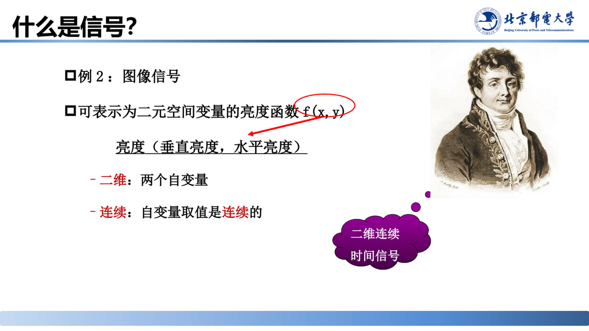

> 课堂补充：电压高低表示图像亮度——高电平对应暗、低电平对应亮，明暗由白经灰到黑的连续过渡对应电压幅度的连续变化，这种用电压波形模拟亮度信息的信号就是"模拟信号"。图像的**频率**对应细节多少（城市部分频率高于天空），**幅度**对应像素大小（太阳照亮区域幅度更高）。

![道琼斯指数走势图 f[n]：一维离散时间信号](images/slides01/page-0012.jpg)

> 课堂补充：若有第二个自变量，则记为二维离散信号 $f[n, m]$。

### 易错点与考点提示

- **信号 ≠ 信息**：信号只是载体，信息是消息中有意义的内容；同一个信号对不同的接收者可能给出不同的信息量。
- 判断"连续/离散"看的是**自变量**，不是函数值：抽样后得到的离散时间信号，其**幅值仍然连续**（第 48–52 页的分类中反复用到）。
- 语音是一维 $f(t)$、图像是二维 $f(x, y)$、指数序列是一维 $f[n]$：**维数 = 自变量个数**，不要与"连续/离散"混为一谈。

### 自测

1. 信号、消息、信息三者的关系是什么？
2. 图像信号 $f(x, y)$ 的自变量是什么？它属于几维、连续还是离散？
3. 为什么说"从数学上可把信号看成具有一个或多个变量的函数"？

参考答案

1. 内容和形式的关系：信号是消息（信息）的物理表现形式，消息（信息）是信号的具体内容。
2. 自变量是两个空间变量 x、y（对应垂直亮度与水平亮度），是二维连续时间（空间）信号。
3. 因为信号是随一些参数变化的物理量，描述它就要给出物理量随自变量（时间、空间等）变化的对应关系，这正是函数；自变量个数决定维数，自变量取值是否连续决定连续/离散。

---

## 3. 信号分析与处理的任务与地位

> 单章文件：[03-信号分析与处理的任务与地位.md](notes/01-信号分析与处理概述/03-信号分析与处理的任务与地位.md)

> 来源：《信号分析与处理》01_20260915.pptx，第 13–23 页（共 11 页）
> 对应课件章节：1.1 信号分析与处理概述（信号分析、信号传输、信号处理）

信号理论包含哪几块内容？"信号分析"和"信号处理"是不是一回事？通过几个日常场景看清二者的分工：分析负责**认知信号**，处理负责**优化信号**。

### 核心结论速查

| 名称 | 任务 | 核心 | 一句话说明 |
|---|---|---|---|
| 信号分析 | 研究和分析信号的基本性能，如信号的表示、频谱、运算等 | 认知信号 | 用数学方法和技术手段研究时域波形、频域频谱，提取核心特征、揭示内在规律 |
| 信号传输 | 发送端消息 → 信号 → 接收端信号 → 消息 | 传递消息 | 即通信，目的是实现消息的传递 |
| 信号处理 | 对信号进行某种加工或变换 | 优化信号 | 在分析基础上做变换、滤波、增强、压缩、识别，剔除冗余和干扰，保留有用信息 |

三者关系：**信号分析是诊断（看清信号里有什么），信号处理是改造（把信号变成想要的样子）。**

---

### 信号理论体系（第 13 页）

信号理论包含三个分支：**信号分析**（研究信号的基本性能，如表示、频谱、运算）、**信号传输**（发送端消息 → 信号 → 接收端信号 → 消息）、**信号处理**（对信号进行某种加工或变换）。

**信号分析**：运用数学方法和技术手段，对信号的**时域波形、频域频谱**等特性进行全面研究，提取核心特征、揭示内在规律的过程，核心是"**认知信号**"。

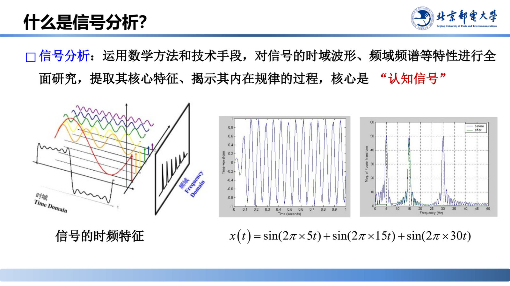

### 什么是信号传输（第 15–16 页）

**信号传输**（即通信）的目的是实现消息的传递。

**远古通信**多为目视方式：烽火台（原始的光通信系统）、旗语（视距范围内传递信息）、航行信号灯等。**现代通信**的传输介质由双绞线 → 同轴电缆 → 微波 → 光纤 → 卫星演进，频段由长波 → 中波 → 短波 → 超短波 → 微波 → 毫米波演进，并由天基、空基、地基平台构成一体化网络。

**抽象的信号传输系统**：为传送消息而装设的全套技术设备（含传输信道），由信息源、发送设备、信道、噪声源、接收设备、受信者组成；消息在发送端变成信号，经信道传输后在接收端被还原成消息。

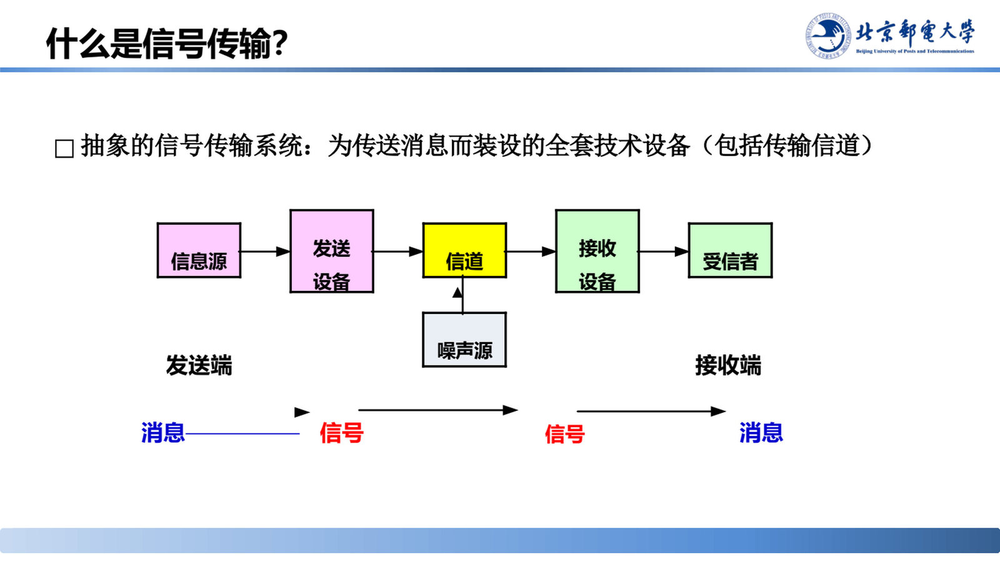

### 什么是信号处理（第 17 页）

**信号处理**：在信号分析的基础上，根据实际需求对信号进行变换、滤波、增强、压缩、识别等操作，以剔除冗余和干扰、保留有用信息，核心是"**优化信号**"。要做的三件事：

1. 消除信号中的多余内容；
2. 滤除混杂的噪声和干扰；
3. 将信号变换成容易分析与识别的形式，便于估计和选择它的特征参量。

#### 五个生活场景

| 场景 | 用到的信号处理方法 |
|---|---|
| 美颜（第 18 页） | 双边滤波、高斯模糊、深度学习去噪 |
| 交通流量预测 / 天气预报（第 19 页） | 时域分析、频域分析、空域分析、深度学习 |
| 医学影像 / 心电图分析 / 智慧医疗（第 20 页） | 影像去噪、边缘锐化、深度学习特征挖掘 |
| MP3 音乐 / 短视频（第 21 页） | 音/视频压缩编码、超分辨率重建、音视频同步、动态降噪、色彩增强 |
| 人脸识别 / 姿态估计（第 22 页） | 目标检测（脸部/身体）、图像预处理、特征提取、知识库比对 |

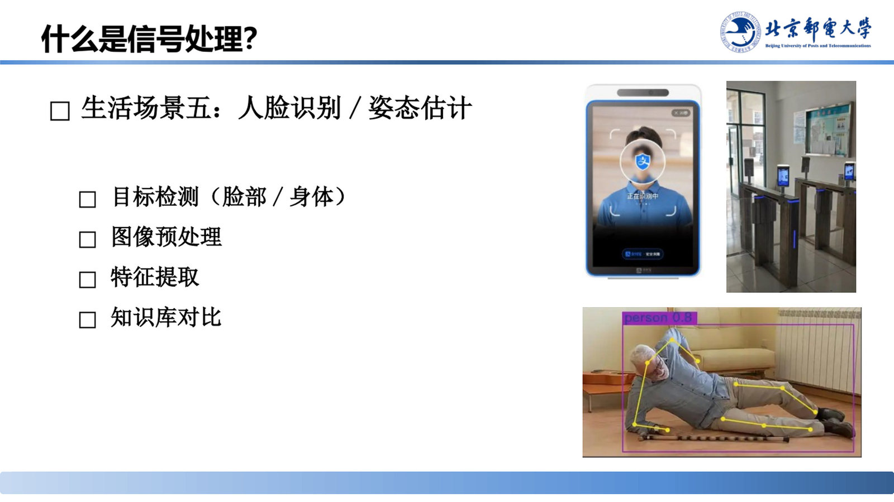

### 信号分析 vs 信号处理：从诊断到改造（第 23 页）

以"一段含噪音频"为例，四步链路展示分析→处理的协同：

| 步骤 | 对象 | 做了什么 |
|---|---|---|
| 原始信号（Raw Signal） | 一段包含背景噪音的音频信号 | 波形杂乱 |
| 信号分析（Signal Analysis） | 分析信号频谱 | 识别出高频区域的噪音成分 |
| 信号处理（Signal Processing） | 应用低通滤波器 | 滤除高频噪音 |
| 最终结果（Final Result） | 一段清晰、无噪音的音频信号 | 波形平滑 |

> 课堂补充：本节按五部分展开——先讲"什么是信号"，再分别深入信号分析和信号处理两个核心概念（可借助"美食家"与"厨师"的比喻理解），之后辨析两者关系，最后用应用案例看技术如何落地。

### 易错点与考点提示

- **分析与处理不是并列的两件事，而是前后衔接的两个环节**：先分析（认清噪声分布在频谱高频区）才能处理（选择低通滤波器）；只有分析清楚，处理才有依据。
- 信号传输系统框图中的**噪声源**作用于信道，它正是后续"随机信号"讨论的现实来源；框图中"消息→信号→消息"的两次转换分别对应发送端的调制编码与接收端的解调译码。
- 判断某个例子属于分析还是处理，看它是在**描述/度量**信号（分析）还是在**改变**信号（处理）。

### 自测

1. 信号分析的"核心"和信号处理的"核心"分别是什么？
2. 抽象的信号传输系统由哪几部分组成？消息与信号在框图中如何相互转换？
3. 给定"分析一段音频的频谱分布"和"用低通滤波器滤掉高频噪声"，分别属于信号分析还是信号处理？

参考答案

1. 信号分析的核心是"认知信号"，信号处理的核心是"优化信号"。
2. 由信息源、发送设备、信道、噪声源、接收设备、受信者组成；发送端把消息变成信号，接收端把信号还原成消息。
3. 前者属于信号分析（认知信号的高频/低频分布），后者属于信号处理（按需求改变信号）。

---

## 4. 为什么要学信号分析与处理

> 单章文件：[04-为什么要学信号分析与处理.md](notes/01-信号分析与处理概述/04-为什么要学信号分析与处理.md)

> 来源：《信号分析与处理》01_20260915.pptx，第 24–39 页（共 16 页）
> 对应课件章节：1.1 信号分析与处理概述（为什么要学习信号分析与处理）

这门课值不值得投入 80 学时？答案是六个层面：生活、理论、技术、行业、个人，以及更本质的"元技能"层面，每一层都有可核对的工程案例。

### 核心结论速查

| 层面 | 一句话定位 | 代表案例（可考事实） |
|---|---|---|
| 生活 | 解决现实问题的刚需 | 手机通话降噪、CT 去噪、MP3 压缩至原文件 1/10、5G OFDM |
| 理论 | 构建现代科技的基础语言 | 傅里叶变换、小波变换、JPEG 的 DCT |
| 技术 | 推动前沿创新的引擎 | CNN（空间域滤波）、MFCC、华为 5G 基站、Neuralink 脑机接口 |
| 行业 | 满足多样化应用需求 | 消费电子 ISP、西门子故障预测 95%、高频交易、卫星遥感 |
| 个人 | 提升职业竞争力的核心技能 | 薪资高于传统 IT 岗 15%–20%、大疆 ISP 算法 |
| 元技能 | 通过数学建模理解世界动态变化的方法论 | 从混沌提取秩序、从局部推断整体、从过去预测未来 |

---

### 一、生活层面：解决现实问题的刚需（第 25–26 页）

- **噪声抑制**：手机通话消除背景噪音；医学影像（如 CT）去噪以清晰显示病灶。
- **弱信号检测**：从地震波中识别微弱的地壳运动信号；从天文数据中捕捉遥远星体的微弱辐射。
- **特征提取**：傅里叶变换把语音分解为频谱以识别不同音素；从心电图中提取心率、心律异常特征。
- **压缩与传输**：MP3 去除人耳不敏感频段，文件缩小至原文件的 **1/10**；JPEG 用离散余弦变换（DCT）减少冗余；5G 用正交频分复用（OFDM）把信号分割为多个子载波并行传输，提升带宽利用率。
- **系统控制与优化**：自动驾驶用激光雷达、摄像头信号实时调整方向盘与油门；用设备振动信号做故障预测与健康管理；做根因分析。

### 二、理论层面：构建现代科技的基础语言（第 27–28 页）

信号分析与处理是**数学、物理与工程学的交叉领域**，其理论体系为现代科技提供核心工具。

- **傅里叶变换**把时域信号分解为频域成分，揭示隐藏结构（音频的音高、图像的纹理）；**小波变换**通过多尺度分析，解决了傅里叶变换无法处理**非平稳信号**（地震波、生物电信号）的问题。
- **物理现象的数字化建模**：把光、声、电等现象转化为数学模型，为系统设计提供依据。雷达通过分析回波的**时延**（测距）与**频率变化**（测速，多普勒效应）实现目标定位与速度测量。

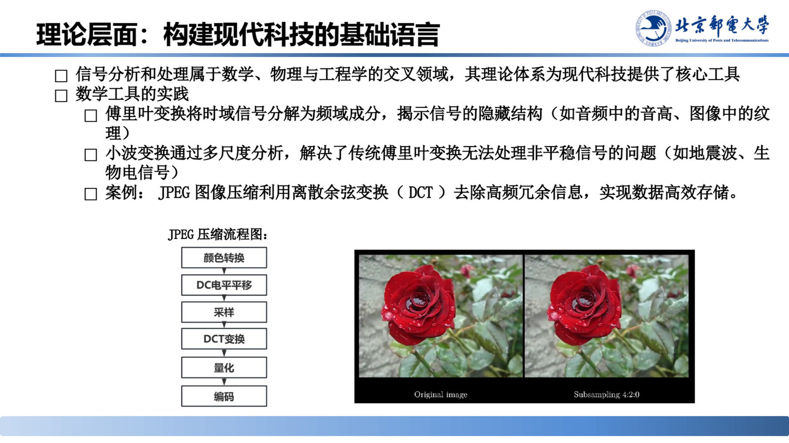

> 课堂补充：第 27 页备注给出 JPEG 压缩的延伸阅读，第 28 页备注给出雷达测距测速的延伸阅读。

### 三、技术层面：推动前沿创新的引擎（第 29–31 页）

信号处理技术是人工智能、通信、生物医学等领域的底层支撑。

- **人工智能**：卷积神经网络（CNN）用卷积核提取图像局部特征，**本质是信号的空间域滤波**；语音识别的梅尔频率倒谱系数（MFCC）与声学模型依赖频域分析；ChatGPT 的语音交互需靠信号处理完成语音—文本双向转换。
- **通信技术**：5G/6G 通过 OFDM 与波束成形实现高速率、低延迟传输；华为 5G 基站靠信号滤波和信道估计在复杂电磁环境中保持通信质量。
- **生物医学**：脑机接口（BCI）分析脑电信号（EEG）的频段特征（α 波、β 波）实现意念控制设备；Neuralink 的脑机芯片通过实时信号处理把神经元活动转化为计算机指令。

### 四、行业层面：满足多样化应用需求（第 32–35 页）

| 行业 | 典型应用与可考事实 |
|---|---|
| 消费电子 | 智能手机降噪麦克风用自适应滤波抑制背景噪声；相机美颜用图像信号处理（ISP）优化色彩、对比度和锐度 |
| 工业制造 | 通过振动信号分析轴承故障特征频率做预测性维护；西门子工业平台把设备故障预测准确率提升至 **95%** |
| 金融科技 | 高频交易分析市场数据的时序特征（波动率、相关性）构建量化策略，在毫秒级完成交易决策；相关工具 Kdb+ 时序数据库 |
| 环境保护 | 分析水体光谱信号检测污染物浓度；NASA 用卫星遥感信号监测全球海洋温度与赤潮 |

> 课堂补充：以上四页备注均给出延伸阅读资料。

### 五、个人层面：提升职业竞争力的核心技能（第 36–37 页）

- **跨学科就业优势**：信号处理工程师需同时具备数学、编程与领域知识（医学、金融），属复合型人才；LinkedIn 统计其岗位平均薪资高于传统 IT 岗位 **15%–20%**。
- **创业与创新机会**：信号处理是硬件创新（传感器、芯片）与软件算法（AI 模型）之间的桥梁；大疆无人机通过优化 ISP 算法实现低光照环境下的高清拍摄。
- **持续学习**：领域内持续涌现量子信号处理、神经形态计算等新技术；建议从 MATLAB/Python 实操入手，再学 TensorFlow、PyTorch 中的信号处理模块。

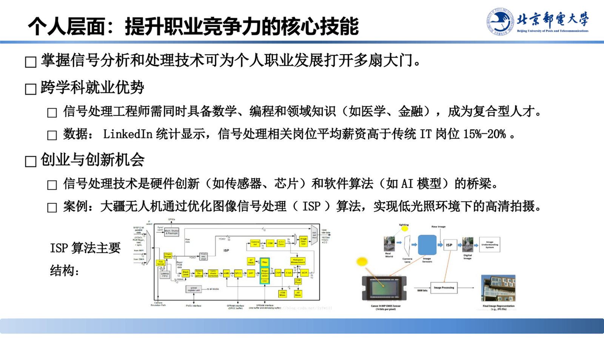

### 六、元技能层面：理解世界动态变化的方法论（第 38 页）

信号分析与处理不仅是技术工具，更是一种通过数学建模理解世界动态变化的方法论：从**混沌**中提取**秩序**（降噪）、从**局部**推断**整体**（频谱分析）、从**过去**预测**未来**（时序预测）。在 AI 驱动的未来，它将成为连接物理世界与数字智能的通用语言。

### 行业标杆人物（第 39 页）

| 人物 | 单位 | 标签 |
|---|---|---|
| 耿鹏 | 中兴通讯 | 5G/6G 通信信号处理领跑者 |
| 李海洲 | 新加坡国立大学 / 快商通 | 语音信号处理产业化先锋 |
| 谢磊 | 西北工业大学 | 音频信号处理产学研融合标杆 |
| 迈克尔·戴尔 | 戴尔科技 | 数据驱动商业决策的典范 |
| Zheng-Hua Tan | 丹麦奥尔堡大学 | 噪声鲁棒语音处理开拓者 |

他们的共同点：以**数学建模**理解信号本质，以**工程思维**解决实际问题，以**商业洞察**推动技术落地。

### 易错点与考点提示

- 六个层面里最容易被考的是**案例与技术的对应关系**：DCT ↔ JPEG 压缩，OFDM/波束成形 ↔ 5G/6G，MFCC ↔ 语音识别，α/β 波 ↔ 脑机接口，自适应滤波 ↔ 降噪耳机。
- 傅里叶变换适合**平稳信号**的整体频谱结构，**小波变换的多尺度分析解决了傅里叶变换无法处理非平稳信号的问题**——两者分工要分清。
- CNN 的卷积核提取局部特征，本质是**空间域滤波**，这句话把深度学习和传统信号处理连起来看，常作为简答考点。

### 自测

1. 为什么说 JPEG 图像压缩是"信号分析理论在工程中的直接落地"？
2. 雷达测距与测速分别利用回波信号的什么变化？
3. 信号处理的"元技能"体现在哪三个方面？

参考答案

1. 因为 JPEG 用离散余弦变换（DCT）把图像变换到频率域，去除人眼不敏感的高频冗余信息，属于把"变换—频域分析"这一理论工具直接用于数据压缩。
2. 测距利用回波信号的**时延**，测速利用回波信号的**频率变化**（多普勒效应）。
3. 从混沌中提取秩序（降噪）、从局部推断整体（频谱分析）、从过去预测未来（时序预测）。

---

## 5. 信号的表示与分类

> 单章文件：[05-信号的表示与分类.md](notes/01-信号分析与处理概述/05-信号的表示与分类.md)

> 来源：《信号分析与处理》01_20260915.pptx，第 42–59 页（共 18 页）
> 对应课件章节：1.2.1 信号的表示；信号的分类（确定/随机、连续/离散、周期/非周期、能量/功率）

一个信号可以用几种方式写下来？面对五花八门的物理量，怎样用有限的几个维度归类，从而决定用哪套数学工具去分析？本节给出信号的**三种表示法**与**四组分类**，是全课程的概念底座：先分清对象是连续还是离散、确定还是随机、周期还是非周期、能量型还是功率型，才能选对变换和算法。

### 核心结论速查

| 分类维度 | 两类对象 | 判别依据 |
|---|---|---|
| 确定性 | 确定信号 / 随机信号 | 指定时刻 t 能否确定函数值 x(t) |
| 自变量 | 连续时间信号 x(t) / 离散时间信号 x[n] | 自变量取值是否连续；**幅值**是否离散另行区分模拟/数字信号 |
| 周期性 | 周期信号 / 非周期信号 | 是否存在 T>0 使 x(t+T)=x(t)（离散为 x[n+N]=x[n]） |
| 能量功率 | 能量信号 / 功率信号 | E<∞（则 P=0）为能量信号；P<∞（则 E=∞）为功率信号 |

| 关键公式 | 表达式 | 适用条件 |
|---|---|---|
| 连续周期 | $x(t)=x(t+T)$，最小正 T 为基本周期 | T 为正数 |
| 离散周期 | $x[n]=x[n+N]$，最小正 N 为基本周期 | N 为正整数 |
| 信号能量 | $E=\int_{-\infty}^{\infty}\lvert f(t)\rvert^{2}\,dt$ | 1Ω 电阻上的能量 |
| 平均功率 | $P=\lim_{T\to\infty}\dfrac{1}{2T}\int_{-T}^{T}\lvert f(t)\rvert^{2}\,dt$ | 1Ω 电阻上的平均功率 |

---

### 信号的三种表示法（第 42 页）

- **公式法**：给出解析表达式，便于运算与推导。
- **图形法**：画出波形，横轴为自变量（通常是时间 t），纵轴为幅度，直观看出变化规律。
- **表格法**：把离散自变量取值与对应函数值列成表，适合实验数据或离散序列。

### 信号的分类总览（第 43 页）

信号可按四组维度分类：**确定信号与随机信号**、**连续时间信号与离散时间信号**、**周期信号与非周期信号**、**能量信号与功率信号**。

### 一、确定信号与随机信号（第 44–47 页）

**确定信号**（第 44 页）：对于指定的某一时刻 t，可确定一相应的函数值 x(t)（若干不连续点除外）；信号可以用确定的时间函数（或确定的数列）描述，给定时刻就能算出或量出确定的取值。课件该页内嵌持续运行的 canvas 动画（原 PPT 内嵌浏览器对象），教学时现场运行以观察确定信号的波形，静态导出未渲染出内容。

**随机信号**（第 46 页）：也称不确定信号，不是时间的确定函数，只能用统计特性（均值、方差、概率分布）描述，具有未可知的不确定性。该页同样内嵌了一个使用噪声（noise）类型的演示，用于呈现随机信号不可预测的波形。

> 课堂补充：第 46 页备注指出该页中的符号 x[k] 应写成 x[n]。

#### 平稳高斯信号与非平稳非高斯信号（第 47 页）

| 项目 | 01 平稳高斯信号 | 02 非平稳非高斯信号 |
|---|---|---|
| 定义 | 统计特性（均值、方差）不随时间变化，幅值严格服从正态分布 | 统计特性随时间演变，幅值分布呈现尖峰、重尾或不对称特征 |
| 波形特征 | 平稳无趋势，波动范围恒定，呈经典的"钟形曲线"分布 | 存在趋势、突变或周期变化，极端值出现概率更高 |
| 幅值分布 | 高斯分布：对称钟形，数据集中于均值，极端值概率低 | 非高斯分布：尖峰重尾，极端异常值更容易出现 |
| 典型场景 | 通信系统中的背景噪声、恒温下的电子热噪声 | 股票价格走势、地震波、机械故障时的振动信号 |

> 课堂补充：平稳高斯是一种理想化模型——统计特性恒定、任何时刻取值都遵循钟形分布；非平稳非高斯更贴近现实（如股票价格），统计特性随时间变化、分布呈尖峰重尾。前者"静态且规则"，后者"动态且不规则"；理解二者区别对选择正确的分析方法至关重要。

### 二、连续时间信号与离散时间信号（第 48–53 页）

**连续时间信号**（第 48 页）：在观测过程的连续时间范围内，除若干不连续点之外，对于任意时间值都可以给出确定的函数值，通常记作 $x(t)$。**模拟信号**是时间和幅值**均为连续**的信号。

**离散时间信号**（第 49 页）：仅在规定的离散时刻有定义，通常记作 $x[n]$，$n$ 为整数。**数字信号**是时间和幅值**均为离散**的信号。

**离散时间信号举例**（第 50 页）：成绩分布、大庆油田 1960–2020 油气产量结构图等，都是以离散自变量（第几名学生、第几年）给出的序列。

**模拟信号与数字信号的关系**（第 51–52 页）：模拟信号经**抽样**得到离散时间信号，再经**量化**得到数字信号。

> 课堂补充："连续时间信号和离散时间信号"一节还内嵌了交互演示（原 PPT 内嵌浏览器对象），教学时现场运行以展示离散化过程。

### 三、周期信号与非周期信号（第 54–57 页）

**连续时间周期信号**（第 54 页）：若存在正数 $T$ 使 $x(t)=x(t+T)$ 成立，则 $x(t)$ 为周期信号；满足条件的最小正 $T$ 称为**基本周期**。

**离散时间周期信号**（第 55 页）：若存在正整数 $N$ 使 $x[n]=x[n+N]$ 成立，则 $x[n]$ 为周期信号；满足条件的最小正 $N$ 称为**基本周期**。课件在此另附"注意"说明（原页以图形/公式对象给出，文本层未导出），并以 $N=20$ 的示例波形说明。

> **关键价值**：只需掌握一个周期内的波形特征，即可推演信号在全部时间轴上的形态，极大简化分析与处理的复杂度。

**非周期信号**（第 56 页）：不满足周期信号定义的信号。

> **关键价值**：非周期信号承载丰富且独特的信息，通常包含宽广的频率成分，是处理突发信息、语音通信和随机过程的基础。

> 课堂补充："周期信号和非周期信号"一节内嵌的演示使用锯齿波（sawtooth）波形，用于观察周期信号的持续波形。

### 四、能量信号与功率信号（第 58–59 页）

#### 定义（第 58 页）

信号可以看作随时间变化的电压或电流，信号 $f(t)$ 在 1Ω 电阻上的瞬时功率为 $f^{2}(t)$，在区间 $(-\infty, \infty)$ 消耗的总能量定义为

$$E = \int_{-\infty}^{\infty} \lvert f(t) \rvert^{2} \, dt$$

其平均功率定义为

$$P = \lim_{T \to \infty} \frac{1}{2T} \int_{-T}^{T} \lvert f(t) \rvert^{2} \, dt$$

信号能量 $E$ 和信号功率 $P$ 都是**非负实数**：

- 若 $E < \infty$，称为能量有限信号，简称**能量信号**，此时 $P = 0$。
- 若 $P < \infty$，称为功率有限信号，简称**功率信号**，此时 $E = \infty$。

#### 两类信号的特征与实例（第 59 页）

| 项目 | 01 能量信号（Energy Signal） | 02 功率信号（Power Signal） |
|---|---|---|
| 总能量 | 总能量为有限值 | 总能量为无穷大 |
| 平均功率 | 平均功率为零 | 平均功率为有限值 |
| 能量分布 | 能量集中在有限的时间范围内，不会随时间无限累积 | 信号持续时间无限，能量随时间不断累积，但单位时间内的功率保持恒定 |
| 数学表示 | $E=\int_{-\infty}^{\infty}\lvert x(t)\rvert^{2}dt$ | $P=\lim_{T\to\infty}\dfrac{1}{2T}\int_{-T}^{T}\lvert x(t)\rvert^{2}dt$ |
| 典型示例 | 相机闪光灯：极短时间内发出强光，能量有限但平均功率几乎为零 | 持续点亮的灯泡：总能量随时间无限累积，但单位时间消耗的功率（亮度）恒定 |

> 课堂补充：这是按总能量和平均功率是否有限来划分的。能量信号的典型例子是矩形脉冲信号，只在很短的时间内存在，能量有限；功率信号则相反，典型例子是正弦信号，一直持续、能量不断累积，但平均功率是固定值。

### 易错点与考点提示

- **抽样 ≠ 量化**：抽样只离散化**时间**（得到离散时间信号，幅值仍连续），量化才离散化**幅值**（得到数字信号）。这是本节最高频的失分点。
- **连续/离散**看自变量，**模拟/数字**看时间和幅值是否都连续。因此"离散时间信号"不一定"数字"，"数字信号"一定离散。
- **周期性的最小周期**：满足条件的最小正 T（或正 N）才叫基本周期；对离散周期信号，N 必须是正整数，这一点与连续情形的 T 为任意正实数不同。
- **能量信号与功率信号互斥**：能量信号 P=0，功率信号 E=∞，不存在"既有界又无穷"的信号；判断时先算 E 再算 P，不要同时假设两者都有限。
- **平稳 ≠ 高斯**：平稳说的是统计特性（均值、方差）不随时间变化，高斯说的是幅值的概率分布形状，两者独立，可以组合出四种情形。

### 自测

1. 信号的三种表示法各自适合什么场合？
2. 写出连续时间周期信号与离散时间周期信号的定义，并说明"基本周期"是什么。
3. 已知某信号 $E$ 有限而 $P=0$，它属于哪类信号？再举出一个功率信号的例子。
4. 抽样后得到的信号是数字信号吗？为什么？

参考答案

1. 公式法适合解析推导与运算；图形法适合直观观察波形与变化规律；表格法适合实验数据、离散序列的逐点记录。
2. 连续：存在正数 T 使 x(t)=x(t+T) 成立，则 x(t) 为周期信号，最小的正 T 为基本周期；离散：存在正整数 N 使 x[n]=x[n+N] 成立，则 x[n] 为周期信号，最小的正 N 为基本周期。
3. 属于能量信号（E<∞，P=0）；功率信号的例子：持续点亮的灯泡、正弦信号、恒温下的电子热噪声。
4. 不是。抽样只把时间离散化，幅值仍然连续，得到的是离散时间信号（抽样信号）；还需再经量化使幅值也离散，才是数字信号。

---

## 6. 系统的描述与分类

> 单章文件：[06-系统的描述与分类.md](notes/01-信号分析与处理概述/06-系统的描述与分类.md)

> 来源：《信号分析与处理》01_20260915.pptx，第 60–74 页（共 15 页）
> 对应课件章节：1.2.2 系统的描述；系统的分类

信号要被"加工"，加工者就是系统。怎样用数学语言把一个系统写下来（微分方程/差分方程/方框图/状态变量）？面对一个具体系统，怎样判断它是不是线性的、时不变的、因果的、稳定的？这四条性质决定了后面能不能用卷积、变换和滤波器这套工具。

### 核心结论速查

| 系统性质 | 判别要点 | 满足时能带来什么 |
|---|---|---|
| 线性 | 同时满足**齐次特性**与**叠加特性** | 输出是输入的线性组合，可用卷积描述 |
| 非时变（时不变） | 零状态条件下，输出响应与输入激励的关系不随激励作用的起点改变；判断时**不涉及初始状态** | 系统特性不随时间漂移，可用冲激响应表征 |
| 因果 | 某时刻输出只由当前和过去时刻的输入决定，不依赖未来输入 | 物理可实现、可实时处理 |
| 稳定（BIBO） | 有界输入产生有界输出，输出不发散 | 系统不会失控 |

本课程聚焦：**线性、时不变、因果、稳定**的连续时间系统与离散时间系统。

---

### 系统与系统描述（第 60–61 页）

**系统**是由若干相互关联、相互作用的部分组成，具备特定功能、能完成某类任务的有机整体；施加于系统的信号称为**输入信号**，由此产生的响应信号称为**输出信号**。

**系统可定义为对输入信号进行加工、变换、处理，并产生输出信号的物理装置。**

**系统描述**就是建立描述系统基本特性的数学模型，有两条路径：**输入输出描述**（通过系统外部的输入与输出描述）与**状态变量描述**（通过系统内部的状态变量描述）。

### 连续时间系统的描述（第 62–63 页）

连续时间系统的输入输出描述包含两种模型：**数学模型**（用微分方程描述输入与输出的关系）与**方框图模型**（用基本功能部件的联结表示）。

**数学模型的建立**：根据实际系统的物理特性列写微分方程。对电路系统，主要依据**元件特性约束**与**网络拓扑约束**：

- **元件特性约束**：表征元件特性的关系式，例如二端元件电阻、电容、电感各自的电压与电流关系，四端元件互感的初、次级电压与电流关系等。
- **网络拓扑约束**：由网络结构决定的电压电流约束关系，即 KCL、KVL。

### 离散时间系统的描述（第 64–65 页）

离散时间系统的输入输出描述同样包含**差分方程**（数学模型）与**方框图模型**。

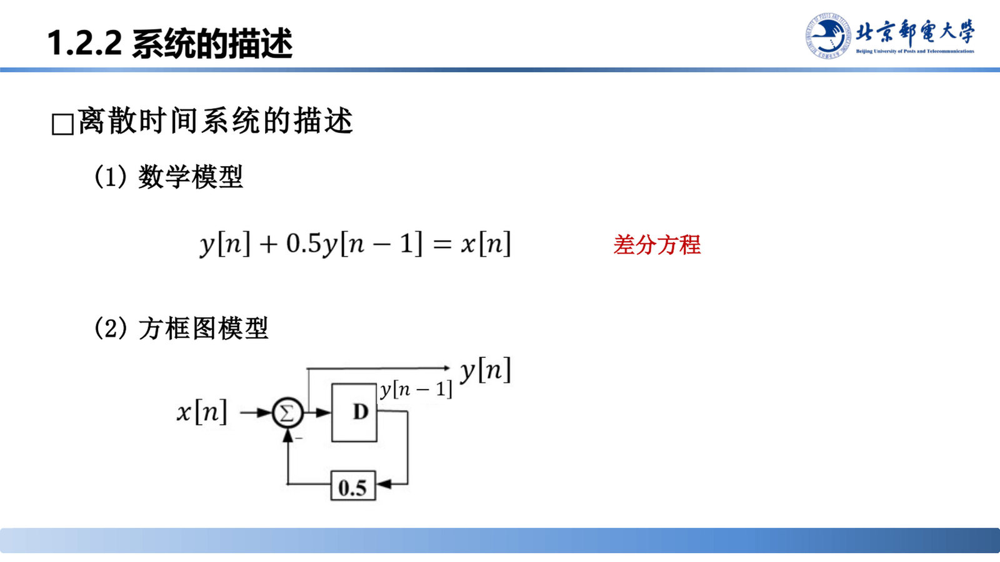

- **差分方程的阶数**：方程中变量的最高和最低序号差数即阶数；若第 n 个输出决定于刚过去的几个输出值及输入值，则描述它的差分方程就是几阶的。
- **微分方程与差分方程的关系**：微分方程可以用差分方程逼近；微分方程解是**精确解**，差分方程解是**近似解**，两者有许多类似之处。
- 差分方程的通式（N 阶常系数线性差分方程，课件以公式对象给出）：

$$\sum_{k=0}^{N} a_k\, y[n-k] = \sum_{m=0}^{M} b_m\, x[n-m]$$

### 系统的分类总览（第 66 页）

1. 线性系统与非线性系统；2. 非时变系统与时变系统；3. 因果系统与非因果系统；4. 稳定系统与非稳定系统；5. 连续时间系统与离散时间系统。

### 一、线性系统与非线性系统（第 67–68 页）

**线性系统**具有线性特性，包含齐次特性与叠加特性：

- **(1) 齐次特性**：若激励 $x(t)$ 产生响应 $y(t)$，则对任意常数 $a$，激励 $a\,x(t)$ 产生响应 $a\,y(t)$，即 $x(t) \to y(t) \;\Longrightarrow\; a\,x(t) \to a\,y(t)$。
- **(2) 叠加特性**：若 $x_1(t) \to y_1(t)$、$x_2(t) \to y_2(t)$，则 $x_1(t) + x_2(t) \to y_1(t) + y_2(t)$。

**非线性系统**：不具有线性特性的系统。

| 关键维度 | 线性系统 | 非线性系统 |
|---|---|---|
| 叠加特性 | 严格满足齐次性与可加性，输出是输入的线性代数和 | 不满足叠加原理，输出包含输入信号的非线性组合项 |
| 频谱变化 | 仅改变频率成分的幅度，不产生新的频率分量 | 产生新的谐波和互调产物，改变信号的音色结构 |
| 类比与效果 | 如同"镜子"：只改变幅度，不改变波形形状 | 会"扭曲"波形，产生原始信号中不存在的新频率分量 |
| 典型场景 | 专业音频混音器把人声、吉他、鼓无损叠加，是录音与扩声的基础 | 电吉他失真效果器刻意制造波形畸变塑造摇滚音色；音量过载导致的"破音" |

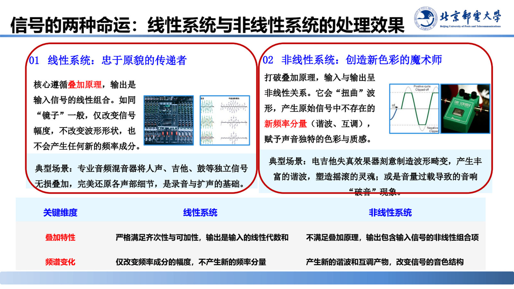

### 二、非时变系统与时变系统（第 69–70 页）

**非时变（时不变）系统**：在**零状态条件**下，系统的输出响应与输入激励的关系不随输入激励作用于系统的起点而改变。**时变系统**：不满足非时变特性的系统。在判断系统的非时变特性时，**不涉及系统的初始状态**。

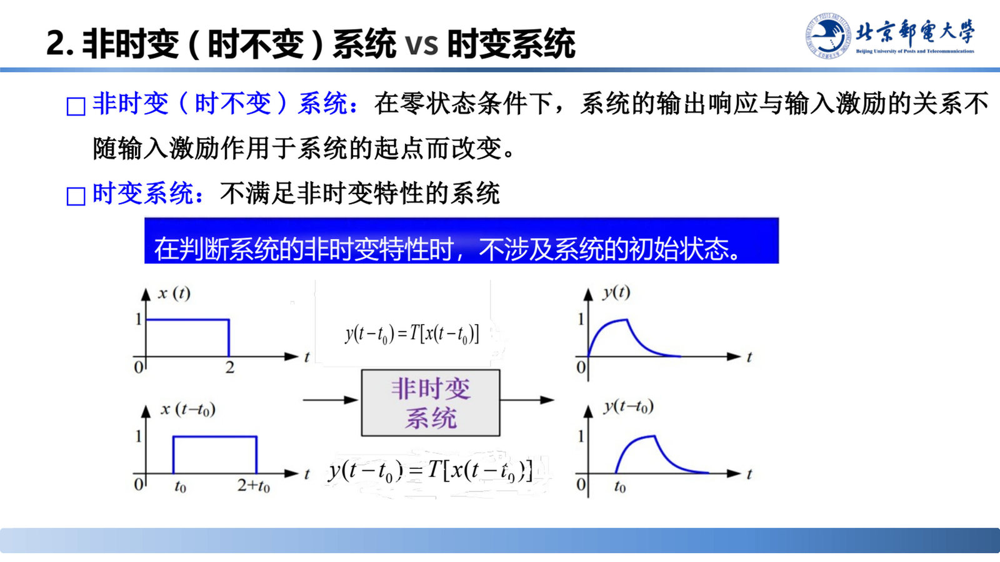

| 项目 | 01 时不变系统（Time-Invariant） | 02 时变系统（Time-Varying） |
|---|---|---|
| 定义 | 运行规则与特性不随时间推移改变，输出仅取决于输入信号的形式，而非输入发生的具体时间点 | 内部参数或外部环境随时间动态变化，相同输入在不同时刻产生不同输出 |
| 特征 | **延迟不变性**：输入延迟 τ，输出同步延迟 τ；**行为一致性**：何时输入相同信号，输出特性都稳定无漂移 | **响应依赖性**：输出与输入发生的具体时间点强相关；**环境耦合性**：特性受天气、温度、噪声等实时影响 |
| 经典案例 | 录制好的数字视频文件：编码规则固定，今天或十年后播放画面与音效都不变 | 无线通信信号传输：受降雨、风速、电离层变化影响，同一信号在晴天与雷雨天质量、衰减截然不同 |

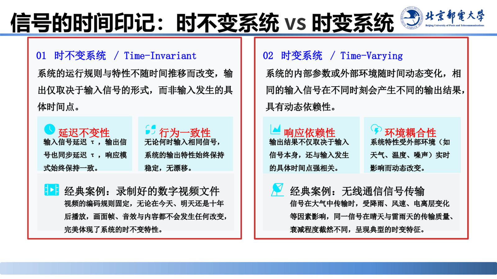

### 三、因果系统与非因果系统（第 71 页）

| 项目 | 01 因果系统（Causal System） | 02 非因果系统（Non-Causal System） |
|---|---|---|
| 定义 | 某一时刻的输出仅由当前时刻和过去时刻的输入决定，不依赖未来的输入，符合物理世界客观规律 | 输出依赖于未来时刻的输入信号 |
| 可实现性 | 物理可实现、可制造；输出无超前依赖 | 无法实时实现，需预知未来输入；仅用于理论分析、离线后处理 |
| 典型案例 | 测温仪器：温度计读数只反映当下或刚刚过去的环境温度 | 音频后期处理：双向平滑滤波处理当前点需用到后续数据，实时播放不可能实现，离线编辑中很常见 |

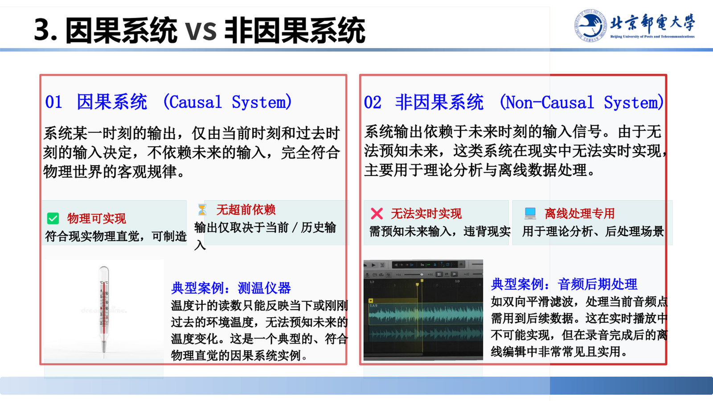

### 四、稳定系统与非稳定系统（第 72 页）

| 项目 | 01 稳定系统（Stable System） | 02 非稳定系统（Unstable System） |
|---|---|---|
| 核心特征 | 遵循"**有界输入，有界输出**"原则（BIBO）：无论输入如何变化，输出始终保持在可控范围内，不发散、不失控 | 即使是微小的有界输入，也可能引发输出幅值无限增长；存在正反馈机制，状态迅速失控甚至崩溃 |
| 实例 | 灯光调光器：旋钮调节幅度有限，亮度也在 0 到最大值之间平稳变化 | 麦克风啸叫：微弱环境噪音被不断放大并形成正反馈循环，输出能量急剧攀升直至过载 |

> 课堂补充：这里讨论的是有界输入有界输出稳定性（BIBO 稳定）。稳定系统像灯光调光器，给有限调节信号就输出有限亮度；非稳定系统的经典例子是麦克风与音箱之间的啸叫。设计系统时稳定性是必须考虑的关键因素。

### 五、连续时间系统与离散时间系统（第 73 页）

- **连续时间系统**：输入与输出都为连续时间信号，数学模型是**微分方程**。
- **离散时间系统**：输入与输出都为离散时间信号，数学模型是**差分方程**。

类比：模拟手机属连续时间系统（微分方程描述），数字手机属离散时间系统（差分方程描述）。

> **课程聚焦**：本课程重点关注**线性时不变因果稳定**的连续和离散时间系统。

> 课堂补充：第 73 页备注指出该页差分方程中的符号 k 应写成 n。

### 系统与信号处理的关系（第 74 页）

**滤波器是一种基本的信号处理系统**：输入信号（含多种频率成分）经过滤波器后，输出信号中特定频率成分被保留。

- **低通滤波器（LPF）**：允许低频信号通过，抑制高频干扰，常用于信号降噪与平滑处理。
- **高通滤波器（HPF）**：保留高频信号，滤除低频噪声，常用于图像边缘检测等场景。

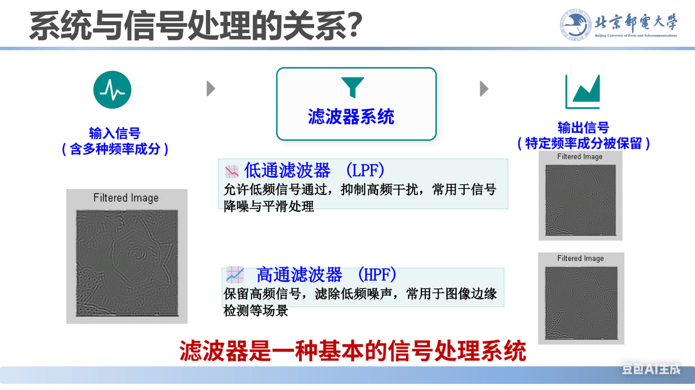

### 易错点与考点提示

- 判断时不变性时**不涉及初始状态**，必须在**零状态条件**下比较"输入延迟 τ，输出是否同样延迟 τ"；把初始状态的影响混进来是最常见的错误。
- **线性 ≠ 时不变**：线性与否看齐次性、叠加性；时不变与否看特性是否随时间改变，两者独立，可以组合出四种系统。
- **因果性看的是"未来输入"，不是"未来的输出"**：非因果系统的例子是双向平滑滤波（要用到后续数据），不要与"不稳定"混淆。
- **稳定性是 BIBO**：有界输入 → 有界输出。麦克风啸叫是正反馈导致的非稳定；调光器是稳定系统的直观例子。
- 连续系统用**微分方程**、离散系统用**差分方程**；微分方程解是精确解，差分方程解是近似解，但两者在分析方法上有许多类似之处。
- 线性系统的频谱变化是"只改幅度、不产生新频率"，非线性系统才会产生**谐波与互调**分量——这句话可直接用于判断失真是线性还是非线性引起的。

### 自测

1. 系统描述有哪两条路径？连续时间系统与离散时间系统的数学模型分别是什么？
2. 写出线性系统的齐次特性与叠加特性的表达式，并说明它们与线性的关系。
3. 因果系统与非因果系统的典型例子各是什么？非因果系统为什么仍有价值？
4. "麦克风啸叫"体现的是哪条系统性质被破坏？

参考答案

1. 输入输出描述与状态变量描述；连续时间系统用微分方程，离散时间系统用差分方程。
2. 齐次特性：x(t)→y(t) 则 a·x(t)→a·y(t)；叠加特性：x₁(t)→y₁(t)、x₂(t)→y₂(t) 则 x₁(t)+x₂(t)→y₁(t)+y₂(t)。同时满足齐次性与叠加特性的系统才是线性系统。
3. 因果系统：测温仪器（温度计只能反映当下或过去的温度）；非因果系统：音频后期处理中的双向平滑滤波。非因果系统虽无法实时实现，但可用于理论分析和离线（后处理）场景，非常实用。
4. 稳定性（BIBO）：微弱噪声经正反馈不断放大，输出能量急剧攀升直至过载，属于非稳定系统。

---

## 7. 发展历程与课程体系

> 单章文件：[07-发展历程与课程体系.md](notes/01-信号分析与处理概述/07-发展历程与课程体系.md)

> 来源：《信号分析与处理》01_20260915.pptx，第 75–78 页（共 4 页）
> 对应课件章节：1.3 信号分析与处理的发展历程

这门学科是怎么一步步走到今天的？每一代技术解决了上一代的什么痛点？本课程在"本科—研究生"的课程链条中处于什么位置，学完之后还能往哪里走？

### 核心结论速查

| 阶段 | 时间 | 关键词 | 解决的问题 |
|---|---|---|---|
| 01 经典模拟信号分析与处理 | 19 世纪 – 20 世纪中叶 | 傅里叶变换 · 拉普拉斯变换 · 抽样定理 · 模拟滤波 | 以连续模拟信号为对象，建立时域、频域与复频域的经典分析思维，是理论基石 |
| 02 经典数字信号分析与处理 | 20 世纪 60 年代 – 80 年代 | FFT 算法 · Z 变换 · 数字滤波器（FIR/IIR）· DSP 芯片 | 在计算机技术推动下从理论走向工程应用，实现离散信号的高效计算与实时处理 |
| 03 现代统计信号分析处理 | 20 世纪 90 年代 – 21 世纪初 | 维纳滤波、卡尔曼滤波、功率谱估计、时频分析、小波变换、自适应滤波、盲信号分离 | 从确定性分析转向基于统计理论的随机信号分析，解决噪声干扰、信号时变等复杂特性（含平稳高斯与非平稳非高斯两个子阶段） |
| 04 智能信号分析与处理 | 21 世纪初 – 至今 | 深度学习 · 神经网络 · 压缩感知 · 语音/图像识别 | 数据驱动与人工智能深度融合，突破传统模型局限，实现自适应与智能决策 |

演进主线：**从模拟到数字，从确定到随机，从理论到智能。** 本课程重点关注前两个阶段。

---

### 信号分析与处理技术的发展历程（第 76 页）

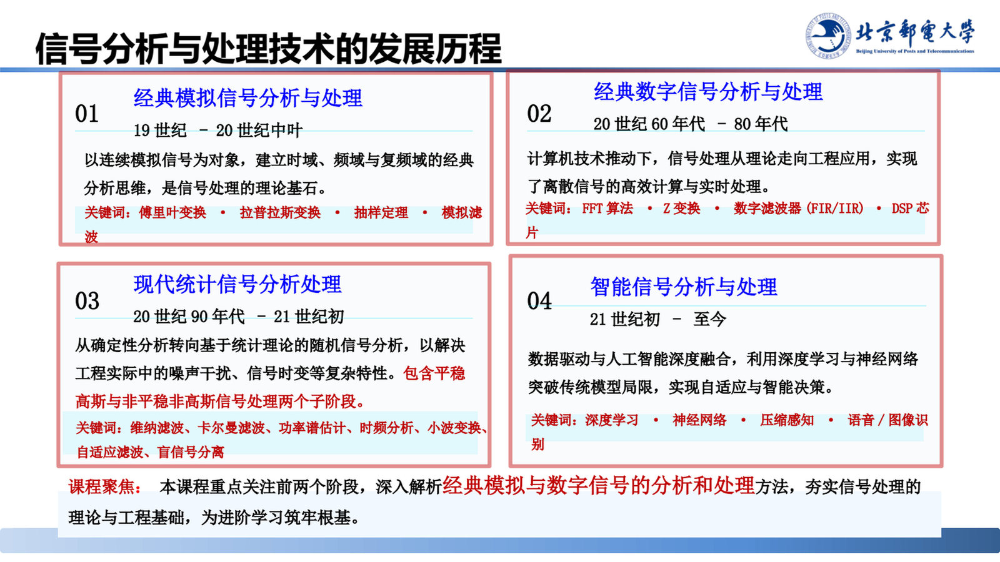

> **课程聚焦**：本课程重点关注前两个阶段，深入解析经典模拟与数字信号的分析与处理方法，夯实理论与工程基础。

> 课堂补充：这一历程遵循"从模拟到数字、从确定到随机、从理论到智能"的规律。第一阶段以傅里叶变换为代表奠定频域分析基础；第二阶段随计算机出现进入经典数字信号处理时代，FFT 算法的诞生让实时处理成为可能；第三阶段面对更复杂的现实世界转向带噪随机信号，卡尔曼滤波等算法应运而生；如今处于智能信号处理阶段，AI 与深度学习正在重塑信号处理的方式。

### 信号分析与处理的课程体系（第 77 页）

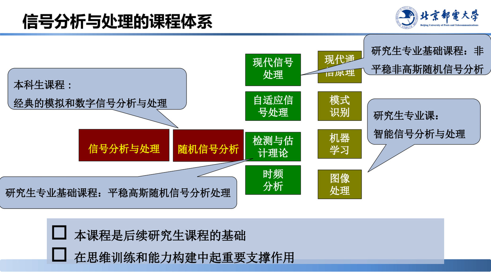

- **本科生课程**：经典的模拟和数字信号分析与处理——即本课程《信号分析与处理》。
- **研究生专业基础课程**：平稳高斯随机信号分析处理、非平稳非高斯随机信号分析处理。
- **研究生专业课**：智能信号分析与处理。
- **相关的后续课程**：随机信号分析、检测与估计理论、现代信号处理、自适应信号处理、时频分析、图像处理、模式识别、机器学习、现代通信原理。

> **本课程是后续研究生课程的基础**，在思维训练和能力构建中起重要支撑作用。

### 易错点与考点提示

- 四个阶段的**时间分界与标志性技术**要能对上号：傅里叶/拉普拉斯变换与模拟滤波属于第一阶段；FFT、Z 变换、FIR/IIR 属于第二阶段；卡尔曼滤波、小波变换、自适应滤波属于第三阶段；深度学习、压缩感知属于第四阶段。
- 本课程只覆盖**前两个阶段**（经典模拟与数字信号分析处理），随机信号与智能方法属于后续课程，不要指望在本课程里解决非平稳非高斯信号问题。
- "现代统计信号分析处理"内部还有两个子阶段：**平稳高斯** → **非平稳非高斯**，与第 47 页的平稳/非平稳信号分类相互呼应。

### 自测

1. 信号分析与处理发展的四个阶段分别是什么？各自的标志性技术有哪些？
2. 本课程重点关注哪几个阶段？为什么？
3. 学完本课程后，可以衔接哪些研究生课程？

参考答案

1. 经典模拟信号分析与处理（傅里叶变换、拉普拉斯变换、抽样定理、模拟滤波）→ 经典数字信号分析与处理（FFT、Z 变换、数字滤波器 FIR/IIR、DSP 芯片）→ 现代统计信号分析处理（维纳滤波、卡尔曼滤波、功率谱估计、时频分析、小波变换、自适应滤波、盲信号分离）→ 智能信号分析与处理（深度学习、神经网络、压缩感知、语音/图像识别）。
2. 前两个阶段（经典模拟与经典数字信号的分析与处理），因为它们是信号处理的理论与工程基础，是后续学习的根基。
3. 平稳高斯/非平稳非高斯随机信号分析处理、智能信号分析与处理，以及与它们配套的随机信号分析、检测与估计理论、现代信号处理、自适应信号处理、时频分析、图像处理、模式识别、机器学习、现代通信原理等。

---

## 8. 典型应用领域与信息通信

> 单章文件：[08-典型应用领域与信息通信.md](notes/01-信号分析与处理概述/08-典型应用领域与信息通信.md)

> 来源：《信号分析与处理》01_20260915.pptx，第 79–87 页（共 9 页）
> 对应课件章节：1.4 信号分析与处理的应用案例（课件页眉写作"1.2.2 典型应用领域"）；1.5 信息通信中的信号分析与处理

前面讲的抽样、变换、滤波，在真实产品里到底出现在哪一步？本节用五个完整案例（5G 基站、降噪耳机、车载雷达、心电图机、相机 ISP）把"问题 → 方法 → 结论"走通，再用一张系统级框图把七章内容接进完整的通信链路。

### 核心结论速查

| 案例 | 核心信号处理手段 | 关键指标/结论 |
|---|---|---|
| 现代通信：手机与基站 | QAM 符号映射 → 子载波分配与 IFFT → 插入循环前缀（CP） | 生成抗多径衰落与干扰的 OFDM 射频波形 |
| 消费电子：主动降噪耳机 | ADC → 自适应滤波预测噪声 → 180° 反相 → DAC 输出 | 反相声波与噪声在耳道内干涉抵消，全程延迟通常 < 1 ms |
| 汽车电子：自动驾驶辅助 | 混频与低通得到中频差频信号 → 第一次 FFT 测距 → 第二次 FFT 测速 | 输出"前方 50 米，相对速度 −10 km/h"一类指令 |
| 医疗电子：心电图提取 | 50 Hz 数字陷波 → 约 0.5 Hz 高通抗漂移 → 约 40 Hz 低通去毛刺 | 得到基线平稳、干净的心电图波形 |
| 数码影像：相机 ISP | 空间插值重建 RGB + 低通去噪 → 色彩矩阵变换与白平衡 → JPEG（二维 DCT）压缩 | 生成色彩准确、体积小巧的标准 JPEG 文件 |

---

### 六大应用领域总览（第 79 页）

通信与网络、工业与自动化、国防与安全、环境与能源、生物医学（生物医学工程）、消费电子与娱乐。

### 案例 1：现代通信——手机与基站建立通信链路（第 80 页）

**问题与输入**：基站向终端传输高清视频流媒体，待下发的是基带芯片中的高速二进制数字比特流。**方法**：

1. **QAM 符号映射**：将多位二进制比特分组，通过正交振幅调制（QAM）映射为复数平面上携带幅度、相位信息的复数符号。
2. **子载波分配与 IFFT**：把并行复数符号分配到数百路互不干扰的正交子载波上组成频域信号，再经逆傅里叶变换合并为单路数字时域 OFDM 波形。
3. **插入循环前缀（CP）**：在符号头部复制粘贴尾部的一小段波形，用于抵消楼宇反射带来的多径时延。

**结论**：经数模转换、射频放大后，生成可在复杂城市环境中抵抗多径衰落与干扰的射频电磁波。

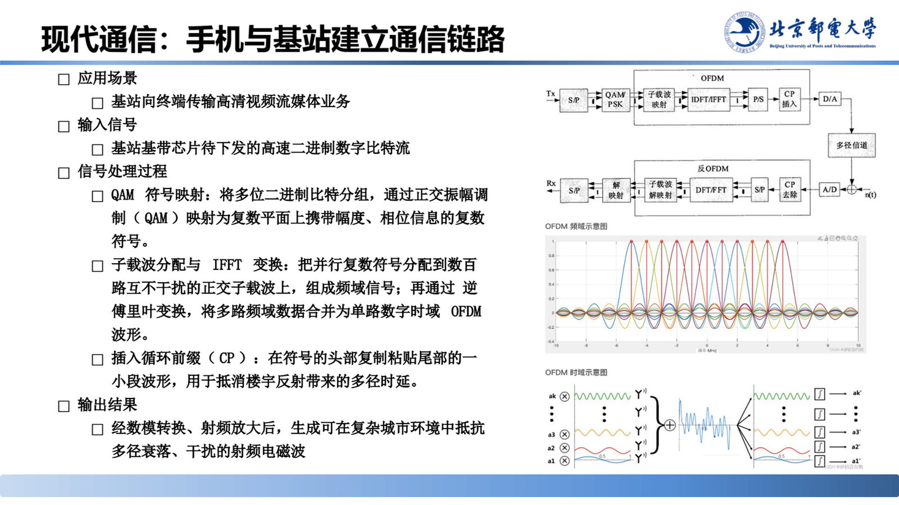

### 案例 2：消费电子——主动降噪耳机（第 81 页）

**问题与输入**：在嘈杂的地铁或飞机上听歌，输入是外部麦克风采集到的低频环境噪声时域连续信号。**方法**：

1. **信号数字化**：通过模数转换器（ADC）把连续声波转化为离散数字信号。
2. **自适应滤波**：DSP 芯片用自适应算法实时预测噪声在下一微秒的振幅和相位走向。
3. **信号反相**：对预测出的噪声信号做精确的 180° 相位移动，生成反相补偿信号。
4. **极低延迟输出**：整个运算与数模转换（DAC）必须在极短时间内（通常小于 1 毫秒）完成，确保反相信号与真实噪声严格同步到达人耳。

**结论**：反相声波与外界原始噪声在耳道内发生物理干涉并相互抵消，最终只留下纯净的音乐信号。

### 案例 3：汽车电子——自动驾驶辅助系统（第 82 页）

**问题与输入**：在高速公路上自适应巡航，输入是天线捕捉到的前方目标反射回来的调频连续波（FMCW）微波信号。**方法**：

1. **混频与低通**：用硬件乘法器把发射波与接收波相乘，再经低通滤波得到频率较低的"中频差频信号"。
2. **距离解算**：对差频信号做第一次 FFT，频域峰值频率正比于电磁波飞行时间，据此推算目标精确距离。
3. **速度解算**：针对连续发送的多个雷达脉冲，对差频信号的相位变化做第二次 FFT，依据多普勒效应导致的微小相位差计算目标相对移动速度。

**结论**：输出汽车控制系统所需的精确数值指令（如"前方 50 米，相对速度 −10 km/h"）。

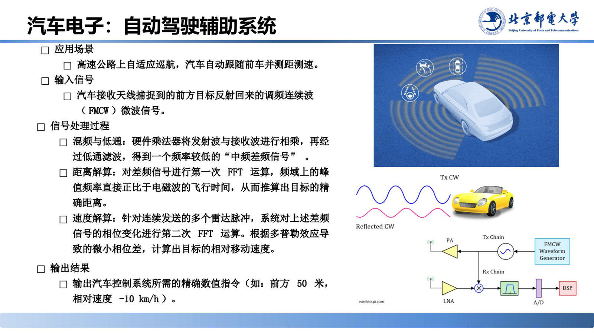

### 案例 4：医疗电子——心电图信号提取（第 83 页）

**问题与输入**：重症监护室或智能手表实时监测心跳，输入是体表电极采集的微弱生理电信号，混杂着 50 Hz 工频干扰、低频呼吸漂移和高频肌电噪声。**方法**：

1. **信号陷波剔除**：用带阻极窄的数字陷波器（通常针对 50 Hz 或 60 Hz 及其谐波），把交流电网引发的单频噪声能量强制归零。
2. **高通滤波抗漂移**：经截止频率约 0.5 Hz 的高通滤波器滤除呼吸导致的胸腔起伏，把波形拉回水平零点。
3. **低通滤波去毛刺**：经截止频率约 40 Hz 的低通滤波器过滤肌肉轻微颤动产生的高频毛刺噪声。

**结论**：屏幕上显示出干净、基线平稳的心电图波形。

### 案例 5：数码影像——相机的图像信号处理器（第 84 页）

**问题与输入**：按下快门，把镜头捕捉到的自然光线转化为可直接分享的标准化照片；输入是 CCD/CMOS 传感器产生的带马赛克排列的单色光强度模拟信号。**方法**：

1. **空间信号重建与滤波**：用空间插值算法把单色阵列重建为 RGB 全彩图像，同时用低通滤波器抹平随机高频噪点。
2. **色彩矩阵变换**：调整色彩通道增益校正白平衡，把图像映射到标准色彩空间并做非线性校正，以匹配人眼视觉感知。
3. **JPEG 压缩**：用二维离散余弦变换把图像转换到频率域，滤除人眼不敏感的高频冗余细节，实现高效压缩。

**结论**：生成色彩还原准确、滤除冗余噪声且体积小巧的标准 JPEG 图像文件。

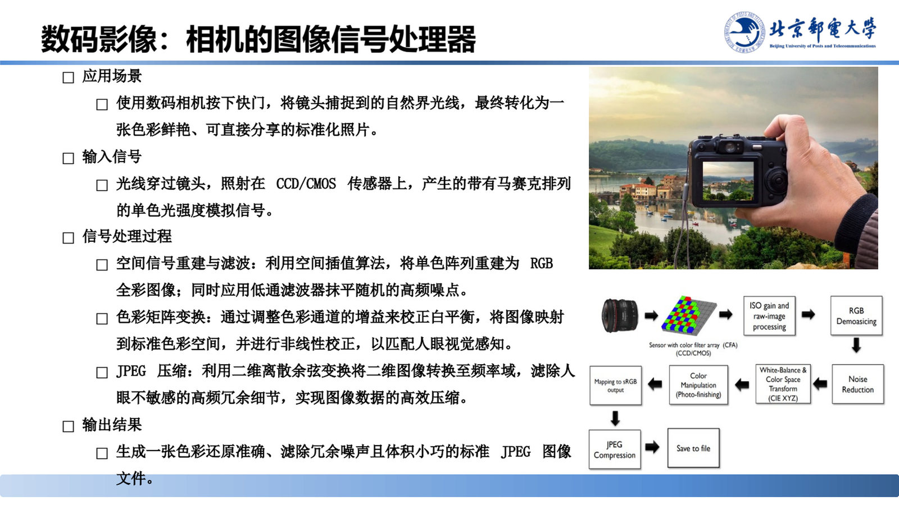

### 信息通信中的信号分析与处理（第 86–87 页）

把上述案例抽象成一条完整链路：

**信源信号的分析与处理**（语音、图像/视频、通信、卫星、辐射源等）→ **连续时间信号分析与处理**（第 2、3 章）→ **取样（AD 转换）** → **离散时间信号分析与处理**（第 5、6、7 章）→ **发射机**（脉冲成形、编码、调制、OFDM 等）→ **信道** → **接收机**（数字解调与差错控制）→ **DA 转换、内插** → **信宿信号的分析与处理**。

其中模拟部分承担模拟电路与数字电路的时域/频域分析（AD/DA 电路、滤波电路、功率放大电路等），数字部分承担数字调制与功率放大、数字解调与差错控制等通信过程中的信号分析与处理。

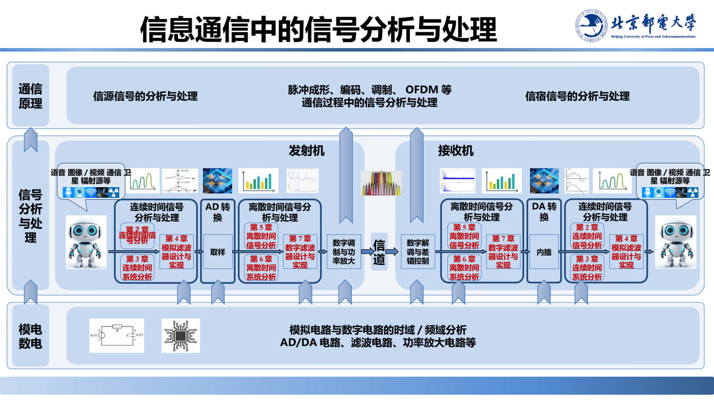

| 课程章节 | 在链路中的位置 |
|---|---|
| 第 2 章 连续时间信号分析 | 连续时间信号分析与处理（信源侧） |
| 第 3 章 连续时间系统分析 | 连续时间信号分析与处理（信源侧） |
| 第 4 章 模拟滤波器设计与实现 | 发射机/接收机中的模拟滤波电路 |
| 第 5 章 离散时间信号分析 | 离散时间信号分析与处理 |
| 第 6 章 离散时间系统分析 | 离散时间信号分析与处理 |
| 第 7 章 数字滤波器设计与实现 | 离散时间信号分析与处理、发射机与接收机算法 |

本课程还与《通信原理》《模拟电子技术》《数字电子技术》相互支撑：本课程提供时域/频域分析工具，通信原理给出调制、编码、OFDM 等应用场景，模电数电提供电路实现基础。

> 课堂补充：第 86 页内嵌的交互演示（原 PPT 内嵌浏览器对象，与第 57 页复用同一演示对象）用于动态展示波形，静态导出未渲染出内容，教学时现场运行。

### 易错点与考点提示

- **FFT 在车载雷达里用了两次，目的不同**：第一次 FFT 的峰值频率 → 距离（飞行时间）；第二次 FFT 看相位变化 → 速度（多普勒效应）。这一对"两次 FFT"是常考的细节。
- **主动降噪的因果性要求**：整个 ADC—自适应预测—反相—DAC 链路必须小于约 1 ms，否则反相声波与噪声不能严格同步、抵消失效——这正是"因果系统才能物理实现"的工程体现。
- **心电图的三级滤波对应三种干扰**：50 Hz 陷波对工频、约 0.5 Hz 高通对呼吸漂移、约 40 Hz 低通对肌电毛刺，不要张冠李戴。
- **JPEG 压缩的关键是二维 DCT**：把图像变换到频率域后滤除人眼不敏感的高频冗余，这与第 27 页"理论层面"的案例是同一技术。
- **循环前缀（CP）的作用**是抵消多径时延，不是抗噪声、也不是同步头，注意区分。

### 自测

1. 基站下行链路中，QAM 映射、IFFT 与循环前缀各自完成什么任务？
2. 心电图信号中 50 Hz 工频干扰、呼吸漂移、肌电噪声分别用什么滤波器处理？
3. 车载雷达测距和测速分别对应哪一次 FFT，依据是什么效应？
4. 本课程七章内容分别落在信息通信链路的哪个环节？

参考答案

1. QAM 映射把二进制比特分组映射为携带幅度、相位信息的复数符号；子载波分配与 IFFT 把并行符号搬上数百路正交子载波并合并为单路时域 OFDM 波形；循环前缀复制符号尾部波形到头部，用于抵消楼宇反射带来的多径时延。
2. 50 Hz（或 60 Hz）及其谐波用工频陷波器（带阻极窄的数字陷波器）；呼吸漂移用截止频率约 0.5 Hz 的高通滤波器；肌电毛刺用截止频率约 40 Hz 的低通滤波器。
3. 测距用第一次 FFT（差频信号峰值频率正比于电磁波飞行时间）；测速用第二次 FFT（对多个脉冲的差频信号相位变化做变换，依据多普勒效应引起的相位差）。
4. 第 2、3 章对应信源侧的连续时间信号分析与处理；第 4 章对应模拟滤波器设计与实现；第 5、6、7 章对应离散时间信号/系统分析及数字滤波器设计与实现，服务于发射机、信道与接收机的算法环节。

# 第二篇　2.1 连续时间信号的时域分析

> 对应课件：《信号分析与处理》2.1节-20260920.pptx，121 页

---

## 9. 典型的连续时间信号（普通信号）

> 单章文件：[01-典型的连续时间信号.md](notes/02-1-连续时间信号分析/01-典型的连续时间信号.md)

> **来源**：《信号分析与处理》2.1节-20260920.pptx，第 1–19 页（共 121 页）
> **对应课件章节**：第二章 概述、2.1.1 典型的连续时间信号、2.1.1.1 普通信号
> **页码说明**：正文中"第 N 页"指课件**幻灯片序号**；插图说明"课件 slide N / 第 P 页"中的 P 为**渲染图页码**（与文件名 page-00PP 一致）。幻灯片 46/47/48 为隐藏页、未导出渲染图；幻灯片序号 n ≥ 49 时 P = n − 3。

2.1 节做**时域**分析，是后续频域、复频域分析与离散化取样的前提。本文件把普通信号（直流、正弦、指数类、抽样信号）的表达式、参数含义与关键性质讲清。

### 核心结论速查

| 信号 | 表达式 | 关键参数 / 性质 |
|---|---|---|
| 直流信号 | $x(t)=A,\ -\infty<t<+\infty$ | 不随时间变化，是实指数信号 $\sigma=0$ 的特例 |
| 正弦信号 | $x(t)=A\sin(\Omega t+\varphi)$ | 振幅 $A$、角频率 $\Omega$、频率 $f_0$、初相 $\varphi$；$T_0=\dfrac{2\pi}{\Omega}=\dfrac{1}{f_0}$，$\Omega=2\pi f_0$ |
| 实指数信号 | $x(t)=Ae^{\sigma t}$ | $\sigma>0$ 增长，$\sigma<0$ 衰减，$\sigma=0$ 为直流；微分、积分后仍是指数形式 |
| 单边指数信号 | $f(t)=e^{-t/\tau}u(t)$ | $\tau>0$ 为时间常数，量纲为时间，表征衰减快慢 |
| 双边指数信号 | $f(t)=e^{-\lvert t\rvert/\tau}$ | 左右对称衰减 |
| 虚指数信号 | $x(t)=Ae^{j\Omega t}$ | 以 $T_0=\dfrac{2\pi}{\lvert\Omega\rvert}$ 为基本周期的周期信号，$e^{j\Omega t}=\cos\Omega t+j\sin\Omega t$ |
| 复指数信号 | $x(t)=Ae^{st},\ s=\sigma+j\Omega$ | $=Ae^{\sigma t}\cos\Omega t+jAe^{\sigma t}\sin\Omega t$，$\sigma$ 定包络、$\Omega$ 定振荡 |
| Sa 信号 | $\mathrm{Sa}(t)=\dfrac{\sin t}{t}$ | 偶函数；$\mathrm{Sa}(0)=1$；零点 $t=\pm\pi,\pm2\pi,\dots$；$\int_{-\infty}^{\infty}\mathrm{Sa}(t)dt=\pi$ |
| sinc 函数 | $\mathrm{sinc}(t)=\dfrac{\sin \pi t}{\pi t}$ | 与 Sa 的关系：$\mathrm{Sa}(t)=\mathrm{sinc}\!\left(\dfrac{t}{\pi}\right)$ |

---

### 一、连续时间信号分析的总览（第 1–7 页）

连续时间信号分析从**时域、频域、复频域**三个维度展开，三者互为补充，是系统分析、滤波器设计与离散化取样的基础。

2.1 节（本部分笔记的对象）是**连续时间信号的时域分析**：

| 小节 | 内容 |
|---|---|
| 2.1.1 | 典型的连续时间信号（普通信号 + 奇异信号） |
| 2.1.2 | 连续时间信号运算（几何变换、微积分、相加相乘、卷积） |
| 2.1.3 | 信号的分解及矢量空间分析 |

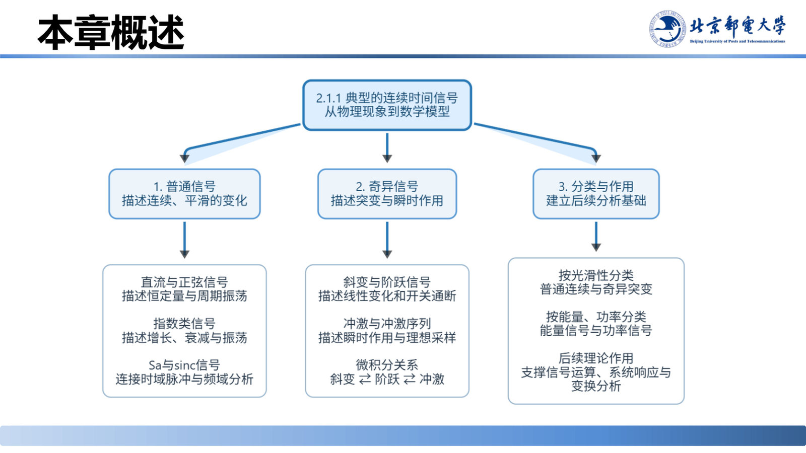

### 二、本节内容框架（第 8 页）

典型的连续时间信号分两类：

- **普通信号**：直流、正弦、指数类、抽样信号——波形连续光滑、幅值变化平稳。
- **奇异信号**：单位阶跃、单位冲激、斜坡（斜变）信号——见第 20–47 页笔记。

### 三、直流信号（第 9 页）

直流信号（direct current signal）的表达式为

$$x(t)=A,\qquad -\infty<t<+\infty$$

其波形是一条水平直线，不随时间变化。从指数类信号的角度看，直流信号就是 $\sigma=0$ 的实指数信号。

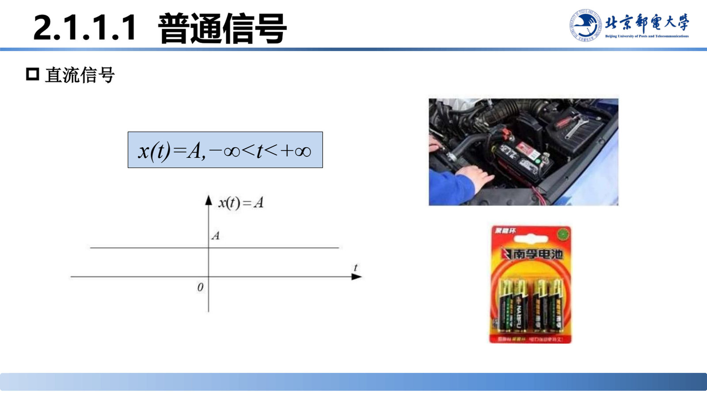

### 四、正弦信号（第 10–11 页）

#### 4.1 表达式与参数

$$x(t)=A\sin(\Omega t+\varphi)$$

| 参数 | 符号 | 含义与关系 |
|---|---|---|
| 振幅 | $A$ | 波形最大值 |
| 角频率 | $\Omega$ | $\Omega=2\pi f_0$ |
| 频率 | $f_0$ | 单位 Hz |
| 周期 | $T_0$ | $T_0=\dfrac{2\pi}{\Omega}=\dfrac{1}{f_0}$ |
| 初相 | $\varphi$ | $t=0$ 时的相位 |

> **课堂演示（slide 10）**：滑块调 $A$、$f$、$\varphi$。结论：$A$ 只改变波形高度；$f$ 改变疏密（$T_0=1/f$）；$\varphi$ 使波形整体平移、形状不变。

#### 4.2 复杂信号是正弦信号的叠加

**复杂信号可以表示为若干不同频率正弦分量的组合**——复杂声音即由多个频率的正弦叠加而成，该思想同样适用于语音、电磁波、生物医学信号。

> **课堂演示（slide 11）**：三音符和弦生成器。结论：单频正弦相加后波形呈现复杂起伏；任何复杂信号都可分解/合成为若干正弦分量，这正是傅里叶分析的出发点。

### 五、指数类信号（第 12–17 页）

#### 5.1 一般形式与分类

$$x(t)=Ae^{st},\qquad s=\sigma+j\Omega$$

按 $\sigma$、$\Omega$ 是否为零分为三类：

| 条件 | 形式 | 名称 |
|---|---|---|
| $\Omega=0$ | $x(t)=Ae^{\sigma t}$ | 实指数信号 |
| $\Omega\ne 0,\ \sigma=0$ | $x(t)=Ae^{j\Omega t}$ | 虚指数信号 |
| $\Omega\ne 0,\ \sigma\ne 0$ | $x(t)=Ae^{\sigma t}e^{j\Omega t}$ | 复指数信号 |

在实指数信号中：$\sigma>0$ 表示信号随时间增长，$\sigma<0$ 表示信号随时间衰减，$\sigma=0$ 时 $x(t)=A$，成为直流信号。

> 课堂补充：振荡类信号（$\Omega\ne 0$）都应该过零点。

#### 5.2 实指数信号

$$x(t)=Ae^{\sigma t}$$

- $\sigma=0$：直流（常数）；$\sigma<0$：指数衰减；$\sigma>0$：指数增长。

**重要特性**：实指数信号对时间的微分和积分仍然是指数形式（微分、积分不改变信号的"指数"性质，只改变系数）。

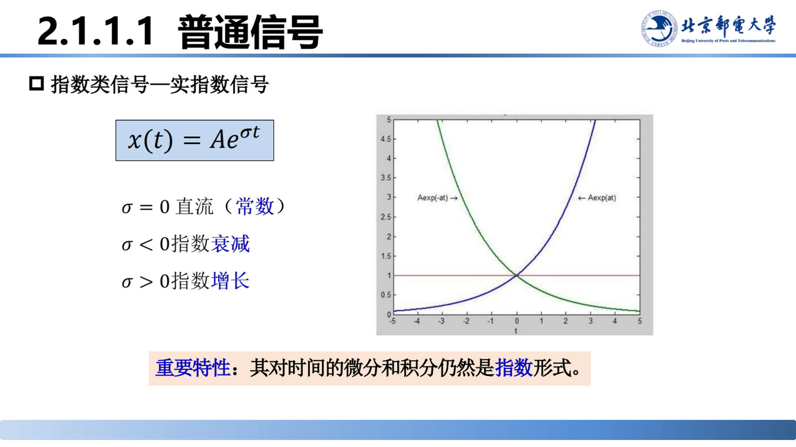

通常把 $\tau$（$\tau>0$）称为指数信号的**时间常数**，代表信号衰减速度，具有时间的量纲。单边指数信号与双边指数信号：

$$f(t)=\begin{cases}0, & t<0\\[2pt] e^{-t/\tau}, & t\ge 0\end{cases}\qquad\qquad
f(t)=\begin{cases}e^{t/\tau}, & t<0\\[2pt] e^{-t/\tau}, & t\ge 0\end{cases}$$

实际应用较多的是指数衰减信号。

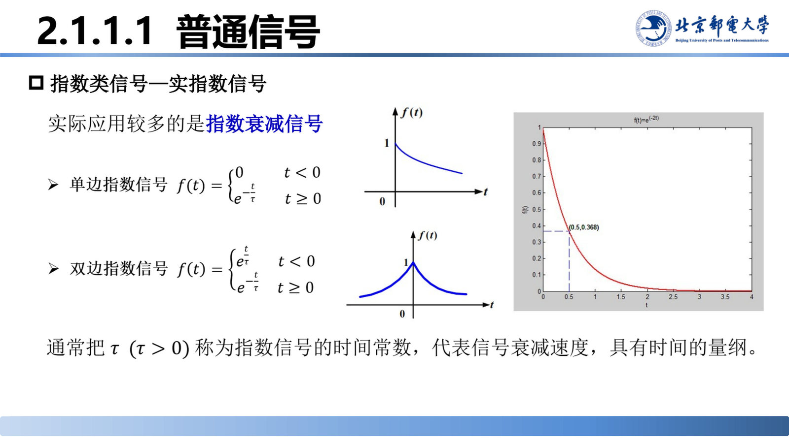

#### 5.3 虚指数信号与欧拉公式（Euler's formula）

$$x(t)=Ae^{j\Omega t}=A\left[\cos(\Omega t)+j\sin(\Omega t)\right]$$

**周期性**：只要满足 $\Omega T_0=2\pi$，就有 $x(t+T_0)=x(t)$，因此基本周期

$$T_0=\frac{2\pi}{|\Omega|}$$

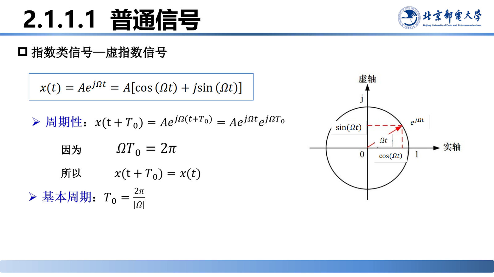

欧拉公式给出了正弦与虚指数之间的桥梁：

$$\cos(\Omega t)=\frac{1}{2}\left(e^{j\Omega t}+e^{-j\Omega t}\right),\qquad
\sin(\Omega t)=\frac{1}{2j}\left(e^{j\Omega t}-e^{-j\Omega t}\right)$$

#### 5.4 复指数信号

$$x(t)=Ae^{st}=Ae^{(\sigma+j\Omega)t}=Ae^{\sigma t}\cos(\Omega t)+jAe^{\sigma t}\sin(\Omega t)$$

其中 $e^{\sigma t}$ 是振荡的**包络**（决定幅度增长/衰减/不变），$\Omega$ 决定**振荡快慢**。六种典型情形：

| 参数 | 波形特征 |
|---|---|
| $\sigma=0,\ \Omega=0$ | 直流 |
| $\sigma>0,\ \Omega=0$ | 升指数信号 |
| $\sigma<0,\ \Omega=0$ | 衰减指数信号 |
| $\sigma=0,\ \Omega\ne 0$ | 等幅振荡 |
| $\sigma>0,\ \Omega\ne 0$ | 增幅振荡 |
| $\sigma<0,\ \Omega\ne 0$ | 衰减振荡 |

> **课堂演示（slide 17）**：实时改变 $\sigma$、$\Omega$。结论：$\Omega=0$ 时波形单调不振荡；$\Omega\ne0$ 时振荡且等间隔过零点；$\sigma<0$ 幅度指数衰减，$\sigma>0$ 指数增长。

### 六、抽样信号：Sa 与 sinc（第 18–19 页）

#### 6.1 Sa 信号

$$\mathrm{Sa}(t)=\frac{\sin t}{t}$$

性质：

- 偶函数：$\mathrm{Sa}(-t)=\mathrm{Sa}(t)$；
- 两端衰减：$\lim\limits_{t\to\pm\infty}\mathrm{Sa}(t)=0$；
- $t=0$ 处 $\mathrm{Sa}(t)=1$，即 $\lim\limits_{t\to0}\mathrm{Sa}(t)=1$；
- 零点：$\mathrm{Sa}(t)=0$，$t=\pm\pi,\pm2\pi,\dots,\pm n\pi$；
- 面积：$\displaystyle\int_{-\infty}^{\infty}\mathrm{Sa}(t)dt=\pi$，且 $\displaystyle\int_{-\infty}^{0}\mathrm{Sa}(t)dt=\int_{0}^{\infty}\mathrm{Sa}(t)dt=\frac{\pi}{2}$。

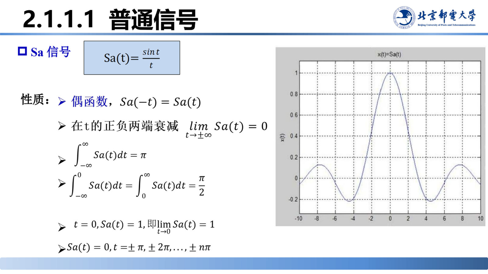

#### 6.2 sinc 函数

$$\mathrm{sinc}(t)=\frac{\sin \pi t}{\pi t},\qquad \mathrm{Sa}(t)=\mathrm{sinc}\!\left(\frac{t}{\pi}\right)=\frac{\sin t}{t}$$

注意：不同教材对 sinc 的定义可能差一个 $\pi$ 因子，看波形对不上符号时要回到这里的定义式。

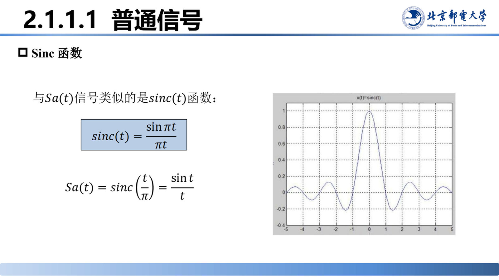

### 易错点与考点提示

- $T_0=\dfrac{2\pi}{\Omega}$：分母是**角频率**；若用频率表示则是 $T_0=\dfrac{1}{f_0}$，而 $\Omega=2\pi f_0$，两者不要混用。
- 虚指数信号的基本周期用 $|\Omega|$，因为周期必须为正。
- $\mathrm{Sa}(t)$ 的零点在 $t=\pm n\pi$，而 $\mathrm{sinc}(t)$ 的零点在 $t=\pm n$（$n$ 为非零整数），这正是差一个 $\pi$ 因子的体现。
- 实指数信号的"微分、积分仍为指数形式"是后面用它做系统分析（解微分方程）的关键，别把它当成普通函数。
- 单边指数信号 $f(t)=e^{-t/\tau}u(t)$ 是后面求卷积、求冲激响应用得最多的信号之一。

### 自测

1. 写出正弦信号 $x(t)=A\sin(\Omega t+\varphi)$ 的周期，并说明它与 $f_0$ 的关系。
2. $\mathrm{Sa}(t)$ 在 $t=0$ 处的值是多少？零点位置在哪里？
3. 已知 $x(t)=Ae^{st}$，$s=\sigma+j\Omega$，问 $\sigma<0,\ \Omega\ne0$ 时波形有什么特征？

参考答案

1. $T_0=\dfrac{2\pi}{\Omega}=\dfrac{1}{f_0}$，且 $\Omega=2\pi f_0$。
2. $\mathrm{Sa}(0)=1$（$\lim\limits_{t\to0}\frac{\sin t}{t}=1$）；零点为 $t=\pm\pi,\pm2\pi,\dots,\pm n\pi$。
3. 为衰减振荡：包络按 $e^{\sigma t}$ 指数衰减，振荡频率由 $\Omega$ 决定，等间隔过零点。

---

## 10. 奇异信号（斜变、阶跃、冲激）

> 单章文件：[02-奇异信号.md](notes/02-1-连续时间信号分析/02-奇异信号.md)

> **来源**：《信号分析与处理》2.1节-20260920.pptx，第 20–47 页（共 121 页）
> **对应课件章节**：2.1.1.2 奇异信号
> **页码说明**：正文中"第 N 页"指课件**幻灯片序号**；插图说明"课件 slide N / 第 P 页"中的 P 为**渲染图页码**（与文件名 page-00PP 一致）。幻灯片 46/47/48 为隐藏页、未导出渲染图；幻灯片序号 n ≥ 49 时 P = n − 3。

工程中"突然接入""瞬间冲击""定时采样"这类现象的波形有跳变点，普通函数描述不了。奇异信号就是为此引入的：**函数本身或其导数（高阶导数）存在不连续点（跳变点）**。本文件讲清 $r(t)$、$u(t)$、$\delta(t)$ 的定义、性质与三者的微积分关系。

### 核心结论速查

| 名称 | 定义 | 关键性质 |
|---|---|---|
| 单位斜变信号 | $r(t)=\begin{cases}0,&t<0\\ t,&t\ge0\end{cases}$ | $\dfrac{dr(t)}{dt}=u(t)$，$r(t)=\displaystyle\int_{-\infty}^{t}u(\tau)d\tau$ |
| 单位阶跃信号 | $u(t)=\begin{cases}1,&t>0\\ 0,&t<0\end{cases}$ | 跳变点 $t=0$ 处函数值未定义；$\dfrac{du(t)}{dt}=\delta(t)$ |
| 单位冲激信号 | $\delta(t)=0\ (t\ne0)$，$\displaystyle\int_{-\infty}^{+\infty}\delta(t)dt=1$ | 宽度为 0、面积为 1；$\displaystyle\int_{-\infty}^{t}\delta(\tau)d\tau=u(t)$ |
| 筛选特性 | $\displaystyle\int_{-\infty}^{+\infty}x(t)\delta(t-t_0)dt=x(t_0)$ | 积分区间不含 $t_0$ 时结果必为零 |
| 展缩特性 | $\delta(at)=\dfrac{1}{\lvert a\rvert}\delta(t)\ (a\ne0)$ | 推论：$\delta(t)=\delta(-t)$（偶函数） |
| 复合自变量 | $\delta(at\pm b)=\dfrac{1}{\lvert a\rvert}\delta\!\left(t\pm\dfrac{b}{a}\right)$ | 必须**先展缩、再筛选** |
| 周期冲激序列 | $\delta_T(t)=\displaystyle\sum_{n=-\infty}^{\infty}\delta(t-nT_0)$ | 理想采样器的数学模型 |
| 强度 | $\displaystyle\int_{-\infty}^{+\infty}k\delta(t)dt=k$ | 冲激的强度 = 它对时间的定积分值 |

---

### 一、什么是奇异信号（第 20 页）

奇异信号：**函数本身或其导数或高阶导数具有不连续点（跳变点）**。两类情形：函数本身具有不连续点（如阶跃在 $t=0$ 处的跳变）；函数本身连续、但高阶导数具有不连续点。

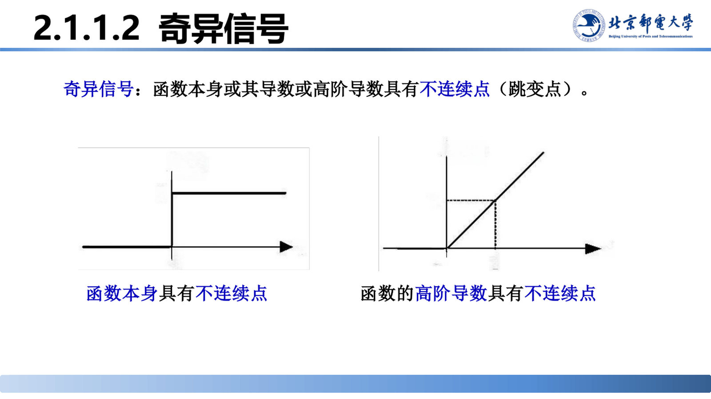

### 二、单位斜变信号（第 21–22 页）

#### 2.1 单位斜变信号

$$r(t)=\begin{cases}0,& t<0\\ t,& t\ge0\end{cases}
\qquad
r(t-t_0)=\begin{cases}0,& t<t_0\\ t-t_0,& t\ge t_0\end{cases}$$

> **课堂演示（slide 21）**：拖动 $t_0$ 观察 $r(t-t_0)$。结论：斜变波形整体平移、斜率不变（$t_0>0$ 延迟，$t_0<0$ 提前）。

#### 2.2 截平斜变信号与有限时宽斜变信号

实际系统中斜变过程会在某个时刻达到上限并保持不变（**截平斜变**）；只保留有限时间内的线性上升过程则得到**有限时宽斜变信号**：

$$r_1(t)=\begin{cases}0,& t<0\\[2pt] \dfrac{K}{\tau}r(t),& 0\le t\le\tau\\[2pt] K,& t\ge\tau\end{cases}
\qquad
r_2(t)=\begin{cases}0,& t<0,\ t>\tau\\[2pt] \dfrac{K}{\tau}r(t),& 0\le t\le\tau\end{cases}$$

> **课堂演示（slide 22）**：改变 $K$、$\tau$。结论：$K$ 定平台高度、$\tau$ 定上升时间（斜率 $K/\tau$）；$r_1$ 在 $t\ge\tau$ 后保持 $K$，$r_2$ 在 $t>\tau$ 后回到 0。

### 三、单位阶跃信号（第 23–29 页）

#### 3.1 定义

$$u(t)=\begin{cases}1,& t>0\\ 0,& t<0\end{cases}
\qquad
u(t-t_0)=\begin{cases}1,& t>t_0\\ 0,& t<t_0\end{cases}$$

在跳变点 $0$（延迟情形为 $t_0$）处，函数值未定义。$u(t)$ 表示信号在某一时刻从零突变接入，并在之后保持幅值不变。

> **课堂演示（slide 23）**：拖动 $t_0$。结论：跳变点随 $t_0$ 移动，跳变前后幅值恒为 0 与 1，跳变点取值不参与积分。

#### 3.2 作用：表示开关信号与数字通信发送信号

开关在 $t=t_0$ 接通相当于接入一个 $u(t-t_0)$。

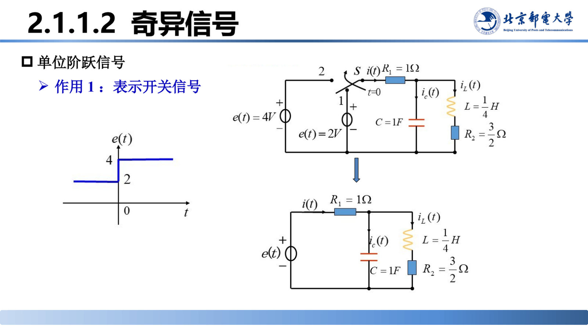

数字通信中用**双极性不归零码**发送比特：比特"1"发幅度 $A$ 的矩形，比特"0"发幅度 $-A$ 的矩形，波形由门函数拼接而成。

> **课堂演示（slide 29）**：给定比特序列逐个码元拼接波形（每码元占一个比特间隔、不归零）。结论：数字基带信号可用阶跃信号（门函数）严格写成解析式。

#### 3.3 作用：表示任意的矩形脉冲信号

两个阶跃相减即得矩形脉冲：$x(t)=u(t-T)-u(t-2T)$。宽度为 $\tau$、关于原点对称的矩形脉冲称为**门函数**（窗函数）：

$$G_\tau(t)=u\!\left(t+\frac{\tau}{2}\right)-u\!\left(t-\frac{\tau}{2}\right)$$

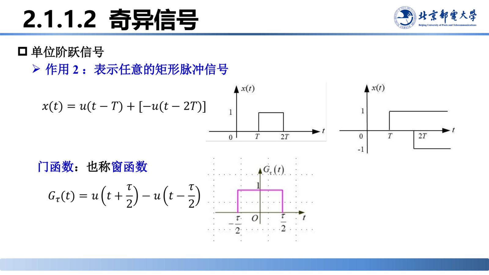

#### 3.4 作用：表示符号函数

$$\operatorname{sgn}(t)=\begin{cases}1,& t>0\\ 0,& t=0\\ -1,& t<0\end{cases}$$

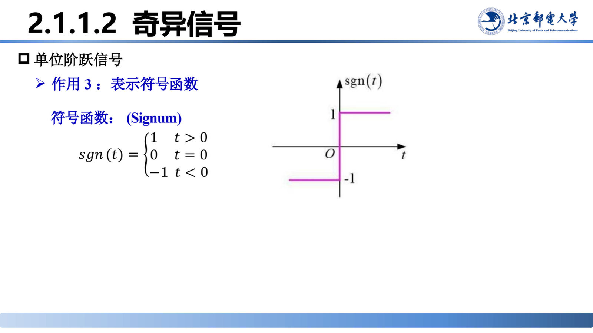

#### 3.5 作用：利用阶跃信号的单边性表示信号的时间范围

把任意信号乘上阶跃信号即可"截取"时间范围。以正弦为例：

| 写法 | 含义 |
|---|---|
| $\sin(\Omega t)\cdot u(t)$ | 从 $t=0$ 开始接入的正弦，相位不含延迟 |
| $\sin\big(\Omega(t-t_0)\big)\cdot u(t)$ | 在 $t=0$ 处接入，但相位已推迟 $t_0$ |
| $\sin(\Omega t)\cdot u(t-t_0)$ | 接入时刻推迟到 $t_0$，相位仍取 $\Omega t$（相位不连续） |
| $\sin\big(\Omega(t-t_0)\big)\cdot u(t-t_0)$ | 接入时刻推迟到 $t_0$，且相位同步延迟（连续的延迟正弦） |

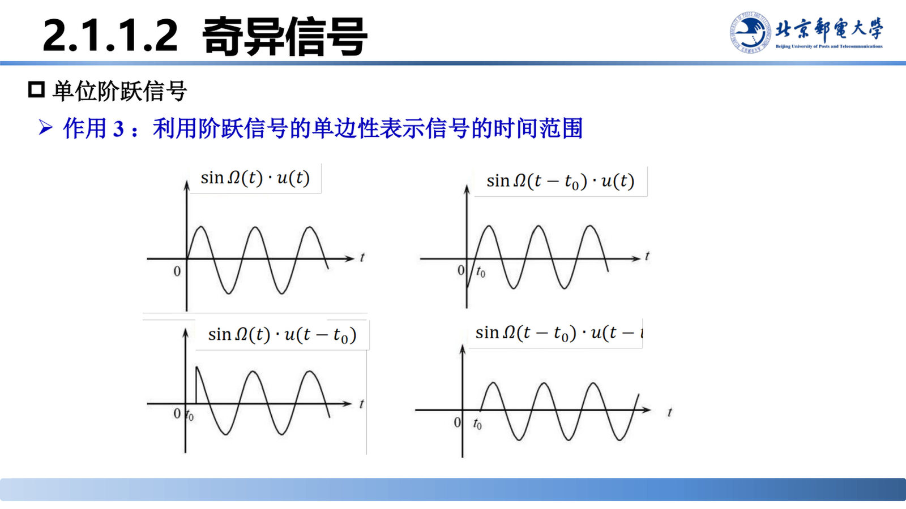

#### 3.6 斜变信号与阶跃信号之间的关系

$$r(t)=\int_{-\infty}^{t}u(\tau)d\tau,\qquad \frac{dr(t)}{dt}=u(t)$$

### 四、单位冲激信号（第 30–41 页）

#### 4.1 物理背景（第 30 页）

瞬间作用的冲击力、闪电等都无法用普通函数描述，其特点是：**作用时间极短，而幅值极大**。

#### 4.2 定义 1：狄拉克（Dirac）函数

$$\int_{-\infty}^{+\infty}\delta(t)dt=1,\qquad \delta(t)=0\quad(t\ne0)$$

即：只在 $t=0$ 处不为零；积分面积为 1；$t=0$ 时 $\delta(t)\to\pm\infty$，为无界函数。并且

$$\int_{-\infty}^{+\infty}\delta(t)dt=\int_{0-\Delta}^{0+\Delta}\delta(t)dt$$

核心定义不是"在 $t=0$ 处有多高"，而是"它的总面积为 1"——这是后面所有冲激运算的落脚点。

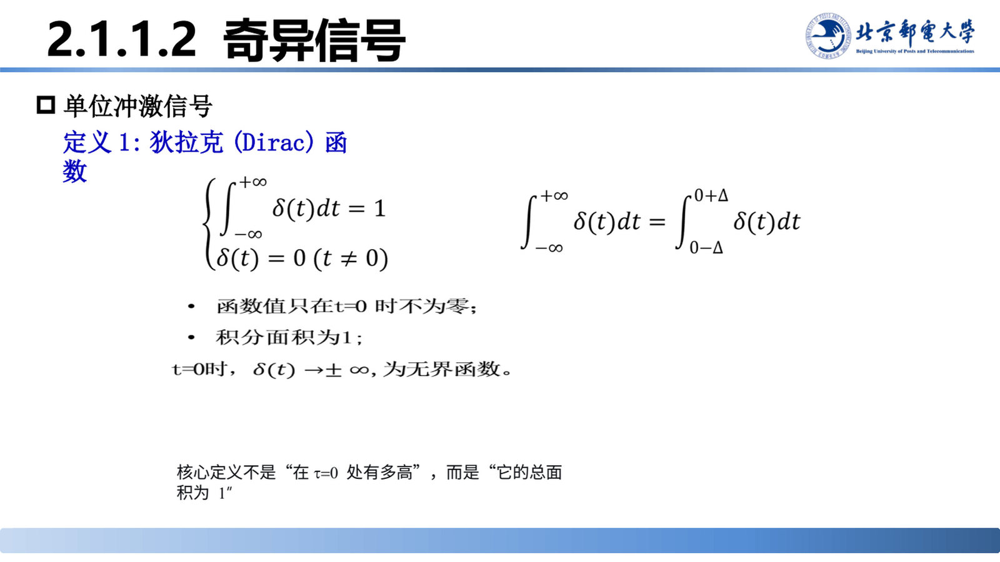

> 课堂补充（课件人物页）：保罗·狄拉克（Paul Dirac）是英国理论物理学家、量子力学创始人之一。1928 年他把相对论引进量子力学，建立狄拉克方程并预言了正电子；与薛定谔共同获得 1933 年诺贝尔物理学奖。1935 年曾应清华大学邀请作关于正电子的演讲，并被选为中国物理学会名誉会员。

#### 4.3 定义 2：规则信号取极限

取宽度为 $\tau$、面积为 1 的矩形脉冲信号

$$f(t)=\frac{1}{\tau}\left[u\!\left(t+\frac{\tau}{2}\right)-u\!\left(t-\frac{\tau}{2}\right)\right]$$

令 $\tau\to0$：面积 1 保持不变，脉宽 $\downarrow$、脉冲高度 $\uparrow$，窄脉冲集中于 $t=0$ 处，于是

$$\delta(t)=\lim_{\tau\to0}f(t)=\lim_{\tau\to0}\frac{1}{\tau}\left[u\!\left(t+\frac{\tau}{2}\right)-u\!\left(t-\frac{\tau}{2}\right)\right]$$

其中矩形信号面积始终为 $\tau\cdot\dfrac{1}{\tau}=1$。

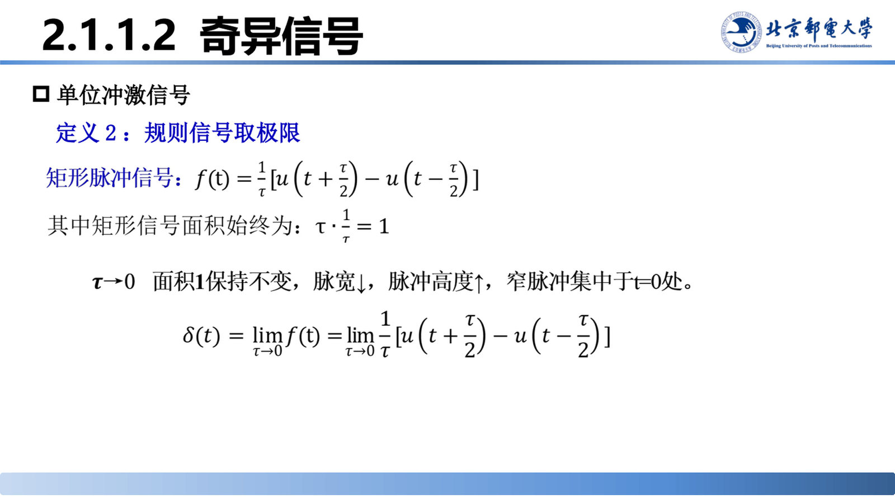

#### 4.4 三个特点与"强度"

- 宽度为 0；面积为 1；幅度为 $\begin{cases}\text{无穷}, & t=\mathbf{0}\\ \mathbf{0}, & t\ne\mathbf{0}\end{cases}$

**冲激信号的强度等于冲激信号对时间的定积分值。**

> **课堂演示（slide 34）**：$\tau=2.0\to0.8\to0.1$ 的动态演示，可设脉冲中心 $t_0$。结论：$\tau$ 减小则脉冲越窄越高，但**面积（强度）始终为 1**；$\tau\to0$ 的极限即 $\delta(t)$，位置由 $t_0$ 描述。

#### 4.5 延迟的单位冲激信号

$$\int_{-\infty}^{+\infty}\delta(t-t_0)dt=1,\qquad \delta(t-t_0)=0\quad(t\ne t_0)$$

若面积为 $k$，则强度为 $k$：$\displaystyle\int_{-\infty}^{+\infty}k\delta(t)dt=k$。

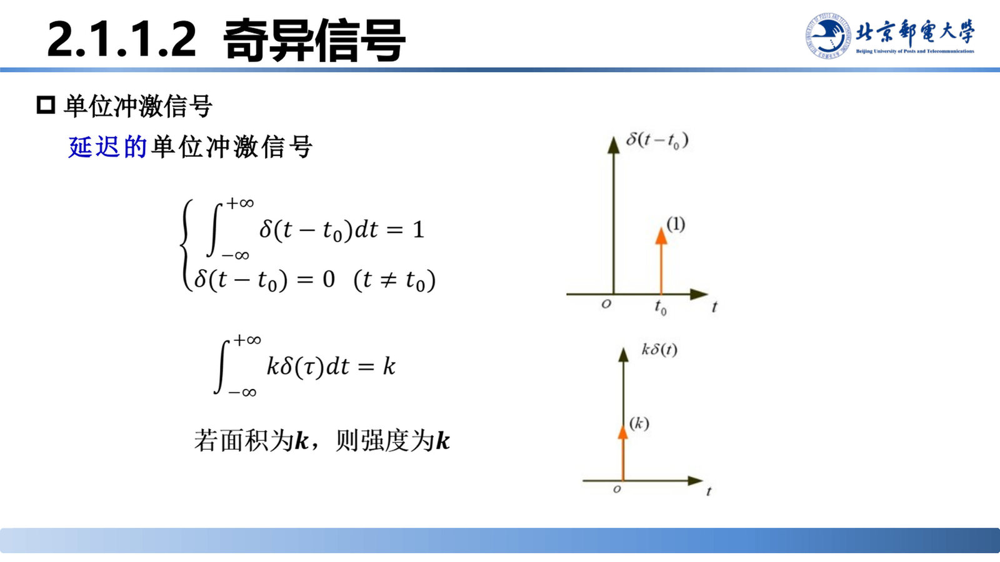

#### 4.6 性质 1：筛选特性

$$\int_{-\infty}^{+\infty}x(t)\delta(t-t_0)dt=x(t_0)$$

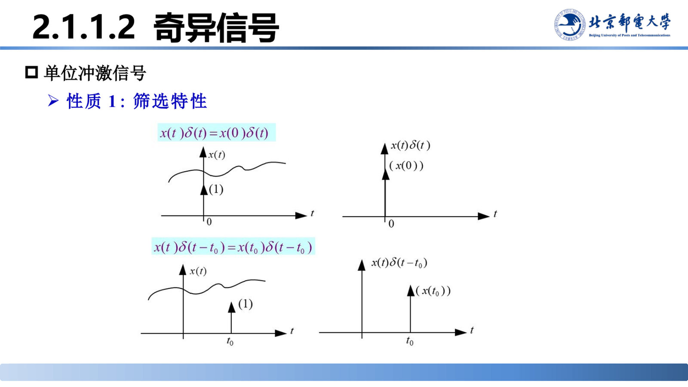

**证明**：

$$\int_{-\infty}^{+\infty}x(t)\delta(t-t_0)dt
=\int_{-\infty}^{+\infty}x(t_0)\delta(t-t_0)dt
=x(t_0)\int_{-\infty}^{+\infty}\delta(t-t_0)dt=x(t_0)$$

关键一步是把 $x(t)$ 在 $t=t_0$ 处的取值 $x(t_0)$ 提出来——因为在 $\delta(t-t_0)$ 非零的位置上 $x(t)=x(t_0)$。

> **课堂演示（slide 37）**：选一个 $x(t)$ 与冲激相乘再积分。结论：无论 $x(t)$ 什么形状，$\int x(t)\delta(t-t_0)dt$ 恒等于 $x(t_0)$——冲激像一把"取样尺"。

#### 4.7 性质 2：展缩特性

$$\delta(at)=\frac{1}{|a|}\delta(t)\qquad(a\ne0)$$

**推论：冲激信号是偶函数**。取 $a=-1$ 得 $\delta(t)=\delta(-t)$。更一般的复合自变量形式：

$$\delta(at\pm b)=\frac{1}{|a|}\delta\!\left(t\pm\frac{b}{a}\right)\qquad(a\ne0)$$

#### 4.8 性质 3：冲激信号与阶跃信号的关系

$$\int_{-\infty}^{t}\delta(\tau)d\tau=\begin{cases}1,& t>0\\ 0,& t<0\end{cases}=u(t),\qquad \frac{du(t)}{dt}=\delta(t)$$

延迟情形同理：$\displaystyle\int_{-\infty}^{t}\delta(\tau-t_0)d\tau=u(t-t_0)$，$\dfrac{du(t-t_0)}{dt}=\delta(t-t_0)$。

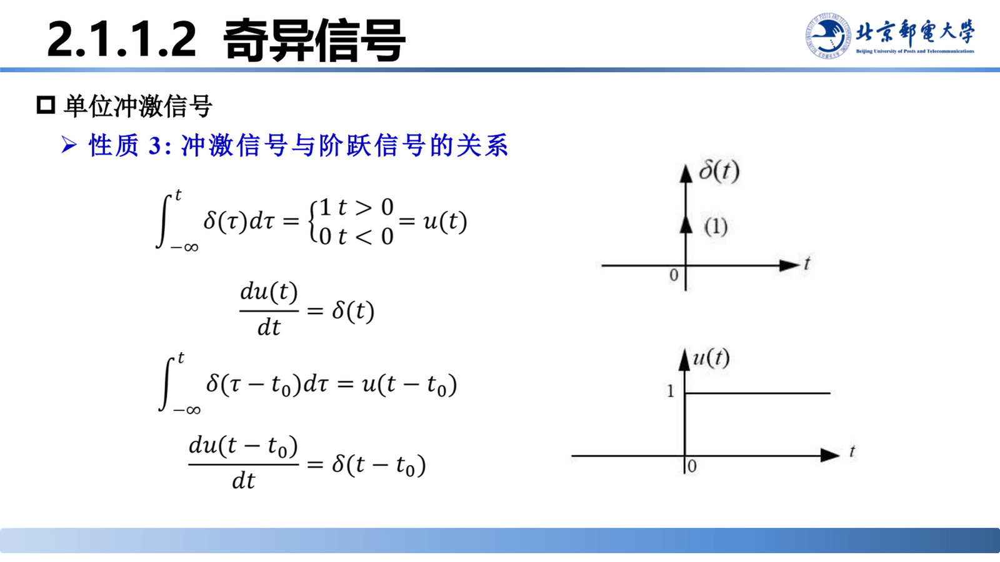

#### 4.9 性质总结（第 40 页）

$$x(t)\delta(t)=x(0)\delta(t)$$

$$\int_{-\infty}^{+\infty}x(t)\delta(t-t_0)dt=x(t_0)$$

$$\delta(at)=\frac{1}{|a|}\delta(t)\qquad(a\ne0),\qquad
\delta(at\pm b)=\frac{1}{|a|}\delta\!\left(t\pm\frac{b}{a}\right)\qquad(a\ne0)$$

$$\int_{-\infty}^{t}\delta(\tau)d\tau=\begin{cases}1,& t>0\\ 0,& t<0\end{cases}=u(t),\qquad
\frac{du(t)}{dt}=\delta(t)$$

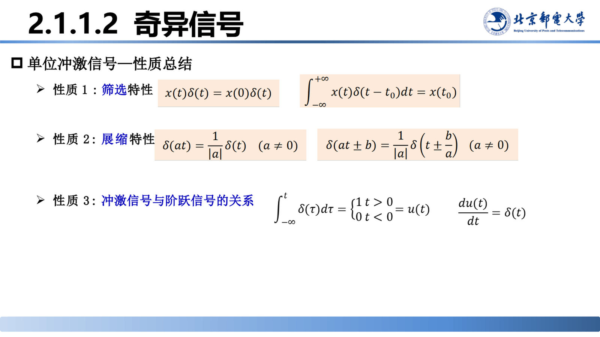

#### 4.10 使用冲激性质的两个注意点（第 41 页）

1. 筛选特性中积分区间不一定是 $(-\infty,+\infty)$，但只要区间**不包括** $\delta(t-t_0)$ 的 $t=t_0$ 时刻，积分结果必为零。
2. 对于 $\delta(at+b)$，要**先用展缩特性**化为 $\dfrac{\delta\!\left(t+\frac{b}{a}\right)}{|a|}$ 形式，方可利用筛选特性。

### 五、三种奇异信号之间的关系（第 42 页）

$$r(t)=\int_{-\infty}^{t}u(\tau)d\tau,\qquad \frac{dr(t)}{dt}=u(t)$$

$$u(t)=\int_{-\infty}^{t}\delta(\tau)d\tau,\qquad \frac{du(t)}{dt}=\delta(t)$$

即：**阶跃是斜变的微分、冲激是阶跃的微分**；反过来，斜变是阶跃的积分、阶跃是冲激的积分。这条微积分链是本节的核心考点。

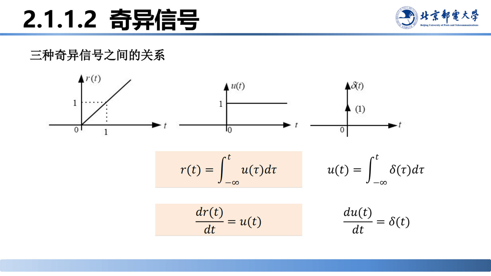

### 六、周期冲激信号与周期矩形信号（第 43–45 页）

#### 6.1 周期冲激信号

$$\delta_T(t)=\sum_{n=-\infty}^{\infty}\delta(t-nT_0)$$

单位冲激周期序列（抽样信号）是**连续信号通往离散世界的数学桥梁**：它是理想采样器的模型，是采样定理的核心分析工具，奠定了数字信号处理的理论基础。

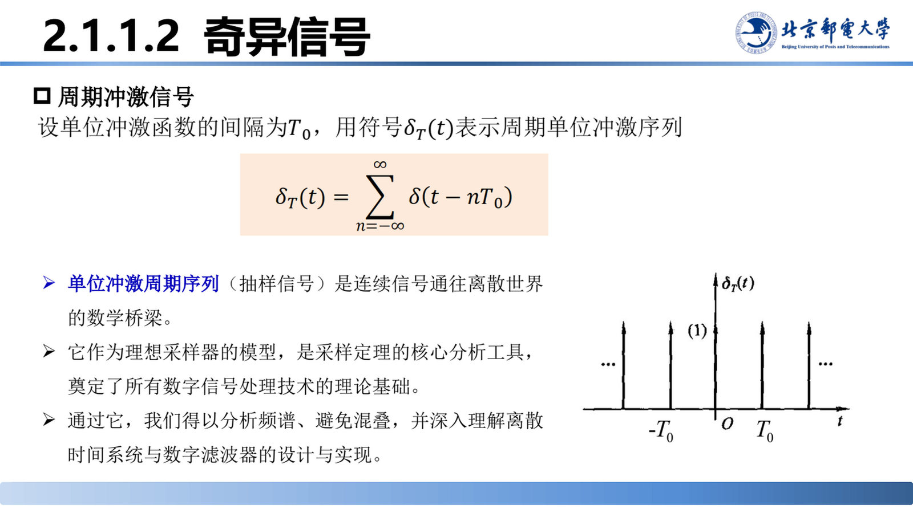

> 课堂补充：课件的公式中把周期写成了 $T_1$，应改为 $T_0$。

#### 6.2 周期矩形信号

设周期矩形脉冲的脉宽为 $\tau$、幅度为 $E$、重复周期为 $T_0$，则一个周期内（$-\dfrac{T_0}{2}\le t\le\dfrac{T_0}{2}$）

$$R(t)=E\left[u\!\left(t+\frac{\tau}{2}\right)-u\!\left(t-\frac{\tau}{2}\right)\right]$$

> **课堂演示（slide 44）**：改变 $\tau$、$E$、$T_0$。结论：波形由门函数按 $T_0$ 周期重复而成（$\tau$ 定脉宽、$E$ 定幅度）。

#### 6.3 从周期矩形到冲激采样

1. 保持矩形信号**面积恒定**、不断缩小宽度 $\tau$，矩形逐步逼近冲激信号，建立矩形与冲激的极限关联；
2. 周期冲激信号以周期 $T$ 等间隔重复，$T$ 越小取样点越密、提取的瞬时样值越多，越能反映原信号细节；
3. $T$ 越大样值越少，难以刻画原信号的变化趋势，丢失大量细节。

> **课堂演示（slide 45）**：拖动矩形宽度与采样周期。结论：缩小矩形宽度逼近冲激即得冲激采样；$T$ 越小样点越密、越能反映细节。

### 七、例题：接收机观察到的因果衰减载波（第 46–47 页，隐藏页）

> 说明：第 46、47 页在课件中被隐藏，未导出渲染图，题目与解答完整保留在课件里，属于"阶跃表示时间范围 + 冲激/延迟模型"的综合应用。

**题面（第 46 页）**：接收机观察到一个因果衰减载波

$$r(t)=1.5\,e^{-4\times10^{7}(t-t_d)}\cos\!\left[2\pi(2.4\times10^{9})(t-t_d)+20^\circ\right]u(t-t_d)\ \text{V}$$

其中传播时延 $t_d=35.2\ \text{ns}$。求：

1. 相对于未延迟载波，传播时延造成的等效载波相移；
2. 在 $t=t_d+5\ \text{ns}$ 时的包络幅度和瞬时电压；
3. 包络下降到初始值一半所需时间；
4. 若采样时钟抖动为 $\pm0.1\ \text{ns}$，估计最坏载波相位误差，并说明工程影响。

**解答（第 47 页）**：载波的周期数为

$$f_c t_d=2.4\times10^{9}\times35.2\times10^{-9}=84.48$$

整数部分 $84$ 对应整周期（不产生相移），小数部分 $0.48$ 造成等效相移

$$\Delta\theta=-2\pi f_c t_d=-2\pi\times0.48=-0.96\pi$$

到达后 $5\ \text{ns}$ 时的包络幅度

$$A_e=1.5\,e^{-4\times10^{7}\times5\times10^{-9}}=1.5\,e^{-0.2}\approx1.228\ \text{V}$$

包络半衰时间由 $e^{-4\times10^{7}t_{1/2}}=\dfrac{1}{2}$ 得到

$$t_{1/2}=\frac{\ln 2}{4\times10^{7}}\approx17.3\ \text{ns}$$

时钟抖动引起的相位误差近似为 $\Delta\phi_j=2\pi f_c\Delta t$；当 $\Delta t=\pm0.1\ \text{ns}$ 时，$\Delta\phi_j=\pm0.48\pi$。**工程结论**：这一误差对非相干包络检测影响较小，但对相干解调和高阶调制非常严重。

### 易错点与考点提示

- 冲激的"高度"无意义，只有**强度（面积）**有意义。
- $\delta(at)=\dfrac{1}{|a|}\delta(t)$ 的 $|a|$ 带绝对值，**不要漏掉 $1/|a|$**；如 $\delta(3t-3)=\dfrac{1}{3}\delta(t-1)$。
- 计算 $\displaystyle\int x(t)\delta(at+b)dt$ 必须先化为 $\dfrac{1}{|a|}\delta\!\left(t+\dfrac{b}{a}\right)$，再取 $x\!\left(-\dfrac{b}{a}\right)$。
- 筛选特性的积分区间若不含冲激所在时刻，结果为零——选择题常设陷阱。
- 阶跃在跳变点处函数值未定义，参与积分时该点不影响积分值。
- 微积分链必须背熟：$u=\dfrac{dr}{dt}$，$\delta=\dfrac{du}{dt}$，$\delta'=\dfrac{d\delta}{dt}$（冲激偶，见 2.1.2.3）。

### 自测

1. 写出 $\delta(3t-3)$ 的化简结果。
2. 计算 $\displaystyle\int_{-\infty}^{+\infty}(t^2+1)\delta(t-2)dt$。
3. 已知 $x(t)=2u(t)-2u(t-3)$，求 $\dfrac{dx(t)}{dt}$。

参考答案

1. $\delta(3t-3)=\dfrac{1}{3}\delta(t-1)$。
2. 由筛选特性，结果为 $x(2)=2^2+1=5$。
3. $x(t)$ 是幅度为 2、宽度为 3 的矩形脉冲，故 $\dfrac{dx(t)}{dt}=2\delta(t)-2\delta(t-3)$。

---

## 11. 信号分类说明与本节重难点

> 单章文件：[03-信号分类与本节重难点.md](notes/02-1-连续时间信号分析/03-信号分类与本节重难点.md)

> **来源**：《信号分析与处理》2.1节-20260920.pptx，第 48–51 页（共 121 页）
> **对应课件章节**：2.1.1.3 信号分类说明、2.1.1 本节重点与难点、2.1.2 章节导入
> **页码说明**：正文中"第 N 页"指课件**幻灯片序号**；插图说明"课件 slide N / 第 P 页"中的 P 为**渲染图页码**（与文件名 page-00PP 一致）。幻灯片 46/47/48 为隐藏页、未导出渲染图；幻灯片序号 n ≥ 49 时 P = n − 3。

学完典型信号需要一次"归纳"：信号可以从哪些角度分类、每一类的判据是什么；同时明确 2.1.1 的考点，并看清 2.1.2"信号运算"要学什么。

### 核心结论速查

| 分类角度 | 类别 | 判据 | 典型例子 |
|---|---|---|---|
| 时域光滑性与奇异性 | 普通信号（连续光滑信号） | 时域波形连续光滑、幅值变化平稳、无跳变间断 | 直流、正弦、指数类、Sa/sinc |
| 时域光滑性与奇异性 | 奇异信号 | 函数本身或其各阶导数存在跳变与不连续点 | 斜变、阶跃、冲激、冲激偶 |
| 能量与功率特征 | 能量有限信号（能量信号） | 全时域总能量有界 $0<E<\infty$，平均功率 $P=0$ | 有限时宽矩形脉冲、单边衰减指数信号 |
| 能量与功率特征 | 功率有限信号（功率信号） | 全时域持续存在，$E=\infty$ 但时间平均功率有限 $0<P<\infty$ | 周期信号、直流信号 |

本节重点：典型普通信号的参数与物理意义；奇异信号的核心功能与建模应用；斜变—阶跃—冲激—冲激偶的微积分链；冲激复合自变量性质的准确运算。

---

### 一、信号的分类（第 48 页）

#### 1.1 按时域光滑性与奇异性分类

- **普通信号（连续光滑信号）**：时域波形连续光滑、幅值变化平稳且不存在跳变间断。
- **奇异信号（含间断点或导数突变信号）**：函数本身或其各阶导数存在跳变与不连续点，用于模拟瞬时通断、短时冲击与定时采样等物理突变过程。

#### 1.2 按信号能量与功率特征分类

- **能量有限信号（能量信号）**：在全时域内总能量有界（$0<E<\infty$），平均功率 $P=0$。如有限时宽的矩形脉冲、单边衰减指数信号。
- **功率有限信号（功率信号）**：在全时域内持续存在，总能量无限（$E=\infty$），但时间平均功率有限（$0<P<\infty$）。

> 补充说明：课件只给出定性描述与符号 $E$、$P$。通用定义为 $E=\displaystyle\int_{-\infty}^{+\infty}|x(t)|^2dt$，$P=\lim\limits_{T\to\infty}\dfrac{1}{T}\displaystyle\int_{-T/2}^{T/2}|x(t)|^2dt$；另有"既非能量信号也非功率信号"的一类（如 $t$ 的幂次增长信号），本课件未涉及。

> 说明：第 48 页在课件中为隐藏页，未导出渲染图。

### 二、本节（2.1.1）重点与难点（第 49 页）

1. **典型普通信号的参数与物理意义**（振幅、角频率、频率、周期、初相、时间常数 $\tau$ 等）。
2. **奇异信号的核心功能与建模应用**（开关、矩形脉冲、符号函数、时间范围截取、瞬时冲击、理想采样）。
3. **奇异信号间的微积分链条**：熟练掌握斜变、阶跃、冲激与冲激偶之间的微积分关系

$$u(t)=\frac{dr(t)}{dt},\qquad \delta(t)=\frac{du(t)}{dt},\qquad \delta'(t)=\frac{d\delta(t)}{dt}$$

4. **冲激信号复合自变量性质的准确运算**：展缩特性 $\delta(at\pm b)=\dfrac{1}{|a|}\delta\!\left(t\pm\dfrac{b}{a}\right)$ 与筛选特性 $\displaystyle\int x(t)\delta(t-t_0)dt=x(t_0)$ 的应用。

### 三、过渡到 2.1.2（第 50–51 页）

第 50 页是章节页（进入 **2.1.2 连续时间信号的基本运算**），第 51 页"本章概述"给出知识地图——总体思路是"从波形变换到系统响应"。2.1.2 的基本运算有四类：

| 运算 | 内容 |
|---|---|
| 几何变换 | 平移、反褶、尺度变换及其组合 |
| 微分和积分 | 时域微分与积分运算 |
| 两信号相加和相乘 | 对应时间点上的逐点运算 |
| 卷积 | 线性时不变系统分析的核心工具 |

要求：掌握信号的基本运算方法。

### 易错点与考点提示

- 能量信号与功率信号是**互斥**的两类：能量信号的平均功率必为 0，功率信号的总能量必为无穷。
- "奇异"指的不是信号"很特殊"，而是指**不连续点/导数突变**这一数学特征。
- 冲激偶 $\delta'(t)$ 只在本页的重难点中点到；它在 2.1.2.3 中作为"微分器"的单位冲激响应 $h(t)=\delta'(t)$ 再次出现（见第 97 页）。

### 自测

1. 判断：周期信号一定是功率信号。为什么？
2. 有限时宽矩形脉冲属于能量信号还是功率信号？

参考答案

1. 正确。周期信号在全时域持续存在，总能量无穷；但其一个周期内的平均功率有限且等于全时域平均功率，故为功率信号。
2. 能量信号：它只在有限时间内非零，$E=\displaystyle\int|x(t)|^2dt$ 有界，$P=0$。

---

## 12. 信号的几何变换（平移、反褶、尺度变换）

> 单章文件：[04-信号的几何变换.md](notes/02-1-连续时间信号分析/04-信号的几何变换.md)

> **来源**：《信号分析与处理》2.1节-20260920.pptx，第 52–57 页（共 121 页）
> **对应课件章节**：2.1.2 连续时间信号的基本运算、2.1.2.1 几何变换
> **页码说明**：正文中"第 N 页"指课件**幻灯片序号**；插图说明"课件 slide N / 第 P 页"中的 P 为**渲染图页码**（与文件名 page-00PP 一致）。幻灯片 46/47/48 为隐藏页、未导出渲染图；幻灯片序号 n ≥ 49 时 P = n − 3。

传输、变速播放等操作会让波形"整体搬家""左右翻转""横向压扁/拉长"——这三类变化只与**自变量** $t$ 有关，统称几何变换。要求：能由 $x(t)$ 快速画出 $x(\pm at\pm b)$，并搞清运算顺序。

### 核心结论速查

| 变换 | 表达式 | 效果 | 记忆要点 |
|---|---|---|---|
| 平移（时移） | $x(t)\to x(t\mp t_0)$ | $x(t-t_0)$ 右移 $t_0$（延迟）；$x(t+t_0)$ 左移 $t_0$（提前） | 括号内 $+$ 左移、$-$ 右移 |
| 反褶（翻转） | $x(t)\to x(-t)$ | 以纵轴为中心作 180° 翻转 | 只要有 $-t$ 就一定有翻转 |
| 尺度变换 | $x(t)\to x(at),\ a>0$ | $a>1$ 压缩；$0<a<1$ 扩展 | 只改变持续时间与变化快慢，不改变幅值 |
| 综合变换 | $f(t)\to f(at\pm b)=f\!\left[a\!\left(t\pm\dfrac{b}{a}\right)\right]$ | 先展缩、再平移 | 一切变换都是相对 $t$ 而言 |
| 含反褶 | $f(-at\pm b)=f\!\left[-a\!\left(t\mp\dfrac{b}{a}\right)\right]$ | 先展缩、再反褶、再平移 | 用"先展缩后平移"顺序最稳 |

---

### 一、2.1.2 的内容与要求（第 52 页）

2.1.2 包含四类运算：几何变换、微分和积分、相加和相乘、卷积。本文件只讨论**几何变换**（2.1.2.1）。

### 二、平移（时移，第 53 页）

$$x(t)\to x(t\pm t_0)\qquad t_0>\mathbf{0}$$

- $x(t-t_0)$：波形整体向**右**移动 $t_0$，表示信号**延迟**；
- $x(t+t_0)$：波形整体向**左**移动 $t_0$，表示信号**提前**。

注意"相对 $t$ 而言"：这里移动的是波形，而 $t$ 轴不动。判断时可以看关键点（起点、峰值、终点）的新坐标。

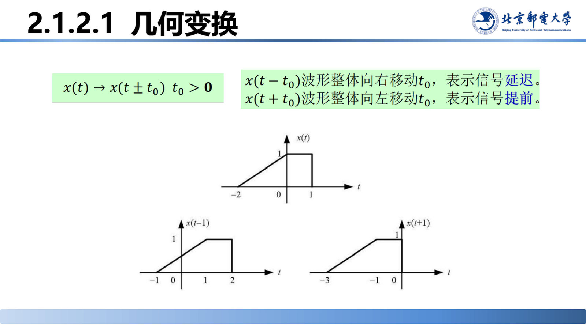

### 三、反褶（翻转，第 54 页）

$$x(t)\to x(-t)$$

即把 $x(t)$ 以**纵轴为中心作 180° 翻转**：原来在 $t>0$ 的部分翻到 $t<0$，反之亦然。

课件特别指出：**没有可实现此功能的实际器件**；在数字信号处理中可以实现这一概念，例如堆栈中的"后进先出"。

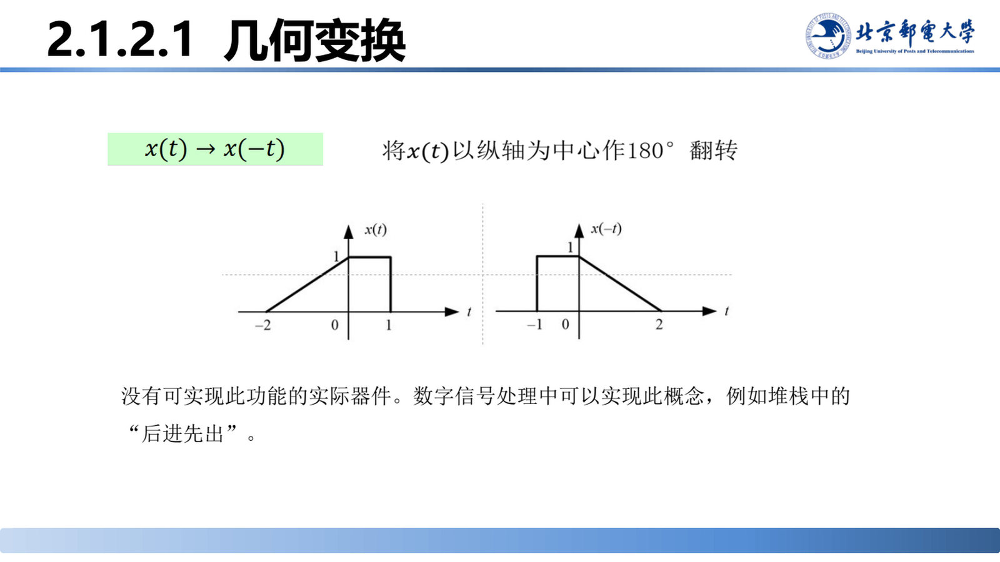

### 四、尺度变换（第 55 页）

$$x(t)\to x(at)\qquad a>0$$

- 若 $0<a<1$，则 $x(at)$ 是对 $x(t)$ 的**扩展**（波形横向拉长）；
- 若 $a>1$，则 $x(at)$ 是对 $x(t)$ 的**压缩**（波形横向压扁）。

关键结论：**尺度变换只改变持续时间和变化快慢，不直接改变信号幅值**。注意 $a>0$ 时没有翻转；若 $a$ 取负值，则同时包含了反褶（见第六节）。

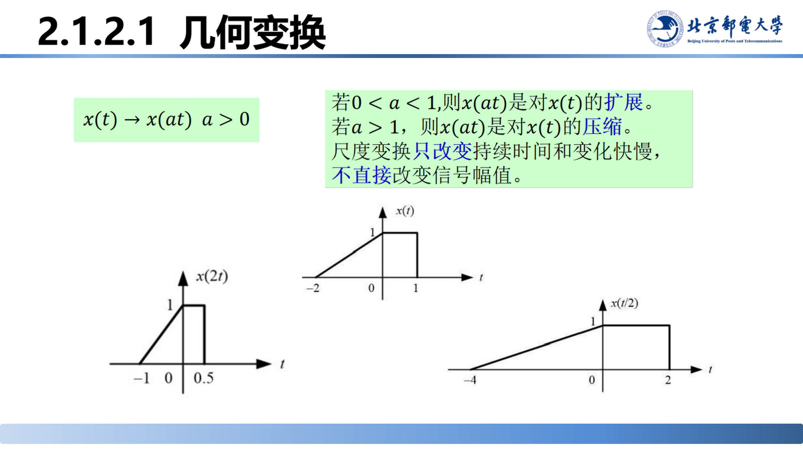

### 五、综合变换的实例演示（第 56 页）

> **课堂演示（slide 56）**：可同时改变尺度因子、时移量和是否反褶。结论：改变尺度因子时波形**横向**压缩/拉伸而高度不变；改变时移量时波形整体平移、形状不变；勾选反褶后波形以纵轴翻转；三者叠加时按"先展缩、后平移"的顺序即可正确读出每一步结果。

### 六、运算顺序与注意点（第 57 页）

综合变换的规范写法：

$$f(t)\to f(at\pm b)=f\!\left[a\!\left(t\pm\frac{b}{a}\right)\right]\qquad a>0$$

$$f(-at\pm b)=f\!\left[-a\!\left(t\mp\frac{b}{a}\right)\right]$$

课件的操作口诀：

- **先展缩**：$a>1$，压缩 $a$ 倍；$a<1$，扩展 $1/a$ 倍；
- **后平移**：括号内为 $+$，左移 $\dfrac{b}{a}$ 单位；为 $-$，右移 $\dfrac{b}{a}$ 单位；
- **再加上反褶**（若自变量带负号）。

**一切变换都是相对 $t$ 而言，最好用先展缩后平移的顺序。**

### 易错点与考点提示

- 平移量是 $\dfrac{b}{a}$ 而**不是** $b$：写 $f(2t-6)$ 时应先化成 $f\!\left[2(t-3)\right]$，再判断为"压缩 2 倍 + 右移 3"。
- 反褶不能"顺手"放到最后：$f(-2t+6)$ 应写成 $f\!\left[-2(t-3)\right]$，即"压缩 2 倍 → 反褶 → 右移 3"。
- 尺度变换只改横轴（时间），不改纵轴（幅值）——注意与"冲激信号强度会随展缩改变"区分开（冲激是面积守恒，见第 68 页）。
- 建议用**关键点法**验算：取原波形的起点、峰值、零点、终点，按新坐标逐点映射后连线。

### 自测

1. 已知 $f(t)$ 的波形，说明 $f(6-2t)$ 由 $f(t)$ 经过哪些变换得到，并给出顺序。
2. $x(3t)$ 与 $x(t)$ 相比，波形是压缩还是扩展？

参考答案

1. $f(6-2t)=f\!\left[-2(t-3)\right]$：先压缩 2 倍得 $f(2t)$，再反褶得 $f(-2t)$，最后右移 3 得 $f\!\left[-2(t-3)\right]$。
2. 压缩（$a=3>1$），时间轴被压为原来的 $1/3$。

---

## 13. 信号运算要点回顾与综合变换（含例题）

> 单章文件：[05-信号运算要点回顾与综合变换.md](notes/02-1-连续时间信号分析/05-信号运算要点回顾与综合变换.md)

> **来源**：《信号分析与处理》2.1节-20260920.pptx，第 58–70 页（共 121 页）
> **对应课件章节**：2.1.2.1 几何变换（要点回顾、综合变换与例题）
> **页码说明**：正文中"第 N 页"指课件**幻灯片序号**；插图说明"课件 slide N / 第 P 页"中的 P 为**渲染图页码**（与文件名 page-00PP 一致）。幻灯片 46/47/48 为隐藏页、未导出渲染图；幻灯片序号 n ≥ 49 时 P = n − 3。

学 2.1.2 之前先把 2.1.1 的结论"回炉"一遍，再把尺度变换从"看图"提升到"会算"（时间轴压缩/拉伸后的高度与面积守恒关系），最后用例 1～例 3 掌握**综合变换**的两种标准解法。

### 核心结论速查

| 内容 | 结论 |
|---|---|
| 基本信号分类 | 从不同角度可分为不同类型，如按能量与功率特征分类、按时域光滑性与奇异性分类 |
| 广义函数的意义 | 引入"广义函数"后，不连续信号也能求导、求积分；冲激的核心定义是"总面积为 1" |
| 筛选特性适用条件 | 积分区间不含 $\delta(t-t_0)$ 所在时刻 $t=t_0$ 时，积分结果必为零 |
| 尺度变换与幅值 | 时间轴被压缩/拉伸后，为保持总面积（能量）不变，其高度必须变成原来的 $\dfrac{1}{\lvert a\rvert}$ 倍 |
| 综合变换顺序 | $f(t)\to f(at\pm b)=f\!\left[a\!\left(t\pm\dfrac{b}{a}\right)\right]$；先展缩、后平移（含反褶时先展缩、再反褶、再平移） |
| 端点函数值不变法 | 新旧自变量相等（$f$ 的取值不变），解出关键点的新横坐标，按新顺序连线并检查是否翻转 |

---

### 一、要点回顾（第 58–64 页）

- 普通信号波形连续光滑、无跳变间断；**奇异信号**是函数本身或其各阶导数存在跳变与不连续点，用于模拟瞬时通断、短时冲击与定时采样。
- 引入**广义函数**后不连续信号也能求导、积分。冲激的核心定义是"总面积为 1"：

$$\int_{-\infty}^{+\infty}\delta(t)dt=1,\qquad \delta(t)=0\quad(t\ne0)$$

- **冲激性质**（详见 2.1.1.2 笔记）：筛选特性 $\displaystyle\int x(t)\delta(t-t_0)dt=x(t_0)$、展缩特性 $\delta(at)=\dfrac{1}{|a|}\delta(t)$（强度改变）；积分区间**不包括** $t=t_0$ 时结果必为零。
- **Sa 与 sinc**：

$$\mathrm{Sa}(t)=\frac{\sin t}{t},\qquad \mathrm{sinc}(t)=\frac{\sin\pi t}{\pi t},\qquad \mathrm{Sa}(t)=\mathrm{sinc}\!\left(\frac{t}{\pi}\right)$$

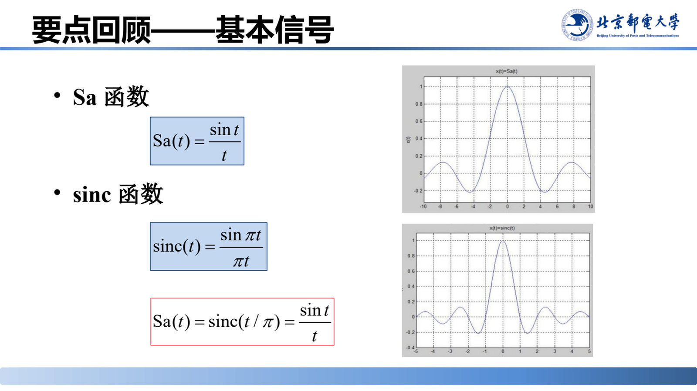

> 课堂补充：稳定系统—非稳定系统：稳定是指对任意有界的输入产生有界输出的系统；可逆系统——不可逆系统：系统在不同的激励下产生相同的响应就无法通过逆运算还原。

### 二、时间尺度变换（第 65 页）

$x(2t)$ 是把 $x(t)$ 在时间轴上压缩 2 倍，$x(0.5t)$ 是扩展 2 倍。**注意！一切变换都是相对 $t$ 而言，最好用先展缩后平移的顺序。**

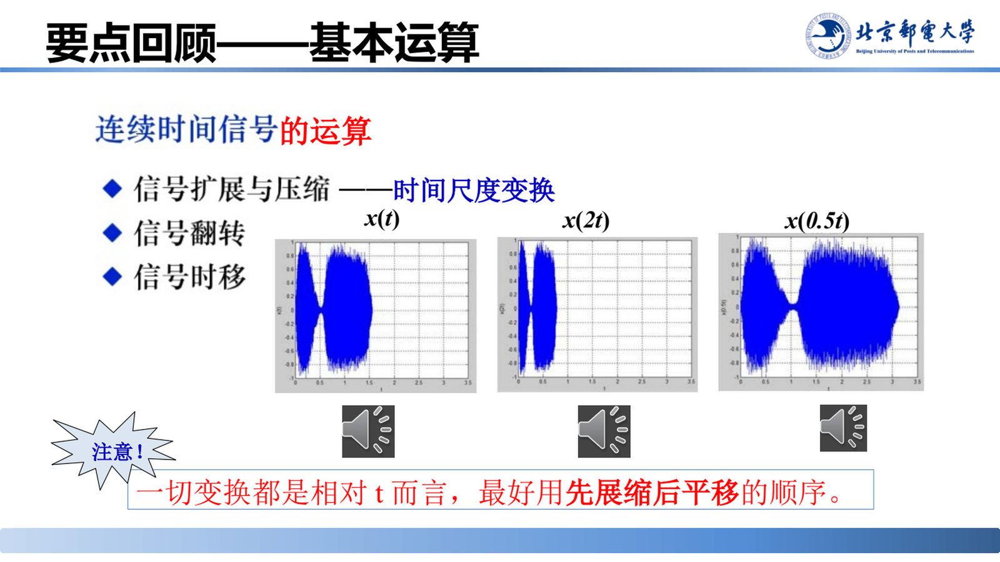

> **课堂演示（slide 65）**：以鸟叫声为素材提供原速、2 倍速、0.5 倍速播放并显示对应波形。结论：2 倍速时波形压缩、时长变短、音调变高；0.5 倍速时拉伸、时长变长、音调变低——尺度变换改变的是"变化快慢"，对应工程中的变速播放。

> 课堂补充：对**连续**信号，运算顺序没有关系，不存在点的丢失问题；而对于**离散**信号，运算顺序有影响——因为压缩可能出现非整数点，而平移的点只能是整数。

### 三、例 1：由 $f(t)$ 画 $f(6-2t)$（第 66 页）

**题面**：已知 $f(t)$ 的波形如图所示，试画出 $f(6-2t)$ 的波形。

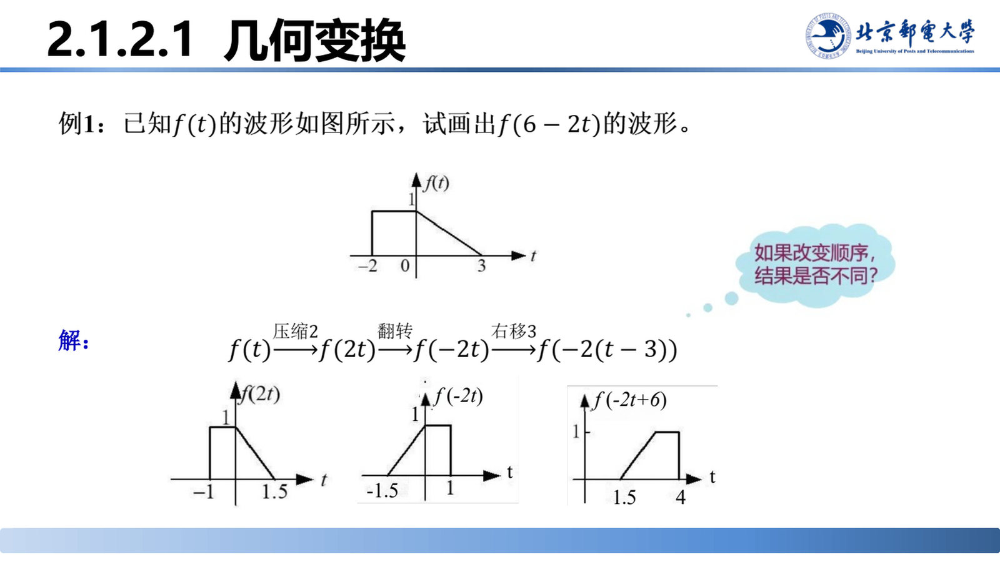

**解**：把 $6-2t$ 写成 $6-2t=-2(t-3)$，即

$$f(6-2t)=f\!\left[-2(t-3)\right]$$

按"先展缩、再反褶、后平移"的顺序：

$$f(t)\ \xrightarrow{\text{压缩}2}\ f(2t)\ \xrightarrow{\text{翻转}}\ f(-2t)\ \xrightarrow{\text{右移}3}\ f\!\left[-2(t-3)\right]$$

波形关键点：翻转后 $f(-2t)$ 的幅度为 1、横坐标为 $-1.5$；右移 3 后 $f(-2t+6)$ 的关键横坐标为 $1.5$ 与 $4$（见上图右侧两幅小图）。

### 四、信号的综合变换：端点函数值不变法（第 67 页）

变换前后函数的"值"不变，做法：

1. 找出所有关键点（峰值、零点、起点、终点等），记录其时间坐标 $t$ 与函数值 $f(t)$；
2. 令新旧括号内的自变量相等（$f$ 的取值不变），解出每个关键点的新横坐标 $t'$；
3. 在新坐标系中按 $(t',f(t))$ 描点；
4. 连接各点并**保持波形形状**（幅度、相对位置不变）。

时间轴的变化可能导致波形被压缩、拉伸或反转，但波形形状不变。

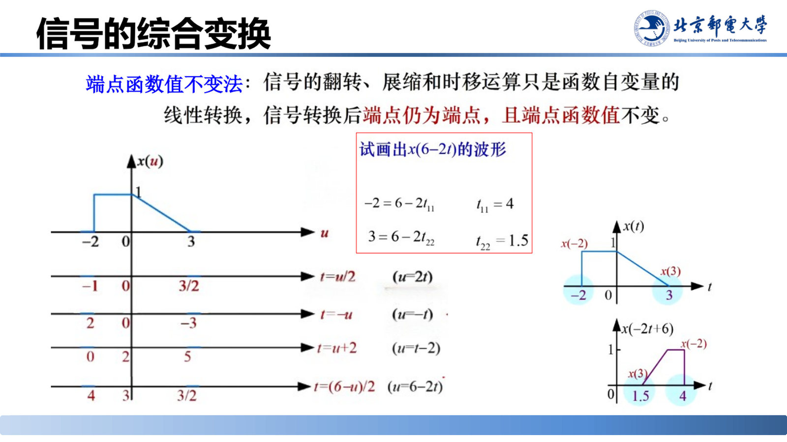

> 课堂补充：函数与自变量的关系——只要有 $-t$ 就一定有翻转；只要 $t$ 的系数绝对值 $|a|>1$，波形就一定有压缩。该方法适用于变换复杂的情况，而且可用于验算。

### 五、尺度变换与冲激强度（第 68 页）

时间轴被压缩/拉伸后，为了保持总面积（能量）不变，它的高度必须变成原来的 $\dfrac{1}{|a|}$ 倍。

> 课堂补充：例如 $x(t)=x_1(t)+\delta(t-3)$，则 $x(3t)=x_1(3t)+\delta(3t-3)$，而 $\delta(3t-3)=\dfrac{1}{3}\delta(t-1)$。**注意：冲激信号被压缩时强度会发生改变**（面积守恒要求 $1/|a|$）。

### 六、例 2：由 $f(1-2t)$ 求 $f(t)$（第 69 页）

**题面**：已知 $f(1-2t)=\delta(t-1)$ 的波形如图所示，画出 $f(t)$ 的波形。

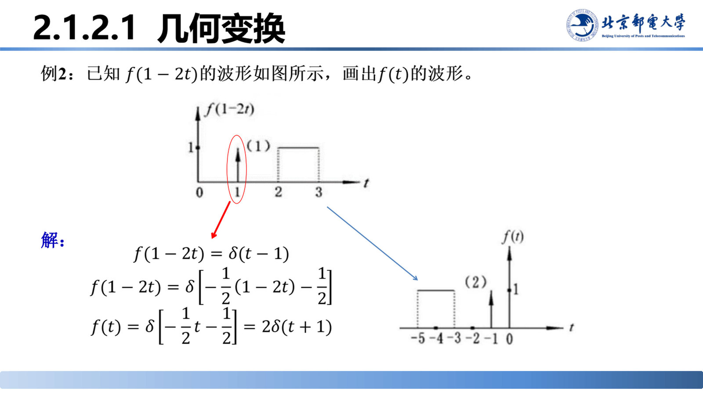

**解**（凑变量法）：把已知结果写成与自变量 $(1-2t)$ 相同的"外形"。由 $t-1=-\dfrac{1}{2}(1-2t)-\dfrac{1}{2}$，得

$$f(1-2t)=\delta\!\left[-\frac{1}{2}(1-2t)-\frac{1}{2}\right]$$

把括号中的 $(1-2t)$ 换成 $t$，即得

$$f(t)=\delta\!\left[-\frac{1}{2}t-\frac{1}{2}\right]=\delta\!\left[-\frac{1}{2}(t+1)\right]=2\delta(t+1)$$

最后一步用到展缩特性 $\delta(at)=\dfrac{1}{|a|}\delta(t)$（此处 $a=-\dfrac{1}{2}$，$\left|-\dfrac{1}{2}\right|=\dfrac{1}{2}$）。

> 课堂补充：这道题的关键是"**凑变量**"——把结论硬凑成与已知自变量完全相同的表达式，再整体替换。

### 七、例 3：由 $f(6-2t)$ 画 $f(2t-3)$（第 70 页）

**题面**：已知 $f(6-2t)$ 的波形如图所示，试画出 $f(2t-3)$ 的波形。

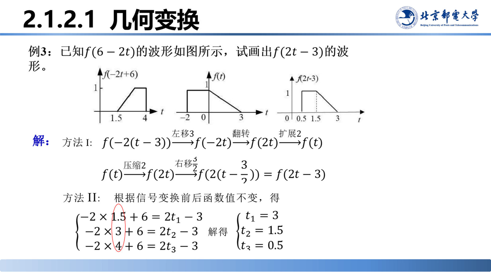

#### 方法 I：变换顺序法

先由 $f(6-2t)$ 反推 $f(t)$：

$$f\!\left[-2(t-3)\right]\ \xrightarrow{\text{左移}3}\ f(-2t)\ \xrightarrow{\text{翻转}}\ f(2t)\ \xrightarrow{\text{扩展}2}\ f(t)$$

再由 $f(t)$ 得到目标波形：

$$f(t)\ \xrightarrow{\text{压缩}2}\ f(2t)\ \xrightarrow{\text{右移}\frac{3}{2}}\ f\!\left(2\left(t-\frac{3}{2}\right)\right)=f(2t-3)$$

#### 方法 II：端点函数值不变法

根据变换前后**函数值不变**，让新旧括号里的式子相等，对三个关键转折点列方程：

$$\begin{cases}
-2\times1.5+6=2t_1-3\\
-2\times3+6=2t_2-3\\
-2\times4+6=2t_3-3
\end{cases}
\quad\Longrightarrow\quad
\begin{cases}
t_1=3\\
t_2=1.5\\
t_3=0.5
\end{cases}$$

> 课堂补充：方法 1——无论自变量怎么变，函数的"值"是不变的：若 $f(A)=1$，不管 $A$ 是 $6-2t$ 还是 $2t-3$，让两式相等解出的 $t$ 就是新横坐标。方法 2——让新旧括号里的式子相等列方程，**注意顺序**！原来 $1.5\to3\to4$（递增），现在 $3\to1.5\to0.5$（递减），说明信号被**翻转**了。

### 易错点与考点提示

- 综合变换先判断"有没有 $-t$"（有则一定翻转），再判断"$|a|$ 是否大于 1"（大于 1 则一定压缩）。
- 平移量必须除以 $a$：$f(at\pm b)=f\!\left[a\!\left(t\pm\dfrac{b}{a}\right)\right]$。
- 尺度变换会改变**冲激信号的强度**（变 $1/|a|$ 倍），但**不改变普通信号的幅值**——最常考的一处对照。
- 端点函数值不变法对"已知变换后的波形求原波形"这类反问题最可靠，而且能顺带验算有没有翻转。

### 自测

1. 已知 $f(t)=\delta(t)$，求 $f(3t-3)$。
2. 例 3 中三个关键点由 $1.5,3,4$ 变为 $3,1.5,0.5$，说明波形发生了哪些变换？

参考答案

1. $\delta(3t-3)=\dfrac{1}{3}\delta(t-1)$。
2. 关键点顺序由递增变为递减，说明发生了**反褶**（翻转）；相邻关键点的间隔被压为原来的 $1/2$（$2t$ 的系数为 2），说明同时**压缩 2 倍**。

---

## 14. 信号的微积分运算

> 单章文件：[06-微积分运算.md](notes/02-1-连续时间信号分析/06-微积分运算.md)

> **来源**：《信号分析与处理》2.1节-20260920.pptx，第 71–71 页（共 121 页）
> **对应课件章节**：2.1.2.2 微积分运算
> **页码说明**：正文中"第 N 页"指课件**幻灯片序号**；插图说明"课件 slide N / 第 P 页"中的 P 为**渲染图页码**（与文件名 page-00PP 一致）。幻灯片 46/47/48 为隐藏页、未导出渲染图；幻灯片序号 n ≥ 49 时 P = n − 3。

除了"搬移、翻转、压扁"，信号还能做**微分**和**积分**运算，它们分别对应"提取变化"和"累积求面积"。

### 核心结论速查

| 运算 | 表达式 | 波形效果 | 关键结论 |
|---|---|---|---|
| 微分 | $y(t)=\dfrac{dx(t)}{dt}$ | 突出信号的变化部分，使边缘轮廓变得突出 | 冲激信号可表示信号间断点处的导数，其**强度值即为信号间断点的跳跃值** |
| 积分 | $y(t)=\displaystyle\int_{-\infty}^{t}x(\tau)d\tau=x^{(-1)}(t)$ | 使变化的部分变得平滑 | 积分就是"求面积"，把一个信号累积起来 |

---

### 一、微分与积分的定义（第 71 页）

$$y(t)=\frac{dx(t)}{dt}\qquad\qquad y(t)=\int_{-\infty}^{t}x(\tau)d\tau=x^{(-1)}(t)$$

其中 $x^{(-1)}(t)$ 表示 $x(t)$ 的积分（记号 $(\cdot)^{(-1)}$ 将在后面卷积的微积分性质中反复使用）。

### 二、两种运算的直观效果

- **微分运算**突出了信号的变化部分，使边缘轮廓变得突出：信号平坦（不变）的区段导数为零，信号陡峭变化（跳变）的区段导数很大。
- **积分运算**使变化的部分变得平滑——求面积，把一个信号累积起来。

**冲激信号可表示信号间断点处信号的导数，其强度值即为信号间断点的跳跃值。**

这一点是 2.1.1.2 内容的自然延续：若信号 $x(t)$ 在某处从 $A$ 跳到 $B$，则 $x'(t)$ 在该处含有一个强度为 $B-A$ 的冲激。因此含跳变的信号也能求导——只要用冲激把跳变"记账"。

> **课堂演示（slide 71）**：同屏给出原信号、微分与积分结果。结论：带跳变的信号微分后平坦段为 0、跳变处出现尖峰（冲激），再积分又回到原信号——微分"找跳变"、积分"补面积"，两者在被微分的信号有起始点时互为逆运算（见第 103 页）。

### 易错点与考点提示

- 微分运算会**丢直流**：常数部分的导数为 0。所以"先微分再积分"只有在被微分信号有起始点（即微分后再积分等于原信号）时才可逆。
- 积分是**变上限积分** $\int_{-\infty}^{t}$，下限取 $-\infty$ 是因为信号在 $-\infty$ 处通常为零。
- 冲激的强度 = 跳变值，这个结论在"已知波形求导"的题目里可以秒杀。

### 自测

1. 已知 $x(t)=u(t)-u(t-2)$，求 $x'(t)$。
2. 为什么"先微分再积分"不一定能还原原信号？

参考答案

1. $x(t)$ 是幅度为 1、宽度为 2 的矩形脉冲，故 $x'(t)=\delta(t)-\delta(t-2)$（在两处跳变点各产生一个强度为 1 的冲激，符号由上升/下降决定）。
2. 微分会把信号中的常数（直流）分量丢掉，积分无法恢复；只有被微分信号是有起始点的信号，即满足 $\displaystyle\int_{-\infty}^{t}\frac{df(\tau)}{d\tau}d\tau=f(t)$ 时才可逆。

---

## 15. 复合运算：相加、相乘与卷积

> 单章文件：[07-复合运算与卷积.md](notes/02-1-连续时间信号分析/07-复合运算与卷积.md)

> **来源**：《信号分析与处理》2.1节-20260920.pptx，第 72–105 页（共 121 页）
> **对应课件章节**：2.1.2.3 复合运算
> **页码说明**：正文中"第 N 页"指课件**幻灯片序号**；插图说明"课件 slide N / 第 P 页"中的 P 为**渲染图页码**（与文件名 page-00PP 一致）。幻灯片 46/47/48 为隐藏页、未导出渲染图；幻灯片序号 n ≥ 49 时 P = n − 3。

两个信号可以相互作用：相加、相乘、卷积。卷积是线性时不变系统分析的核心工具（已知输入 $e(t)$ 与系统冲激响应 $h(t)$，输出就是二者的卷积），算法有两条正路——**解析式法**（列积分式、定积分限、分段写结果）与**图解法**（变量替换、反褶、时移、相乘积分）。

### 核心结论速查

| 性质 | 公式 | 备注 |
|---|---|---|
| 卷积定义 | $y(t)=x_1(t)*x_2(t)=\displaystyle\int_{-\infty}^{\infty}x_1(\tau)x_2(t-\tau)d\tau$ | $\tau$ 是积分变量，$t$ 是参变量 |
| 交换律 | $x_1(t)*x_2(t)=x_2(t)*x_1(t)$ | 可证明（换元 $t-\tau=\lambda$） |
| 分配律 | $x_1(t)*[x_2(t)+x_3(t)]=x_1(t)*x_2(t)+x_1(t)*x_3(t)$ | 对应系统**并联** |
| 结合律 | $[x(t)*h_1(t)]*h_2(t)=x(t)*[h_1(t)*h_2(t)]$ | 对应系统**串联** |
| 时移性质 | 若 $x(t)=x_1(t)*x_2(t)$，则 $x_1(t-t_1)*x_2(t)=x(t-t_1)$；$x_1(t-t_1)*x_2(t-t_2)=x(t-t_1-t_2)$ | 延时器可移到卷积之外 |
| 与冲激卷积 | $x(t)*\delta(t)=x(t)$；$x(t)*\delta(t-t_0)=x(t-t_0)$ | 单位冲激响应 $\delta(t)$ 对应理想导线 |
| 与冲激偶卷积 | $x(t)*\delta'(t)=x'(t)$；$x(t)*\delta^{(k)}(t)=x^{(k)}(t)$；$x(t)*\delta^{(k)}(t-t_0)=x^{(k)}(t-t_0)$ | 对应 $k$ 个微分器 + 时移 |
| 与阶跃卷积 | $x(t)*u(t)=\displaystyle\int_{-\infty}^{t}x(\lambda)d\lambda$ | 单位冲激响应 $u(t)$ 对应积分器 |
| 微分积分性质 | 设 $g(t)=x(t)*h(t)$，则 $g'(t)=x'(t)*h(t)=x(t)*h'(t)$ | 微分可任意搬到任一卷积因子上 |
| 推广 | $g^{(n)}(t)=x(t)*h^{(n)}(t)=x^{(n)}(t)*h(t)$；$g^{(n-m)}(t)=x^{(n)}(t)*h^{(-m)}(t)$ | 微积分次数可"抵消" |
| 卷积结果区间 | 两信号非零区间为 $[t_1,t_2]$、$[t_3,t_4]$ 时，$t_1+t_3\le t\le t_2+t_4$ | 卷积时宽 = 两信号时宽之和 |
| 使用微积分性质的条件 | $\displaystyle\int_{-\infty}^{t}\frac{df(\tau)}{d\tau}d\tau=f(t)$ | 被微分的信号必须**有起始点** |

---

### 一、两信号相加和相乘（第 72 页）

$$x(t)=x_1(t)+x_2(t)+\cdots+x_n(t)\qquad\qquad x(t)=x_1(t)\cdot x_2(t)$$

**注意要在对应的时间上进行运算**——逐点相加、逐点相乘，两个信号在时间轴上必须对齐。

> **课堂演示（slide 72）**：同屏画出两信号及其和、积。结论：乘积的非零区间是两个信号非零区间的**交集**，相乘相当于"用一个信号去调制/截取另一个信号"。

### 二、例题：两正弦信号相乘包含的频率（第 73 页）

**题面**：设有两个正弦信号 $x_1(t)=\cos(100\pi t)$ 和 $x_2(t)=\cos(900\pi t)$，求二者乘积包含的频率。

**解**：两个信号的频率分别为 $50\ \text{Hz}$ 和 $450\ \text{Hz}$。利用**积化和差**公式

$$x_1(t)x_2(t)=\frac{1}{2}\cos(800\pi t)+\frac{1}{2}\cos(1000\pi t)$$

输出包含 **400 Hz 的差频**和 **500 Hz 的和频**——两个余弦相乘 = 和频 + 差频各一半，这正是调制（混频）的数学本质。

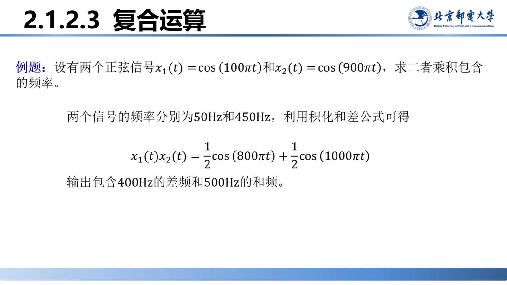

### 三、卷积的引出与定义（第 74 页）

卷积描述两个信号在时间上的相互作用过程；**当其中一个信号表示线性时不变系统的特性时，卷积便描述输入信号经过该系统后的输出响应**。设有两个任意连续时间信号 $x_1(t)$ 与 $x_2(t)$，二者的卷积运算定义为

$$y(t)=x_1(t)*x_2(t)=\int_{-\infty}^{\infty}x_1(\tau)x_2(t-\tau)d\tau$$

### 四、卷积的计算——解析式法（第 75–79 页）

#### 4.1 方法要点

解析式法直接利用定义式计算。在积分求解之前，**关键是先确定乘积 $x_1(\tau)x_2(t-\tau)$ 的非零区间**；积分上下限通常随 $t$ 改变，因此卷积结果往往需要**分段表示**。

#### 4.2 例题：矩形脉冲与指数信号的卷积

**题面**：已知 $e(t)=u(t)-u(t-t_0)$，$h(t)=e^{-t}u(t)$，求 $r(t)=e(t)*h(t)$，设 $t_0>0$。

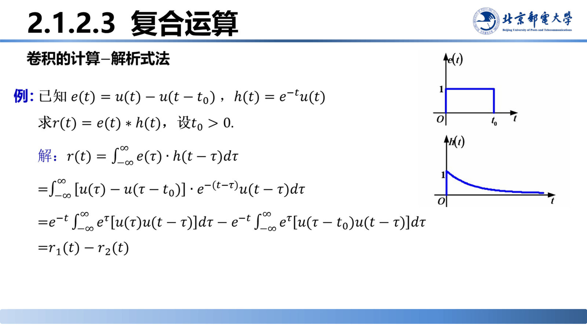

**解**：

$$r(t)=\int_{-\infty}^{\infty}e(\tau)h(t-\tau)d\tau
=\int_{-\infty}^{\infty}\left[u(\tau)-u(\tau-t_0)\right]e^{-(t-\tau)}u(t-\tau)d\tau$$

$$=e^{-t}\int_{-\infty}^{\infty}e^{\tau}\left[u(\tau)u(t-\tau)\right]d\tau-e^{-t}\int_{-\infty}^{\infty}e^{\tau}\left[u(\tau-t_0)u(t-\tau)\right]d\tau
=r_1(t)-r_2(t)$$

**(1) $r_1(t)$**（第 77 页）：由 $u(\tau)u(t-\tau)\ne0$ 得

$$\begin{cases}\tau>0\\ t-\tau>0\end{cases}\Longrightarrow\begin{cases}0<\tau<t\\ t>0\end{cases}$$

于是

$$r_1(t)=e^{-t}\int_{0}^{t}e^{\tau}d\tau\cdot u(t)=\left(1-e^{-t}\right)u(t)$$

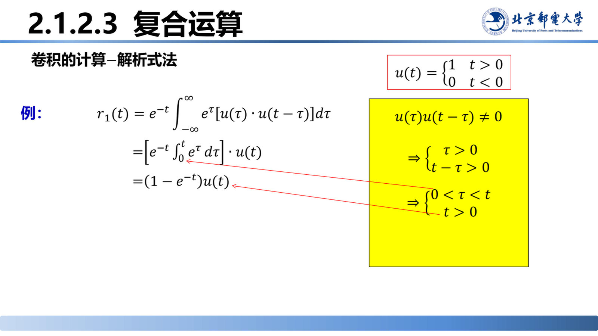

**(2) $r_2(t)$**（第 78 页）：由 $u(\tau-t_0)u(t-\tau)\ne0$ 得

$$\begin{cases}\tau-t_0>0\\ t-\tau>0\end{cases}\Longrightarrow\begin{cases}t_0<\tau<t\\ t>t_0\end{cases}$$

于是

$$r_2(t)=e^{-t}\int_{t_0}^{t}e^{\tau}d\tau\cdot u(t-t_0)=\left[1-e^{-(t-t_0)}\right]u(t-t_0)$$

**(3) 最终结果**（第 79 页）：

$$r(t)=r_1(t)-r_2(t)=\left(1-e^{-t}\right)u(t)-\left[1-e^{-(t-t_0)}\right]u(t-t_0)$$

从波形上看：$0\le t<t_0$ 段 $r(t)$ 按 $1-e^{-t}$ 上升；$t\ge t_0$ 后按 $e^{-t}(e^{t_0}-1)$ 衰减。

> 课堂补充：确定积分变量 $\tau$ 的有效范围是解析式法的唯一难点，把两个阶跃（或门函数）的条件写成不等式组即可。

### 五、卷积的计算——图解法（第 80–91 页）

#### 5.1 图解法的物理意义（第 80 页）

把一个矩形信号沿另一个矩形信号滑动，二者乘积的积分等于**重叠面积**：重叠面积从零增大、可能保持、再减小，因此卷积结果形成**三角形或梯形**。若一个矩形代表输入、另一个代表系统冲激响应，输出曲线就是系统对输入的累积响应——**冲激响应越宽，系统记忆越长**。

> **课堂演示（slide 80）**：拖动滑动量 $t$，显示重叠区域与卷积值。结论：重叠宽度线性增大→保持→线性减小，对应卷积的上升斜线→平台→下降斜线；两矩形等宽时退化为三角形。

#### 5.2 图解法四步骤（第 81 页）

函数式复杂时，用图解法便于直观地确定积分限：

1. **变量替换**：$f_1(t)\to f_1(\tau)$，$f_2(t)\to f_2(\tau)$，积分变量改为 $\tau$；
2. **反褶**：$f_2(\tau)\to f_2(-\tau)$；
3. **时移**：$t$ 为参变量，$f_2(-\tau)\to f_2(t-\tau)$；
4. **相乘积分**：$\displaystyle\int_{-\infty}^{\infty}f_1(\tau)f_2(t-\tau)d\tau$。

#### 5.3 例题：两个矩形信号的卷积（第 82–90 页）

**题面**（第 82 页）：$f_1(t)$ 和 $f_2(t)$ 波形如下所示，求 $f_1(t)$ 和 $f_2(t)$ 的卷积 $g(t)$。

**坐标关系**（第 83 页）：反褶并时移后 $f_2(t-\tau)=f_2\left[-(\tau-t)\right]$；原坐标系中 $f_2$ 的非零段 $\tau=0$ 到 $\tau=3$，在新坐标系（自变量 $t-\tau$）中对应 $\tau=t$ 到 $\tau=t-3$。

**分段讨论**（乘积高度恒为 2）：完全不重叠（$t\le-1$）与完全分离（$t\ge4$）时 $g(t)=0$；关键的两段是**部分重叠**：

**② $-1\le t\le1$**（第 85 页）：重叠区右边界随 $t$ 移动，

$$g(t)=\int_{-1}^{t}f_1(\tau)f_2(t-\tau)d\tau=\int_{-1}^{t}2\,d\tau=2\tau\Big|_{-1}^{t}=2t+2$$

**③ $1\le t\le2$**（第 86 页）：完全重叠，$g(t)=\displaystyle\int_{-1}^{1}2\,d\tau=4$（最大值）。

**④ $2\le t\le4$**（第 87 页）：重叠区左边界随 $t$ 移动，

$$g(t)=\int_{t-3}^{1}2\,d\tau=2\tau\Big|_{t-3}^{1}=-2t+8$$

**汇总**（第 89 页）：

$$g(t)=\begin{cases}
2t+2, & -1\le t\le1\\
4, & 1\le t\le2\\
-2t+8, & 2\le t\le4\\
0, & \text{其他 }t
\end{cases}$$

**时宽关系**（第 90 页）：$g(t)$ 的时宽 = 两信号时宽之和（本例 $2+3=5$，与 $t$ 从 $-1$ 到 $4$ 一致）。

> **课堂演示（slide 91）**：四步骤按钮 + 滑块拖动 $t$。结论：图解法就是"把 $f_2$ 反褶后沿 $\tau$ 轴平移扫过 $f_1$，边走边算重叠面积"，分段点正是两个波形端点相遇的时刻。

### 六、卷积的性质（第 92–100 页）

#### 6.1 交换律（第 92–93 页）

$$x_1(t)*x_2(t)=x_2(t)*x_1(t)$$

**证明**：令 $t-\tau=\lambda$，则 $\tau=t-\lambda$，$d\tau=-d\lambda$，$\tau:-\infty\to\infty$ 对应 $\lambda:\infty\to-\infty$，

$$x_1(t)*x_2(t)=\int_{-\infty}^{\infty}x_1(\tau)x_2(t-\tau)d\tau
=\int_{\infty}^{-\infty}x_2(\lambda)x_1(t-\lambda)(-d\lambda)
=\int_{-\infty}^{\infty}x_2(\lambda)x_1(t-\lambda)d\lambda
=x_2(t)*x_1(t)$$

#### 6.2 卷积的代数性质（第 93 页）

| 性质 | 公式 | 系统含义 |
|---|---|---|
| （1）交换律 | $x_1(t)*x_2(t)=x_2(t)*x_1(t)$ | 级联次序可换 |
| （2）分配律 | $x_1(t)*[x_2(t)+x_3(t)]=x_1(t)*x_2(t)+x_1(t)*x_3(t)$ | 对应系统**并联** |
| （3）结合律 | $[x(t)*h_1(t)]*h_2(t)=x(t)*[h_1(t)*h_2(t)]$ | 对应系统**串联**（等效冲激响应为 $h_1*h_2$） |

> **课堂演示（slide 94）**：串联、并联、交换次序三个按钮。结论：串联等效冲激响应为 $h_1(t)*h_2(t)$（交换两级次序输出不变）；并联为 $h_1(t)+h_2(t)$；两级串联也可先合并再与输入卷积——三条代数性质就是 LTI 系统三种连接方式的数学表达。

#### 6.3 卷积的时移性质（第 95 页）

若 $x(t)=x_1(t)*x_2(t)$，则

$$x_1(t-t_1)*x_2(t)=x(t-t_1),\qquad x_1(t-t_1)*x_2(t-t_2)=x(t-t_1-t_2)$$

即"延时器"可以整体挪到卷积之外：先卷积再延时 $t_1$，与先让 $x_1$ 延时 $t_1$ 再卷积，结果完全相同。

#### 6.4 与冲激函数或阶跃函数的卷积（第 96–97 页）

**（1）与 $\delta(t)$ 卷积**——理想导线的单位冲激响应为 $h(t)=\delta(t)$：

$$x(t)*\delta(t)=\int_{-\infty}^{\infty}x(t-\tau)\delta(\tau)d\tau=x(t)$$

**（2）与 $\delta(t-t_0)$ 卷积**：$h(t)=\delta(t-t_0)$（延时器），$x(t)*\delta(t-t_0)=x(t-t_0)$——与冲激卷积相当于"把信号整体搬移"到冲激所在的位置。

**（3）与冲激偶卷积**：$h(t)=\delta'(t)$（微分器），$x(t)*\delta'(t)=x'(t)$；推广到 $k$ 个微分器（微分和时移）：

$$x(t)*\delta^{(k)}(t)=x^{(k)}(t),\qquad x(t)*\delta^{(k)}(t-t_0)=x^{(k)}(t-t_0)$$

**（4）与阶跃函数卷积**：$h(t)=u(t)$（积分器），$x(t)*u(t)=\displaystyle\int_{-\infty}^{t}x(\lambda)d\lambda$。

#### 6.5 卷积的微分积分性质（第 98–99 页）

设 $g(t)=x(t)*h(t)$，则 $g'(t)=x'(t)*h(t)=x(t)*h'(t)$——微分算子可以搬到任意一个卷积因子上，结果不变。

**证明**（第 99 页）：由 $g(t)=\displaystyle\int_{-\infty}^{\infty}x(t-\tau)h(\tau)d\tau$ 两端对 $t$ 求导：

$$\frac{dg(t)}{dt}=\int_{-\infty}^{\infty}\frac{dx(t-\tau)}{dt}h(\tau)d\tau=\int_{-\infty}^{\infty}x'(t-\tau)h(\tau)d\tau$$

即 $g'(t)=x'(t)*h(t)$，再由交换律即得 $g'(t)=x(t)*h'(t)$。

#### 6.6 推广（第 100 页）

$$g^{(n)}(t)=x(t)*h^{(n)}(t)=x^{(n)}(t)*h(t)$$

$$g^{(n-m)}(t)=x^{(n)}(t)*h^{(-m)}(t)=x^{(-m)}(t)*h^{(n)}(t)$$

$$g^{(-1)}(t)=x(t)*h^{(-1)}(t)=x^{(-1)}(t)*h(t)$$

特别地 $g(t)=x'(t)*h^{(-1)}(t)$。有的函数微分后出现冲激信号，可用冲激信号卷积的性质简化运算。

### 七、例题：用微积分性质简化卷积（第 101–102 页）

#### 7.1 例：把微分放到简单的因子上

**题面**：已知 $f(t)$、$h(t)$，求 $g(t)=f(t)*h(t)$。

**解**：令简单的 $h(t)$ 去求导、复杂的 $f(t)$ 去积分，

$$g(t)=f^{(-1)}(t)*h'(t)=f^{(-1)}(t)*\left[\delta(t)-\delta(t-1)\right]=f^{(-1)}(t)-f^{(-1)}(t-1)$$

即结果是 $f(t)$ 的积分波形与其自身延时 1 后的积分波形之差。

> 课堂补充：**让简单的 $h(t)$ 去求导，让复杂的 $f(t)$ 去积分。** 与 $\delta$ 函数卷积可以看做一个整体加权、移位。

#### 7.2 例：含直流分量的信号

**题面/解法**（第 102 页）：把信号写为"直流 + 交流"两部分 $f_1(t)=1+f_{11}(t)$，则

$$f_1(t)*f_2(t)=1*f_2(t)+\frac{df_{11}(t)}{dt}*\int_{-\infty}^{t}f_2(t)dt$$

即直流部分单独处理，交流部分用"一个求导、一个积分"的微积分性质来算。

### 八、使用微积分性质的条件（第 103 页）

使用微积分性质的条件：**被微分的信号是一个有起始点的信号**，即被微分的信号微分后再积分等于原信号：

$$\int_{-\infty}^{t}\frac{df(\tau)}{d\tau}d\tau=f(t)$$

这个条件保证了"微分—积分"可逆，也就保证了 $x'(t)*h^{(-1)}(t)=x(t)*h(t)$ 成立。

### 九、本节重点与难点（第 104–105 页）

- **卷积的计算，确定积分限是关键**：解析式法用不等式组定出 $\tau$ 的有效范围再分段积分；图解法按"变量替换 → 反褶 → 时移 → 相乘积分"四步走。
- **卷积结果的区间**：两信号非零区间为 $[t_1,t_2]$、$[t_3,t_4]$ 时，$t_1+t_3\le t\le t_2+t_4$。
- **必须掌握的四组性质**：代数性质（交换律、分配律、结合律）、时移性质、与冲激/阶跃函数的卷积、微积分性质。
- 记号说明：课件也把卷积写成 $r(t)=e(t)\otimes h(t)=e(t)*h(t)$。

### 易错点与考点提示

- 卷积是**积分**，不是相乘；$x_1(t)x_2(t)\ne x_1(t)*x_2(t)$。
- 解析式法的唯一难点是积分限：把每个阶跃/门函数的非零条件写成关于 $\tau$ 的不等式组，再与 $t$ 的关系一起解。
- 与 $\delta(t-t_0)$ 卷积只做"搬移"，不改变波形形状；与 $\delta'(t)$ 卷积则求导——快速解题的利器。
- 用微积分性质前必须检查"被微分的信号有起始点"，否则微分丢掉的直流分量无法通过积分找回。
- $t$ 是参变量、$\tau$ 是积分变量，不要把 $x_2(t-\tau)$ 写成 $x_2(t)$。
- 卷积结果时宽 = 两信号时宽之和（对有限时宽信号），可快速验算分段区间。

### 自测

1. 写出 $x(t)*\delta(t-2)$ 的结果。
2. 两个时宽分别为 3 和 4 的有限时宽信号做卷积，结果时宽是多少？
3. 已知 $g(t)=x(t)*h(t)$，说明 $g'(t)$ 的两种等价写法。

参考答案

1. $x(t)*\delta(t-2)=x(t-2)$。
2. $3+4=7$。
3. $g'(t)=x'(t)*h(t)=x(t)*h'(t)$。

---

## 16. 信号的分解与矢量空间

> 单章文件：[08-信号的分解与矢量空间.md](notes/02-1-连续时间信号分析/08-信号的分解与矢量空间.md)

> **来源**：《信号分析与处理》2.1节-20260920.pptx，第 106–119 页（共 121 页）
> **对应课件章节**：2.1.3 信号的分解及矢量空间分析（2.1.3.1–2.1.3.5）
> **页码说明**：正文中"第 N 页"指课件**幻灯片序号**；插图说明"课件 slide N / 第 P 页"中的 P 为**渲染图页码**（与文件名 page-00PP 一致）。幻灯片 46/47/48 为隐藏页、未导出渲染图；幻灯片序号 n ≥ 49 时 P = n − 3。

复杂信号可以拆成几块"更好用"的部分（四种标准拆法）；各部分是否"互不干扰"（正交/独立）决定了分解是否唯一、能否分别处理。把信号看成**矢量**——内积衡量相似性、范数衡量能量或长度、正交基用于逼近——这套几何语言是傅里叶级数与频域分析的骨架。

### 核心结论速查

| 分解方式 | 分解式 | 各分量表达式 | 关键性质 |
|---|---|---|---|
| 直流/交流 | $x(t)=x_{DC}(t)+x_{AC}(t)$ | $x_{DC}(t)=\dfrac{1}{T}\displaystyle\int_{t_0}^{t_0+T}x(t)dt$ | $\dfrac{1}{T}\displaystyle\int_{t_0}^{t_0+T}x_{AC}(t)dt=0$ |
| 偶/奇 | $x(t)=x_e(t)+x_o(t)$ | $x_e(t)=\dfrac{x(t)+x(-t)}{2}$；$x_o(t)=\dfrac{x(t)-x(-t)}{2}$ | $x_e(t)=x_e(-t)$，$x_o(t)=-x_o(-t)$ |
| 实部/虚部 | $x(t)=x_R(t)+jx_I(t)$ | $x_R(t)=\dfrac{x(t)+x^*(t)}{2}$；$x_I(t)=\dfrac{x(t)-x^*(t)}{2j}$ | 共轭 $x^*(t)=x_R(t)-jx_I(t)$ |
| 正交函数 | $x(t)=\displaystyle\sum_{n=1}^{N}c_nx_n(t)$ | $c_n=\dfrac{\langle x,x_n\rangle}{\langle x_n,x_n\rangle}$ | $\langle x_n,x_n\rangle=1$ 时为正交归一（单位正交）函数 |
| 功率关系 | $P=x_{DC}^2(t)+\dfrac{1}{T}\displaystyle\int_{t_0}^{t_0+T}x_{AC}^2(t)dt$ | 信号平均功率 = 直流功率 + 交流功率 | 交叉项积分为零 |
| 内积 | $\langle x(t),y(t)\rangle=\displaystyle\int x(t)y^*(t)dt$；$\langle x[n],y[n]\rangle=\displaystyle\sum x[n]y^*[n]$ | 衡量信号相似性 | 正交 $\Leftrightarrow$ 内积为 0 |
| 范数 | $\lvert x \rvert=\sqrt{\langle x,x\rangle}$ | 信号的能量或长度 | 用于归一化 |
| 相关系数 | $\rho=\dfrac{\lvert\langle x_1,x_2\rangle\rvert}{\lvert x_1 \rvert\,\lvert x_2 \rvert}$ | 衡量两波形相似程度 | $\rho=0$ 正交；$\rho$ 接近 1 方向接近 |
| 最佳逼近 | $\hat{x}_N(t)=\displaystyle\sum_{n=1}^{N}c_nx_n(t)$ | 误差 $e(t)=x(t)-\hat{x}_N(t)$ | $\langle e,x_n\rangle=0$ 时取得最小均方误差 |

---

### 一、2.1.3 的内容与要求（第 106–108 页）

2.1.3 包含三块分解：**直流分量与交流分量**、**奇分量与偶分量**、**实部分量与虚部分量**；此外讨论正交函数分量与信号矢量空间。

### 二、直流分量与交流分量（第 109–111 页）

#### 2.1 分解式与直流分量

$$x(t)=x_{AC}(t)+x_{DC}(t)$$

其中直流分量是信号在一个周期（或定义区间 $(a,b)$）内的平均值：

$$x_{DC}(t)=\frac{1}{T}\int_{t_0}^{t_0+T}x(t)dt$$

**交流分量在一个周期内的平均值为零**：

$$\frac{1}{T}\int_{t_0}^{t_0+T}x_{AC}(t)dt=0$$

这一性质可直接检验分解是否正确——若交流分量仍有非零平均值，说明直流分量没有完全去除。

> **课堂演示（slide 109）**：切换信号类型，显示原信号、直流与交流三条曲线。结论：交流分量在一个周期内面积相消、平均值为零，两条分量逐点相加可还原原信号。

#### 2.2 平均功率的分解（第 110 页）

$$P=\frac{1}{T}\int_{t_0}^{t_0+T}x^2(t)dt
=\frac{1}{T}\int_{t_0}^{t_0+T}\left[x_{DC}(t)+x_{AC}(t)\right]^2dt
=x_{DC}^2(t)+\frac{1}{T}\int_{t_0}^{t_0+T}x_{AC}^2(t)dt$$

即**信号的平均功率 = 直流功率 + 交流功率**。交叉项积分为零，说明直流分量和零均值交流分量在平均功率意义下**彼此独立**（正交）。

#### 2.3 工程实例：全波整流提取直流分量（第 111 页）

利用**全波整流电路**从 220 V-50 Hz 交流信号中提取直流分量，信号流程为：交流电源 → 变压电路 → 全波整流 → 滤波稳压 → 负载。整流后信号的直流分量（平均值）为

$$U_{DC}=100\int_{0}^{\frac{1}{100}}U_m\sin(2\pi\times50t)dt=\frac{2}{\pi}U_m\approx0.64U_m$$

即全波整流后取平均值得到约 0.64 倍峰值的直流电压——这就是"交流变直流"的第一级。

### 三、偶分量与奇分量（第 112 页）

$$x(t)=x_e(t)+x_o(t)$$

$$x_e(t)=\frac{x(t)+x(-t)}{2},\qquad x_o(t)=\frac{x(t)-x(-t)}{2},\qquad x_e(t)=x_e(-t),\quad x_o(t)=-x_o(-t)$$

> **课堂演示（slide 112）**：切换信号并选择显示偶分量、奇分量或两者。结论：偶分量关于纵轴镜像对称、奇分量关于原点中心对称，两者相加还原原信号；原信号本身为偶函数时其奇分量为零——偶奇分解是唯一的。

> 课堂补充：这里没有考虑复信号（复信号的偶奇分解需另行定义）。

### 四、实部分量与虚部分量（第 113–114 页）

#### 4.1 直角坐标形式

$$x(t)=x_R(t)+jx_I(t),\qquad x^*(t)=x_R(t)-jx_I(t)$$

$$x_R(t)=\frac{x(t)+x^*(t)}{2},\qquad x_I(t)=\frac{x(t)-x^*(t)}{2j}$$

#### 4.2 极坐标形式

$$x(t)=A(t)e^{j\theta(t)}$$

其中

$$x_R(t)=A(t)\cos(\theta(t)),\qquad x_I(t)=A(t)\sin(\theta(t))$$

$$A(t)=|x(t)|=\sqrt{x_R^2(t)+x_I^2(t)},\qquad \theta(t)=\arg\left[x(t)\right]$$

> **课堂演示（slide 114）**：改变幅度与相位，显示实部、虚部、幅度与相位四条曲线。结论：$A(t)$ 放大时实部虚部同步放大，$\theta(t)$ 改变时实部虚部此消彼长（差 $90^\circ$）；极坐标与直角坐标是同一复信号的两种等价描述。

### 五、正交函数分量（第 115 页）

两函数的内积定义为

$$\langle x_m,x_n\rangle=\int_{t_1}^{t_2}x_m(t)x_n^*(t)dt$$

若 $\langle x_m,x_n\rangle=0\ (m\ne n)$，则称两者**正交**。若信号可以由一组正交函数表示

$$x(t)=\sum_{n=1}^{N}c_nx_n(t)\qquad\Longrightarrow\qquad c_n=\frac{\langle x,x_n\rangle}{\langle x_n,x_n\rangle}$$

$c_n$ 表示信号沿第 $n$ 个正交函数方向的**投影大小**。若 $\langle x_n,x_n\rangle=1$，则称 $x_n$ 为**单位正交函数**。

注意：**同一对函数在一个区间上正交，在另一个区间上未必正交**——正交性由"函数对 + 区间"共同决定。

### 六、信号矢量空间（第 116–118 页）

#### 6.1 基本概念（第 116 页）

- **信号与矢量的类比**：连续/离散信号可视为无限维/有限维矢量。
- **矢量空间**：满足线性运算（加法、数乘）封闭性的信号集合。
- **内积**（衡量相似性）：$\langle x(t),y(t)\rangle=\displaystyle\int x(t)y^*(t)dt$，$\langle x[n],y[n]\rangle=\displaystyle\sum x[n]y^*[n]$。
- **范数**（能量或长度）：$\|x\|=\sqrt{\langle x,x\rangle}$。

#### 6.2 正交性与基信号（第 117 页）

- **正交信号**：内积为 0 的信号（互不相关）。
- **正交基**：一组正交信号构成的完备基（如傅里叶级数中的复指数信号）。
- **信号分解**：任意信号可表示为基信号的线性组合（如频域分析）。

#### 6.3 相关系数与最佳逼近（第 118 页）

$$\rho=\frac{|\langle x_1,x_2\rangle|}{\|x_1\|\,\|x_2\|}$$

衡量波形相似程度：$\rho=0$ 表示两个信号正交，$\rho$ 接近 1 表示方向接近。

使用 $N$ 个正交基函数逼近信号：$\hat{x}_N(t)=\displaystyle\sum_{n=1}^{N}c_nx_n(t)$，误差 $e(t)=x(t)-\hat{x}_N(t)$。当

$$\langle e,x_n\rangle=0,\qquad n=1,2,\cdots,N$$

时，$\hat{x}_N(t)$ 是给定子空间内的**最小均方误差逼近**。几何上相当于从信号点向子空间作垂线，**垂足就是最佳近似**。

> **课堂演示（slide 118）**：改变基函数个数 $N$ 与夹角。结论：$N$ 增大时残差不断减小；误差信号与每个基函数都正交时误差长度最小；夹角偏离 90° 则投影变长、误差变大——最佳逼近的充要条件就是"误差与子空间正交"。

### 七、本节重点与难点（第 119 页）

- **四大经典分解方法**：直流与交流、偶分量与奇分量、实部与虚部分量、正交函数分解——会写分解式与分量表达式。
- **信号矢量空间的几何概念**：内积、范数与子空间最佳逼近原理（误差与子空间正交时取得最小均方误差）。

### 易错点与考点提示

- 直流分量是**平均值**，不是"最小值"；周期信号取一个周期平均，非周期信号取定义区间平均。
- 偶、奇分量公式中都有除以 2，且 $x_o$ 是"$x(t)-x(-t)$"，不要写成 $x(-t)-x(t)$（差一个符号）。
- 虚部分量的分母是 $2j$ 不是 $2$，忘记 $j$ 是最常见的丢分点。
- 正交性依赖区间：说"两个函数正交"时必须指明区间。
- 分解后各部分"功率相加、交叉项为零"——这是正交性在能量上的体现，也是帕塞瓦尔关系的雏形。
- 相关系数取绝对值，$\rho\in[0,1]$ 表示相似程度，与正负号（同相/反相）无关。

### 自测

1. 求 $x(t)=e^{-t}u(t)$ 的偶分量与奇分量。
2. 已知复信号 $x(t)=Ae^{j\theta}$，写出它的实部、虚部、幅度与相位。
3. 两个信号正交的含义是什么？如何用内积判断？

参考答案

1. $x_e(t)=\dfrac{e^{-|t|}}{2}=\dfrac{1}{2}e^{-|t|}$，$x_o(t)=\dfrac{e^{-t}u(t)-e^{t}u(-t)}{2}$（即 $t>0$ 时为 $\frac{1}{2}e^{-t}$，$t<0$ 时为 $-\frac{1}{2}e^{t}$）。
2. $x_R=A\cos\theta$，$x_I=A\sin\theta$，$A=|x|=\sqrt{x_R^2+x_I^2}$，$\theta=\arg[x]$。
3. 正交指两信号在给定区间上的内积为零：$\langle x_1,x_2\rangle=\displaystyle\int_{t_1}^{t_2}x_1(t)x_2^*(t)dt=0$，即它们互不相关、没有相互"投影"。

---

## 17. 工程案例：音频回声与心电图时域滤波

> 单章文件：[09-工程案例.md](notes/02-1-连续时间信号分析/09-工程案例.md)

> **来源**：《信号分析与处理》2.1节-20260920.pptx，第 120–121 页（共 121 页）
> **对应课件章节**：2.1.2.3 复合运算（卷积）与 2.1.2.2 微积分运算的工程应用
> **页码说明**：正文中"第 N 页"指课件**幻灯片序号**；插图说明"课件 slide N / 第 P 页"中的 P 为**渲染图页码**（与文件名 page-00PP 一致）。幻灯片 46/47/48 为隐藏页、未导出渲染图；幻灯片序号 n ≥ 49 时 P = n − 3。

用两个工程问题回答"卷积、微分、积分有什么用"：房间回声的"冲激响应 + 卷积"建模，以及心电信号用微分、积分两级抑制基线漂移与肌电噪声。

### 核心结论速查

| 案例 | 问题 | 方法 | 结论 |
|---|---|---|---|
| 案例 1 音频回声 | 声音在封闭空间反射，与原声叠加形成令人不悦的回声 | 冲激响应建模为多个延迟冲激之和 $h(t)=\delta(t)+\alpha\delta(t-T)+\alpha^2\delta(t-2T)+\cdots$，输出 $y(t)=x(t)*h(t)$ | $\alpha$ 控制回声衰减、$T$ 控制回声间隔；$N=5$、$\alpha=0.7$、$T=0.3$ 时叠加回声后信号明显变嘈杂 |
| 案例 2 心电滤波 | 基线漂移（$<1$ Hz）与肌电噪声（20–1000 Hz） | 先微分（$h(t)=\delta'(t)$）抑制基线漂移，再积分（$h(t)=u(t)$）抑制高频噪声 | 整体响应 $y(t)=[x(t)*\delta'(t)]*u(t)$，最终输出保留心电图的关键特征 |

---

### 案例 1：音频系统的回声（第 120 页）

#### 1.1 问题

在音频处理领域，回声是声音信号在封闭空间（房间、音乐厅、电话会议系统）中反射产生的现象。当原始声音信号与延迟的反射信号叠加时，会产生令人不悦的回声效果。

#### 1.2 方法：把房间建模成一个 LTI 系统

系统的冲激响应可建模为

$$h(t)=\delta(t)+\alpha\delta(t-T)+\alpha^2\delta(t-2T)+\alpha^3\delta(t-3T)+\cdots$$

其中 $\alpha$ 为回声的衰减系数（每次反射后幅度按 $\alpha$ 衰减），$T$ 为回声延迟时间（对应声波多走一段距离所用的时间）。课件取回声次数 $N=5$，$\alpha=0.7$，$T=0.3$。输出信号计算：

$$y(t)=x(t)*h(t)=\int_{-\infty}^{\infty}x(\tau)h(t-\tau)d\tau$$

由于 $h(t)$ 是一串延迟冲激，利用"与 $\delta(t-t_0)$ 卷积等于搬移"的性质，输出就是原声与若干个衰减、延迟副本的叠加：

$$y(t)=x(t)+\alpha x(t-T)+\alpha^2x(t-2T)+\alpha^3x(t-3T)+\cdots$$

#### 1.3 结论

左图为叠加回声前，右图为叠加回声后——叠加回声后信号变得嘈杂。只要测得（或估计出）$\alpha$ 与 $T$，就能用卷积"制造"回声；反向地，已知 $h(t)$ 可设计逆系统做**去回声**。$T$ 越大回声与原声分得越开（像山谷回音），$T$ 越小则听感上变成"浑浊"。

### 案例 2：心电图信号滤波的时域分析（第 121 页）

#### 2.1 问题

心电图（ECG）的实际采集信号常受两类噪声干扰：

1. **基线漂移（低频噪声）**：由呼吸或身体运动引起（频率 $<1$ Hz），表现为信号缓慢波动；
2. **肌电噪声（高频噪声）**：由肌肉收缩产生（频率 20–1000 Hz），表现为随机尖峰。

#### 2.2 方法：两级系统，先微分、后积分

**第一级——微分运算抑制基线漂移**：$h(t)=\delta'(t)$；**第二级——积分运算抑制高频噪声**：$h(t)=u(t)$。整体响应为

$$y(t)=\left[x(t)*\delta'(t)\right]*u(t)$$

#### 2.3 机理与结论

- **微分抑制基线漂移**：基线漂移是缓慢变化的低频成分，变化率很小，经微分后幅度被大幅压低（微分"突出变化部分"，对"不变化的部分"输出接近于零）。
- **积分抑制高频噪声**：积分是"求面积、累积信号"，对快速跳变的尖峰起平滑作用。

**最终输出保留心电图的关键特征。** 工程启示：不必设计复杂滤波器——微分、积分、卷积（与 $\delta'$、$u$ 的卷积）已能搭出可用的时域滤波结构；"整体响应 = 两级冲激响应的卷积"正是结合律 $[x*h_1]*h_2=x*[h_1*h_2]$ 的直接应用。

### 易错点与考点提示

- 回声模型的 $h(t)$ 是**冲激串**，不是某个连续波形；用"与冲激卷积 = 搬移 + 加权"可以在一步之内写出 $y(t)$。
- 先微分再积分**不等于**恒等系统：微分会丢直流，因此两级级联的整体响应并非 $\delta(t)$，其滤波效果正来自这个"不相等"。
- 分析级联系统时优先用结合律把两级合并，再与输入卷积，可大幅减少计算量。

### 自测

1. 写出回声模型的 $h(t)$（用 $N=5$、$\alpha$、$T$ 表示），并说明 $y(t)$ 与 $x(t)$ 的关系。
2. 为什么微分能抑制基线漂移、积分能抑制高频噪声？

参考答案

1. $h(t)=\delta(t)+\alpha\delta(t-T)+\alpha^2\delta(t-2T)+\alpha^3\delta(t-3T)+\alpha^4\delta(t-4T)$；$y(t)=x(t)*h(t)=x(t)+\alpha x(t-T)+\alpha^2x(t-2T)+\alpha^3x(t-3T)+\alpha^4x(t-4T)$。
2. 基线漂移是缓慢变化的低频成分，变化率小，微分后幅度被大幅压低；肌电噪声是快速变化的高频成分，积分（累积求面积）对其起平滑作用。

# 第三篇　2.2 连续时间信号的频域分析

> 对应课件：《信号分析与处理》2.2节-20260920.pptx，144 页

---

## 18. 引言：为何做频域分析

> 单章文件：[01-引言-为何做频域分析.md](notes/02-2-连续时间信号的频域分析/01-引言-为何做频域分析.md)

> **来源**：《信号分析与处理》2.2节-20260920.pptx，第 1–10 页（共 144 页）
> **对应课件章节**：2.2 连续时间信号的频域分析（概述与本节导引）

连续时间信号是自然界与工程中最普遍的形式（语音、光波、温度、电磁波）。**时域分析的天花板**：它只反映幅值随时间的整体变化（强弱、快慢、突变），无法区分频率不同而波形相似的信号。本节回答：怎样把信号从"随时间的取值"翻译成"由哪些频率成分叠加而成"，以及这套翻译（傅里叶级数、傅里叶变换）有哪些可复用的性质。

### 核心结论速查

| 维度 | 工具 | 看什么 | 局限性 / 收益 |
|---|---|---|---|
| 时域 | 波形 | 幅值随时间的变化：强弱、快慢、突变 | 难以区分频率不同而波形相似的信号 |
| 频域 | 傅里叶级数 / 傅里叶变换 | 信号的频率结构与频谱特征 | **本节重点**，可分辨各频率成分 |
| 复频域 | 拉普拉斯变换 | 把微分运算转化为代数运算 | 简化动态系统求解 |

---

### 1. 时域分析的局限：A 大调与 C 大调

**A 大调与 C 大调在时域波形上几乎无法区分**，频域中却可直接分辨各音符的频率差异——时域里"藏着"却"看不出"的信息，正是频域分析要提取的对象。男生/女生语音同理：时域相似，频域频率结构明显不同。

> 课堂补充：本页例子源于陈后金《知而有识 学而善用》概述例子 P43–46。

#### 工程应用

| 应用 | 用频域做什么 |
|---|---|
| 降噪耳机 | 区分人声与噪声 |
| 北斗导航 | 筛选有效载波 |
| 滤波器设计 | 按频率范围取舍信号 |
| 频谱监测 | 观测信号占用的频段 |

---

### 2. 傅里叶变换的引出：信号分解为正弦之和

**任意（满足条件的）信号都可以看作一系列不同频率、不同幅度、不同初相的正弦分量叠加。**

> 课堂演示（slide 4，交互页）：拖动频率/幅度/相位滑块，合成波形逐步逼近任意给定波形。结论：满足狄利克雷条件的信号都能展开为不同频率、幅度、初相的正弦分量之和——这正是傅里叶级数与傅里叶变换的出发点。

---

### 3. 本节导航：目标、重点与难点

**主要内容**：2.2.1 周期信号的傅里叶级数；2.2.2 傅里叶变换及典型非周期信号的傅里叶变换；2.2.3 傅里叶变换的基本性质；2.2.4 典型周期信号的傅里叶变换；本节总结。

**目标与要求**：掌握信号频谱的概念和物理意义；掌握傅里叶变换的性质；掌握抽样信号频谱的特点。

**重点与难点**：傅里叶变换的定义和物理意义（重点）；傅里叶变换的性质（重点）。

---

### 易错点与考点提示

- "频域分析"用傅里叶级数/变换，"复频域分析"用拉普拉斯变换把微分方程代数化，两条路线不要混用适用场合。
- 频谱存在的前提是狄利克雷条件；2.2.2 节讲"傅里叶变换存在的条件"时会再出现，前后要串起来记。

### 自测

1. 时域分析为什么难以区分 A 大调与 C 大调音阶信号？频域分析靠什么区分？
2. 本节列出的三个分析维度分别对应什么数学工具？

参考答案

1. 两种音阶时域波形几乎一致，时域只反映幅值随时间的整体变化；频域给出各音符的频率成分（谱线位置与强度），可直接分辨。
2. 时域→波形分析；频域→傅里叶级数与傅里叶变换；复频域→拉普拉斯变换。

---

## 19. 周期信号的傅里叶级数

> 单章文件：[02-周期信号的傅里叶级数.md](notes/02-2-连续时间信号的频域分析/02-周期信号的傅里叶级数.md)

> **来源**：《信号分析与处理》2.2节-20260920.pptx，第 11–26 页（共 144 页）
> **对应课件章节**：2.2.1 周期信号的傅里叶级数

周期信号在一个周期内可被"拆"成一系列成谐波关系的正弦、余弦分量之和，这就是傅里叶级数。本章解决三件事：系数怎么算（三角形式）、同频率分量怎么合并（谐波形式）、怎样用一对复指数写得最紧凑（指数形式）；最后说明有限项逼近时为何在间断点附近出现消不掉的振铃（吉布斯现象）。

### 核心结论速查

| 名称 | 公式 | 适用条件 / 说明 |
|---|---|---|
| 三角形式 | $x(t)=a_0+\sum\limits_{n=1}^{\infty}\left[a_n\cos(n\Omega_0 t)+b_n\sin(n\Omega_0 t)\right]$ | $x(t)$ 满足狄利克雷条件 |
| 直流分量 | $a_0=\dfrac{1}{T_0}\displaystyle\int_{t_0}^{t_0+T_0}x(t)\,\mathrm{d}t$ | 一个周期内的平均值 |
| 余弦分量系数 | $a_n=\dfrac{2}{T_0}\displaystyle\int_{t_0}^{t_0+T_0}x(t)\cos(n\Omega_0 t)\,\mathrm{d}t$ | $n=1,2,\cdots$ |
| 正弦分量系数 | $b_n=\dfrac{2}{T_0}\displaystyle\int_{t_0}^{t_0+T_0}x(t)\sin(n\Omega_0 t)\,\mathrm{d}t$ | $n=1,2,\cdots$ |
| 谐波形式 | $x(t)=c_0+\sum\limits_{n=1}^{\infty}c_n\cos(n\Omega_0 t+\varphi_n)$ | 同频率项合并，统一写成余弦 |
| 谐波幅度/相位 | $c_n=\sqrt{a_n^2+b_n^2}\;(c_n\ge 0)$，$\varphi_n=\arctan\!\left(-\dfrac{b_n}{a_n}\right)$ | $c_0=a_0$ |
| 指数形式 | $x(t)=\sum\limits_{n=-\infty}^{\infty}F_n\mathrm{e}^{\mathrm{j}n\Omega_0 t}$ | 基信号 $\{\mathrm{e}^{\mathrm{j}n\Omega_0 t}\}$ 为完备正交集 |
| 指数形式系数 | $F_n=\dfrac{1}{T_0}\displaystyle\int_{t_0}^{t_0+T_0}x(t)\mathrm{e}^{-\mathrm{j}n\Omega_0 t}\,\mathrm{d}t$ | $F_n=\dfrac{1}{2}(a_n-\mathrm{j}b_n)$ |
| 两种形式关系 | $\lvert F_n \rvert=\lvert F_{-n} \rvert=\dfrac{1}{2}\sqrt{a_n^2+b_n^2}=\dfrac{1}{2}c_n$，$\varphi_n=-\varphi_{-n}$ | $x(t)$ 为实函数时 |
| 频谱三特征 | 离散性（谐波性）、收敛性、唯一性 | 谱线只出现在 $n\Omega_0$ 处 |

---

### 1. 三角函数形式的傅里叶级数

设周期信号 $x(t)$ 的基波周期为 $T_0$，基波角频率 $\Omega_0=\dfrac{2\pi}{T_0}$。$x(t)$ 可分解为**成谐波关系**的三角函数组合：

$$x(t)=a_0+\sum_{n=1}^{\infty}\left[a_n\cos(n\Omega_0 t)+b_n\sin(n\Omega_0 t)\right]$$

其中 $\left\{\cos(n\Omega_0 t),\ \sin(n\Omega_0 t)\right\},\ n=0,1,2,\cdots$ 构成**完备正交函数集**：

- **正交**：一个周期内任意两项内积为零；
- **完备**：不存在非零周期函数同时与所有这些基正交。

系数由正交性逐项投影得到：

$$a_0=\frac{1}{T_0}\int_{t_0}^{t_0+T_0}x(t)\,\mathrm{d}t$$

$$a_n=\frac{\displaystyle\int_{t_0}^{t_0+T_0}x(t)\cos(n\Omega_0 t)\,\mathrm{d}t}{\displaystyle\int_{t_0}^{t_0+T_0}\cos^2(n\Omega_0 t)\,\mathrm{d}t}=\frac{2}{T_0}\int_{t_0}^{t_0+T_0}x(t)\cos(n\Omega_0 t)\,\mathrm{d}t$$

$$b_n=\frac{2}{T_0}\int_{t_0}^{t_0+T_0}x(t)\sin(n\Omega_0 t)\,\mathrm{d}t$$

推导中用降幂公式 $\cos 2\alpha=1-2\sin^2\alpha=2\cos^2\alpha-1$ 把 $\cos^2(n\Omega_0 t)$ 化为 $\dfrac{1+\cos(2n\Omega_0 t)}{2}$，其在一个周期上的积分为 $T_0/2$。

> 课堂补充：$x(t)$ 必须满足狄利克雷条件，级数才收敛到 $x(t)$。

#### 狄利克雷（Dirichlet）条件

| 条件 | 内容 |
|---|---|
| 条件 1 | 在一周期内，信号**绝对可积**，即 $\displaystyle\int_{t_0}^{t_0+T_0}\lvert x(t) \rvert\,\mathrm{d}t<\infty$ |
| 条件 2 | 在一周期内，如果存在间断点，则**间断点的数目应是有限个** |
| 条件 3 | 在一周期内，**极大值和极小值的数目应是有限个** |

反例：不满足条件 2 的信号周期为 8、后一阶梯高度与宽度是前一阶梯的一半，面积不超过 8，但**不连续点有无穷多个**；不满足条件 3 的信号周期为 1，极大值/极小值有无穷多个。

> 隐藏页 slide 13 为交互式演示（H5 内嵌网页）：演示三角形式各次谐波幅度/相位随项数的变化，课件未导出渲染图，故不插图。

### 2. 谐波形式（同频率合并）

把同频率的正弦项与余弦项合并，统一写成余弦函数形式：

$$x(t)=c_0+\sum_{n=1}^{\infty}c_n\cos(n\Omega_0 t+\varphi_n)$$

合并思路是把两边展开比对：

$$a_n\cos(n\Omega_0 t)+b_n\sin(n\Omega_0 t)=c_n\cos(n\Omega_0 t+\varphi_n)=c_n\cos(n\Omega_0 t)\cos\varphi_n-c_n\sin(n\Omega_0 t)\sin\varphi_n$$

比较两边系数得 $a_n=c_n\cos\varphi_n$，$b_n=-c_n\sin\varphi_n$，于是**参数关系**：

$$c_n^2=a_n^2+b_n^2,\qquad \tan\varphi_n=-\frac{b_n}{a_n}$$

$$c_n=\sqrt{a_n^2+b_n^2}\ (c_n\ge 0),\qquad \varphi_n=\arctan\!\left(-\frac{b_n}{a_n}\right)$$

各分量的物理含义：$n=0$、$c_0=a_0$ 为**直流**（平均值）；$n=1$ 为**基波**（fundamental signal，也称 1 次谐波）；$n$ 为 **$n$ 次谐波**（harmonic signal）。

#### 例 1：由已给表达式直接画幅度谱与相位谱

已知

$$f(t)=1+\sin\Omega_0 t+\sqrt{3}\cos\Omega_0 t-\cos\!\left(2\Omega_0 t+\frac{5\pi}{4}\right)$$

请画出其幅度频谱图和相位频谱图。

**解**：设 $f_1(t)=\sin\Omega_0 t+\sqrt{3}\cos\Omega_0 t$，同频率项合并、化为余弦形式，得

$$f_1(t)=2\cos\!\left(\Omega_0 t-\frac{\pi}{6}\right)$$

对第二项用 $\cos(\alpha+\pi)=-\cos\alpha$ 把负号吸收进相位：

$$-\cos\!\left(2\Omega_0 t+\frac{5\pi}{4}\right)=\cos\!\left(2\Omega_0 t+\frac{5\pi}{4}-\pi\right)=\cos\!\left(2\Omega_0 t+\frac{\pi}{4}\right)$$

于是

$$f(t)=1+2\cos\!\left(\Omega_0 t-\frac{\pi}{6}\right)+\cos\!\left(2\Omega_0 t+\frac{\pi}{4}\right)$$

可直接读出：直流分量 $c_0=1$；基波幅度 $c_1=2$、初相 $\varphi_1=-\pi/6$；二次谐波幅度 $c_2=1$、初相 $\varphi_2=\pi/4$。据此画单边幅度谱与相位谱。

由上面的结果画出**单边频谱图**与**双边频谱图**（同一信号两种画法，横轴分别只取 $\Omega\ge 0$ 与取到负频率）。

### 3. 指数函数形式的傅里叶级数

#### (1) 由三角函数到指数函数

利用欧拉公式把余弦项展开为两个虚指数项：

$$c_n\cos(n\Omega_0 t+\varphi_n)=\frac{1}{2}c_n\left[\mathrm{e}^{\mathrm{j}(n\Omega_0 t+\varphi_n)}+\mathrm{e}^{-\mathrm{j}(n\Omega_0 t+\varphi_n)}\right]=\frac{1}{2}c_n\mathrm{e}^{\mathrm{j}\varphi_n}\mathrm{e}^{\mathrm{j}n\Omega_0 t}+\frac{1}{2}c_n\mathrm{e}^{-\mathrm{j}\varphi_n}\mathrm{e}^{-\mathrm{j}n\Omega_0 t}=F_n\mathrm{e}^{\mathrm{j}n\Omega_0 t}+F_{-n}\mathrm{e}^{-\mathrm{j}n\Omega_0 t}$$

级数形式：

$$x(t)=\sum_{n=-\infty}^{\infty}F_n\mathrm{e}^{\mathrm{j}n\Omega_0 t}$$

**傅里叶级数系数**（由正交性投影，分母 $\int_{t_0}^{t_0+T_0}\mathrm{e}^{\mathrm{j}n\Omega_0 t}\mathrm{e}^{-\mathrm{j}n\Omega_0 t}\mathrm{d}t=T_0$）：

$$F_n=\frac{\displaystyle\int_{t_0}^{t_0+T_0}x(t)\mathrm{e}^{-\mathrm{j}n\Omega_0 t}\,\mathrm{d}t}{\displaystyle\int_{t_0}^{t_0+T_0}\mathrm{e}^{\mathrm{j}n\Omega_0 t}\mathrm{e}^{-\mathrm{j}n\Omega_0 t}\,\mathrm{d}t}=\frac{1}{T_0}\int_{t_0}^{t_0+T_0}x(t)\mathrm{e}^{-\mathrm{j}n\Omega_0 t}\,\mathrm{d}t$$

> 课堂补充：**为什么引入负频率？** $x(t)$ 是实函数，分解成虚指数必须有**共轭对** $\mathrm{e}^{\mathrm{j}n\Omega_0 t}$ 和 $\mathrm{e}^{-\mathrm{j}n\Omega_0 t}$，才能保证 $x(t)$ 实函数的性质不变。$\left\{\mathrm{e}^{\mathrm{j}n\Omega_0 t}\right\},n=0,\pm1,\pm2,\cdots$ 是完备正交函数集。

#### (2) 指数形式的表达与"变换"思想

周期信号 $f(t)$ 可表示为**无数个不同频率的虚指数信号的线性叠加**：

$$f(t)=\sum_{k=-\infty}^{\infty}F_k\mathrm{e}^{\mathrm{j}k\Omega_0 t},\qquad F_k=\frac{1}{T_0}\int_{t_0}^{t_0+T_0}f(t)\mathrm{e}^{-\mathrm{j}k\Omega_0 t}\,\mathrm{d}t$$

级数形式与级数系数**一一对应**：基信号是 $\mathrm{e}^{\mathrm{j}k\Omega_0 t}$，加权函数（前面的系数）$F_k$ 就是该变换域中的函数。

> 课堂补充：在一个周期里积分**与起点无关**。所有变换都是这个思想——把时域信号表示为另一个域的信号，其加权函数就是变换域的函数；换个变换只是换了一组基信号。

#### (3) 连续周期信号的频谱概念——幅度频谱和相位频谱

把 $f(t)$ 按谐波逐项写出：

$$f(t)=F_0+F_{-1}\mathrm{e}^{-\mathrm{j}\Omega_0 t}+F_1\mathrm{e}^{\mathrm{j}\Omega_0 t}+F_{-2}\mathrm{e}^{-\mathrm{j}2\Omega_0 t}+F_2\mathrm{e}^{\mathrm{j}2\Omega_0 t}+\cdots+F_{-k}\mathrm{e}^{-\mathrm{j}k\Omega_0 t}+F_k\mathrm{e}^{\mathrm{j}k\Omega_0 t}+\cdots$$

| 项 | 名称 |
|---|---|
| $F_0$ | 直流分量 |
| $F_{-1}\mathrm{e}^{-\mathrm{j}\Omega_0 t}+F_1\mathrm{e}^{\mathrm{j}\Omega_0 t}$ | 基波分量 |
| $F_{-k}\mathrm{e}^{-\mathrm{j}k\Omega_0 t}+F_k\mathrm{e}^{\mathrm{j}k\Omega_0 t}$ | $k$ 次谐分量 |

> $F_k$ 反映周期信号 $f(t)$ 中各次谐波的分布特性，称为 $f(t)$ 的**频谱**；$f(t)$ 与 $F_k$ **一一对应**。

由 $F_k=|F_k|\mathrm{e}^{\mathrm{j}\varphi_k}$ 可分别画出 $|F_k|\sim\Omega$（**幅度频谱图**）与 $\varphi_k\sim\Omega$（**相位频谱图**）。

> 课堂补充："谱"就是分布；只有一一对应，此变换才有意义。$F_k$ 反映各正弦谐波的幅度与相位随频率变化的规律，故称频谱函数——不同的时域信号只是 $F_k$ 不同，研究 $F_k$ 即可研究信号特性。
>
> 若 $F_k$ 是**实函数**，用一张图画频谱；若为**虚函数**，则需幅度谱 + 相位谱两张图。

### 4. 两种级数形式的关系

设 $x(t)$ 为**实函数**，$n>0$。由定义直接展开：

$$F_n=\frac{1}{T_0}\int_{T_0}x(t)\mathrm{e}^{-\mathrm{j}n\Omega_0 t}\mathrm{d}t=\frac{1}{T_0}\int_{T_0}x(t)\cos(n\Omega_0 t)\mathrm{d}t-\mathrm{j}\frac{1}{T_0}\int_{T_0}x(t)\sin(n\Omega_0 t)\mathrm{d}t=\frac{1}{2}\left(a_n-\mathrm{j}b_n\right)$$

$$F_{-n}=\frac{1}{T_0}\int_{T_0}x(t)\cos(n\Omega_0 t)\mathrm{d}t+\mathrm{j}\frac{1}{T_0}\int_{T_0}x(t)\sin(n\Omega_0 t)\mathrm{d}t=\frac{1}{2}\left(a_n+\mathrm{j}b_n\right)$$

写成模与相位：

$$\begin{cases}F_n=|F_n|\mathrm{e}^{\mathrm{j}\varphi_n}\\ F_{-n}=|F_{-n}|\mathrm{e}^{\mathrm{j}\varphi_{-n}}\end{cases}$$

由此得到两条对称规律与三条频谱特征：

| 项目 | 结论 |
|---|---|
| 幅频特性 | **偶对称**：$\lvert F_n \rvert=\lvert F_{-n} \rvert=\dfrac{1}{2}\sqrt{a_n^2+b_n^2}=\dfrac{1}{2}c_n$ |
| 相频特性 | **奇对称**：$\varphi_n=\arctan\!\left(-\dfrac{b_n}{a_n}\right)$，$\varphi_{-n}=\arctan\!\left(\dfrac{b_n}{a_n}\right)$，$\varphi_n=-\varphi_{-n}$ |
| 收敛性 | $n\uparrow$，$\lvert F(n\Omega_0) \rvert\downarrow$ |
| 谐波性（离散性） | 谱线只出现在 $n\Omega_0$ 处 |
| 唯一性 | $x(t)$ 的谱线唯一 |

#### 课堂演示：单边谱与双边谱（slide 26）

同一个周期信号的**单边频谱**（横轴 $\Omega\ge 0$，谱线高度 $c_n$，只画正频率）与**双边频谱**（横轴 $-\infty<\Omega<\infty$，谱线高度 $|F_n|=c_n/2$，负频率与正频率成偶对称）：

**结论**：两者描述同一个信号，只是"把负频率那一半摊到正频率上"与"显式画出正负两半"两种画法；双边谱的负频率由共轭对给出，不是额外信息。

### 5. 有限项傅里叶级数与吉布斯现象

- 受硬件所限通常截取前 $N$ 项谐波近似原始波形；增加项数可使间断点附近的振荡区域**变窄**；
- 间断点处，傅里叶级数收敛到跳变前后极限值的**平均值**。

**吉布斯现象（Gibbs）**

- 有限项逼近时，间断点两侧始终存在超出原信号幅度的**振铃状过冲**；
- 过冲峰值约为跳变值的 **9%**，仅增加项数不能消除，只使振荡变窄。

**工程启示**：削弱高次谐波后，方波、脉冲的边沿变得圆滑；相位变化会引起波形畸变。

> 课堂演示（slide 17，交互页）：谐波合成项数可取 1、5、8、12 项。现象：随项数增加，过冲位置向间断点收拢，但**过冲高度基本不变**——与吉布斯现象一致。

---

### 易错点与考点提示

- 系数易混：$a_n,b_n$ 前是 $\dfrac{2}{T_0}$，$a_0$ 与 $F_n$ 前是 $\dfrac{1}{T_0}$。
- 谐波形式必须统一为**余弦**再读相位，遇 $-\cos(\cdot)$ 先把负号转成相位 $\pm\pi$（如例 1）。
- $F_n=\dfrac{1}{2}(a_n-\mathrm{j}b_n)$ 的负号位置易记反，与 $F_{-n}=\dfrac{1}{2}(a_n+\mathrm{j}b_n)$ 成对记忆。
- 双边谱的谱线高度是真幅度的一半（$|F_n|=c_n/2$），别照抄单边谱高度。
- 吉布斯过冲约 9% 是"截断"造成的，不是"项数不够多"造成的。

### 自测

1. 已知周期信号 $x(t)$ 的 $a_1=3,\ b_1=4$，求基波的幅度 $c_1$ 与初相 $\varphi_1$，并写出 $F_1$、$F_{-1}$。
2. 为什么实信号的指数形式傅里叶级数一定要出现负频率项？
3. 把方波的谐波项数从 10 项增加到 1000 项，间断点处的过冲会消失吗？

参考答案

1. $c_1=\sqrt{3^2+4^2}=5$；$\varphi_1=\arctan(-4/3)\approx-53.13^\circ$；$F_1=\frac{1}{2}(3-\mathrm{j}4)$，$F_{-1}=\frac{1}{2}(3+\mathrm{j}4)=F_1^{*}$。
2. $x(t)$ 是实函数，展开成虚指数时必须成共轭对出现（$\mathrm{e}^{\mathrm{j}n\Omega_0 t}$ 与 $\mathrm{e}^{-\mathrm{j}n\Omega_0 t}$ 的虚部相互抵消），才能保证求和结果为实函数。
3. 不会。过冲峰值约 9%，增加项数只让振荡区域变窄、过冲位置向间断点收拢，高度不消失。

---

## 20. 周期信号的频谱结构

> 单章文件：[03-周期信号的频谱结构.md](notes/02-2-连续时间信号的频域分析/03-周期信号的频谱结构.md)

> **来源**：《信号分析与处理》2.2节-20260920.pptx，第 27–35 页（共 144 页）
> **对应课件章节**：2.2.1 周期信号的傅里叶级数（频谱结构与频带宽度）

前两章给出"怎么算谱线"，本章回答"谱线长什么样、受什么控制"：以周期矩形脉冲序列为样板信号，把离散性、谐波性、收敛性落实成可画的图，说明脉冲高度 $E$、脉宽 $\tau$、周期 $T_0$ 各自改变频谱的哪一部分，并引入频带宽度（带宽）。

### 核心结论速查

| 参数 | 对频谱的作用 |
|---|---|
| 脉冲高度 $E$ | $F_n$ 与 $E$ **成正比**（整体按比例放大/缩小） |
| 脉宽 $\tau$ | 包络线第一个零点 $B=\dfrac{2\pi}{\tau}$，与 $\tau$ **成反比**；时域压缩，频域扩展 |
| 周期 $T_0$ | 谱线间隔 $\Omega_0=\dfrac{2\pi}{T_0}$；$T_0$ 越大，谱线间隔越小（谱线越密） |
| 频谱特征 | 离散性、谐波性、收敛性（周期冲激信号无收敛性） |
| 带宽 | 矩形脉冲零点带宽 $\Omega_B=\dfrac{2\pi}{\tau}$；$3\ \mathrm{dB}$ 半功率带宽；能量有效带宽 |

---

### 1. 周期冲激信号的傅里叶级数

周期冲激信号 $\delta_T(t)=\sum\limits_{n=-\infty}^{\infty}\delta(t-nT_0)$ 的傅里叶级数（作为"极限情形"给出）：

$$\delta_T(t)=\frac{1}{T_0}\sum_{n=-\infty}^{\infty}\mathrm{e}^{\mathrm{j}n\Omega_0 t},\qquad \Omega_0=\frac{2\pi}{T_0}$$

其频谱 $F_n=\dfrac{1}{T_0}$ 为常数，因此 $\delta_T(t)$ 的频谱具有**离散性、谐波性，但无收敛性**——各次谐波幅度相同，**频带无限宽**。

> 狄氏条件是傅里叶级数存在的**充分条件**。冲激信号的积分有确定值，故其级数存在——周期冲激信号虽不满足"有限个间断点/极值"的直觉要求，级数依然成立。

### 2. 周期矩形脉冲序列的频谱结构

设周期矩形脉冲序列：**脉宽为 $\tau$、周期为 $T_0$、脉冲高度为 $E$**，且脉冲关于原点偶对称（$-\tau/2$ 到 $\tau/2$ 之间取 $E$）。

#### (1) 三角函数形式的谱系数

$$a_0=E\frac{\tau}{T_0}\qquad\left(\frac{\tau}{T_0}:\ \text{占空比}\right)$$

由于 $x(t)$ 为偶函数 $\Rightarrow b_n=0$，因此

$$F_n=\frac{1}{2}(a_n-\mathrm{j}b_n)=\frac{1}{2}a_n$$

#### (2) 指数形式的谱系数

$$F_n=\frac{1}{T_0}\int_{-\tau/2}^{\tau/2}E\,\mathrm{e}^{-\mathrm{j}n\Omega_0 t}\,\mathrm{d}t=\frac{E\tau}{T_0}\,\mathrm{Sa}\!\left(\frac{n\Omega_0\tau}{2}\right)$$

其中抽样函数定义为

$$\mathrm{Sa}(x)=\frac{\sin x}{x}$$

#### (3) 频谱及其特点

包络函数：

$$\frac{E\tau}{T_0}\,\mathrm{Sa}\!\left(\Omega\frac{\tau}{2}\right)$$

**包络线第一个零点**：令 $\Omega\dfrac{\tau}{2}=\pi$，得

$$\Omega=\frac{2\pi}{\tau}\quad\Longrightarrow\quad B=\frac{2\pi}{\tau}$$

谱线间隔：$\Omega_0=\dfrac{2\pi}{T_0}$，谱线出现在 $\Omega=0,\pm\Omega_0,\pm2\Omega_0,\cdots$ 处。**频谱特点**：离散性、谐波性、收敛性。

> 课堂补充：过零点要用**连续变量** $\Omega$ 求得，因为谱线不一定正好落在 $\Omega$ 的整数倍过零处（零点 $2\pi/\tau$ 与谱线位置 $n\Omega_0$ 一般不对齐）。

#### 幅度谱与相位谱

$F_n$ 为实函数，故一张图即可表示频谱；按符号展开即得幅度谱与相位谱：包络 $\left|\dfrac{E\tau}{T_0}\mathrm{Sa}\!\left(\dfrac{\Omega\tau}{2}\right)\right|$ 给出幅度谱，$\mathrm{Sa}$ 的符号给出相位（取 $0$ 或 $\pi$）。

### 3. 周期与脉宽对频谱的影响

把 $F_n=E\dfrac{\tau}{T_0}\mathrm{Sa}\!\left(n\Omega_0\dfrac{\tau}{2}\right)$ 中的参数分开看：

| 变化 | 频谱响应 |
|---|---|
| $E$ 变化 | $F_n$ 与 $E$ 成正比 |
| $\tau$ 变小（$T_0$ 不变） | $\Omega_0=\dfrac{2\pi}{T_0}$ **不变**，谱线位置不动；$B=\dfrac{2\pi}{\tau}$ **变大**，包络展宽 → 时域压缩、频域扩展 |
| $T_0$ 变大 | 谱线间隔 $\Omega_0=\dfrac{2\pi}{T_0}$ **变小**，谱线变密；包络 $B=2\pi/\tau$ 不变 |

$T_0$ 不变、$\tau$ 变小时，谱线位置（间隔 $\Omega_0$）不变而包络零点外扩：

$\tau$ 不变、$T_0$ 增大时，包络不动而谱线变密；$T_0\to\infty$ 时 $\Omega_0\to0$，离散谱线连成一片成为连续谱：

> 课堂演示（slide 35，交互页）：固定 $T_0=2$ 拖动脉宽 $\tau$，界面直接显示包络零点与主瓣宽度（如 $\tau=0.77$ 时零点约 $\pm8.16$、主瓣宽 $16.32$，谱线间隔恒为 $\Omega_0=\pi$），与上表结论一致。

### 4. 频带宽度（带宽）

- 时域有限长信号，频域频谱延伸至无穷；真实信号时宽有限，只关注一定频率范围。
- **带宽**：信号主要占用的频率范围，是频域分析的核心指标，主要由**幅度频谱**决定。

| 带宽定义 | 含义 |
|---|---|
| 零点带宽 | 幅度频谱**第一个过零点**对应的频率（矩形信号 $\Omega_B=\dfrac{2\pi}{\tau}$） |
| $3\ \mathrm{dB}$ 半功率带宽 | 幅值下降至最大值 $0.707$ 倍对应的频率范围 |
| 能量有效带宽 | 包含信号总能量一定占比的频率区间 |

**时频制约关系**：时域波形越窄，频谱主瓣越宽；时域波形越宽，频谱主瓣越窄。

> 同一规律的交互演示在非周期信号部分（slide 54）再次出现，见 [05-典型非周期信号的傅里叶变换.md](05-典型非周期信号的傅里叶变换.md)。

---

### 易错点与考点提示

- $\mathrm{Sa}(x)=\dfrac{\sin x}{x}$（本课件定义），零点在 $x=\pm\pi,\pm2\pi,\cdots$，**不是** $\pm1,\pm2,\cdots$；用 $B=2\pi/\tau$ 反推时不要写成 $B=\pi/\tau$ 或 $B=1/\tau$。
- "$T_0$ 变大 → 谱线变密"与"$\tau$ 变小 → 包络变宽"是两条**独立**规律：前者改谱线间隔，后者改包络形状，常被放在一起设陷阱。
- 周期冲激信号是唯一没有收敛性的典型周期信号（$F_n=1/T_0$），"频带无限宽"是它的标志性结论。
- 过零点要用连续变量 $\Omega$ 求；若 $2\pi/\tau$ 不是 $n\Omega_0$ 的整数倍，该零点处没有谱线，看起来"少一根谱线"。

### 自测

1. 周期矩形脉冲序列 $E=2\ \mathrm{V}$、$\tau=1\ \mathrm{ms}$、$T_0=4\ \mathrm{ms}$，求 $F_0$、谱线间隔 $\Omega_0$ 与包络第一个零点 $B$。
2. 若保持 $E$、$\tau$ 不变而把周期 $T_0$ 加倍，$F_n$ 的**包络**和**谱线间隔**各如何变化？
3. 为什么说周期冲激信号的频带无限宽？

参考答案

1. $F_0=E\dfrac{\tau}{T_0}=2\times\dfrac{1}{4}=0.5\ \mathrm{V}$；$\Omega_0=\dfrac{2\pi}{T_0}=\dfrac{2\pi}{4\times10^{-3}}=500\pi\ \mathrm{rad/s}$；$B=\dfrac{2\pi}{\tau}=\dfrac{2\pi}{10^{-3}}=2000\pi\ \mathrm{rad/s}$。
2. 包络 $\dfrac{E\tau}{T_0}\mathrm{Sa}\!\left(\dfrac{\Omega\tau}{2}\right)$ 中 $T_0$ 只在系数里，故包络**形状与零点位置不变、整体幅度减半**；谱线间隔 $\Omega_0$ 减半，谱线变密一倍。
3. 其傅里叶级数系数 $F_n=\dfrac{1}{T_0}$ 与 $n$ 无关，各次谐波幅度相同（无收敛性），直到无穷高次谐波都有分量。

---

## 21. 傅里叶变换的引出与定义

> 单章文件：[04-傅里叶变换的引出与定义.md](notes/02-2-连续时间信号的频域分析/04-傅里叶变换的引出与定义.md)

> **来源**：《信号分析与处理》2.2节-20260920.pptx，第 36–49 页（共 144 页）
> **对应课件章节**：2.2.2 傅里叶变换及典型非周期信号的傅里叶变换

周期信号的频谱是一根根离散谱线，高度为有限值；当 $T_0\to\infty$ 时信号退化为非周期信号，谱线间隔 $\Omega_0\to0$、谱线高度也趋近于零，"谱线高度"不再可用。本章说明这时改用什么量描述频谱（**频谱密度函数**）、正反变换如何成对出现、变换的物理意义与存在条件。

### 核心结论速查

| 名称 | 公式 | 说明 |
|---|---|---|
| 频谱密度函数 | $X(\Omega)=\lim\limits_{T_0\to\infty}T_0F(n\Omega_0)$ | 单位频带上的频谱值，简称频谱 |
| 傅里叶正变换 | $X(\Omega)=\displaystyle\int_{-\infty}^{\infty}x(t)\mathrm{e}^{-\mathrm{j}\Omega t}\,\mathrm{d}t=F[x(t)]$ | 由 $x(t)$ 求 $X(\Omega)$ |
| 傅里叶反变换 | $x(t)=\dfrac{1}{2\pi}\displaystyle\int_{-\infty}^{\infty}X(\Omega)\mathrm{e}^{\mathrm{j}\Omega t}\,\mathrm{d}\Omega=F^{-1}[X(\Omega)]$ | 由 $X(\Omega)$ 还原 $x(t)$ |
| 简写 | $x(t)\leftrightarrow X(\Omega)$ | $x(t)$ 称原函数，$X(\Omega)$ 称傅里叶变换函数 |
| 幅度谱 / 相位谱 | $\lvert X(\Omega) \rvert\sim\Omega$，$\varphi(\Omega)\sim\Omega$ | $X(\Omega)=\lvert X(\Omega) \rvert\mathrm{e}^{\mathrm{j}\varphi(\Omega)}$ |
| 存在条件 | 狄利克雷条件（绝对可积、有限个极值、有限个间断点且为有限值） | 充分条件 |
| 中心点校验 | $X(0)=\displaystyle\int_{-\infty}^{\infty}x(t)\mathrm{d}t$，$x(0)=\dfrac{1}{2\pi}\displaystyle\int_{-\infty}^{\infty}X(\Omega)\mathrm{d}\Omega$ | 快速检验频谱计算结果 |

---

### 1. 傅里叶变换的引出：从 $F(n\Omega_0)$ 到频谱密度

起点是周期信号的指数形式傅里叶级数系数：

$$F(n\Omega_0)=\frac{1}{T_0}\int_{-T_0/2}^{T_0/2}x(t)\mathrm{e}^{-\mathrm{j}n\Omega_0 t}\,\mathrm{d}t$$

当 $T_0\to\infty$ 时：

$$T_0F(n\Omega_0)=\frac{F(n\Omega_0)}{1/T_0}=\frac{F(n\Omega_0)}{f}\quad\text{——单位频带上的频谱值}$$

其中 $f=\dfrac{1}{T_0}\to 0$，$F(n\Omega_0)\to 0$，但比值 $\dfrac{F(n\Omega_0)}{f}$ **趋于有界函数**；同时离散谱线间隔趋于微分 $\Delta(n\Omega_0)=\Omega_0\to \mathrm{d}\Omega$，离散变量连续化 $(n\Omega_0)\to\Omega$。

因此把 $\dfrac{F(n\Omega_0)}{f}$ 记作 $F(\Omega)$ 或 $F(\mathrm{j}\Omega)$，称为**频谱密度函数**（简称频谱）：

$$X(\Omega)=\lim_{T_0\to\infty}T_0F(n\Omega_0)\ \xrightarrow{\ T_0\to\infty\ }\ \int_{-T_0/2}^{T_0/2}x(t)\mathrm{e}^{-\mathrm{j}n\Omega_0 t}\,\mathrm{d}t$$

**物理对照**：

| 信号类型 | 频谱 | 幅度 |
|---|---|---|
| 周期信号 | 离散谱 | 谱线幅度为有限值 |
| 非周期信号 | 连续谱 | 幅度无限小 |

非周期信号各分量幅度虽无限小，但**相对大小仍有区别**，所以才引入频谱密度函数。

### 2. 傅里叶反变换

由复指数形式的傅里叶级数 $x(t)=\sum\limits_{n=-\infty}^{\infty}F(n\Omega_0)\mathrm{e}^{\mathrm{j}n\Omega_0 t}$ 出发，除以 $\Omega_0$ 再乘以 $\Omega_0$：

$$x(t)=\sum_{n=-\infty}^{\infty}\frac{F(n\Omega_0)}{\Omega_0}\cdot\Omega_0\cdot\mathrm{e}^{\mathrm{j}n\Omega_0 t}$$

当 $T_0\to\infty$ 时，$\Omega_0\to\mathrm{d}\Omega$，$n\Omega_0\to\Omega$，而由 $X(\Omega)=\lim\limits_{T_0\to\infty}T_0F(n\Omega_0)=\lim\limits_{T_0\to\infty}\dfrac{F(n\Omega_0)}{\Omega_0}2\pi$ 得

$$\lim_{T_0\to\infty}\frac{F(n\Omega_0)}{\Omega_0}=\frac{X(\Omega)}{2\pi}$$

于是求和化为积分，得到**傅里叶反变换**：

$$x(t)=\frac{1}{2\pi}\int_{-\infty}^{\infty}X(\Omega)\mathrm{e}^{\mathrm{j}\Omega t}\,\mathrm{d}\Omega$$

### 3. 傅里叶变换对

$$X(\Omega)=\int_{-\infty}^{\infty}x(t)\mathrm{e}^{-\mathrm{j}\Omega t}\,\mathrm{d}t=F[x(t)]$$

$$x(t)=\frac{1}{2\pi}\int_{-\infty}^{\infty}X(\Omega)\mathrm{e}^{\mathrm{j}\Omega t}\,\mathrm{d}\Omega=F^{-1}[X(\Omega)]$$

简写为 $x(t)\leftrightarrow X(\Omega)$：$x(t)$ 称**原函数**，$X(\Omega)$ 称**傅里叶变换函数**，由 $x(t)$ 求 $X(\Omega)$ 称为**傅里叶变换**。

$X(\Omega)$ 一般为复信号，故可表示为 $X(\Omega)=|X(\Omega)|\mathrm{e}^{\mathrm{j}\varphi(\Omega)}$，其中 $|X(\Omega)|\sim\Omega$ 为**幅度频谱**，$\varphi(\Omega)\sim\Omega$ 为**相位频谱**。

### 4. 傅里叶变换的物理意义

从反变换出发，把 $X(\Omega)$ 写成模与相位：

$$x(t)=\frac{1}{2\pi}\int_{-\infty}^{\infty}X(\Omega)\mathrm{e}^{\mathrm{j}\Omega t}\mathrm{d}\Omega=\frac{1}{2\pi}\int_{-\infty}^{\infty}|X(\Omega)|\mathrm{e}^{\mathrm{j}\varphi(\Omega)}\mathrm{e}^{\mathrm{j}\Omega t}\mathrm{d}\Omega$$

利用欧拉公式展开：

$$=\frac{1}{2\pi}\int_{-\infty}^{\infty}|X(\Omega)|\cos\left[\Omega t+\varphi(\Omega)\right]\mathrm{d}\Omega+\mathrm{j}\frac{1}{2\pi}\int_{-\infty}^{\infty}|X(\Omega)|\sin\left[\Omega t+\varphi(\Omega)\right]\mathrm{d}\Omega$$

被积函数中 $\sin[\cdot]$ 对 $\Omega$ 是**奇函数，积分为 0**，虚部消失；又因 $|X(\Omega)|$、$\varphi(\Omega)$ 对 $\Omega$ 分别为偶函数和奇函数，可用 $0\to\infty$ 的积分表示：

$$x(t)=\frac{1}{\pi}\int_{0}^{\infty}|X(\Omega)|\cos\left[\Omega t+\varphi(\Omega)\right]\mathrm{d}\Omega$$

写成便于解读的形式：

$$x(t)\Rightarrow\int_{0}^{\infty}\frac{|X(\Omega)|}{\pi}\,\mathrm{d}\Omega\cos\left[\Omega t+\theta(\Omega)\right]$$

$$\underbrace{\text{求和}}_{\text{连续叠加}}\quad\underbrace{\text{振幅}}_{\frac{1}{\pi}|X(\Omega)|\mathrm{d}\Omega}\quad\underbrace{\text{正弦信号}}_{\cos[\Omega t+\theta(\Omega)]}$$

**解释**：

- $x(t)$ 是**无穷多个振幅为无穷小**（$\dfrac{1}{\pi}|X(\Omega)|\mathrm{d}\Omega$）的**连续余弦信号之和**，频域范围 $0\to\infty$：

$$f(t)=\frac{1}{2\pi}\int_{-\infty}^{\infty}X(\Omega)\mathrm{e}^{\mathrm{j}\Omega t}\mathrm{d}\Omega\ \Rightarrow\ \int_{-\infty}^{\infty}\frac{X(\Omega)}{2\pi}\,\mathrm{d}\Omega\cdot\mathrm{e}^{\mathrm{j}\Omega t}$$

- 也可理解为无穷多个幅度为无穷小（$\dfrac{1}{2\pi}|X(\Omega)|\mathrm{d}\Omega$）的**连续指数信号之和**，占据整个频域 $\Omega:-\infty\to\infty$。

### 5. 带宽与频谱中心点

#### 频带宽度（带宽）

- **带宽**：信号主要占用的频率范围，是频域分析的核心指标，主要由幅度频谱决定。
- 常用划分：**零点带宽**（幅度频谱第一个过零点，矩形信号 $\Omega_B=\dfrac{2\pi}{\tau}$）、**$3\ \mathrm{dB}$ 半功率带宽**（幅值降至最大值 $0.707$ 倍的频率范围）、**能量有效带宽**（含信号总能量一定占比的频率区间）。
- 时频制约关系：时域波形越窄，频谱主瓣越宽；时域波形越宽，频谱主瓣越窄。

#### 频谱中心点（速算校验）

在正变换定义式中令 $\Omega=0$：

$$X(0)=\int_{-\infty}^{\infty}x(t)\,\mathrm{d}t$$

信号在整个时间轴上的积分（"面积"）等于频谱在零频处的值。在反变换中令 $t=0$：

$$x(0)=\frac{1}{2\pi}\int_{-\infty}^{\infty}X(\Omega)\,\mathrm{d}\Omega$$

频谱曲线与横轴围成的面积为 $2\pi\cdot x(0)$。

**应用**：快速检验频谱计算结果。例：矩形脉冲面积为 $E\tau$，则其频谱在零频处应为 $E\tau$，否则检查归一化系数。

**等效脉冲宽度与等效带宽**：描述时域、频域集中程度，体现二者制约关系。通信速率提高 $\Rightarrow$ 码元持续时间缩短 $\Rightarrow$ 频谱占用更宽——这是高速传输与有限带宽矛盾的来源。

### 6. 傅里叶变换存在的条件

**狄利克雷条件（充分条件）**

- **绝对可积**，即 $\displaystyle\int_{-\infty}^{\infty}|x(t)|\,\mathrm{d}t<\infty$；
- 在任何有限区间内，$x(t)$ 只有**有限个最大值和最小值**；
- 在任何有限区间内，$x(t)$ 有**有限个不连续点**，且每个不连续点都必须是有限值。

此外：**能量有限信号的傅里叶变换存在**；引入 $\delta(\Omega)$ 函数的概念后，允许作傅里叶变换的函数类型大大扩展。

> 隐藏页 slide 48 为交互式演示（H5 内嵌网页），演示时域波形与频谱密度函数的一一对应关系，课件未导出渲染图，故不插图。

---

### 易错点与考点提示

- **"频谱"与"频谱密度"不同**：周期信号的 $F_n$ 是谱线幅度（有限值），非周期信号的 $X(\Omega)$ 是单位频带上的值；$T_0\to\infty$ 时谱线幅度趋于零，但不能说"频谱为零"。
- 反变换前有系数 $\dfrac{1}{2\pi}$、正变换没有——这是 $\Omega$ 体系；$f$ 体系正反变换对称、无 $2\pi$，两者不要混用。
- $X(0)=\displaystyle\int x(t)\mathrm{d}t$ 是最常用的自检公式，算完频谱先代 $\Omega=0$ 验一遍。
- 狄利克雷条件是**充分条件**而非必要条件：$\delta(t)$、$u(t)$、$\mathrm{sgn}(t)$ 都不满足绝对可积，但引入 $\delta(\Omega)$ 后仍可有傅里叶变换。

### 自测

1. 写出傅里叶正变换与反变换的定义式（$\Omega$ 体系），并说明 $1/(2\pi)$ 出现在哪一侧。
2. 已知某信号 $x(t)$ 面积为 $A$，其频谱在 $\Omega=0$ 处的取值应为多少？
3. 为什么非周期信号不能用 $F_n$ 表示频谱？

参考答案

1. $X(\Omega)=\displaystyle\int_{-\infty}^{\infty}x(t)\mathrm{e}^{-\mathrm{j}\Omega t}\mathrm{d}t$；$x(t)=\dfrac{1}{2\pi}\displaystyle\int_{-\infty}^{\infty}X(\Omega)\mathrm{e}^{\mathrm{j}\Omega t}\mathrm{d}\Omega$。系数 $\dfrac{1}{2\pi}$ 只在反变换一侧。
2. $X(0)=\displaystyle\int_{-\infty}^{\infty}x(t)\mathrm{d}t=A$。
3. $T_0\to\infty$ 时谱线间隔与谱线幅度都趋于零，各分量幅度均为无穷小，$F_n$ 不再能反映"大小"；必须改用单位频带上的频谱密度 $X(\Omega)$，它仍是有限值，且能区分各频率成分的相对大小。

---

## 22. 典型非周期信号的傅里叶变换

> 单章文件：[05-典型非周期信号的傅里叶变换.md](notes/02-2-连续时间信号的频域分析/05-典型非周期信号的傅里叶变换.md)

> **来源**：《信号分析与处理》2.2节-20260920.pptx，第 50–66 页（共 144 页）
> **对应课件章节**：2.2.2 傅里叶变换及典型非周期信号的傅里叶变换

傅里叶变换的定义式是一个积分，直接算往往算不出来，有些常用信号（直流、符号函数、单位阶跃）连绝对可积都不满足。本章逐个推导六种**典型非周期信号**的频谱：矩形脉冲、单边指数、直流、单位冲激、符号函数、单位阶跃，并总结成一张变换对表。这六对结果是后面所有性质与例题的"基本零件"，必须记牢。

### 核心结论速查

| 信号 | 时域 | 频域 |
|---|---|---|
| 矩形脉冲信号 | $x(t)=E\left[u\!\left(t+\dfrac{\tau}{2}\right)-u\!\left(t-\dfrac{\tau}{2}\right)\right]$ | $X(\Omega)=E\tau\,\mathrm{Sa}\!\left(\dfrac{\Omega\tau}{2}\right)$ |
| 单边指数信号 | $x(t)=\begin{cases}\mathrm{e}^{-\alpha t},&t\ge 0\\ 0,&t<0\end{cases}$ | $X(\Omega)=\dfrac{1}{\alpha+\mathrm{j}\Omega}$ |
| 直流信号 | $x(t)=A$ | $X(\Omega)=2\pi A\cdot\delta(\Omega)$ |
| 符号函数 | $x(t)=\mathrm{sgn}(t)=\begin{cases}+1&(t>0)\\ 0&(t=0)\\ -1&(t<0)\end{cases}$ | $X(\Omega)=\dfrac{2}{\mathrm{j}\Omega}$ |
| 单位冲激信号 | $x(t)=\delta(t)=\begin{cases}\infty,&t=0\\ 0,&t\ne 0\end{cases}$ | $X(\Omega)=1$ |
| 单位阶跃信号 | $f(t)=u(t)=\begin{cases}1,&t>0\\ 0,&t<0\end{cases}$ | $\pi\delta(\Omega)+\dfrac{1}{\mathrm{j}\Omega}$ |

**速记规律**：时域越窄，频域越宽（$\delta(t)\leftrightarrow 1$ 是极端情形）；不满足绝对可积的信号，用"取极限"或"拆成已知信号"两条路绕过去。

---

### 1. 矩形脉冲信号

由周期矩形脉冲序列推广到非周期：周期信号第 $n$ 次谐波的谱系数为

$$F(n\Omega_0)=\frac{E\tau}{T_0}\mathrm{Sa}\!\left(\frac{n\Omega_0\tau}{2}\right)$$

取极限得到单个矩形脉冲的频谱密度：

$$X(\Omega)=\lim_{T_0\to\infty}T_0F(n\Omega_0)=E\tau\,\mathrm{Sa}\!\left(\frac{\Omega\tau}{2}\right)$$

**幅度频谱与相位频谱**（$E\tau>0$ 为实数，故 $|X(\Omega)|=E\tau\left|\mathrm{Sa}\!\left(\dfrac{\Omega\tau}{2}\right)\right|$，相位由 $\mathrm{Sa}$ 的符号决定，取 $0$ 或 $\pi$）：

- 主瓣：$-\dfrac{2\pi}{\tau}$ 到 $\dfrac{2\pi}{\tau}$；
- 第一个零点：$\Omega=\pm\dfrac{2\pi}{\tau}$；
- 频宽：$\dfrac{2\pi}{\tau}$。

> 自检：矩形脉冲面积为 $E\tau$，故 $X(0)=E\tau$，与频谱表达式在 $\Omega=0$ 处一致（见 [04-傅里叶变换的引出与定义.md](04-傅里叶变换的引出与定义.md) 第 5 节）。

> 课堂演示（slide 54，交互页）：改变脉宽 $\tau$，可见**时域波形越窄、频谱主瓣越宽**，主瓣宽 $\approx 2\times\dfrac{2\pi}{\tau}$。这是"时宽与频宽成反比"最直观的例子，也是零点带宽 $\Omega_B=2\pi/\tau$ 的来源。

### 2. 单边指数信号

$$x(t)=E\mathrm{e}^{-\alpha t}u(t)\qquad(\alpha>0)$$

按定义积分：

$$F(\Omega)=\int_{-\infty}^{\infty}E\mathrm{e}^{-\alpha t}u(t)\mathrm{e}^{-\mathrm{j}\Omega t}\mathrm{d}t=\int_{0}^{\infty}E\mathrm{e}^{-(\alpha+\mathrm{j}\Omega)t}\mathrm{d}t=\left.\frac{E}{-(\alpha+\mathrm{j}\Omega)}\mathrm{e}^{-(\alpha+\mathrm{j}\Omega)t}\right|_{0}^{\infty}=\frac{E}{\alpha+\mathrm{j}\Omega}$$

取 $E=1$ 时即 $\mathrm{e}^{-\alpha t}u(t)\leftrightarrow\dfrac{1}{\alpha+\mathrm{j}\Omega}$。

**幅度频谱图**

$$|X(\Omega)|=\frac{E}{\sqrt{\alpha^2+\Omega^2}}$$

| 频点 | 取值 |
|---|---|
| $\Omega=0$ | $\lvert X(\Omega) \rvert=\dfrac{E}{\alpha}$（最大值） |
| $\Omega\to\pm\infty$ | $\lvert X(\Omega) \rvert\to 0$ |
| $\Omega=\alpha$ | $\lvert X(\Omega) \rvert=\dfrac{E}{\sqrt{2}\alpha}$（即峰值的 $0.707$ 倍） |

**相位频谱图**

$$\varphi(\Omega)=-\arctan\frac{\Omega}{\alpha}$$

| 频点 | 取值 |
|---|---|
| $\Omega\to 0$ | $\varphi(\Omega)=0$ |
| $\Omega\to+\infty$ | $\varphi(\Omega)\to-\pi/2$ |
| $\Omega\to-\infty$ | $\varphi(\Omega)\to\pi/2$ |

> 注意：$\Omega=\alpha$ 处幅度跌到峰值的 $1/\sqrt{2}$，即 $-3\ \mathrm{dB}$ 点，这就是单边指数信号的**$3\ \mathrm{dB}$ 半功率带宽**取 $\alpha$ 的依据。

> 课堂演示（slide 58，交互页）：同时观察 $\mathrm{e}^{-\alpha t}u(t)$ 与其频谱随 $\alpha$ 的变化——$\alpha$ 减小则时域衰减变慢、频域主瓣变窄变高，再次体现时宽与频宽的反比关系。

### 3. 直流信号

直流信号 $x(t)=1$ **不满足绝对可积条件，不能直接用定义**。处理方法是**取极限**：把直流看成宽度为 $2\tau$、高度为 1 的矩形脉冲 $f_1(t)$ 当 $\tau\to\infty$ 时的极限。

$$F_1(\Omega)=2\tau\,\mathrm{Sa}(\Omega\tau)$$

$$X(\Omega)=\lim_{\tau\to\infty}F_1(\Omega)=2\pi\lim_{\tau\to\infty}\frac{\tau}{\pi}\mathrm{Sa}(\Omega\tau)=2\pi\delta(\Omega)=2\pi\delta(2\pi f)=\delta(f)$$

其中用到冲激函数的极限表示：

$$\lim_{\tau\to\infty}\frac{\tau}{\pi}\mathrm{Sa}(\Omega\tau)=\delta(\Omega)$$

**说明**：$\tau\uparrow$ 时 $\dfrac{\pi}{\tau}\downarrow$、波形压缩，而峰值 $\dfrac{\tau}{\pi}\uparrow$，$\Omega=0$ 点的值增大，极限成为冲激。$\mathrm{Sa}(x)$ 与横轴围成的**面积为 $\pi$**，故冲激强度为 $2\pi$。

> 课堂补充：$\mathrm{Sa}$ 函数主瓣宽度为 $\pi/\tau$；$\tau\to\infty$ 时乘以主瓣宽度倒数，乘积为 1——这正是"面积守恒"的直观解释。

结论：$x(t)=A\ \leftrightarrow\ X(\Omega)=2\pi A\delta(\Omega)$，即直流信号的频谱是位于 $\Omega=0$ 处的冲激，与 $\delta(t)\leftrightarrow 1$ 构成**时频对偶**。

> 课堂演示（slide 61，交互页）：同时画出"时域越宽 $\leftrightarrow$ 频域越窄"与"时域冲激 $\leftrightarrow$ 频域常数"两个极端，验证 $\delta(t)\leftrightarrow 1$、$1\leftrightarrow 2\pi\delta(\Omega)$ 的对偶关系。

### 4. 单位冲激信号

$$\mathscr{F}\left[\delta(t)\right]=\int_{-\infty}^{\infty}\delta(t)\mathrm{e}^{-\mathrm{j}\Omega t}\,\mathrm{d}t=1$$

由冲激函数的抽样性质，积分结果与 $\Omega$ 无关，故 $\delta(t)\leftrightarrow 1$：**时域无限窄，频域无限宽**。

### 5. 符号函数

$$x(t)=\mathrm{sgn}(t)=\begin{cases}+1,&t>0\\ 0,&t=0\\ -1,&t<0\end{cases}$$

$\mathrm{sgn}(t)$ **不满足绝对可积条件**（$\int_{-\infty}^{\infty}|\mathrm{sgn}(t)|\mathrm{d}t$ 发散）。处理方法：**构造双边指数函数**逼近它，

$$x_1(t)=\mathrm{sgn}(t)\mathrm{e}^{-\alpha|t|}\quad(\alpha>0),\qquad X(\Omega)=\lim_{\alpha\to 0}X_1(\Omega)$$

分段积分：

$$X_1(\Omega)=\int_{-\infty}^{0}-\mathrm{e}^{\alpha t}\mathrm{e}^{-\mathrm{j}\Omega t}\mathrm{d}t+\int_{0}^{\infty}\mathrm{e}^{-\alpha t}\mathrm{e}^{-\mathrm{j}\Omega t}\mathrm{d}t=\frac{-1}{\alpha-\mathrm{j}\Omega}+\frac{1}{\alpha+\mathrm{j}\Omega}=\frac{-\mathrm{j}2\Omega}{\alpha^2+\Omega^2}$$

取 $\alpha\to 0$：

$$X(\Omega)=\lim_{\alpha\to 0}X_1(\Omega)=\lim_{\alpha\to 0}\frac{-\mathrm{j}2\Omega}{\alpha^2+\Omega^2}=\frac{2}{\mathrm{j}\Omega}$$

**幅度频谱** $|X(\Omega)|=\dfrac{2}{|\Omega|}$；**相位频谱**（把 $\dfrac{2}{\mathrm{j}\Omega}$ 写成模·相位的指数形式）：

$$X(\Omega)=\begin{cases}\dfrac{2}{|\Omega|}\mathrm{e}^{-\mathrm{j}\frac{\pi}{2}},&\Omega>0\\[2mm]\dfrac{2}{|\Omega|}\mathrm{e}^{\mathrm{j}\frac{\pi}{2}},&\Omega<0\end{cases}\qquad\Longrightarrow\qquad \varphi(\Omega)=\begin{cases}-\dfrac{\pi}{2},&\Omega>0\\[2mm]\dfrac{\pi}{2},&\Omega<0\end{cases}$$

### 6. 单位阶跃信号

$u(t)$ 也**不满足绝对可积条件**，但可拆成"直流 + 符号函数"两半：$u(t)=\dfrac{1}{2}+\dfrac{1}{2}\mathrm{sgn}(t)$。**分别利用直流信号与符号函数的变换对**（线性性质）：

$$u(t)=\frac{1}{2}+\frac{1}{2}\mathrm{sgn}(t)\quad\xleftrightarrow{\ \mathrm{FT}\ }\quad \pi\delta(\Omega)+\frac{1}{\mathrm{j}\Omega}$$

### 7. 典型非周期信号的傅里叶变换对（汇总表）

六个变换对见上文「核心结论速查」，课件原表如下：

---

### 易错点与考点提示

- 直流、符号函数、单位阶跃都属于**不满足绝对可积**的信号，必须用"取极限"或"拆成已知信号之和"，不能直接套定义式硬算。
- $\mathrm{sgn}(t)$ 的频谱是 $\dfrac{2}{\mathrm{j}\Omega}$，不是 $\dfrac{2}{\Omega}$；相位在正负频率处分别是 $-\pi/2$ 和 $+\pi/2$（奇对称）。
- $u(t)$ 的频谱必须带 $\pi\delta(\Omega)$（直流分量 $\dfrac{1}{2}$ 的贡献），丢掉它是常见错误；$\dfrac{1}{\mathrm{j}\Omega}$ 是符号函数那一半的贡献。
- 用 $X(0)$ 自检：矩形脉冲 $X(0)=E\tau$，单边指数 $X(0)=E/\alpha$，$\delta(t)$ 的 $X(0)=1$。
- $\mathrm{Sa}(x)$ 第一零点在 $x=\pi$，故矩形脉冲频谱第一个零点在 $\Omega=\pm\dfrac{2\pi}{\tau}$（不是 $\pm\dfrac{\pi}{\tau}$）。

### 自测

1. 求 $x(t)=3\mathrm{e}^{-2t}u(t)$ 的傅里叶变换，并写出幅度谱在 $\Omega=0$ 与 $\Omega=2$ 处的值。
2. 用线性性质由 $\delta(t)\leftrightarrow 1$ 与 $1\leftrightarrow 2\pi\delta(\Omega)$ 说明 $u(t)$ 的频谱为什么有 $\pi\delta(\Omega)$ 项。
3. $\mathrm{sgn}(t)$ 能不能直接代入傅里叶变换定义式求频谱？为什么？

参考答案

1. $X(\Omega)=\dfrac{3}{2+\mathrm{j}\Omega}$；$|X(0)|=1.5$；$|X(2)|=\dfrac{3}{\sqrt{2^2+2^2}}=\dfrac{3}{2\sqrt{2}}\approx1.06$。
2. $u(t)=\dfrac{1}{2}+\dfrac{1}{2}\mathrm{sgn}(t)$：常数 $\dfrac{1}{2}$ 的频谱为 $2\pi\cdot\dfrac{1}{2}\delta(\Omega)=\pi\delta(\Omega)$，$\dfrac{1}{2}\mathrm{sgn}(t)$ 的频谱为 $\dfrac{1}{\mathrm{j}\Omega}$，相加即得。
3. 不能。$\mathrm{sgn}(t)$ 不满足绝对可积，$\displaystyle\int_{-\infty}^{\infty}|\mathrm{sgn}(t)|\mathrm{d}t$ 发散，定义式积分不收敛。需先用 $\mathrm{sgn}(t)\mathrm{e}^{-\alpha|t|}$（$\alpha>0$）使其绝对可积，求出 $X_1(\Omega)$ 后再令 $\alpha\to0$ 取极限。

---

## 23. 傅里叶变换的性质（一）：线性、对称性、奇偶虚实性、尺度变换、时移、频移

> 单章文件：[06a-傅里叶变换的性质-线性到频移.md](notes/02-2-连续时间信号的频域分析/06a-傅里叶变换的性质-线性到频移.md)

> **来源**：《信号分析与处理》2.2节-20260920.pptx，第 67–100 页（共 144 页）
> **对应课件章节**：2.2.2.3 傅里叶变换的基本性质

若每个变换都从定义式积分出发会非常繁琐。本章给出最常用的六条性质（线性、对称性、奇偶虚实性、尺度变换、时移、频移）及其证明，用途有三：看清时域与频域特性的内在联系；用性质求变换（而不是硬算积分）；理解傅里叶变换在通信中的应用（幅度调制与频谱搬移）。

### 核心结论速查

| 性质 | 时域 | 频域 | 一句话说明 |
|---|---|---|---|
| 线性 | $\sum\limits_{i=1}^{n}a_ix_i(t)$ | $\sum\limits_{i=1}^{n}a_iX_i(\Omega)$ | $a_i$ 为常数 |
| 对称性 | $X(t)$ | $2\pi x(-\Omega)$ | 时频角色互换 |
| 奇偶虚实性（实信号） | 偶函数（奇分量为零） | 实偶函数，相位 $0$ 或 $\pi$ | $X(\Omega)=R(\Omega)$ |
| 奇偶虚实性（实信号） | 奇函数（偶分量为零） | 虚奇函数，相位 $\pm\pi/2$ | $X(\Omega)=\mathrm{j}X(\Omega)$ |
| 共轭对称性 | 实信号 | $X(-\Omega)=X^{*}(\Omega)$ | 幅频偶、相频奇 |
| 时域复信号 | $x^{*}(t)$ | $F^{*}(-\Omega)$ | 取共轭再反褶 |
| 尺度变换 | $x(at)$ | $\dfrac{1}{\lvert a \rvert}X\!\left(\dfrac{\Omega}{a}\right)$ | $a$ 为非零实常数 |
| 时移 | $x(t-t_0)$ | $X(\Omega)\mathrm{e}^{-\mathrm{j}\Omega t_0}$ | 幅频不变，只改相频 |
| 时移 + 尺度 | $x(at+b)$ | $\dfrac{1}{\lvert a \rvert}X\!\left(\dfrac{\Omega}{a}\right)\mathrm{e}^{\mathrm{j}\Omega\frac{b}{a}}$ | 先尺度后时移 |
| 频移 | $x(t)\mathrm{e}^{\mathrm{j}\Omega_0 t}$ | $X(\Omega-\Omega_0)$ | 频谱整体搬移 |

---

### 1. 线性

若 $\mathscr{F}\left[x_i(t)\right]=X_i(\Omega)\ (i=1,2,\cdots,n)$，则

$$\mathscr{F}\left[\sum_{i=1}^{n}a_ix_i(t)\right]=\sum_{i=1}^{n}a_iX_i(\Omega)$$

其中 $a_i$ 为常数，$n$ 为正整数。**用途**：把复杂信号拆成若干已知变换对的线性组合（如 $u(t)=\dfrac{1}{2}+\dfrac{1}{2}\mathrm{sgn}(t)$）。**注意**：只取**有限项**叠加不成问题；若为无穷级数，需考虑一致收敛性。

### 2. 对称性

#### (1) 性质

$$\text{若}\ \mathscr{F}\left[x(t)\right]=X(\Omega),\ \text{则}\ \mathscr{F}\left[X(t)\right]=2\pi x(-\Omega)$$

#### (2) 分析

正变换与反变换形式很相似，但又不完全相同：

$$\begin{cases}\text{正变换：}X(\Omega)=\displaystyle\int_{-\infty}^{\infty}x(t)\mathrm{e}^{-\mathrm{j}\Omega t}\mathrm{d}t\\[3mm]\text{逆变换：}x(t)=\dfrac{1}{2\pi}\displaystyle\int_{-\infty}^{\infty}X(\Omega)\mathrm{e}^{\mathrm{j}\Omega t}\mathrm{d}\Omega\end{cases}$$

#### (3) 证明

由反变换式出发，把变量名 $t$ 与 $\Omega$ 互换（把 $t$ 换成 $-\Omega$ 的形式），即得 $\mathscr{F}\left[X(t)\right]=2\pi x(-\Omega)$。

> 记法提示：若 $x(t)\leftrightarrow X(\Omega)$，则 $X(t)\leftrightarrow 2\pi x(-\Omega)$——把频域函数搬到时域，等于把时域函数反褶后乘 $2\pi$。

#### 例 2：由 $\delta(t)\leftrightarrow 1$ 求常数的频谱

若 $x(t)=\delta(t)$，$X(\Omega)=1$ 已知，利用对称性求 $X(t)=1$ 的傅里叶变换 $X_1(\Omega)$。

**解**：由 $\mathscr{F}\left[X(t)\right]=2\pi x(-\Omega)$，

$$\mathscr{F}\left[X(t)\right]=2\pi\delta(-\Omega)=2\pi\delta(\Omega)\qquad(\delta(\Omega)\ \text{为偶函数})$$

即 $1\leftrightarrow 2\pi\delta(\Omega)$——与 [05-典型非周期信号的傅里叶变换.md](05-典型非周期信号的傅里叶变换.md) 中直流信号的结果一致。

#### 例 3：求 $1/t$ 的傅里叶变换

求信号 $\dfrac{1}{t}$ 的傅里叶变换 $F_1(\Omega)$。已知 $\mathscr{F}\left[\mathrm{sgn}(t)\right]=\dfrac{2}{\mathrm{j}\Omega}$，利用对称性：

$$\mathscr{F}\left[\frac{2}{\mathrm{j}t}\right]=2\pi\,\mathrm{sgn}(-\Omega)$$

> 课堂补充：符号函数是**奇函数**，所以 $\mathrm{sgn}(-\Omega)=-\mathrm{sgn}(\Omega)$。

则

$$\mathscr{F}\left[\frac{1}{t}\right]=-\mathrm{j}\pi\,\mathrm{sgn}(\Omega)$$

其幅度频谱 $|F_1(\Omega)|=\pi$（常数），相位频谱为 $\Omega>0$ 时 $-\pi/2$、$\Omega<0$ 时 $+\pi/2$。

#### 例 4：求抽样信号 $\mathrm{Sa}(\Omega_ct)$ 的傅里叶变换

求抽样信号 $\mathrm{Sa}(\Omega_ct)$ 的傅里叶变换 $X_1(\Omega)$。

**分析**：若利用定义式，则 $X_1(\Omega)=\displaystyle\int_{-\infty}^{\infty}\mathrm{Sa}(\Omega_ct)\mathrm{e}^{-\mathrm{j}\Omega t}\mathrm{d}t$，积分 $\displaystyle\int_{-\infty}^{\infty}\mathrm{Sa}(\Omega_ct)\mathrm{e}^{\mathrm{j}\Omega t}\mathrm{d}t$ **无法求出**，故尝试利用**对称性**求解。

**解**：已知门函数（矩形脉冲）与其频谱的变换对

$$f(t)\ \leftrightarrow\ X(\Omega)=\tau\,\mathrm{Sa}\!\left(\frac{\tau}{2}\Omega\right)$$

利用对称性得**新变换对**：

$$X(t)=\tau\,\mathrm{Sa}\!\left(\frac{\tau}{2}t\right)\ \leftrightarrow\ 2\pi f(-\Omega)$$

$f(-\Omega)$ 仍是同一个矩形脉冲（宽度 $\tau$、高度 1，且在 $-\tau/2$ 到 $\tau/2$ 之间），故频谱为高度 $2\pi$、宽度 $\tau$ 的矩形。

### 3. 奇偶虚实性

#### (1) 时域实函数频谱函数的对称性

频谱的代数形式与极坐标形式：

$$X(\Omega)=|X(\Omega)|\mathrm{e}^{\mathrm{j}\varphi(\Omega)}=R(\Omega)+\mathrm{j}X(\Omega)$$

其中 $R(\Omega)$ 为实部、$\mathrm{j}X(\Omega)$ 的系数为虚部。把实信号分解为偶分量与奇分量 $x(t)=x_e(t)+x_o(t)$，代入正变换并用欧拉公式展开：

$$X(\Omega)=\int_{-\infty}^{\infty}x(t)\mathrm{e}^{-\mathrm{j}\Omega t}\mathrm{d}t=\int_{-\infty}^{\infty}\left[x_e(t)+x_o(t)\right]\left[\cos\Omega t-\mathrm{j}\sin\Omega t\right]\mathrm{d}t$$

利用 $x_e(t)\cos\Omega t$ 与 $x_o(t)\sin\Omega t$ 为偶函数（交叉项为奇函数、积分为零），得

$$X(\Omega)=2\int_{0}^{\infty}x_e(t)\cos\Omega t\,\mathrm{d}t-\mathrm{j}2\int_{0}^{\infty}x_o(t)\sin\Omega t\,\mathrm{d}t$$

$$\underbrace{2\int_{0}^{\infty}x_e(t)\cos\Omega t\,\mathrm{d}t}_{\text{实部}R(\Omega)}\qquad\underbrace{-2\int_{0}^{\infty}x_o(t)\sin\Omega t\,\mathrm{d}t}_{\text{虚部}}$$

由此得到四条对称性：

| 量 | 关于 $\Omega$ 的奇偶性 |
|---|---|
| $R(\Omega)=2\displaystyle\int_{0}^{\infty}x_e(t)\cos(\Omega t)\mathrm{d}t$ | **偶函数** |
| $X(\Omega)=-2\displaystyle\int_{0}^{\infty}x_o(t)\sin(\Omega t)\mathrm{d}t$ | **奇函数** |
| $\lvert X(\Omega) \rvert=\sqrt{\left[R(\Omega)\right]^2+\left[X(\Omega)\right]^2}$ | **偶函数** |
| $\varphi(\Omega)=\mathrm{atan2}\left[X(\Omega),\ R(\Omega)\right]$ | **奇函数** |

并得到**共轭对称性**：

$$X(-\Omega)=R(-\Omega)+\mathrm{j}X(-\Omega)=R(\Omega)-\mathrm{j}X(\Omega)=X^{*}(\Omega)$$

#### 奇偶虚实性汇总表

| $x(t)$ | $X(\Omega)=\mathscr{F}\left[x(t)\right]$ | 结论 |
|---|---|---|
| 偶函数（奇分量为零） | 实偶函数，相位 $0$ 或 $\pi$ | $X(\Omega)=R(\Omega)$ |
| 奇函数（偶分量为零） | 虚奇函数，相位 $\pm\pi/2$ | $X(\Omega)=\mathrm{j}X(\Omega)$ |

> 课堂补充：**时域偶函数 $\to$ 频域实函数，时域奇函数 $\to$ 频域虚函数**。判谱最快的口诀：先看时域奇偶性，即可判断频谱是实是虚、相位取 $0/\pi$ 还是 $\pm\pi/2$。

#### (2) 时域复信号频谱的性质

设 $x^{*}(t)$ 的傅里叶变换为 $G(\Omega)$，令 $g(t)=x^{*}(t)$，则

$$G(\Omega)=\int_{-\infty}^{+\infty}g(t)\mathrm{e}^{-\mathrm{j}\Omega t}\mathrm{d}t=\int_{-\infty}^{+\infty}x^{*}(t)\mathrm{e}^{-\mathrm{j}\Omega t}\mathrm{d}t$$

对 (1) 式取共轭：

$$G(\Omega)=\left[\int_{-\infty}^{+\infty}x(t)\mathrm{e}^{\mathrm{j}\Omega t}\mathrm{d}t\right]^{*}=\left[\int_{-\infty}^{+\infty}x(t)\mathrm{e}^{-\mathrm{j}(-\Omega)t}\mathrm{d}t\right]^{*}$$

与傅里叶正变换对照，(2) 式即为 $F^{*}(-\Omega)$，即

$$F\left[x^{*}(t)\right]=F^{*}(-\Omega)$$

### 4. 尺度变换特性

$$\text{若}\ \mathscr{F}\left[x(t)\right]=X(\Omega),\ \text{则}\ \mathscr{F}\left[x(at)\right]=\frac{1}{|a|}X\!\left(\frac{\Omega}{a}\right)$$

其中 $a$ 为非零的实常数。特别地，$a=-1$ 时：$x(t)\to x(-t)$，$X(\Omega)\to X(-\Omega)$（时域反褶对应频域反褶）。

**证明**（以 $a<0$ 为例）：令 $u=at$，则 $t=\dfrac{u}{a}$，$\mathrm{d}t=\dfrac{\mathrm{d}u}{a}$。

$$\mathscr{F}\left[x(at)\right]=\int_{-\infty}^{\infty}x(u)\mathrm{e}^{-\mathrm{j}\Omega\frac{u}{a}}\frac{\mathrm{d}u}{a}=\frac{1}{a}\int_{-\infty}^{-\infty}x(u)\mathrm{e}^{-\mathrm{j}\frac{\Omega}{a}u}\mathrm{d}u=-\frac{1}{a}\int_{-\infty}^{\infty}x(u)\mathrm{e}^{-\mathrm{j}\frac{\Omega}{a}u}\mathrm{d}u=-\frac{1}{a}X\!\left(\frac{\Omega}{a}\right)$$

$a<0$ 时积分上下限互换产生一个负号，与 $\dfrac{1}{a}$ 中的负号抵消，故

$$\text{综上，}\ \mathscr{F}\left[x(at)\right]=\frac{1}{|a|}X\!\left(\frac{\Omega}{a}\right)$$

#### 时宽与频宽成反比

$|a|>1$ 时波形压缩、频谱展宽；$|a|<1$ 时波形展宽、频谱压缩——**时宽和频宽成反比**。

> 频谱中心点与等效带宽等内容见 [04-傅里叶变换的引出与定义.md](04-傅里叶变换的引出与定义.md) 第 5 节。

### 5. 时移特性

$$\text{若}\ \mathscr{F}\left[x(t)\right]=X(\Omega),\ \text{则}\ \mathscr{F}\left[x(t-t_0)\right]=X(\Omega)\mathrm{e}^{-\mathrm{j}\Omega t_0}$$

即

$$\mathscr{F}\left[x(t-t_0)\right]=|X(\Omega)|\cdot\mathrm{e}^{\mathrm{j}\left[\varphi(\Omega)-\Omega t_0\right]}$$

**幅度频谱无变化，只影响相位频谱**（相位增加与 $\Omega$ 成正比的线性项 $-\Omega t_0$）。

**证明**：令 $\lambda=t-t_0$，则 $t=\lambda+t_0$，

$$\int_{-\infty}^{\infty}x(t-t_0)\mathrm{e}^{-\mathrm{j}\Omega t}\mathrm{d}t=\int_{-\infty}^{\infty}x(\lambda)\mathrm{e}^{-\mathrm{j}\Omega(\lambda+t_0)}\mathrm{d}\lambda=\mathrm{e}^{-\mathrm{j}\Omega t_0}\int_{-\infty}^{\infty}x(\lambda)\mathrm{e}^{-\mathrm{j}\Omega\lambda}\mathrm{d}\lambda=\mathrm{e}^{-\mathrm{j}\Omega t_0}X(\Omega)$$

#### 例 5：三脉冲信号的频谱

求三脉冲信号（一个中心脉冲，左右各一个移位脉冲，脉宽均为 $\tau$、高度均为 $E$）的频谱。

**解**：把三脉冲分解为一个中心脉冲与两个移位脉冲之和：

$$x(t)=x_0(t)+x_0(t+T)+x_0(t-T)$$

单个脉冲（宽度 $\tau$、高度 $E$、中心在原点）的频谱为

$$X_0(\Omega)=E\tau\cdot\mathrm{Sa}\!\left(\frac{\Omega\tau}{2}\right)$$

用线性性质与时移特性：

$$F(\Omega)=F_0(\Omega)\left(1+\mathrm{e}^{\mathrm{j}\Omega T}+\mathrm{e}^{-\mathrm{j}\Omega T}\right)=E\tau\cdot\mathrm{Sa}\!\left(\frac{\Omega\tau}{2}\right)\left[1+2\cos(\Omega T)\right]$$

**结论**：

- **频谱的包络是由单脉冲的形状决定的**（包络即 $E\tau\mathrm{Sa}(\Omega\tau/2)$）；
- 脉冲个数增多，**频谱包络不变，带宽不变**，只是在包络下"填充"出更多瓣。

#### 时移加尺度变换

$$\text{若}\ \mathscr{F}\left[x(t)\right]=X(\Omega),\ \text{则}\ \mathscr{F}\left[x(at+b)\right]=\mathscr{F}\left\{x\!\left[a\!\left(t+\frac{b}{a}\right)\right]\right\}=\frac{1}{|a|}X\!\left(\frac{\Omega}{a}\right)\cdot\mathrm{e}^{\mathrm{j}\Omega\frac{b}{a}}$$

**算例**：已知 $\mathscr{F}\left[x(t)\right]=X(\Omega)$，求 $x(2t-5)$ 的频谱密度函数。

$$x(2t)\leftrightarrow\frac{1}{2}X\!\left(\frac{\Omega}{2}\right)$$

$$x(2t-5)=x\!\left[2\!\left(t-\frac{5}{2}\right)\right]\leftrightarrow\frac{1}{2}X\!\left(\frac{\Omega}{2}\right)\cdot\mathrm{e}^{-\mathrm{j}\Omega\frac{5}{2}}$$

> 注意符号：一般式写成 $\mathrm{e}^{\mathrm{j}\Omega\frac{b}{a}}$（对应 $x(at+b)$），而算例中的 $x(2t-5)=x[2(t-5/2)]$ 属于"先尺度再右移"，故指数因子为 $\mathrm{e}^{-\mathrm{j}\Omega\cdot\frac{5}{2}}$。使用时统一按 $x\!\left[a\left(t-t_0\right)\right]\leftrightarrow\dfrac{1}{|a|}X\!\left(\dfrac{\Omega}{a}\right)\mathrm{e}^{-\mathrm{j}\Omega t_0}$ 更不易出错。

### 6. 频移特性

#### (1) 性质

$$\text{若}\ \mathscr{F}\left[x(t)\right]=X(\Omega)=\int_{-\infty}^{\infty}x(t)\mathrm{e}^{-\mathrm{j}\Omega t}\mathrm{d}t$$

$$\text{则}\quad\begin{cases}\mathscr{F}\left[x(t)\mathrm{e}^{\mathrm{j}\Omega_0 t}\right]=X(\Omega-\Omega_0)\\[2mm]\mathscr{F}\left[x(t)\mathrm{e}^{-\mathrm{j}\Omega_0 t}\right]=X(\Omega+\Omega_0)\end{cases}$$

$\Omega_0$ 为常数，**注意 $\pm$ 号**。

#### 证明

把 $x(t)\mathrm{e}^{\mathrm{j}\Omega_0 t}$ 代入正变换定义式，$\mathrm{e}^{\mathrm{j}\Omega_0 t}\mathrm{e}^{-\mathrm{j}\Omega t}=\mathrm{e}^{-\mathrm{j}(\Omega-\Omega_0)t}$，令 $\Omega'=\Omega-\Omega_0$ 即得 $X(\Omega-\Omega_0)$。

#### 例 6：矩形调幅信号的频谱

试求 $x(t)=x_0(t)\cos(\Omega_0 t)$ 的频谱函数，其中 $x_0(t)$ 为宽度 $\tau$、高度 $E$ 的矩形脉冲。

**解**：根据欧拉公式

$$x(t)=\frac{1}{2}x_0(t)\left(\mathrm{e}^{\mathrm{j}\Omega_0 t}+\mathrm{e}^{-\mathrm{j}\Omega_0 t}\right)$$

再根据**频移性质**，

$$X(\Omega)=\frac{1}{2}X_0(\Omega-\Omega_0)+\frac{1}{2}X_0(\Omega+\Omega_0)$$

由矩形脉冲的频谱 $X_0(\Omega)=E\tau\cdot\mathrm{Sa}\!\left(\dfrac{\Omega\tau}{2}\right)$，得

$$X(\Omega)=\frac{1}{2}E\tau\,\mathrm{Sa}\!\left[\frac{(\Omega-\Omega_0)\tau}{2}\right]+\frac{1}{2}E\tau\,\mathrm{Sa}\!\left[\frac{(\Omega+\Omega_0)\tau}{2}\right]$$

**将包络线的频谱一分为二，向左、右各平移 $\Omega_0$**：峰值由 $E\tau$ 降为 $\dfrac{E\tau}{2}$，中心分别移到 $\pm\Omega_0$。这就是调幅（AM）信号的频谱结构。

> 课堂补充：演示中可见余弦波变密，说明频率变高、即 $\Omega_0$ 变大，于是矩形脉冲的频谱往两边移。

> 课堂演示（slide 100，交互页）：三条性质放在一起对比——改变 $a$ 看时宽与频宽的反比；改变 $t_0$ 看幅度谱不动、相位谱加线性项；改变 $\Omega_0$ 看频谱整体平移。**结论**：影响"谱的形状"的是尺度因子 $a$；只改"相位"的是时移 $t_0$；只改"谱的位置"的是频移 $\Omega_0$。

#### 课堂演示：调制与频谱搬移（slide 122）

演示"余弦调制：基带频谱变成两个边带"，可分别调节**载波角频率 $\Omega_0$**（默认 5.0）与**基带带宽**（默认 1.4）。图中灰色曲线为原基带频谱 $X(\Omega)$，紫色曲线为乘以 $\cos\Omega_0 t$ 后的双边带频谱。

**现象与结论**：$x(t)\cos\Omega_0 t$ 的频谱是把原频谱**向右、向左各平移一份，并各乘 $\dfrac{1}{2}$**，即

$$X(\Omega)=\frac{1}{2}X_0(\Omega-\Omega_0)+\frac{1}{2}X_0(\Omega+\Omega_0)$$

原基带谱被"搬"到 $\pm\Omega_0$ 附近形成双边带；增大载波 $\Omega_0$ 则两个边带整体外移且间距变大，改变基带带宽则只改变边带自身的宽度——这正是频移性质在调幅通信中的直接应用。

---

### 易错点与考点提示

- **时移不改幅度谱**：$|X(\Omega)\mathrm{e}^{-\mathrm{j}\Omega t_0}|=|X(\Omega)|$，只给相位加 $-\Omega t_0$；问"时移后幅度谱如何变化"，答案一定是"不变"。
- **频移与调制定理**：$x(t)\cos\Omega_0 t$ 的频谱是 $\dfrac{1}{2}\left[X(\Omega-\Omega_0)+X(\Omega+\Omega_0)\right]$，系数 $\dfrac{1}{2}$，峰值减半。
- **尺度因子取绝对值**：公式是 $\dfrac{1}{|a|}$，$a<0$ 时不要漏 $|a|$；证明中"上下限互换"的负号与 $\dfrac{1}{a}$ 的负号恰好抵消。
- 对称性公式 $\mathscr{F}\left[X(t)\right]=2\pi x(-\Omega)$ 中的 $2\pi$ 与**反褶**（$-\Omega$）都不能漏；对偶题（$\mathrm{Sa}$ 信号、$1/t$）必须先确认时域信号的奇偶性。
- 实信号的 $X(-\Omega)=X^{*}(\Omega)$；判断"幅频偶、相频奇"就靠这一条。

### 自测

1. 已知 $x(t)\leftrightarrow X(\Omega)$，写出 $x(3t-6)$ 的频谱。
2. $x(t)$ 为实信号且为**奇函数**，其频谱的实部是多少？相位谱取什么值？
3. 用对称性由 $\mathrm{sgn}(t)\leftrightarrow\dfrac{2}{\mathrm{j}\Omega}$ 求 $\dfrac{1}{t}$ 的频谱。

参考答案

1. $x(3t-6)=x\left[3(t-2)\right]\leftrightarrow\dfrac{1}{3}X\!\left(\dfrac{\Omega}{3}\right)\mathrm{e}^{-\mathrm{j}2\Omega}$。
2. 实部 $R(\Omega)=0$（偶分量为零），频谱为**虚奇函数**，相位谱取 $\pm\pi/2$。
3. $\mathscr{F}\left[\dfrac{2}{\mathrm{j}t}\right]=2\pi\,\mathrm{sgn}(-\Omega)=-2\pi\,\mathrm{sgn}(\Omega)$，故 $\mathscr{F}\left[\dfrac{1}{t}\right]=-\mathrm{j}\pi\,\mathrm{sgn}(\Omega)$。

---

## 24. 傅里叶变换的性质（二）：微积分性质与卷积定理

> 单章文件：[06b-傅里叶变换的性质-微积分与卷积.md](notes/02-2-连续时间信号的频域分析/06b-傅里叶变换的性质-微积分与卷积.md)

> **来源**：《信号分析与处理》2.2节-20260920.pptx，第 101–123 页（共 144 页）
> **对应课件章节**：2.2.2.3 傅里叶变换的基本性质

本章给出傅里叶变换最有工程价值的几条性质：时域微分/积分、频域微分/积分，以及**时域卷积定理**与**频域卷积定理**。它们把微积分运算变成代数乘法、把卷积变成乘积（或反过来），是滤波器设计、调制解调、频谱分析的数学基础。两个工程案例把卷积定理落到"降噪滤波"与"加窗截断引起频谱泄漏"上。

### 核心结论速查

| 性质 | 时域 | 频域 |
|---|---|---|
| 时域微分 | $x'(t)$（一般 $x^{(n)}(t)$） | $\mathrm{j}\Omega X(\Omega)$（$(j\Omega)^nX(\Omega)$） |
| 频域微分 | $tx(t)$（$t^nx(t)$） | $\mathrm{j}\dfrac{\mathrm{d}X(\Omega)}{\mathrm{d}\Omega}$（$(\mathrm{j})^n\dfrac{\mathrm{d}^nX(\Omega)}{\mathrm{d}\Omega^n}$） |
| 频域微分（等价形式） | $(-\mathrm{j}t)^nx(t)$ | $\dfrac{\mathrm{d}^nX(\Omega)}{\mathrm{d}\Omega^n}$ |
| 时域积分 | $\displaystyle\int_{-\infty}^{t}x(\tau)\mathrm{d}\tau$ | $X(\Omega)\left[\dfrac{1}{\mathrm{j}\Omega}+\pi\delta(\Omega)\right]$；若 $X(0)=0$ 则为 $\dfrac{X(\Omega)}{\mathrm{j}\Omega}$ |
| 频域积分（了解） | $-\dfrac{x(t)}{\mathrm{j}t}+\pi f(0)\delta(t)$ | $\displaystyle\int_{-\infty}^{\Omega}X(v)\mathrm{d}v$ |
| 时域卷积定理 | $x_1(t)*x_2(t)$ | $X_1(\Omega)\cdot X_2(\Omega)$ |
| 频域卷积定理 | $x_1(t)\cdot x_2(t)$ | $\dfrac{1}{2\pi}X_1(\Omega)*X_2(\Omega)$ |

---

### 1. 时域微分性质

$$\text{已知}\ \mathscr{F}\left[x(t)\right]=X(\Omega),\ \text{则}\ \mathscr{F}\left[x'(t)\right]=\mathrm{j}\Omega X(\Omega)$$

**作用效果**：幅度乘 $|\Omega|$；相位增加 $\mathrm{j}=\mathrm{e}^{\mathrm{j}\frac{\pi}{2}}$，即相位增加 $\dfrac{\pi}{2}$。一般情况：

$$x^{(n)}(t)\leftrightarrow(\mathrm{j}\Omega)^nX(\Omega)$$

**证明**：由反变换 $x(t)=\dfrac{1}{2\pi}\displaystyle\int_{-\infty}^{\infty}X(\Omega)\mathrm{e}^{\mathrm{j}\Omega t}\mathrm{d}\Omega$，两边对 $t$ 求导：

$$x'(t)=\frac{\mathrm{d}}{\mathrm{d}t}\left[\frac{1}{2\pi}\int_{-\infty}^{\infty}X(\Omega)\mathrm{e}^{\mathrm{j}\Omega t}\mathrm{d}\Omega\right]=\frac{1}{2\pi}\int_{-\infty}^{\infty}X(\Omega)\frac{\mathrm{d}}{\mathrm{d}t}\left(\mathrm{e}^{\mathrm{j}\Omega t}\right)\mathrm{d}\Omega=\frac{1}{2\pi}\int_{-\infty}^{\infty}\mathrm{j}\Omega X(\Omega)\mathrm{e}^{\mathrm{j}\Omega t}\mathrm{d}\Omega$$

$x'(t)$ 和 $\mathrm{j}\Omega X(\Omega)$ 是一个傅里叶变换对，即 $\mathscr{F}\left[x'(t)\right]=\mathrm{j}\Omega X(\Omega)$。

**结论**：**微分使高频分量增强**（幅度按 $|\Omega|$ 加权），微分是"高通"操作。

#### 例 7：求 $\delta'(t)$ 的傅里叶变换

已知 $\mathscr{F}\left[\delta(t)\right]=1$，求 $\mathscr{F}\left[\delta'(t)\right]$。

**解**：根据时域微分性质，

$$\mathscr{F}\left[\delta'(t)\right]=\mathrm{j}\Omega\cdot1=\mathrm{j}\Omega$$

#### 例 8：求 $1/t^2$ 的傅里叶变换

已知 $x(t)=\dfrac{1}{t^2}$，求 $\mathscr{F}\left[x(t)\right]=X(\Omega)$。

**解**：注意到 $\dfrac{1}{t^2}=-\dfrac{\mathrm{d}}{\mathrm{d}t}\left(\dfrac{1}{t}\right)$，所以 $X(\Omega)=-\mathrm{j}\Omega\,\mathscr{F}\left[\dfrac{1}{t}\right]$；已知 $\dfrac{1}{t}\leftrightarrow-\mathrm{j}\pi\,\mathrm{sgn}(\Omega)$，故

$$\therefore\ X(\Omega)=-\pi\Omega\,\mathrm{sgn}(\Omega)$$

#### 演示：微分的频谱效应（频谱为 FFT 处理的结果）

演示中取 $f_1(t)=\cos(2\pi ft)+A\cdot n(t)$（带噪余弦），再做时域微分 $f_2(t)=\mathrm{d}f_1(t)/\mathrm{d}t$，并用 FFT 观察两者频谱（$f=250\ \mathrm{Hz}$，$A=0.380$）。

**现象与结论**：微分后 $f_2(t)$ 的时域波形中高频毛刺被显著放大；其 FFT 频谱在信号频率附近仍有两个尖峰，但**整个频段的本底噪声被抬高**，信噪比变差——印证 $\mathscr{F}[x'(t)]=\mathrm{j}\Omega X(\Omega)$：幅度按 $|\Omega|$ 加权，微分就是高通。

### 2. 频域微分性质

$$\text{若}\ \mathscr{F}\left[x(t)\right]=X(\Omega),\ \text{则}\ \mathscr{F}\left[tx(t)\right]=\mathrm{j}\frac{\mathrm{d}X(\Omega)}{\mathrm{d}\Omega}\quad\text{或}\quad\mathscr{F}\left[-\mathrm{j}tx(t)\right]=\frac{\mathrm{d}X(\Omega)}{\mathrm{d}\Omega}$$

**推广**：

$$\mathscr{F}\left[(-\mathrm{j}t)^nx(t)\right]=\frac{\mathrm{d}^nX(\Omega)}{\mathrm{d}\Omega^n}\qquad\text{或}\qquad\mathscr{F}\left[t^nx(t)\right]=(\mathrm{j})^n\frac{\mathrm{d}^nX(\Omega)}{\mathrm{d}\Omega^n}$$

**证明**：已知 $X(\Omega)=\displaystyle\int_{-\infty}^{\infty}x(t)\mathrm{e}^{-\mathrm{j}\Omega t}\mathrm{d}t$，两边对 $\Omega$ 求导：

$$\frac{\mathrm{d}}{\mathrm{d}\Omega}X(\Omega)=\frac{\mathrm{d}}{\mathrm{d}\Omega}\left[\int_{-\infty}^{+\infty}x(t)\mathrm{e}^{-\mathrm{j}\Omega t}\mathrm{d}t\right]=\int_{-\infty}^{\infty}x(t)\frac{\mathrm{d}}{\mathrm{d}\Omega}\left(\mathrm{e}^{-\mathrm{j}\Omega t}\right)\mathrm{d}t=\int_{-\infty}^{\infty}\left[-\mathrm{j}tx(t)\right]\mathrm{e}^{-\mathrm{j}\Omega t}\mathrm{d}t$$

$$\therefore\ \mathscr{F}\left[-\mathrm{j}tx(t)\right]=\frac{\mathrm{d}X(\Omega)}{\mathrm{d}\Omega}$$

#### 例 9：求 $(t-2)x(t)$ 的傅里叶变换

已知 $\mathscr{F}\left[x(t)\right]=X(\Omega)$，求 $\mathscr{F}\left[(t-2)x(t)\right]$。

**解**：

$$\mathscr{F}\left[(t-2)x(t)\right]=\mathscr{F}\left[tx(t)-2x(t)\right]=\mathrm{j}\frac{\mathrm{d}X(\Omega)}{\mathrm{d}\Omega}-2X(\Omega)$$

#### 例 10：求 $\mathscr{F}\left[t^n\right]$

**解**：把 $t^n$ 写成 $t^n\cdot1$，已知 $\mathscr{F}\left[1\right]=2\pi\delta(\Omega)=X(\Omega)$，逐次用频域微分性质：

$$\mathscr{F}\left[t\cdot1\right]=\mathrm{j}\frac{\mathrm{d}X(\Omega)}{\mathrm{d}\Omega},\qquad\mathscr{F}\left[t\cdot(t\cdot1)\right]=\mathrm{j}\left[\mathrm{j}\frac{\mathrm{d}X^2(\Omega)}{\mathrm{d}\Omega^2}\right]$$

$$\mathscr{F}\left[t^n\cdot1\right]=(\mathrm{j})^n\frac{\mathrm{d}^nX(\Omega)}{\mathrm{d}\Omega^n}=(\mathrm{j})^n\frac{\mathrm{d}^n\left[2\pi\delta(\Omega)\right]}{\mathrm{d}\Omega^n}$$

即 $t^n$ 的频谱是冲激函数的 $n$ 阶导数（乘常数）。

### 3. 时域积分性质

$$\text{若}\ x(t)\leftrightarrow X(\Omega),\ \text{则}\ \int_{-\infty}^{t}x(\tau)\mathrm{d}\tau\ \leftrightarrow\ X(\Omega)\cdot\left[\frac{1}{\mathrm{j}\Omega}+\pi\delta(\Omega)\right]$$

当 $X(0)=0$ 时（信号面积为零，无直流分量）：

$$\int_{-\infty}^{t}x(\tau)\mathrm{d}\tau\ \leftrightarrow\ \frac{X(\Omega)}{\mathrm{j}\Omega}$$

**结论**：积分使幅度按 $\dfrac{1}{|\Omega|}$ 衰减、相位减 $\dfrac{\pi}{2}$，是**低通**操作；$\pi\delta(\Omega)$ 项体现积分可能引入的直流（常数）分量。

#### 例 11：求积分型折线信号的频谱

求信号 $x(t)$ 的傅里叶变换 $X(\Omega)$，其中 $x(t)=\displaystyle\int_{-\infty}^{t}G_\tau(\tau)\mathrm{d}\tau$，$G_\tau(t)$ 为宽度 $\tau$、高度 1 的矩形脉冲。

**解**：已知 $\mathscr{F}\left[G_\tau(t)\right]=\tau\,\mathrm{Sa}\!\left(\dfrac{\Omega\tau}{2}\right)$，用**时域积分性质**：

$$X(\Omega)=\tau\,\mathrm{Sa}\!\left(\frac{\Omega\tau}{2}\right)\left[\pi\delta(\Omega)+\frac{1}{\mathrm{j}\Omega}\right]=\tau\pi\delta(\Omega)+\frac{\tau}{\mathrm{j}\Omega}\mathrm{Sa}\!\left(\frac{\Omega\tau}{2}\right)$$

> 注意结果中的 $\tau\pi\delta(\Omega)$ 项：$G_\tau(t)$ 的面积为 $\tau\ne0$，积分后信号含有直流分量 $\dfrac{\tau}{2}$，这一项不能丢。

### 4. 频域积分性质（了解）

$$\text{已知}\ \mathscr{F}\left[x(t)\right]=X(\Omega),\ \text{则}\ \mathscr{F}^{-1}\left[\int_{-\infty}^{\Omega}X(v)\mathrm{d}v\right]=-\frac{x(t)}{\mathrm{j}t}+\pi f(0)\delta(t)$$

### 5. 时域卷积定理

若 $\mathscr{F}\left[x_1(t)\right]=X_1(\Omega)$，$\mathscr{F}\left[x_2(t)\right]=X_2(\Omega)$，则

$$\mathscr{F}\left[x_1(t)*x_2(t)\right]=X_1(\Omega)\cdot X_2(\Omega)$$

**时域卷积 $\xleftrightarrow{\ \mathrm{FT}\ }$ 频域乘积**。

**证明**：

$$\mathscr{F}\left[x_1(t)*x_2(t)\right]=\int_{-\infty}^{\infty}\left[\int_{-\infty}^{\infty}x_1(\tau)x_2(t-\tau)\mathrm{d}\tau\right]\mathrm{e}^{-\mathrm{j}\Omega t}\mathrm{d}t$$

交换积分次序：

$$=\int_{-\infty}^{\infty}x_1(\tau)\left[\int_{-\infty}^{\infty}x_2(t-\tau)\mathrm{e}^{-\mathrm{j}\Omega t}\mathrm{d}t\right]\mathrm{d}\tau=\int_{-\infty}^{\infty}x_1(\tau)\mathrm{e}^{-\mathrm{j}\Omega\tau}\mathrm{d}\tau\cdot X_2(\Omega)=X_1(\Omega)\cdot X_2(\Omega)$$

#### 例 12：三角脉冲的频谱

求三角脉冲 $x(t)$ 的频谱密度函数 $X(\Omega)$：三角脉冲宽度 $\tau$、峰值 $E$，是两个相同脉宽的矩形脉冲的卷积

$$x(t)=g(t)*g(t)$$

**关键关系**：**卷积的时宽 = 两信号时宽之和**，故矩形脉宽取 $\dfrac{\tau}{2}$；由面积守恒

$$\frac{\tau}{2}A^2=E\quad\Longrightarrow\quad\text{矩形高度}\ A=\sqrt{\frac{2E}{\tau}}$$

**解**：矩形脉冲的频谱为

$$X_0(\Omega)=\frac{\sqrt{2E\tau}}{2}\mathrm{Sa}\!\left(\frac{\tau}{4}\Omega\right)$$

由时域卷积定理：

$$X(\Omega)=X_0(\Omega)\cdot X_0(\Omega)=\frac{E\tau}{2}\mathrm{Sa}^2\!\left(\frac{\tau}{4}\Omega\right)$$

**结论**：与同宽度的矩形脉冲相比，三角脉冲的频谱按 $\mathrm{Sa}^2$ 衰减（比 $\mathrm{Sa}$ 更快），**频谱更集中于低频段**。

> 课堂补充：三角脉冲在纵坐标的截距为 $\dfrac{A^2\tau}{2}$。

#### 例 13：积分器的频率响应

积分器的单位冲激响应 $h(t)=\displaystyle\int_{-\infty}^{t}\delta(\tau)\mathrm{d}\tau=u(t)$；信号 $x(t)$ 通过积分器的响应是

$$g(t)=x(t)*u(t)=\int_{-\infty}^{t}x(\tau)\mathrm{d}\tau$$

**用卷积定理重新导出时域积分性质**：

$$\mathscr{F}\left[\int_{-\infty}^{t}x(\tau)\mathrm{d}\tau\right]=\mathscr{F}\left[x(t)\right]\cdot\mathscr{F}\left[u(t)\right]=X(\Omega)\cdot\left[\frac{1}{\mathrm{j}\Omega}+\pi\delta(\Omega)\right]$$

即"时域积分 = 与 $u(t)$ 卷积"，其频域效果就是乘上 $u(t)$ 的频谱——**时域积分性质是时域卷积定理的推论**。

### 6. 频域卷积定理

若 $\mathscr{F}\left[f_1(t)\right]=F_1(\Omega)$，$\mathscr{F}\left[f_2(t)\right]=F_2(\Omega)$，则

$$\mathscr{F}\left[x_1(t)\cdot x_2(t)\right]=\frac{1}{2\pi}X_1(\Omega)*X_2(\Omega)$$

**时域乘积 $\xleftrightarrow{\ \mathrm{FT}\ }$ 频域卷积的 $\dfrac{1}{2\pi}$ 倍**。

> 课堂演示（slide 117，交互页）：并排展示"时域卷积 $\leftrightarrow$ 频域乘积"与"时域乘积 $\leftrightarrow$ 频域卷积"两条对偶路线。结论：两条定理互为对偶，系数 $\dfrac{1}{2\pi}$ 只出现在频域卷积一侧。

### 7. 工程案例 1：时域卷积 ⇔ 频域相乘（噪声滤波）

**问题**：实测信号 $x(t)$ 含 0.5 Hz、1.3 Hz 两个有用分量，同时叠加了宽带高频噪声，如何在保留有用分量的前提下去掉噪声？

**方法**：用时域卷积定理

$$y(t)=x(t)*h(t)\ \Longleftrightarrow\ Y(\mathrm{j}\Omega)=X(\mathrm{j}\Omega)\cdot H(\mathrm{j}\Omega)$$

取 $h(t)$ 为移动平均平滑器的冲激响应（矩形窗），则 $|H(f)|$ 为低通形状。

**结果**：

- **频域**：输出谱＝输入谱 × 频率响应，$|Y(f)|=|X(f)|\cdot|H(f)|$；低通 $|H(f)|$ 把高频噪声平台压至近零，而 0.5 Hz、1.3 Hz 两条信号谱线**完整保留**。
- **时域**：含噪信号 $x(t)$ 与 $h(t)$ 卷积（滑动平均），高频毛刺被抹平，输出逼近原始波形。

**工程启示**：时域"卷一次"与频域"乘一下"是同一件事的两种做法；**设计滤波器本质上就是设计频率响应 $H(\mathrm{j}\Omega)$ 的形状**。

### 8. 工程案例 2：时域相乘 ⇔ 频域卷积（加窗与频谱泄漏）

**问题**：实际频谱分析只能观测有限时长，截断会不会改变频谱？

**方法**：用时域相乘等价于加窗 $w(t)$，再用频域卷积定理

$$y(t)=x(t)\cdot w(t)\ \Longleftrightarrow\ Y(\mathrm{j}\Omega)=\frac{1}{2\pi}X(\mathrm{j}\Omega)*W(\mathrm{j}\Omega)$$

**结果**：

- **时域**：任何观测都只能取有限时长，相当于原信号 $x(t)$ 乘以窗函数 $w(t)$——矩形窗是硬截断，汉宁窗是渐变截断。
- **频域**：真实谱线与窗谱 $W(f)$ 卷积，被"涂抹"成主瓣＋旁瓣，形成**频谱泄漏**；矩形窗主瓣窄但旁瓣大，汉宁窗旁瓣小、泄漏受抑。

**工程启示**：频谱分析必然加窗截断；**选窗就是在分辨率（主瓣宽度）与泄漏（旁瓣电平）之间折中**。

### 9. 傅里叶变换性质汇总表

| 性质汇总 | 表达式 |
|---|---|
| 线性 | $\mathrm{F}\left\{c_1F_1(t)\right\}+F_2\left\{c_2F_2(t)\right\}=c_1F_1(\Omega)+c_2F_2(\Omega)$（课件原表记法） |
| 对称性 | $\mathrm{F}\left\{F(t)\right\}=2\pi f(-\Omega)$ |
| 尺度变换特性 | $\mathrm{F}\left\{f(at)\right\}=\dfrac{1}{\lvert a \rvert}F\!\left(\dfrac{\Omega}{a}\right)$ |
| 时移特性 | $\mathrm{F}\left\{f(t-t_0)\right\}=F(\Omega)\mathrm{e}^{-\mathrm{j}\Omega t_0}$ |
| 频移特性 | $\mathrm{F}\left\{f(t)\mathrm{e}^{\mathrm{j}\Omega_0 t}\right\}=F(\Omega-\Omega_0)$ |
| 时域微分性质 | $\mathrm{F}\left\{\dfrac{\mathrm{d}}{\mathrm{d}t}x(t)\right\}=\mathrm{j}2\pi fX(f)$（课件原表记法） |
| 时域积分性质 | $\mathrm{F}\left\{\displaystyle\int_{-\infty}^{t}f(\tau)\mathrm{d}\tau\right\}=F(\Omega)\cdot\left[\dfrac{1}{\mathrm{j}\Omega}+\pi\delta(\Omega)\right]$ |
| 频域积分性质 | $\mathrm{F}^{-1}\left\{\displaystyle\int_{-\infty}^{\Omega}F(v)\mathrm{d}v\right\}=-\dfrac{f(t)}{\mathrm{j}t}+\pi f(0)\delta(t)$ |
| 时域卷积定理 | $\mathrm{F}\left\{f_1(t)*f_2(t)\right\}=F_1(\Omega)F_2(\Omega)$ |
| 频域卷积定理 | $\mathrm{F}\left\{f_1(t)\cdot f_2(t)\right\}=\dfrac{1}{2\pi}F_1(\Omega)*F_2(\Omega)$ |

> **读表提示**：课件汇总表把"线性"写成 $c_1F_1(\Omega)+c_2F_2(\Omega)$、"时域微分"写成 $\mathrm{j}2\pi fX(f)$，前者是原表格的记号排列，后者换用了 $f$（Hz）体系。本笔记正文统一用 $\Omega$ 体系（线性为 $\mathscr{F}\left[\sum_i a_ix_i(t)\right]=\sum_i a_iX_i(\Omega)$，时域微分为 $\mathrm{j}\Omega X(\Omega)$）；做题时按题目给定的频率变量取对应形式，不要两套混用。

---

### 易错点与考点提示

- 时域微分与积分互为"逆操作"：微分乘 $\mathrm{j}\Omega$（高通、增强高频），积分除 $\mathrm{j}\Omega$（低通、削弱高频）。信号被微分后噪声变差，就该想到 $|\Omega|$ 加权。
- 时域积分公式中的 $\pi\delta(\Omega)$ **只有当 $X(0)=0$ 时才能省掉**，判据是信号面积是否为零（有无直流分量）。例 11 中 $G_\tau(t)$ 面积不为零，故 $\tau\pi\delta(\Omega)$ 必须保留。
- 卷积定理两侧系数不对称：时域卷积对频域**乘积**（无系数）；时域乘积对频域卷积要乘 $\dfrac{1}{2\pi}$，丢它是高频错误。
- 频域微分性质有两种等价写法（$\mathrm{j}\dfrac{\mathrm{d}}{\mathrm{d}\Omega}$ 与 $-\mathrm{j}$ 的符号）：按 $\mathrm{e}^{-\mathrm{j}\Omega t}$ 对 $\Omega$ 求导得 $-\mathrm{j}t$，写成公式后符号别反。
- 三角脉冲频谱 $\dfrac{E\tau}{2}\mathrm{Sa}^2\!\left(\dfrac{\tau}{4}\Omega\right)$ 的衰减比矩形脉冲的 $\mathrm{Sa}$ 快一阶（平方），这是"信号越平滑、频谱衰减越快"的体现；卷积使波形变平滑，频谱衰减更快。

### 自测

1. 已知 $x(t)\leftrightarrow X(\Omega)$，求 $\dfrac{\mathrm{d}^2x(t)}{\mathrm{d}t^2}$ 的频谱，并说明它对高频分量的影响。
2. 某信号面积为 0，其积分 $\displaystyle\int_{-\infty}^{t}x(\tau)\mathrm{d}\tau$ 的频谱表达式可以简化成什么？
3. 用卷积定理解释：为什么"时域平滑（滑动平均）"能滤掉高频噪声？

参考答案

1. $\mathscr{F}\left[x''(t)\right]=(\mathrm{j}\Omega)^2X(\Omega)=-\Omega^2X(\Omega)$；幅度按 $\Omega^2$ 加权，**高频分量被大幅增强**（二阶微分的"高通"作用比一阶更强）。
2. 因 $X(0)=\displaystyle\int_{-\infty}^{\infty}x(t)\mathrm{d}t=0$，$\pi\delta(\Omega)$ 项为零，故频谱为 $\dfrac{X(\Omega)}{\mathrm{j}\Omega}$。
3. 滑动平均即 $y(t)=x(t)*h(t)$，$h(t)$ 为矩形脉冲，$H(\Omega)$ 为 $\mathrm{Sa}$ 型低通；由时域卷积定理 $Y(\Omega)=X(\Omega)H(\Omega)$，高频段被 $|H(\Omega)|$ 的小值抑制，故高频噪声被滤除。

---

## 25. 一般周期信号的傅里叶变换

> 单章文件：[07-一般周期信号的傅里叶变换.md](notes/02-2-连续时间信号的频域分析/07-一般周期信号的傅里叶变换.md)

> **来源**：《信号分析与处理》2.2节-20260920.pptx，第 124–144 页（共 144 页）
> **对应课件章节**：2.2.4 典型周期信号的傅里叶变换

前面把"周期信号用傅里叶级数（离散谱）"与"非周期信号用傅里叶变换（连续谱）"当两条路走。本章把两条路统一：**周期信号也可以做傅里叶变换**，只是其频谱密度由一串冲激组成。内容包括一般周期信号的变换公式、三个典型周期信号（余弦、正弦、单位冲激序列）的频谱、$F_n$ 与单脉冲频谱 $F_0(\mathrm{j}\Omega)$ 的关系，以及一条极实用的求解流程。

### 核心结论速查

| 名称 | 公式 |
|---|---|
| 一般周期信号的傅里叶变换 | $X(\Omega)=\mathrm{F}\left[x(t)\right]=2\pi\sum\limits_{n=-\infty}^{\infty}F_n\delta(\Omega-n\Omega_0)$，$\Omega_0=\dfrac{2\pi}{T}$ |
| 冲激位置 | $\Omega=n\Omega_0$（谐波频率处） |
| 冲激强度 | $2\pi F_n$，与 $F_n$ 成正比，由傅里叶系数决定 |
| 与单脉冲频谱的关系 | $F_n=\dfrac{1}{T}F_0(\mathrm{j}n\Omega_0)=\dfrac{1}{T}F_0(\mathrm{j}\Omega)\Big\rvert _{\Omega=n\Omega_0}$ |
| 等价形式 | $\mathrm{F}\left[f_T(t)\right]=\Omega_0\sum\limits_{n=-\infty}^{\infty}F_0(\mathrm{j}n\Omega_0)\delta(\Omega-n\Omega_0)$ |
| 时域卷积表示 | $x(t)=x_0(t)*\delta_T(t)=x_0(t)*\sum\limits_{n=-\infty}^{\infty}\delta(t-nT)$ |
| 余弦信号 | $\cos\Omega_0t\ \xleftrightarrow{\ \mathrm{FT}\ }\ \pi\left[\delta(\Omega+\Omega_0)+\delta(\Omega-\Omega_0)\right]$ |
| 正弦信号 | $\sin\Omega_0t\ \xleftrightarrow{\ \mathrm{FT}\ }-\mathrm{j}\pi\delta(\Omega-\Omega_0)+\mathrm{j}\pi\delta(\Omega+\Omega_0)$ |
| 单位冲激序列 | $\mathrm{F}\left[\delta_T(t)\right]=\Omega_0\sum\limits_{n=-\infty}^{\infty}\delta(\Omega-n\Omega_0)$ |

---

### 1. 统一的分析方法：周期信号也能做傅里叶变换

| 信号 | 频谱工具 | 谱型 |
|---|---|---|
| 周期信号 | 傅里叶级数 $F_n$ | 离散谱 |
| 非周期信号 | 傅里叶变换 $X(\Omega)$ | 连续谱 |

要回答两个问题：**周期信号的傅里叶变换如何求？与傅里叶级数的关系？** 答案是：$x(t)$（无论周期或非周期）统一采用**傅里叶变换分析法**——周期信号的频谱密度由**冲激序列**构成，冲激的位置与强度都由 $F_n$ 决定。

从有限长到周期：时域有限（单个脉冲）$\to$ 频谱连续；脉冲数量增加 $\to$ 频谱开始振荡；成为**周期脉冲序列**后 $\to$ 频谱**离散化**，仅含基频整数倍分量。

### 2. 一般周期信号的傅里叶变换

周期为 $T$ 的周期信号可展开为指数形式的傅里叶级数：

$$x(t)=\sum_{n=-\infty}^{\infty}F_n\mathrm{e}^{\mathrm{j}n\Omega_0 t}\qquad\left(T_0=\frac{2\pi}{\Omega_0}\right)$$

对它求傅里叶变换，由于 **$F_n$ 与 $t$ 无关**，可逐项求变换：

$$\mathrm{F}\left[x(t)\right]=\mathrm{F}\left[\sum_{n=-\infty}^{\infty}F_n\mathrm{e}^{\mathrm{j}n\Omega_0 t}\right]=\sum_{n=-\infty}^{\infty}F_n\mathrm{F}\left[\mathrm{e}^{\mathrm{j}n\Omega_0 t}\right]$$

用到两个基本变换对：

$$1\ \xleftrightarrow{\ \mathrm{FT}\ }\ 2\pi\delta(\Omega),\qquad \mathrm{e}^{\mathrm{j}n\Omega_0 t}\ \xleftrightarrow{\ \mathrm{FT}\ }\ 2\pi\delta(\Omega-n\Omega_0)$$

于是得到**一般周期信号的傅里叶变换**：

$$\mathrm{F}\left[x(t)\right]=2\pi\sum_{n=-\infty}^{\infty}F_n\delta(\Omega-n\Omega_0)\qquad\left(T_0=\frac{2\pi}{\Omega_0}\right)$$

#### 频谱密度的结构

$$X(\Omega)=2\pi\sum_{n=-\infty}^{\infty}F_n\cdot\delta(\Omega-n\Omega_0)$$

- $x(t)$ 的频谱密度由**冲激序列**组成；
- **冲激位置**：$\Omega=n\Omega_0$（谐波频率处）；
- **冲激强度**：$2\pi F_n$，与 $F_n$ 成正比，由傅里叶系数决定。

**谱线幅度不是有限值**，因为 $X(\Omega)$ 是**频谱密度**：周期信号的 $X(\Omega)$ **只存在于 $\Omega=n\Omega_0$ 处**，频率范围无限小、幅度为 $\infty$。

### 3. 典型周期信号的傅里叶变换

#### (1) 余弦信号的傅里叶变换

由欧拉公式 $\cos\Omega_0t=\dfrac{1}{2}\left(\mathrm{e}^{\mathrm{j}\Omega_0t}+\mathrm{e}^{-\mathrm{j}\Omega_0t}\right)$，已知 $1\leftrightarrow2\pi\delta(\Omega)$，由**频移性质**：

$$\cos\Omega_0t\ \xleftrightarrow{\ \mathrm{FT}\ }\ \pi\left[\delta(\Omega+\Omega_0)+\delta(\Omega-\Omega_0)\right]$$

对比两种谱的画法：傅里叶级数谱 $F(n\Omega_0)$ 在 $\pm\Omega_0$ 处高度为 $\dfrac{1}{2}$；傅里叶变换谱 $F(\Omega)$ 在 $\pm\Omega_0$ 处为强度 $\pi$ 的冲激——**同一信号，两种谱的"高度"物理量不同**（一个是谱系数，一个是谱密度×冲激强度）。

#### (2) 正弦信号的傅里叶变换

由 $\sin\Omega_0t=\dfrac{1}{2\mathrm{j}}\left(\mathrm{e}^{\mathrm{j}\Omega_0t}-\mathrm{e}^{-\mathrm{j}\Omega_0t}\right)$，得

$$\sin\Omega_0t\ \xleftrightarrow{\ \mathrm{FT}\ }-\mathrm{j}\pi\delta(\Omega-\Omega_0)+\mathrm{j}\pi\delta(\Omega+\Omega_0)=\pi\mathrm{e}^{\mathrm{j}\frac{\pi}{2}}\delta(\Omega-\Omega_0)+\pi\mathrm{e}^{\mathrm{j}\frac{\pi}{2}}\delta(\Omega+\Omega_0)$$

**结论**：

- $\sin(\Omega_0t)$ 的**幅度频谱与 $\cos(\Omega_0t)$ 相同**（都是 $\pm\Omega_0$ 处强度 $\pi$ 的冲激）；
- **相位频谱不同**：正弦的相位谱在 $\Omega>0$ 处为 $-\dfrac{\pi}{2}$、$\Omega<0$ 处为 $+\dfrac{\pi}{2}$；余弦的相位谱为 $0$（或 $\pi$）。

> 课堂演示（slide 131，交互页）：改变正弦频率 $\Omega_0$，频谱上的两根冲激随之左右移动、幅度不变——**冲激位置由信号频率决定，强度与频率无关**。

#### (3) 单位冲激序列的傅里叶变换

单位冲激序列 $\delta_T(t)=\sum\limits_{n=-\infty}^{\infty}\delta(t-nT_0)$（$n$ 为整数）的**傅氏级数谱系数**：

$$F_n=\frac{1}{T_0}\int_{-\frac{T_0}{2}}^{\frac{T_0}{2}}\delta(t)\mathrm{e}^{-\mathrm{j}n\Omega_0 t}\mathrm{d}t=\frac{1}{T_0}$$

**傅氏级数形式**：

$$\delta_T(t)=\frac{1}{T_0}\sum_{n=-\infty}^{\infty}\mathrm{e}^{\mathrm{j}n\Omega_0 t}=\frac{1}{T_0}+\frac{2}{T_0}\sum_{n=1}^{\infty}\cos(n\Omega_0 t)$$

**求傅里叶变换**：由 $\mathrm{e}^{\mathrm{j}n\Omega_0t}\leftrightarrow2\pi\delta(\Omega-n\Omega_0)$，

$$\therefore\ F(\Omega)=\frac{1}{T_0}\sum_{n=-\infty}^{\infty}2\pi\delta(\Omega-n\Omega_0)=\Omega_0\sum_{n=-\infty}^{\infty}\delta(\Omega-n\Omega_0)$$

**结论：$\delta_T(t)$ 的频谱函数仍是冲激序列，强度和间隔都是 $\Omega_0$**（时域、频域形式自相似，是傅里叶变换对偶性的典型例子）。

#### 两种谱的对比（单位冲激序列）

| | 傅里叶级数频谱 | 傅里叶变换频谱 |
|---|---|---|
| 谱线形状 | 冲激序列 | 冲激序列 |
| 高度/强度 | $F_n=\dfrac{1}{T_0}$ | $\Omega_0=\dfrac{2\pi}{T_0}$ |
| 特征 | 满足离散性、**不满足收敛性**、频带无限宽 | 同左 |

### 4. 本节重点：典型周期信号的傅里叶变换

三个典型周期信号的变换对见上文「核心结论速查」。**根据单脉冲傅里叶变换得到周期信号的傅里叶变换**：

$$x(t)=x_0(t)*\delta_T(t),\qquad X(\Omega)=X_0(\Omega)\cdot\Omega_0\sum_{n=-\infty}^{\infty}\delta(\Omega-n\Omega_0)$$

其中用到冲激函数的**搬移（筛选）性质**：

$$x(t)*\delta(t)=\int_{-\infty}^{\infty}x(\tau)\delta(t-\tau)\mathrm{d}\tau=x(t),\qquad x(t)*\delta(t-t_0)=\int_{-\infty}^{\infty}x(\tau)\delta(t-t_0-\tau)\mathrm{d}\tau=x(t-t_0)$$

> 课堂补充：**非周期信号 $f_0(t)$ 与冲激序列卷积可得到周期脉冲信号**——这是把周期信号看成"单脉冲的周期复制"的时域解释，也是下面 $F_n$ 与 $F_0(\mathrm{j}\Omega)$ 关系的来源。

### 5. 周期信号傅里叶系数与傅里叶变换的关系

#### 时域卷积的视角

$x_T(t)$ 可视为 $x_0(t)$（第一个周期内的单脉冲）和 $\delta_T(t)$（周期冲激序列）的**卷积**：

$$x(t)=x_0(t)*\delta_T(t)=x_0(t)*\sum_{n=-\infty}^{\infty}\delta(t-nT)$$

由**时域卷积定理**（时域卷积，频域乘积）：

$$X(\Omega)=X_0(\Omega)\cdot\Omega_0\sum_{n=-\infty}^{\infty}\delta(\Omega-n\Omega_0)=\Omega_0\sum_{n=-\infty}^{\infty}F_0(\mathrm{j}n\Omega_0)\delta(\Omega-n\Omega_0)$$

**读图要点**：**整体包络形状取决于 $X_0(\Omega)$**（单脉冲的频谱）；**间隔由 $\Omega_0$ 决定**。

#### 关系式的推导

$$X(\mathrm{j}\Omega)=X_0(\mathrm{j}\Omega)\cdot\Omega_0\sum_{n=-\infty}^{\infty}\delta(\Omega-n\Omega_0)=\Omega_0\sum_{n=-\infty}^{\infty}F_0(\mathrm{j}n\Omega_0)\delta(\Omega-n\Omega_0)$$

$$X(\mathrm{j}\Omega)=2\pi\sum_{n=-\infty}^{\infty}F_n\delta(\Omega-n\Omega_0)=\Omega_0\sum_{n=-\infty}^{\infty}F_0(\mathrm{j}n\Omega_0)\delta(\Omega-n\Omega_0)$$

比较冲激强度，$2\pi F_n=\Omega_0F_0(\mathrm{j}n\Omega_0)$，而 $\Omega_0=\dfrac{2\pi}{T}$，故

$$\boxed{\ F_n=\frac{1}{T}F_0(\mathrm{j}n\Omega_0)=\frac{1}{T}F_0(\mathrm{j}\Omega)\Big|_{\Omega=n\Omega_0}\ }$$

### 6. 求解周期信号傅里叶变换的方法

$$\mathrm{F}\left[f_T(t)\right]=2\pi\sum_{n=-\infty}^{\infty}F_n\delta(\Omega-n\Omega_0),\qquad\Omega_0=\frac{2\pi}{T},\qquad F_n=\frac{1}{T}F_0(\mathrm{j}n\Omega_0)=\frac{1}{T}F_0(\mathrm{j}\Omega)\Big|_{\Omega=n\Omega_0}$$

$$\mathrm{F}\left[f_T(t)\right]=\Omega_0\sum_{n=-\infty}^{\infty}F_0(\mathrm{j}n\Omega_0)\delta(\Omega-n\Omega_0),\qquad\Omega_0=\frac{2\pi}{T}$$

**四步法**：

1. **找**周期信号在第一个周期内的**单体** $f_0(t)$；
2. **求** $f_0(t)$ 对应的傅里叶变换 $F_0(\mathrm{j}\Omega)$；
3. 周期信号的**傅里叶系数**为 $F_n=\dfrac{1}{T}F_0(\mathrm{j}n\Omega_0)=\dfrac{1}{T}F_0(\mathrm{j}\Omega)\Big|_{\Omega=n\Omega_0}$；
4. 周期信号的**傅里叶变换** $\mathrm{F}\left[f_T(t)\right]=2\pi\sum\limits_{n=-\infty}^{\infty}F_n\delta(\Omega-n\Omega_0)$，$\Omega_0=\dfrac{2\pi}{T}$。

> 课堂补充（老师口述，解题最实用的两句话）：
> - 周期信号的频谱密度由冲激序列组成，冲激强度是傅里叶系数的 $2\pi$ 倍；
> - 周期信号的傅里叶系数 $F_n$ 等于单个周期信号频谱密度在 $n\Omega_0$ 处的**抽样值再乘 $\dfrac{1}{T}$**。
>
> 另一页备注强调：**先求非周期信号的频谱密度，再取样 $1/T$，得到傅里叶级数的系数 $F_n$**。

#### 例 1：周期矩形脉冲信号的傅里叶变换与指数形式傅里叶级数

已知周期矩形脉冲信号（如下图），$T=3$，试求此信号的傅里叶变换与指数形式的傅里叶级数。

$$T=3,\qquad\Omega_0=\frac{2\pi}{T}=\frac{2\pi}{3}$$

单脉冲与它的变换：

$$x_0(t)=2g_2(t)\ \xleftrightarrow{\ \mathrm{FT}\ }\ X_0(\mathrm{j}\Omega)=4\,\mathrm{Sa}(\Omega)$$

傅里叶系数：

$$F_n=\frac{1}{T}F_0(\mathrm{j}\Omega)\Big|_{\Omega=n\Omega_0}=\frac{4}{3}\mathrm{Sa}\!\left(\frac{2\pi}{3}n\right)$$

傅里叶变换：

$$X(\mathrm{j}\Omega)=2\pi\sum_{n=-\infty}^{\infty}F_n\delta(\Omega-n\Omega_0)=\frac{8\pi}{3}\sum_{n=-\infty}^{\infty}\mathrm{Sa}\!\left(\frac{2\pi}{3}n\right)\delta\!\left(\Omega-\frac{2\pi}{3}n\right)$$

指数形式傅里叶级数：

$$x(t)=\sum_{n=-\infty}^{\infty}F_n\mathrm{e}^{\mathrm{j}n\Omega_0t}=\frac{4}{3}\sum_{n=-\infty}^{\infty}\mathrm{Sa}\!\left(\frac{2\pi}{3}n\right)\mathrm{e}^{\mathrm{j}\frac{2\pi}{3}nt}$$

> 符号说明：课件在本例中把单脉冲写作 $x_0(t)=2g_2(t)$，并直接给出 $X_0(\mathrm{j}\Omega)=4\,\mathrm{Sa}(\Omega)$（$g_2$ 为课件记号下的门函数）。记公式时以课件原式的数值关系为准，不必替换成别的记法。

#### 例 2：周期三角信号的傅里叶变换

已知周期信号如图所示（三角波），$T=2$，试求此信号的傅里叶变换。

$$T=2,\qquad\Omega_0=\frac{2\pi}{T}=\pi$$

单脉冲与它的变换：

$$x_0(t)=\Delta_2(t)\ \xleftrightarrow{\ \mathrm{FT}\ }\ X_0(\mathrm{j}\Omega)=\mathrm{Sa}^2\!\left(\frac{\Omega}{2}\right)$$

傅里叶系数：

$$F_n=\frac{1}{T}F_0(\mathrm{j}\Omega)\Big|_{\Omega=n\Omega_0}=\frac{1}{2}\mathrm{Sa}^2\!\left(\frac{\pi}{2}n\right)$$

傅里叶变换：

$$X(\mathrm{j}\Omega)=2\pi\sum_{n=-\infty}^{\infty}F_n\delta(\Omega-n\Omega_0)=\pi\sum_{n=-\infty}^{\infty}\mathrm{Sa}^2\!\left(\frac{\pi}{2}n\right)\delta(\Omega-n\pi)$$

指数形式傅里叶级数：

$$x(t)=\sum_{n=-\infty}^{\infty}F_n\mathrm{e}^{\mathrm{j}n\Omega_0t}=\frac{1}{2}\sum_{n=-\infty}^{\infty}\mathrm{Sa}^2\!\left(\frac{\pi}{2}n\right)\mathrm{e}^{\mathrm{j}\pi nt}$$

### 7. 本节总结

- **离散谱**，仅含基频 $\Omega_0=\dfrac{2\pi}{T}$ 的**整数倍分量**；
- 傅里叶变换公式：$X(\Omega)=2\pi\sum\limits_{n=-\infty}^{\infty}F_n\delta(\Omega-n\Omega_0)$。

---

### 易错点与考点提示

- 周期信号的 $X(\Omega)$ 是**频谱密度**，谱线是冲激，其"高度"是冲激**强度** $2\pi F_n$，不是有限幅度——不要把 $2\pi F_n$ 当成有限高度的谱线再讨论"收敛性"。
- $F_n=\dfrac{1}{T}F_0(\mathrm{j}n\Omega_0)$ 的因子是 $\dfrac{1}{T}$（不是 $2\pi$、也不是 $\dfrac{1}{2\pi}$）；$\mathrm{F}[f_T(t)]$ 前的因子才是 $2\pi$。这两个系数最易写错。
- 比较 $\cos$ 与 $\sin$：**幅度谱相同、相位谱相差 $\pi/2$**。"两者频谱差在哪里"要答相位。
- 单脉冲 $x_0(t)$ 的取法会影响 $F_0(\mathrm{j}\Omega)$ 的表达式，但 $F_n$ 的结果唯一——只要 $x_0(t)$ 恰好是 $f_T(t)$ 在一个周期内的波形即可。
- 冲激序列时域与频域形式自相似（间隔 $T_0$ / $\Omega_0$、强度 $1$ 或 $\Omega_0$），是傅里叶变换**对偶性**的经典例子，常出现在概念题中。

### 自测

1. 写出周期信号 $x(t)$ 的傅里叶变换表达式，并说明冲激的位置与强度分别由什么决定。
2. 已知单脉冲 $f_0(t)$ 的频谱 $F_0(\mathrm{j}\Omega)$，写出周期复制后信号 $f_T(t)$ 的傅里叶系数 $F_n$。
3. $\cos\Omega_0t$ 与 $\sin\Omega_0t$ 的频谱在幅度谱和相位谱上分别有什么异同？

参考答案

1. $X(\Omega)=2\pi\sum\limits_{n=-\infty}^{\infty}F_n\delta(\Omega-n\Omega_0)$，$\Omega_0=\dfrac{2\pi}{T}$；冲激位于谐波频率 $\Omega=n\Omega_0$ 处，强度为 $2\pi F_n$，由 $F_n$ 决定。
2. $F_n=\dfrac{1}{T}F_0(\mathrm{j}n\Omega_0)=\dfrac{1}{T}F_0(\mathrm{j}\Omega)\Big|_{\Omega=n\Omega_0}$。
3. 幅度谱相同：都在 $\pm\Omega_0$ 处有强度 $\pi$ 的冲激；相位谱不同：$\cos$ 的相位为 $0$（或 $\pi$），$\sin$ 的相位在 $\Omega>0$ 处为 $-\pi/2$、$\Omega<0$ 处为 $+\pi/2$。

